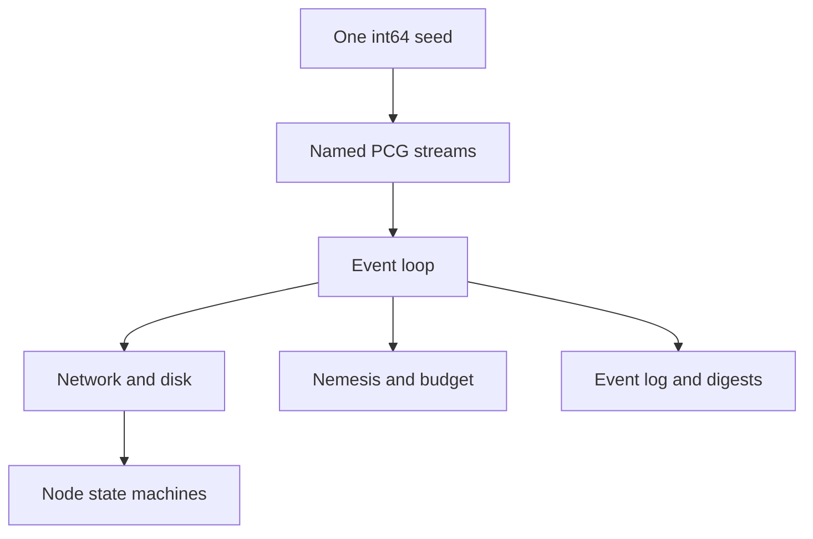
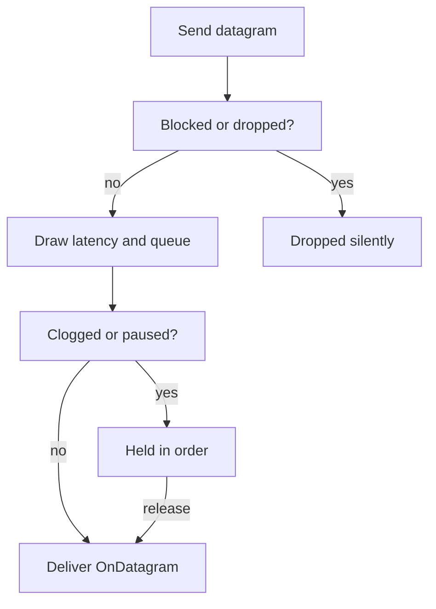

# Deterministic Simulation Testing

Distributed systems fail in the gaps between events. A packet arrives two milliseconds after a timeout fires, a node crashes between writing a file and calling `fsync`, and a partition heals just as a retry lands. Run that test on real sockets and OS threads and the bug disappears as soon as you add a print statement or rerun the binary.

Deterministic simulation testing (DST) removes the scheduler, wall clock, and real I/O from the loop. An entire cluster runs inside a single OS thread. One `int64` seed drives every random decision: network delays, packet drops, bit flips, clock drift, and the fault injector. Virtual time advances only when the simulator pops the next event from its queue. Because nothing depends on real time or thread interleaving, any seed replays the exact same sequence of events byte for byte. When a 100-node chaos run breaks an invariant after 15,000 events, you do not hunt for a flaky reproduction — you rerun one seed and step straight to the failure.

## How the simulator fits this repository

Four packages implement the simulation layer. Protocol code imports only the first; tests and the CLI drive the rest.



<!-- draw-visual: diagrams/01-sim-architecture.mmd -->
```text
┌───────────────────┐
│   One int64 seed  │
└─────────┬─────────┘
          ▼
┌───────────────────┐
│ Named PCG streams │
└─────────┬─────────┘
          ▼
┌───────────────────┐
│     Event loop    ├───┬─────────┐
└─────────┬─────────┘   └─────────┼───────────────────────┐
          ▼                       ▼                       ▼
┌───────────────────┐   ┌──────────────────┐   ┌─────────────────────┐
│  Network and disk │   │Nemesis and budget│   │Event log and digests│
└─────────┬─────────┘   └──────────────────┘   └─────────────────────┘
          ▼
┌───────────────────┐
│Node state machines│
└───────────────────┘
```

### The environment boundary (`internal/env`)

Protocol code never imports `net`, `os`, `sync`, or `time.Now`. Instead, every node receives an `env.Env` containing its `NodeID`, its `Region`, and four runtime dependencies:

- `Clock` — virtual `env.Time` (nanoseconds since start) and `AfterFunc` timers with `Stop` and `Reset`.
- `Rand` — a per-node `*rand.Rand` stream.
- `Transport` — `Send` for fire-and-forget datagrams and `Request` for request/response RPCs with timeouts.
- `Disk` — named blobs with `Read`, `Write`, `Append`, `Sync`, `Delete`, and `List`.

Each node implements `env.Process` (`Start`, `OnDatagram`, `OnRequest`, and `EncodeState`). When real-runtime adapters arrive in a later chapter, the same protocol code will run unchanged behind real sockets, OS files, and the real clock.

### The simulation engine (`internal/sim`)

`sim.Sim` wires the four dependencies to deterministic fakes inside one event loop:

- **Named PRNG streams.** One `int64` seed derives independent PCG streams for `net`, `disk`, `nemesis`, `workload`, and each `node/<id>`. Draws in the network layer do not shift random choices inside a node or the workload generator. A node's `node/<id>` stream persists across restarts so a restarted incarnation does not replay earlier draws.
- **Event queue and loop.** Pending timers, messages, faults, and test actions live in an indexed min-heap ordered by virtual timestamp `at`, breaking ties by a monotonic sequence number `seq`. `Step`, `RunUntil`, `RunFor`, `RunUntilQuiet`, and `RunUntilConverged` drain the heap up to a step cap (`MaxSteps`, default 10,000,000). Stalls, violated invariants, and panics anywhere in protocol or test callbacks become sticky errors (`*StallError`, `*InvariantError`, `*PanicError`) that stop the loop and carry the seed.
- **Fault-injecting network and disk.** Each directed link carries latency bounds (same-region and inter-region), drop and duplicate rates, per-link loss, partition flags, and a clog queue. Every datagram or stream frame is copied across the boundary so mutating a buffer after `Send` cannot leak across nodes.



<!-- draw-visual: diagrams/01-message-life.mmd -->
```text
┌──────────────────────┐
│    Send datagram     │
└───────────┬──────────┘
            ▼
┌──────────────────────┐
│ Blocked or dropped?  │
└───────────┬──────────┘
            │
            ├──────────────────────────────┐
            │                              │
           no                             yes
            │                              │
            ▼                              ▼
┌──────────────────────┐          ┌────────────────┐
│Draw latency and queue│          │Dropped silently│
└───────────┬──────────┘          └────────────────┘
            ▼
┌──────────────────────┐
│  Clogged or paused?  ├────────yes────────┐
└───────────┬──────────┘                   │
            │                              │
           no                              │
            ▼                              ▼
┌──────────────────────┐          ┌────────────────┐
│  Deliver OnDatagram  │◄release──┤ Held in order  │
└──────────────────────┘          └────────────────┘
```

- **Nemesis and fault budget.** `StartNemesis` alternates chaos windows and `HealAll` recovery windows, scheduling process crashes, torn crashes, pauses, wipes, bit-rot, read errors, partitions, link loss, and clogs at randomized gaps. A `Budget` bounds the damage: `MinLive` keeps a minimum number of up, unpaused nodes; `MaxDamagedDisks` caps nodes with damaged or erroring disks; `MaxDamagedPerGroup` with a `GroupOf(node, blob)` callback enforces stripe-level bounds (such as at most *m* damaged shards of one erasure-coded stripe, while ignoring ungrouped blobs where `GroupOf` returns `""`). Setting `Lifted: true` disables the budget for destructive tests. `QuietAt()` returns the timestamp of the final heal so liveness checks can require convergence within a virtual-time bound after chaos ends.
- **Event log and two digests.** Every executed event appends a 38-byte big-endian record (timestamp, sequence number, kind, disposition, node and peer indices, wire-payload FNV-64a hash taken before the handler runs, and auxiliary call/incarnation ID) into a running SHA-256 digest (`Digests.Events`) and a bounded ring buffer (`LogCap`, default `2^20`) for failure tails. `Digests.State` hashes every node's ID, region, lifecycle flags, incarnation, `EncodeState()`, and both disk layers in sorted key order.

### Test plumbing and CLI (`internal/sim/simtest`, `cmd/objsim`)

`internal/sim/simtest` drives DST inside `go test`. `Seeds` resolves which seeds to run: `-seed` if passed, else `DST_SEED`, else pinned regression seeds from `testdata/seeds.txt` followed by `DST_SEEDS` (default 3) sequential seeds from `DST_SEED_BASE` (default 1). `Sweep` opens one `seed=<n>` subtest per seed. `RequireDeterministic` runs the scenario twice from the same seed, compares both digests (`ErrNondeterministic` on mismatch), calls `s.Verify()`, and on failure emits the report shown below (writing a full log when `DST_ARTIFACTS` is set).

`cmd/objsim` runs named scenarios (`toy-chaos-5`, `toy-chaos-20`, `toy-chaos-50`, and `toy-chaos-100`, built on the max-register flood toy in `internal/sim/simtoy`) from the command line, printing both digests and — on failure — the log tail, panic stack, and `REPLAY:` line.

### Design choices and what each costs

Every simplification that makes a simulator deterministic carries a trade-off:

- **Single-threaded state machines.** Protocol code spawns no goroutines, holds no locks, and never sees re-entrant callbacks — timers, `Request` completions, and local errors always run as later events. *Cost:* protocols must be written in callback style, and an infinite loop inside a handler cannot be preempted by the simulator.
- **Integers, not floats.** Virtual time is `int64` nanoseconds, fault rates are parts per million (`PPM = 1_000_000`), and per-node clock skew and drift use 128-bit integer arithmetic (`math/bits`) with saturating addition. *Cost:* explicit bounds (`Horizon = 2^62` ns, about 146 years; `MaxSkew = 2^61` ns, about 73 years; `MaxDriftPPM = 100_000`, or ±10%). Events due after `Horizon` are never queued, and `AddNode` rejects larger skew or drift.
- **Errors as wire status codes.** Errors returned through `env.Reply` cross the simulated network as `(env.Code, message)` via `env.CodeTable` and arrive as `*env.RemoteError` wrapping both the mapped sentinel and `env.ErrRemote`. *Cost:* protocol sentinels must be registered at `>= CodeAppMin` (64), and concrete Go error structs do not survive across the wire.
- **Two delivery classes.** Datagrams (`Send`, default 65,507 B max) drop, duplicate, and reorder freely. Request/response (`Request`, default 16 MiB max) is FIFO per directed link, never duplicated, and collapses lost requests, lost responses, partitions, paused servers, and silent servers into the same `ErrTimeout`. *Cost:* transport-level request duplication is not modeled directly; idempotency is tested by dropping a response (for example with `PartitionOneWay`) and letting the protocol retry.
- **Written vs durable disk layers.** `Write`, `Append`, and `Delete` update only the written layer; `Sync` commits that blob to the durable layer. `Crash` discards unsynced state; `CrashTorn` keeps a random prefix of unsynced append-only tails (including the first append of a new blob). Silent single-bit rot flips one durable bit without returning a read error, and damage marks persist across unsynced writes until a clean `Sync` replaces or deletes the blob. *Cost:* disk calls are synchronous with no I/O latency or disk-full errors, and named blobs omit POSIX directory semantics (such as `fsync` on a parent directory after unlink).

### Keeping the simulator honest

Determinism erodes silently unless it is enforced from three angles at once:

1. **Static lint (`detlint`).** A custom Go type-checked linter scans simulated product packages and bans wall-clock calls, global `math/rand`, `go`/`select`/channels/`sync`, floats, process state (`os.Getenv`, `runtime`), pointer formatting, build tags, and unsorted `range` over maps.
2. **Cross-process replay and golden digests.** `TestReplayAcrossProcesses` re-executes the test binary under varied scheduler and GC settings and requires identical digests. `TestGoldenDigests` pins digests across seeds and cluster sizes so unintended shifts break immediately.
3. **Canary tests.** Three tests deliberately plant a violation — an unseeded `math/rand/v2` draw (`TestCanaryUnseededDraw`), an unsorted map range (`TestCanaryMapOrder`), and silently skipped invariants (`TestCanaryDroppedInvariant`) — and fail if the harness does not reject them with the expected error.

## Key pieces in code

Stream isolation takes nine lines in [`internal/sim/stream.go`](../../internal/sim/stream.go). Hashing the label into PCG's second state word splits one `int64` seed into independent streams:

```go
func NewStream(seed int64, label string) *rand.Rand {
	return rand.New(rand.NewPCG(uint64(seed), fnv64a([]byte(label))))
}

func fnv64a(b []byte) uint64 {
	h := fnv.New64a()
	_, _ = h.Write(b)
	return h.Sum64()
}
```

Total event order lives in [`internal/sim/queue.go`](../../internal/sim/queue.go). When two events share a virtual timestamp, the earlier sequence number always runs first:

```go
func (q eventQueue) less(i, j int) bool {
	if q[i].at != q[j].at {
		return q[i].at < q[j].at
	}
	return q[i].seq < q[j].seq
}
```

A DST test using `simtest` stays short. Here is `TestReplaySameProcess` from [`internal/sim/meta_test.go`](../../internal/sim/meta_test.go):

```go
func TestReplaySameProcess(t *testing.T) {
	for _, n := range metaSizes {
		t.Run(fmt.Sprintf("nodes=%d", n), func(t *testing.T) {
			simtest.Sweep(t, func(t *testing.T, seed int64) {
				s := simtest.RequireDeterministic(t, seed, chaos(n))
				if !simtoy.Converged(s) {
					t.Fatalf("not converged at %d", s.Now())
				}
			})
		})
	}
}
```

When a run fails, `Report` in [`internal/sim/simtest/determinism.go`](../../internal/sim/simtest/determinism.go) prints the diagnostics with the replay command last so it is easy to grab from CI output:

```go
	var b strings.Builder
	fmt.Fprintf(&b, "simulation failed\nseed: %d\nerror: %v\ndigests: %s\nsteps: %d, virtual time: %d\n",
		s.Seed(), s.Err(), s.Digests(), s.Steps(), s.Now())
	tail := s.LogTail(TailLines)
	fmt.Fprintf(&b, "event log tail (%d of %d):\n", len(tail), s.LogLen())
	for _, line := range tail {
		b.WriteString("  " + line + "\n")
	}
	var pe *sim.PanicError
	if errors.As(s.Err(), &pe) && len(pe.Stack) > 0 {
		fmt.Fprintf(&b, "panic stack:\n%s\n", strings.TrimRight(string(pe.Stack), "\n"))
	}
	if path, err := writeArtifact(t, s); err != nil {
		fmt.Fprintf(&b, "artifact: %v\n", err)
	} else if path != "" {
		fmt.Fprintf(&b, "artifact: %s\n", path)
	}
	fmt.Fprintf(&b, "PIN: echo '%d %s' >> testdata/%s\n", s.Seed(), t.Name(), SeedsFile)
	b.WriteString(ReplayCommand(t, s.Seed()))
	t.Log(b.String())
```

## What the tests show, and what they do not

All measurements below were recorded inside the project's 4-core Docker development container on the current tree:

- **Throughput.** `BenchmarkChaos100` runs at 232,147 events/s at 100 nodes — 70.8 ms per ~16k-event chaos run including setup, nemesis, invariants every 100 events, and both digests.
- **Replay and sweeps.** `TestReplaySameProcess` passed across 500 seeds × 3 cluster sizes (20, 50, and 100 nodes) × 2 runs (98 s for `internal/sim`). `TestReplayAcrossProcesses` matched digests across `GOMAXPROCS=1 GOGC=1` and `GOMAXPROCS=4 GOGC=off`. `TestGoldenDigests` matched all 9 pinned rows (seeds 1–3 at each size).
- **Properties, fuzzing, race, and coverage.** Eight `pgregory.net/rapid` properties (listed below) passed at 2,000 checks (58 s). `FuzzSimSchedule` ran 30 s with no crashers (13,248 execs in the gated run; earlier runs on the same target reached ~48k execs). `go test -race` passed across all packages (35 s). Statement coverage is 98.0% in `cmd/objsim`, 97.9% in `internal/env`, 95.3% in `internal/sim`, and 95.1% in `internal/sim/simtest` (`internal/sim/simtoy` has no in-package tests and is exercised from `internal/sim`).
- **Adversarial testing.** An independent attack harness ran 60 attacks across seven claims (replay, network rates, partition isolation, disk faults and budgets, stream independence, loop liveness and arithmetic bounds, and failure reporting). On the first run, 52 held and 8 broke. Six defects were repaired and now hold: read-fault count overflow and its budget-hiding twin, an unguarded `Budget.GroupOf` panic, latency-range draw overflow, a silent timer clamp past `2^62` ns, and missing log tail and `REPLAY:` output in `cmd/objsim` (an audit also bounded the `uint32` incarnation counter so it never wraps). On the second run, 58 held and 2 remained marked broken:
  - `clock-overflow` is fixed by rejecting `|Skew| > sim.MaxSkew` at `AddNode` with `ErrInvalidArgument` so local clocks can no longer wrap backwards; the unmodified attack driver treats any `AddNode` error as a failure.
  - `network-nemesis-dynamic-blobs` exposed an overbroad claim and led to the first narrowing below.

### Narrowed claims

Two claims were narrowed to match what is actually true and tested:

1. **Nemesis schedule independence.** *Narrowed claim:* the nemesis's schedule — when it acts, on which node, with which kind of fault — depends only on the seed and the nemesis configuration. Which blob a disk fault hits is chosen from the blobs on that node at that instant, so it depends on what the protocol has written. *Why narrowed:* changing network drop rates can change whether a node writes a new blob before a bit-rot or grouped read-error fires, which changes the target blob name. The nemesis now draws exactly one `uint64` per target choice even on an empty disk, so timing, node, and fault kind stay identical (`TestPropNemesisTimingIgnoresInventory`), while the chosen blob name reflects the node's live inventory.
2. **Determinism lint scope.** `detlint` checks simulated product code (`internal/env`, `internal/sim`, `internal/sim/simtoy`, and future protocol packages — 15 files in 3 packages today), not `_test.go` files or `internal/sim/simtest`. *Why narrowed:* test harnesses must read flags, environment variables, files, and spawn child processes. Test-side nondeterminism that leaks into a simulation is caught instead by double-running each seed in `RequireDeterministic` and by cross-process replay.

### What the simulator does not prove

The simulator proves properties of protocol state machines under the faults it models. It proves nothing about real OS sockets, real disks or filesystems, real hardware clocks, or the Go runtime scheduler. Bugs in production adapters — goroutine races, lock deadlocks, missing parent-directory `fsync` after unlink, sector-level torn writes, or out-of-space handling — lie outside its scope. Single-threaded execution cannot preempt an infinite loop inside a callback, and replay has been verified in one Linux container environment rather than across CPU architectures or Go compiler versions.

The storage protocols that will run on top of `internal/env` — SWIM gossip membership, Reed-Solomon erasure coding, Merkle-tree anti-entropy, optimistic concurrency control for metadata, and Sagas for bucket migration — are not built yet; each will arrive in a coming chapter.

## Go deeper in the repo

- **Interfaces and errors:** [`internal/env/env.go`](../../internal/env/env.go), [`internal/env/errors.go`](../../internal/env/errors.go).
- **Core engine:** [`internal/sim/sim.go`](../../internal/sim/sim.go) (loop, nodes, invariants, errors), [`internal/sim/queue.go`](../../internal/sim/queue.go) (heap), [`internal/sim/clock.go`](../../internal/sim/clock.go) (virtual clock and timers), [`internal/sim/stream.go`](../../internal/sim/stream.go) and [`internal/sim/rand.go`](../../internal/sim/rand.go) (named streams).
- **Fault models and logging:** [`internal/sim/net.go`](../../internal/sim/net.go) and [`internal/sim/handle.go`](../../internal/sim/handle.go) (transport and request serving), [`internal/sim/disk.go`](../../internal/sim/disk.go) (two-layer disk), [`internal/sim/process.go`](../../internal/sim/process.go) (crash, pause, wipe, heal), [`internal/sim/fault.go`](../../internal/sim/fault.go) and [`internal/sim/nemesis.go`](../../internal/sim/nemesis.go) (faults as data, nemesis, budget), [`internal/sim/log.go`](../../internal/sim/log.go) (event log and digests).
- **Test harness and CLI:** [`internal/sim/simtest/seeds.go`](../../internal/sim/simtest/seeds.go), [`internal/sim/simtest/determinism.go`](../../internal/sim/simtest/determinism.go), [`internal/sim/simtest/cluster.go`](../../internal/sim/simtest/cluster.go), [`internal/sim/simtoy/simtoy.go`](../../internal/sim/simtoy/simtoy.go), [`cmd/objsim/main.go`](../../cmd/objsim/main.go).
- **Named tests:** replay meta-tests (`TestReplaySameProcess`, `TestReplayAcrossProcesses`, `TestGoldenDigests`, `TestDifferentSeedsDiffer`) and canaries (`TestCanaryUnseededDraw`, `TestCanaryMapOrder`, `TestCanaryDroppedInvariant`) in [`internal/sim/meta_test.go`](../../internal/sim/meta_test.go); the eight `rapid` properties (`TestPropStreamsIndependent`, `TestPropNetworkDrawsDoNotShiftTheNemesis`, `TestPropTimeMonotonic`, `TestPropHealedNetworkDelivers`, `TestPropNemesisRespectsBudget`, `TestPropDiskModel`, `TestPropStreamOrderPerConnection`, `TestPropNemesisTimingIgnoresInventory`) in [`internal/sim/prop_test.go`](../../internal/sim/prop_test.go); the fuzz target (`FuzzSimSchedule`) in [`internal/sim/fuzz_test.go`](../../internal/sim/fuzz_test.go).
- **Adversarial harness and results:** `agent_work/adversarial/0b-simulator/` (`ATTACKS.md`, `RESULTS.md`, and `run-all.sh`).

Replay one seed of the meta-test or run a 100-node chaos scenario from the CLI:

```sh
docker compose run --rm dev go test ./internal/sim -run '^TestReplaySameProcess$' -seed=3 -count=1
docker compose run --rm dev go run ./cmd/objsim -scenario toy-chaos-100 -seed 3
```

## Sources and further reading

- **Will Wilson, "Testing Distributed Systems w/ Deterministic Simulation" (Strange Loop, 2014).** The FoundationDB blueprint for abstracting network, disk, time, and randomness behind a single-threaded event loop so rare failure schedules replay from one seed.
- **Joran Dirk Greef and the TigerBeetle team, VOPR design and testing write-ups.** Continuous deterministic simulation combining swarm-tested fault mixes with strict fault budgets to verify storage and replication invariants.
- **Kyle Kingsbury, Jepsen analyses.** The vocabulary of nemeses, asymmetric partitions, and clock skew, and the discipline of checking observed histories against explicit consistency guarantees.
- **Will Wilson and the Antithesis team, writings on deterministic hypervisors.** Pushing determinism down to the hypervisor so unmodified multi-threaded binaries replay deterministically — the main architectural alternative to this project's library-level `internal/env` boundary.
- **Go standard library, `testing/synctest`.** Virtualized time for real goroutines inside an isolated test bubble; useful for testing real-runtime adapters alongside a fault-injecting simulator like `internal/sim`.
