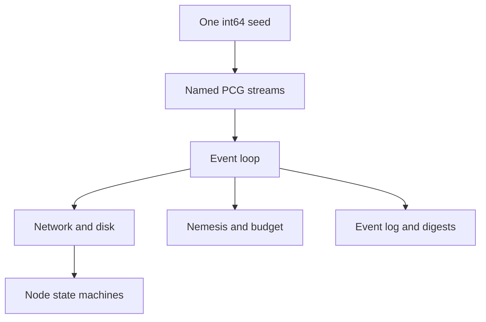
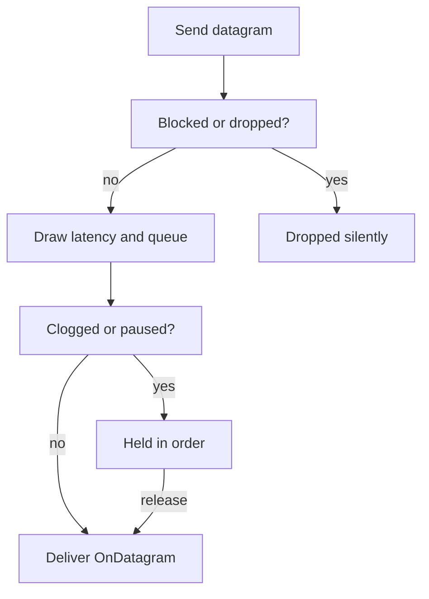

# Deterministic Simulation Testing

Distributed systems fail in the gaps between events. A packet arrives two milliseconds after a timeout fires, a node crashes between writing a file and calling `fsync`, and a network partition heals just as a retry lands. Run that test on real sockets and OS threads and the bug vanishes as soon as you add a print statement or rerun the binary.

Deterministic simulation testing removes the OS scheduler, wall clock, and real I/O from the loop. An entire cluster runs inside a single thread. One `int64` **seed** drives every random decision: network delays, packet drops, bit flips, clock drift, and the fault injector (a **nemesis** that schedules crashes, partitions, and disk damage during a run). Virtual time advances only when the simulator pops the next event from its queue.

Because nothing depends on real time or thread interleaving, any seed lets you **replay** the exact same event sequence byte for byte. Tests run a **sweep** across many seeds to explore rare interleavings. When a 100-node chaos run breaks an **invariant** (a safety condition checked continuously) after 15,000 events, you rerun one seed and step straight to the failure.

## How deterministic simulation maps to this repository

Four packages implement the simulation layer. Protocol code imports only `internal/env`; tests and the CLI drive `internal/sim`, `internal/sim/simtest`, and `cmd/objsim`.



<!-- draw-visual: diagrams/01-sim-architecture.mmd -->
```text
┌───────────────────┐
│   One int64 seed  │
└─────────┬─────────┘
          ▼
┌───────────────────┐
│ Named PCG streams │
└─────────┬─────────┘
          ▼
┌───────────────────┐
│     Event loop    ├───┬─────────┐
└─────────┬─────────┘   └─────────┼───────────────────────┐
          ▼                       ▼                       ▼
┌───────────────────┐   ┌──────────────────┐   ┌─────────────────────┐
│  Network and disk │   │Nemesis and budget│   │Event log and digests│
└─────────┬─────────┘   └──────────────────┘   └─────────────────────┘
          ▼
┌───────────────────┐
│Node state machines│
└───────────────────┘
```

### The environment boundary

In `internal/env`, protocol code never imports `net`, `os`, `sync`, or `time.Now`. Every node receives an `env.Env` containing its `NodeID`, its `Region`, and four runtime dependencies:

- `Clock` — virtual `env.Time` (nanoseconds since start) and `AfterFunc` timers with `Stop` and `Reset`.
- `Rand` — a per-node `*rand.Rand` stream.
- `Transport` — `Send` for fire-and-forget datagrams and `Request` for request/response RPCs with timeouts.
- `Disk` — named blobs with `Read`, `Write`, `Append`, `Sync`, `Delete`, and `List`.

Each node implements `env.Process` (`Start`, `OnDatagram`, `OnRequest`, and `EncodeState`). In [The Object Store and Sync Engine](07-object-store-and-sync-engine.md), the same protocol code runs unchanged behind real sockets, OS files, and the real clock.

### The simulation engine

`sim.Sim` in `internal/sim` wires those four dependencies to deterministic fakes inside one event loop:

- **Named PRNG streams.** One `int64` seed derives independent PCG (permuted congruential generator) streams for `net`, `disk`, `nemesis`, `workload`, and each `node/<id>`. Network draws do not shift random choices in a node or workload, and a node's `node/<id>` stream persists across restarts so a restarted incarnation does not replay earlier draws.
- **Event queue and loop.** Pending timers, messages, faults, and test actions live in an indexed min-heap ordered by virtual timestamp `at`, breaking ties by a monotonic sequence number `seq`. `Step`, `RunUntil`, `RunFor`, `RunUntilQuiet`, and `RunUntilConverged` drain the heap up to `MaxSteps` (default 10,000,000). Stalls, violated invariants, and panics become sticky errors (`*StallError`, `*InvariantError`, `*PanicError`) that stop the loop and carry the seed.
- **Fault-injecting network and disk.** Each directed link carries same-region and inter-region latency bounds, drop and duplicate rates, per-link loss, partition flags, and a clog queue. Every datagram or stream frame is copied on send so mutating a buffer afterwards cannot leak across nodes.



<!-- draw-visual: diagrams/01-message-life.mmd -->
```text
┌──────────────────────┐
│    Send datagram     │
└───────────┬──────────┘
            ▼
┌──────────────────────┐
│ Blocked or dropped?  │
└───────────┬──────────┘
            │
            ├──────────────────────────────┐
            │                              │
           no                             yes
            │                              │
            ▼                              ▼
┌──────────────────────┐          ┌────────────────┐
│Draw latency and queue│          │Dropped silently│
└───────────┬──────────┘          └────────────────┘
            ▼
┌──────────────────────┐
│  Clogged or paused?  ├────────yes────────┐
└───────────┬──────────┘                   │
            │                              │
           no                              │
            ▼                              ▼
┌──────────────────────┐          ┌────────────────┐
│  Deliver OnDatagram  │◄release──┤ Held in order  │
└──────────────────────┘          └────────────────┘
```

- **Nemesis and fault budget.** `StartNemesis` alternates chaos windows and `HealAll` recovery windows, scheduling crashes, torn crashes, pauses, wipes, bit-rot, read errors, partitions, link loss, and clogs at random gaps. A `Budget` caps damage: `MinLive` keeps enough up, unpaused nodes; `MaxDamagedDisks` caps nodes with damaged or erroring disks; `MaxDamagedPerGroup` with `GroupOf(node, blob)` enforces stripe-level bounds (such as at most *m* damaged shards per erasure-coded stripe, ignoring ungrouped blobs where `GroupOf` returns `""`). `Lifted: true` disables the budget for destructive tests. `QuietAt()` returns the final heal timestamp for liveness checks.
- **Event log and two digests.** Every executed event appends a 38-byte big-endian record (timestamp, sequence number, kind, disposition, node and peer indices, pre-handler wire-payload FNV-64a hash, and auxiliary call/incarnation ID) into a running SHA-256 digest (`Digests.Events`) and a ring buffer (`LogCap`, default `2^20`) for failure tails. `Digests.State` hashes every node's ID, region, lifecycle flags, incarnation, `EncodeState()`, and both disk layers in sorted key order.

### Test plumbing and CLI

`internal/sim/simtest` drives the simulator inside `go test`. `Seeds` picks `-seed`, else `DST_SEED`, else pinned seeds in `testdata/seeds.txt` followed by `DST_SEEDS` (default 3) sequential seeds from `DST_SEED_BASE` (default 1). `Sweep` opens one `seed=<n>` subtest per seed. `RequireDeterministic` runs a scenario twice from one seed, compares both digests (`ErrNondeterministic` on mismatch), calls `s.Verify()`, and logs diagnostics on failure (writing a full log when `DST_ARTIFACTS` is set).

`objsim` (`cmd/objsim`) runs named scenarios (`toy-chaos-5`, `toy-chaos-20`, `toy-chaos-50`, and `toy-chaos-100`, built on the max-register toy in `internal/sim/simtoy`), printing both digests and — on failure — the log tail, panic stack, and `REPLAY:` line.

### Design choices and what each costs

- **Single-threaded state machines.** Protocol code spawns no goroutines, holds no locks, and never sees re-entrant callbacks — timers, `Request` completions, and local errors run as later events. *Cost:* callback style, and infinite loops cannot be preempted.
- **Integers, not floats.** Virtual time is `int64` nanoseconds, fault rates are parts per million (`PPM = 1_000_000`), and clock skew and drift use 128-bit integer math (`math/bits`) with saturating addition. *Cost:* explicit bounds (`Horizon = 2^62` ns, about 146 years; `MaxSkew = 2^61` ns, about 73 years; `MaxDriftPPM = 100_000`, or ±10%). Events past `Horizon` are never queued; `AddNode` rejects larger skew or drift.
- **Errors as wire status codes.** `env.Reply` errors cross the network as `(env.Code, message)` via `env.CodeTable` and arrive as `*env.RemoteError` wrapping the mapped sentinel and `env.ErrRemote`. *Cost:* protocol sentinels register at `>= CodeAppMin` (64), and concrete Go error structs do not cross the wire.
- **Two delivery classes.** Datagrams (`Send`, default 65,507 B max) drop, duplicate, and reorder freely. Request/response (`Request`, default 16 MiB max) is FIFO per directed link, never duplicated, and collapses lost requests or responses, partitions, and paused or silent servers into `ErrTimeout`. *Cost:* transport-level request duplication is not modeled; idempotency is tested by dropping responses (for example via `PartitionOneWay`) so callers retry.
- **Written vs durable disk layers.** `Write`, `Append`, and `Delete` update the written layer; `Sync` commits that blob to the durable layer. `Crash` discards unsynced state; `CrashTorn` keeps a random prefix of unsynced append-only tails (including the first append of a new blob). Silent single-bit rot flips one durable bit without a read error, and damage marks persist across unsynced writes until a clean `Sync` replaces or deletes the blob. *Cost:* synchronous disk calls with no I/O latency or disk-full errors, and named blobs omit POSIX directory semantics (such as `fsync` on a parent directory after unlink).

### Testing on the simulator

Determinism erodes unless enforced from three angles:

1. **Static lint (`detlint`).** A Go type-checked linter scans simulated product packages and bans wall-clock calls, global `math/rand`, `go`/`select`/channels/`sync`, floats, process state (`os.Getenv`, `runtime`), pointer formatting, build tags, and unsorted `range` over maps.
2. **Cross-process replay and golden digests.** `TestReplayAcrossProcesses` re-runs the test binary under varied scheduler and GC settings for identical digests. `TestGoldenDigests` pins digests across seeds and cluster sizes to catch unintended shifts.
3. **Canary tests.** A canary plants a deliberate bug and fails if the simulator misses it: an unseeded `math/rand/v2` draw (`TestCanaryUnseededDraw`), an unsorted map range (`TestCanaryMapOrder`), and skipped invariants (`TestCanaryDroppedInvariant`).

## Key pieces in code

Stream isolation in [`internal/sim/stream.go`](../../internal/sim/stream.go) hashes the label into PCG's second state word to split one `int64` seed into independent streams:

```go
func NewStream(seed int64, label string) *rand.Rand {
	return rand.New(rand.NewPCG(uint64(seed), fnv64a([]byte(label))))
}

// fnv64a computes the 64-bit FNV-1a hash of b.
func fnv64a(b []byte) uint64 {
	h := fnv.New64a()
	_, _ = h.Write(b)
	return h.Sum64()
}
```

Total event order lives in [`internal/sim/queue.go`](../../internal/sim/queue.go). When two events share a virtual timestamp, the earlier sequence number always runs first:

```go
func (q eventQueue) less(i, j int) bool {
	if q[i].at != q[j].at {
		return q[i].at < q[j].at
	}
	return q[i].seq < q[j].seq
}
```

A simulator test using `simtest` stays short. Here is `TestReplaySameProcess` from [`internal/sim/meta_test.go`](../../internal/sim/meta_test.go):

```go
func TestReplaySameProcess(t *testing.T) {
	for _, n := range metaSizes {
		t.Run(fmt.Sprintf("nodes=%d", n), func(t *testing.T) {
			simtest.Sweep(t, func(t *testing.T, seed int64) {
				s := simtest.RequireDeterministic(t, seed, chaos(n))
				if !simtoy.Converged(s) {
					t.Fatalf("not converged at %d", s.Now())
				}
			})
		})
	}
}
```

When a run fails, `Report` in [`internal/sim/simtest/determinism.go`](../../internal/sim/simtest/determinism.go) prints diagnostics with the replay command last:

```go
	var b strings.Builder
	fmt.Fprintf(&b, "simulation failed\nseed: %d\nerror: %v\ndigests: %s\nsteps: %d, virtual time: %d\n",
		s.Seed(), s.Err(), s.Digests(), s.Steps(), s.Now())
	tail := s.LogTail(TailLines)
	fmt.Fprintf(&b, "event log tail (%d of %d):\n", len(tail), s.LogLen())
	for _, line := range tail {
		b.WriteString("  " + line + "\n")
	}
	var pe *sim.PanicError
	if errors.As(s.Err(), &pe) && len(pe.Stack) > 0 {
		fmt.Fprintf(&b, "panic stack:\n%s\n", strings.TrimRight(string(pe.Stack), "\n"))
	}
	if path, err := writeArtifact(t, s); err != nil {
		fmt.Fprintf(&b, "artifact: %v\n", err)
	} else if path != "" {
		fmt.Fprintf(&b, "artifact: %s\n", path)
	}
	fmt.Fprintf(&b, "PIN: echo '%d %s' >> testdata/%s\n", s.Seed(), t.Name(), SeedsFile)
	b.WriteString(ReplayCommand(t, s.Seed()))
	t.Log(b.String())
```

## What the tests show, and what they do not

All measurements below were recorded inside the project's 4-core Docker development container:

- **Throughput.** `BenchmarkChaos100` runs at 232,147 events/s at 100 nodes — 70.8 ms per ~16k-event chaos run including setup, nemesis, invariants every 100 events, and both digests.
- **Replay and sweeps.** `TestReplaySameProcess` passed across 500 seeds × 3 cluster sizes (20, 50, and 100 nodes) × 2 runs (98 s for `internal/sim`). `TestReplayAcrossProcesses` matched digests across `GOMAXPROCS=1 GOGC=1` and `GOMAXPROCS=4 GOGC=off`. `TestGoldenDigests` matched all 9 pinned rows (seeds 1–3 at each size).
- **Properties, fuzzing, race, and coverage.** Eight `pgregory.net/rapid` properties passed at 2,000 checks (58 s). `FuzzSimSchedule` ran 30 s with no crashers (13,248 execs in the gated run; earlier runs reached ~48k execs). `go test -race` passed across all packages (35 s). Statement coverage is 98.0% in `cmd/objsim`, 97.9% in `internal/env`, 95.3% in `internal/sim`, and 95.1% in `internal/sim/simtest` (`internal/sim/simtoy` is exercised from `internal/sim`).
- **Adversarial testing.** An independent attack harness ran 60 attacks across seven claims (replay, network rates, partition isolation, disk faults and budgets, stream independence, loop liveness and arithmetic bounds, and failure reporting). On run 1, 52 held and 8 broke. Six defects were repaired and now hold: read-fault count overflow and its budget-hiding twin, an unguarded `Budget.GroupOf` panic, latency-range draw overflow, a silent timer clamp past `2^62` ns, and missing log tail and `REPLAY:` output in `objsim` (an audit also bounded the `uint32` incarnation counter so it never wraps). On run 2, 58 held and 2 remained marked broken:
  - `clock-overflow` is fixed by rejecting `|Skew| > sim.MaxSkew` at `AddNode` with `ErrInvalidArgument` so local clocks cannot wrap backwards; the unmodified attack driver treats any `AddNode` error as a failure.
  - `network-nemesis-dynamic-blobs` exposed an overbroad claim and led to the first narrowing below.

### Narrowed claims

Two claims were narrowed to match what is true and tested:

1. **Nemesis schedule independence.** *Narrowed claim:* the nemesis's schedule — when it acts, on which node, with which kind of fault — depends only on the seed and nemesis configuration. Which blob a disk fault hits is chosen from the blobs on that node at that instant, so it depends on what the protocol has written. *Why narrowed:* changing network drop rates can change whether a node writes a blob before a bit-rot or grouped read-error fires, changing the target blob name. The nemesis draws exactly one `uint64` per target choice even on an empty disk, so timing, node, and fault kind stay identical (`TestPropNemesisTimingIgnoresInventory`), while the chosen blob name reflects the node's live inventory.
2. **Determinism lint scope.** `detlint` checks simulated product code (`internal/env`, `internal/sim`, `internal/sim/simtoy`, and future protocol packages — 15 files in 3 packages today), not `_test.go` files or `internal/sim/simtest`. *Why narrowed:* test harnesses must read flags, environment variables, files, and spawn child processes. Test-side nondeterminism that leaks into a simulation is caught by double-running each seed in `RequireDeterministic` and by cross-process replay.

### What the tests do not prove

The simulator proves properties of protocol state machines under the faults it models. It proves nothing about real OS sockets, real disks or filesystems, real hardware clocks, or the Go runtime scheduler. Bugs in production adapters — goroutine races, lock deadlocks, missing parent-directory `fsync` after unlink, sector-level torn writes, or out-of-space handling — lie outside its scope. Single-threaded execution cannot preempt an infinite loop inside a callback, and replay was verified in one Linux container environment rather than across CPU architectures or Go compiler versions.

The storage protocols running over `internal/env` start next with [SWIM Gossip Membership](02-swim-gossip.md), followed by [Reed-Solomon Erasure Coding](03-reed-solomon-erasure-coding.md), [Merkle-Tree Anti-Entropy](04-merkle-anti-entropy.md), [Optimistic Concurrency Control](05-optimistic-concurrency-control.md), and [Sagas](06-sagas.md), before [The Object Store and Sync Engine](07-object-store-and-sync-engine.md) connects them to a real runtime.

## Go deeper in the repo

- **Interfaces and errors:** [`internal/env/env.go`](../../internal/env/env.go), [`internal/env/errors.go`](../../internal/env/errors.go).
- **Core engine:** [`internal/sim/sim.go`](../../internal/sim/sim.go) (loop, nodes, invariants, errors), [`internal/sim/queue.go`](../../internal/sim/queue.go) (heap), [`internal/sim/clock.go`](../../internal/sim/clock.go) (virtual clock and timers), [`internal/sim/stream.go`](../../internal/sim/stream.go) and [`internal/sim/rand.go`](../../internal/sim/rand.go) (named streams).
- **Fault models and logging:** [`internal/sim/net.go`](../../internal/sim/net.go) and [`internal/sim/handle.go`](../../internal/sim/handle.go) (transport and request serving), [`internal/sim/disk.go`](../../internal/sim/disk.go) (two-layer disk), [`internal/sim/process.go`](../../internal/sim/process.go) (crash, pause, wipe, heal), [`internal/sim/fault.go`](../../internal/sim/fault.go) and [`internal/sim/nemesis.go`](../../internal/sim/nemesis.go) (faults as data, nemesis, budget), [`internal/sim/log.go`](../../internal/sim/log.go) (event log and digests).
- **Test harness and CLI:** [`internal/sim/simtest/seeds.go`](../../internal/sim/simtest/seeds.go), [`internal/sim/simtest/determinism.go`](../../internal/sim/simtest/determinism.go), [`internal/sim/simtest/cluster.go`](../../internal/sim/simtest/cluster.go), [`internal/sim/simtoy/simtoy.go`](../../internal/sim/simtoy/simtoy.go), [`cmd/objsim/main.go`](../../cmd/objsim/main.go).
- **Named tests:** replay meta-tests (`TestReplaySameProcess`, `TestReplayAcrossProcesses`, `TestGoldenDigests`, `TestDifferentSeedsDiffer`) and canaries (`TestCanaryUnseededDraw`, `TestCanaryMapOrder`, `TestCanaryDroppedInvariant`) in [`internal/sim/meta_test.go`](../../internal/sim/meta_test.go); the eight `rapid` properties (`TestPropStreamsIndependent`, `TestPropNetworkDrawsDoNotShiftTheNemesis`, `TestPropTimeMonotonic`, `TestPropHealedNetworkDelivers`, `TestPropNemesisRespectsBudget`, `TestPropDiskModel`, `TestPropStreamOrderPerConnection`, `TestPropNemesisTimingIgnoresInventory`) in [`internal/sim/prop_test.go`](../../internal/sim/prop_test.go); the fuzz target (`FuzzSimSchedule`) in [`internal/sim/fuzz_test.go`](../../internal/sim/fuzz_test.go).

Replay one seed of the meta-test or run a 100-node chaos scenario from the CLI:

```sh
docker compose run --rm dev go test ./internal/sim -run '^TestReplaySameProcess$' -seed=3 -count=1
docker compose run --rm dev go run ./cmd/objsim -scenario toy-chaos-100 -seed 3
```

## Sources and further reading

- **Will Wilson, "Testing Distributed Systems w/ Deterministic Simulation" (Strange Loop, 2014).** The FoundationDB blueprint for abstracting network, disk, time, and randomness behind a single-threaded event loop so rare failure schedules replay from one seed.
- **Joran Dirk Greef and the TigerBeetle team, VOPR design and testing write-ups.** Continuous deterministic simulation combining swarm-tested fault mixes with strict fault budgets to verify storage and replication invariants.
- **Kyle Kingsbury, Jepsen analyses.** The vocabulary of nemeses, asymmetric partitions, and clock skew, and checking observed histories against explicit consistency guarantees.
- **Will Wilson and the Antithesis team, writings on deterministic hypervisors.** Pushing determinism down to the hypervisor so unmodified multi-threaded binaries replay deterministically — the main alternative to library-level `internal/env`.
- **Go standard library, `testing/synctest`.** Virtualized time for real goroutines inside an isolated test bubble; useful for testing real-runtime adapters alongside a fault-injecting simulator like `internal/sim`.
