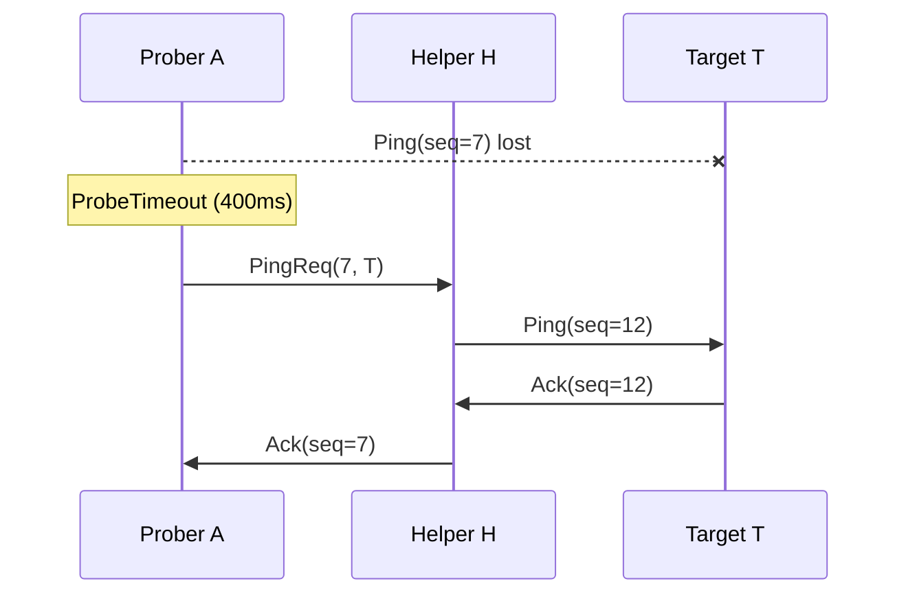
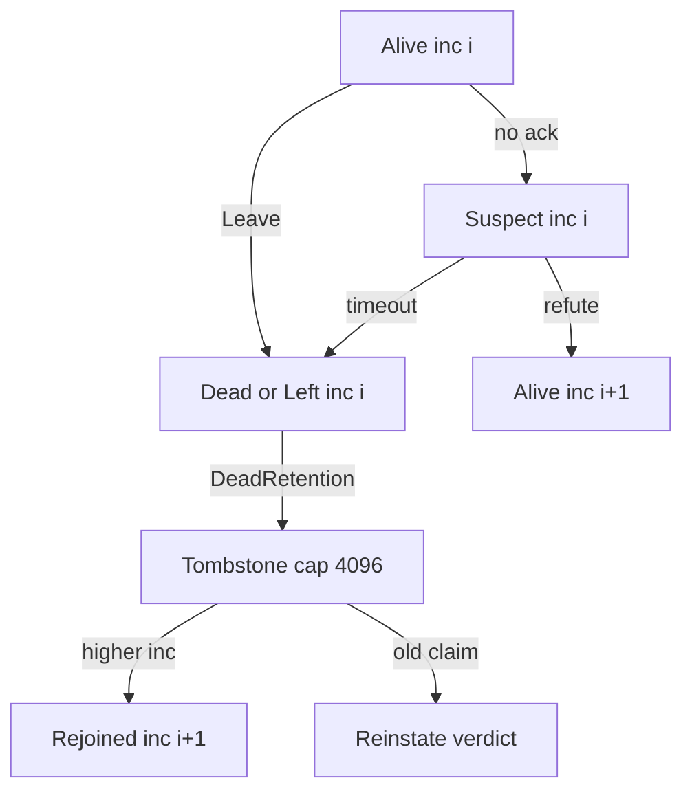

# SWIM Gossip Membership

A decentralized cluster needs every node to agree on who is alive, who left, and who crashed. All-to-all heartbeats fail at scale: traffic grows as *O*(*N*²), and one flaky or one-way link triggers false failure verdicts.

SWIM (Scalable Weakly-consistent Infection-style Process Group Membership) separates failure detection from dissemination and keeps per-node load constant:

- **Direct and indirect probing.** Every period *T*, each node sends a `Ping` to one peer. If no `Ack` arrives within the probe timeout, it asks *k* other live peers (`PingReq`) to probe the target and relay any `Ack` back. Indirect checks route around one-way links and localized loss while holding per-node load at *O*(1).
- **Suspicion, incarnations, and epidemic gossip.** A failed probe marks the target `suspect`, not `dead`. Updates piggyback on protocol datagrams — each transmitted λ⌈log₂ *N*⌉ times — spreading in expected *O*(log *N*) periods. A suspected target refutes by incrementing its incarnation and gossiping `alive(inc+1)`. Only an unrefuted timeout declares `dead`. Periodic push-pull syncs repair missed gossip and heal partitions.

## How SWIM maps to this repository

One package, `internal/gossip`, implements the protocol in five files: [`config.go`](../../internal/gossip/config.go), [`errors.go`](../../internal/gossip/errors.go), [`member.go`](../../internal/gossip/member.go), [`wire.go`](../../internal/gossip/wire.go), and [`node.go`](../../internal/gossip/node.go).

`*gossip.Node` sits on the `internal/env` boundary from [Deterministic Simulation Testing](01-deterministic-simulation.md). It implements `env.Process` (`Start`, `OnDatagram`, `OnRequest`, `EncodeState`) using only `Clock`, `Rand`, and `Transport` — never `Disk`, goroutines, or locks. Callers read membership through the value-based `Membership` interface (`Members`, `Lookup`, `Subscribe`) plus `All`, `Tombstones`, `Join`, `Leave`, `Self`, `Stats`, `LastError`, and `Closed`. `Subscribe` delivers synchronous `Event{Kind, Member, At}` callbacks (`EventJoined`, `EventSuspected`, `EventRecovered`, `EventDied`, `EventLeft`). Wire errors register at `CodeAppMin+16..+20` (`80..84` via `Codes()`/`CodeTable()`) so remote `ErrMalformed`, `ErrNotMember`, `ErrClosed`, `ErrJoinFailed`, and `ErrViewFull` cross the transport intact. Every scenario runs on `internal/sim` via `simtest.Sweep` and `simtest.RequireDeterministic`.

### Merge lattice and self-refutation (`member.go`, `node.go`)

Each entry is `Member{ID, Region, Incarnation, State}` ordered `StateAlive < StateSuspect < StateDead < StateLeft`. `View` applies updates via `Supersedes(a, b)`, comparing `(Incarnation, State, Region)` lexicographically. That strict total order makes `View` a commutative, idempotent max-lattice: any update order or partial-view merge produces the same table.

Updates about self bypass the lattice. Any claim at `inc >= own` other than `alive` at the node's own incarnation and region triggers refutation to `claim + 1`, updating the view and queuing `alive`. A node never declares itself suspect or dead, and its incarnation never decreases; at `math.MaxUint32`, refutation saturates without wrapping (`Stats.RefuteOverflows`).

### Probing and indirect relays (`node.go`)

Live peers (excluding self) are probed in shuffled round-robin order; new joiners enter a random remaining slot in *O*(1) time, and dead or left entries are skipped. Each `ProbeInterval` (1 s), an unacked previous probe marks its target `suspect`; the node then sends `KindPing` to the next target and arms `ProbeTimeout` (400 ms). On timeout, it sends `KindPingReq` to `IndirectProbes` (*k* = 3) distinct random live helpers.



<!-- draw-visual: diagrams/02-indirect-probe.mmd -->
```text
     ┌──────────┐     ┌──────────┐     ┌──────────┐
     │ Prober A │     │ Helper H │     │ Target T │
     └─────┬────┘     └─────┬────┘     └─────┬────┘
           │                │                │
           │ Ping(seq=7) lost                │
           ├┈┈┈┈┈┈┈┈┈┈┈┈┈┈┈┈┈┈┈┈┈┈┈┈┈┈┈┈┈┈┈┈×│
           │                │                │
┌──────────────────────┐    │                │
│ ProbeTimeout (400ms) │    │                │
└──────────────────────┘    │                │
           │                │                │
           │ PingReq(7, T)  │                │
           ├───────────────►│                │
           │                │                │
           │                │ Ping(seq=12)   │
           │                ├───────────────►│
           │                │                │
           │                │ Ack(seq=12)    │
           │                │◄───────────────┤
           │                │                │
           │ Ack(seq=7)     │                │
           │◄───────────────┤                │
           │                │                │
```

A helper probes `Target` under its own sequence number, stores the pending relay in `map[uint32]relay` with an expiry FIFO, and forwards the first matching `KindAck` using the requester's sequence number. Relays expire after one `ProbeInterval`, prune on arrival and ticks, and cap at `MaxRelays` (1,024; `Stats.RelaysDropped`). Failed `KindPing` sends allocate no slot.

### Suspicion, piggybacking, and burial (`config.go`, `node.go`)

Entering `StateSuspect` starts a timer for `SuspicionMult × ⌈log₂ N⌉ × ProbeInterval` (default multiplier 4, *N* = live count including self, ⌈log₂ *N*⌉ ≥ 1); leaving cancels it, expiry promotes to `StateDead`.

The gossip queue keeps one entry per member. Each outgoing datagram packs updates within `MaxPacket` (default 1,400 B; `MinPacket` = 781 B) in priority order: explicit leads (leave notices), the destination's own non-alive entry (so a suspected or dead peer hears about itself on the first packet even after the queue drains), and queued updates sorted by fewest transmissions, newest first. Entries drop after `RetransmitMult × ⌈log₂ N⌉` transmits (multiplier 4).

Deleting dead entries outright fails twice: peers purging at different times re-infect each other via sync in endless gossip loops, and stale `alive(0)` replays resurrect dead nodes.



<!-- draw-visual: diagrams/02-member-lifecycle.mmd -->
```text
┌────────────────┐
│  Alive inc i   ├───────Leave────────┐
└────────┬───────┘                    │
         │                            │
      no ack                          │
         ▼                            ▼
┌────────────────┐          ┌──────────────────┐
│ Suspect inc i  ├─timeout─►│Dead or Left inc i│
└────────┬───────┘          └─────────┬────────┘
         │                            │
      refute                    DeadRetention
         ▼                            ▼
┌────────────────┐          ┌──────────────────┐
│ Alive inc i+1  │          │Tombstone cap 4096│
└────────────────┘          └─────────┬────────┘
                                      │
         ┌────────────────────────────┤
         │                            │
    higher inc                    old claim
         │                            │
         ▼                            ▼
┌────────────────┐          ┌──────────────────┐
│Rejoined inc i+1│          │Reinstate verdict │
└────────────────┘          └──────────────────┘
```

`internal/gossip` uses a bounded tombstone floor:

1. **Retention.** `dead`/`left` verdicts stay in the view for `DeadRetention` (5 min). Stranger verdicts learned via sync are stored without enqueuing for gossip.
2. **Burial.** On expiry, the entry leaves the view and becomes a tombstone (`MaxTombstones` = 4,096, oldest-buried evicted first).
3. **Old news.** Non-superseding `dead`/`left` updates for a tombstoned ID are dropped, preventing cross-peer resurrection. Stale `alive`/`suspect` claims reinstate the verdict for one more `DeadRetention` (`Stats.Reinstated`, no event, not queued) so sync replies and destination-led packets force a wiped node to refute to `verdict + 1`. A higher incarnation removes the tombstone and rejoins.

### Join, sync, leave, and wire format (`wire.go`, `node.go`)

`Join` and periodic sync share one push-pull RPC (`KindSyncReq` / `KindSyncResp` carrying the full view). `Join` contacts all seeds concurrently, succeeds on the first valid reply, or joins every error with `ErrJoinFailed`. Seeds from `Config.Seeds` and `Join` are remembered (self and duplicates stripped, cap `MaxSeeds` = 256). Every `SyncInterval` (15 s, jittered) a node syncs with one random live peer and one heal candidate from `{dead view entries} ∪ {dead tombstones} ∪ {remembered non-live seeds}` — never `StateLeft`. A lonely node with seeds retries `Join` once per `ProbeInterval` (`Stats.Rejoins`), one join at a time.

`Leave` marks self `StateLeft`, replaces any queued `StateAlive` self entry, gossips `StateLeft` to every live peer, stops all timers, and closes the node (`ErrClosed` on further calls/syncs; datagrams counted in `Stats.DroppedClosed`).

The big-endian `Version` 1 wire format frames `version | kind | seq | [target for ping-req] | count | updates...`, separating datagram kinds (`KindPing`, `KindAck`, `KindPingReq`, `KindGossip`) from sync kinds (`KindSyncReq`, `KindSyncResp`). Canonical decoding checks minimum bytes before allocating and rejects trailing bytes with `ErrMalformed`, ensuring `Encode(Decode(b)) == b`.

### Design choices and what each costs

- **No authentication.** Plain SWIM trusts datagram senders. *Cost:* a forged `dead(id, MaxUint32)` saturates refutation and evicts that ID permanently.
- **Volatile incarnations.** Nothing is written to `env.Disk`. *Cost:* a wiped node restarts at 0 and relies on hearing its prior entry or tombstone during join or sync.
- **Fixed logarithmic suspicion timeout (no Lifeguard).** *Cost:* no local health multiplier or confirmation shortening; a stalled node does not widen its own timeouts.
- **Count-bounded full-view sync (`MaxMembers`).** Defaults to and caps at `MaxUpdates` (65,535) for the `uint16` count. *Cost:* sync payloads grow linearly with *N*, and long IDs can exceed the 16 MiB request cap (`env.ErrTooLarge`).
- **Bounded tombstones (`4,096`) and relays (`1,024`).** Keeps state bounded and `onAck` *O*(1). *Cost:* evicting an old tombstone forgets its floor, and duplicate `PingReq`s consume extra relay slots until expiry.
- **Uniform `MaxPacket`.** Oversized inbound datagrams are dropped as malformed. *Cost:* mismatched packet budgets drop packets silently.

## Key pieces in code

The merge lattice takes nine lines in [`internal/gossip/member.go`](../../internal/gossip/member.go):

```go
func Supersedes(a, b Member) bool {
	if a.Incarnation != b.Incarnation {
		return a.Incarnation > b.Incarnation
	}
	if a.State != b.State {
		return a.State > b.State
	}
	return a.Region > b.Region
}
```

Ack handling in [`internal/gossip/node.go`](../../internal/gossip/node.go) closes the active probe or forwards a relayed `KindAck` in *O*(1) time under the requester's original sequence number:

```go
func (n *Node) onAck(seq uint32) {
	if n.probe.active && !n.probe.acked && n.probe.seq == seq {
		n.probe.acked = true
		if n.probe.timer != nil {
			n.probe.timer.Stop()
		}
		return
	}
	r, ok := n.relays[seq]
	if !ok {
		return
	}
	delete(n.relays, seq)
	if n.e.Clock.Now() <= r.expires {
		n.send(r.origin, Message{Kind: KindAck, Seq: r.originSeq})
	}
}
```

Suspicion timers in [`internal/gossip/node.go`](../../internal/gossip/node.go) scale with ⌈log₂ *N*⌉ and re-check state and incarnation when they fire:

```go
func (n *Node) startSuspicion(l *memberLocal, u Member) {
	if l.suspect != nil {
		l.suspect.Stop()
	}
	id, inc := u.ID, u.Incarnation
	l.suspect = n.e.Clock.AfterFunc(n.cfg.SuspicionTimeout(n.view.LiveCount()), func() {
		if n.closed {
			return
		}
		m, ok := n.view.Get(id)
		if !ok || m.State != StateSuspect || m.Incarnation != inc {
			return
		}
		m.State = StateDead
		n.apply(m)
	})
}
```

Burial in [`internal/gossip/node.go`](../../internal/gossip/node.go) enforces the `MaxTombstones` (4,096) FIFO cap and compacts stale queue references past twice the cap:

```go
func (n *Node) bury(m Member) {
	for len(n.tombs) >= MaxTombstones {
		ref := n.tombFIFO[0]
		n.tombFIFO = n.tombFIFO[1:]
		if t, ok := n.tombs[ref.id]; ok && t.order == ref.order {
			delete(n.tombs, ref.id)
			n.stats.TombstonesEvicted++
		}
	}
	n.tombSeq++
	n.tombs[m.ID] = tomb{m: m, order: n.tombSeq}
	n.tombFIFO = append(n.tombFIFO, tombRef{id: m.ID, order: n.tombSeq})
	if len(n.tombFIFO) > 2*MaxTombstones {
		n.tombFIFO = slices.DeleteFunc(n.tombFIFO, func(r tombRef) bool {
			t, ok := n.tombs[r.id]
			return !ok || t.order != r.order
		})
	}
}
```

## What the tests show, and what they do not

All measurements come from the 4-core Docker development container on the current tree, with every DST seed double-run via `simtest.RequireDeterministic`.

- **Convergence and message cost.** `TestSWIMConvergenceDST` ran 500 seeds plus 3 pinned seeds across three sizes (3 regions, 5–10% link loss, *N*/10 late joiners, *N*/20 crashes, *N*/20 leaves over 30 s, measured from `HealNet` to identical live views):

  | *N* | ⌈log₂ *N*⌉ | Periods (min / med / p99 / max) | max ÷ ⌈log₂ *N*⌉ | Datagrams / node / period (med / max) |
  |---|---|---|---|---|
  | 20 | 5 | 0 / 8 / 21 / 21 | 4.2 (cap 40) | 3.233 / 4.011 (cap 5.000) |
  | 50 | 6 | 1 / 18 / 26 / 29 | 4.8 (cap 48) | 3.027 / 3.778 (cap 5.000) |
  | 100 | 7 | 10 / 26 / 32 / 34 | 4.9 (cap 56) | 2.905 / 3.554 (cap 5.000) |

  Sync RPCs (up to two per node per `SyncInterval`) are excluded from datagram counts. False deaths were 0 across all 1,500+ convergence runs and 500+ crash-detection runs. Controlled scaling in the adversarial harness (8 seeds at *N* = 20, 50, 100, and 200, crash at heal) gave maxima of 25.25 s, 28.50 s, 34.50 s, and 38.75 s (max ÷ ⌈log₂ *N*⌉ in 4.75–5.05).
- **Detection, asymmetric links, and canary.** `TestSWIMCrashDetectionDST` (*N* = 20, 5% loss, 500 seeds) detected crashes at every live node in 21.5 / 23.0 / 27.0 / 28.0 s (bound 40 s). `TestSWIMAsymmetricLinkDST` (*N* = 12, 300 s one-way link, 500 seeds) saw 0 suspicions and 0 deaths. `TestCanaryNoIndirectProbe` (indirect probes off) produced 416–543 suspicions per seed (median 492) and 0 evictions because targets refuted in time — showing why asserting zero suspicions is necessary.
- **Partition heal, purge, and restart.** `TestSWIMPartitionHealDST` (*N* = 12, within retention, 500 seeds) re-merged in 4.0 / 6.5 / 10.5 / 11.5 s (bound 60 s). `TestSWIMLongPartitionHealDST` (past `DeadRetention` = 20 s) re-merged in 2.5 / 7.0 / 14.5 / 16.0 s with a seed across the cut and 2.5 / 12.0 / 29.0 / 35.0 s with tombstones only (bound 90 s). `TestDeadEntriesStayPurgedDST` (5 nodes, crash and leave, watched 3 × `DeadRetention` past purge) purged each victim once per survivor with zero reinstatements. `TestSWIMRestartSameIDDST` (500 seeds) converged wiped restarts within 30 s on both retained and tombstoned paths.
- **Properties, fuzzing, race, and coverage.** Statement coverage in `internal/gossip` is 97.4% (remaining branches are defensive). `TestPropViewMergeIsCommutative` and `TestPropIncarnationMonotonic` (including `propRecordMonotonicAcrossPurge`) passed 2,000 `rapid` checks. `FuzzGossipWire` (30 s, 64,508 execs) and `FuzzViewMergeLaws` (30 s, 25,371 execs; non-empty seeds checked by `TestFuzzSeedsDrawNonEmptyViews`) found no crashers. `go test -race` passed (75 s repo-wide; 52.5 s in `internal/gossip`). The 500-seed DST sweep finished in 484.1 s across four convergence shards (peak memory ~82–132 MB vs. 5.1 GB OOM if all 500 seeds ran concurrently).
- **Adversarial testing.** A 73-check harness (`core`, `scenarios`, `scaling`, `canary`) broke 4 checks on run 1 (`retention-monotonicity`, `stale-replay-after-purge`, `partition-heal-retained-false`, `default-retention-long-partition`). With code audits (cross-peer resurrection, unbounded `relays`, views past `MaxUpdates`, synchronous encode-error callbacks, region-mismatch refutation, duplicate self entries on `Leave`), those drove tombstones, remembered `Join` seeds, and hard caps. On run 2, 72 held and 1 remained broken: `relay-once-original-sequence` relays to an unregistered `"target"` (`Send` fails with `env.ErrUnreachable`) yet expects a synthetic `Ack` to forward. Dropping unsent relays is intentional; valid relaying is verified by `TestProbeAndIndirectProbe`, `TestRelayBounds`, and `TestSWIMAsymmetricLinkDST`.

### Narrowed claims

1. **Monotonicity and no-resurrection across purges.** *Narrowed:* a node's record (view entry, else tombstone) never moves backward in `Supersedes` order, dead/left entries stay purged without re-gossip storms, and stale `alive` replays cannot revive a buried member — *while fewer than `MaxTombstones` (4,096) later burials occur on that node*. *Why:* FIFO eviction forgets older tombstones, reopening `alive(0)` acceptance; bursts above 4,096 deaths across staggered peer purges can re-admit evicted entries for one `DeadRetention` (without re-gossip). Stranger verdicts from sync also persist one `DeadRetention` on the learner.
2. **Long partition re-merge.** *Narrowed:* healed halves re-merge *if at least one node holds a reachable remembered seed (≤ 256) or a dead view entry / tombstone of an up peer across the cut*. *Why:* SWIM has no external discovery; if cross-cut seeds are down and both sides bury over 4,096 other members, no cross-cut address remains. Many tombstones dilute uniform heal picks (expected first contact ≈ `SyncInterval × h / (u × m)` for *m* nodes, *h* candidates, *u* up peers across the cut).
3. **Restart with lost state and the same ID.** *Narrowed:* wiped nodes rejoin above their prior incarnation whenever any reachable peer holds the entry or tombstone — *unless it already saturated at `math.MaxUint32`*. *Why:* incarnations never wrap.
4. **View capacity vs. message bytes.** *Narrowed:* `Config.MaxMembers` (≤ 65,535) bounds entry count for the wire `uint16`, *not* byte size. *Why:* 65,535 long-ID entries exceed the 16 MiB request cap (`env.ErrTooLarge`), requiring a lower `MaxMembers`.

### What the tests do not prove

Everything above is proven only on the single-threaded simulator (`internal/sim`). Real UDP/TCP sockets, kernel buffers, MTU fragmentation across mismatched `MaxPacket` values, DNS, OS timers, GC pauses, and concurrent adapters wait for the real-runtime adapter and integrated node in coming chapters. Peer authentication, persistent incarnations, Lifeguard local-health adaptation, and clusters beyond *N* = 200 are outside scope; storage layers consuming `Membership` (erasure coding, anti-entropy, metadata OCC, migration sagas) arrive in coming chapters.

## Go deeper in the repo

- **Protocol code:** [`config.go`](../../internal/gossip/config.go), [`errors.go`](../../internal/gossip/errors.go), [`member.go`](../../internal/gossip/member.go), [`wire.go`](../../internal/gossip/wire.go), and [`node.go`](../../internal/gossip/node.go) under `internal/gossip/`.
- **Unit and regression tests:** [`member_test.go`](../../internal/gossip/member_test.go) (`TestStateTransitions`, `TestIncarnationRules`, `TestViewAccessors`, `TestViewApplyRemoveWithoutReadStaysBounded`); [`wire_test.go`](../../internal/gossip/wire_test.go) (`TestWireRoundTrip`, `TestDecodeMalformed`, `TestEncodeRejectsInvalidMessages`, [`testdata/wire-golden.txt`](../../internal/gossip/testdata/wire-golden.txt)); [`node_test.go`](../../internal/gossip/node_test.go) (`TestProbeTargetRotation`, `TestProbeAndIndirectProbe`, `TestPiggybackSelectionAndLimit`, `TestJoin`, `TestSyncRequests`, `TestOperationsAfterLeave`, `TestErrors`, `TestEncodeStateIsCanonical`); [`repair_test.go`](../../internal/gossip/repair_test.go) (`TestDeadEntryLifetime`, `TestJoinSeedsAreRemembered`, `TestRelayBounds`, `TestViewBounds`, `TestCallbacksNeverRunInsideTheRegisteringCall`, `TestRepairNits`).
- **Property, fuzz, and DST suites:** [`prop_test.go`](../../internal/gossip/prop_test.go) (`TestPropViewMergeIsCommutative`, `TestPropIncarnationMonotonic`, `FuzzViewMergeLaws`, `TestFuzzSeedsRunWithoutSkipping`, `TestFuzzSeedsDrawNonEmptyViews`, [`testdata/merge-seeds.txt`](../../internal/gossip/testdata/merge-seeds.txt)); [`fuzz_test.go`](../../internal/gossip/fuzz_test.go) (`FuzzGossipWire`); [`dst_test.go`](../../internal/gossip/dst_test.go) (`TestSWIMConvergenceDST`, `TestSWIMAsymmetricLinkDST`, `TestCanaryNoIndirectProbe`, `TestSWIMCrashDetectionDST`, `TestSWIMPartitionHealDST`, `TestSWIMRefutationDST`, `TestSWIMRestartSameIDDST`, `TestJoinNoReachableSeedDST`, `TestDeadEntriesStayPurgedDST`, `TestSWIMLongPartitionHealDST`, [`testdata/seeds.txt`](../../internal/gossip/testdata/seeds.txt)).
- **Adversarial harness and results:** `agent_work/adversarial/01-gossip/` (`RESULTS.md`, `run-all.sh`, `main.go`, `extra.go`).

Replay a pinned 20-node convergence seed or run the asymmetric-link test with its indirect-probe canary:

```sh
docker compose run --rm dev go test ./internal/gossip -run '^TestSWIMConvergenceDST$/^N=20$/^shard=1$/^seed=33$' -seed=33 -count=1
docker compose run --rm dev go test ./internal/gossip -run '^TestSWIMAsymmetricLinkDST$|^TestCanaryNoIndirectProbe$' -seed=33 -v -count=1
```

## Sources and further reading

- **Abhinandan Das, Indranil Gupta, and Ashish Motivala, "SWIM: Scalable Weakly-consistent Infection-style Process Group Membership Protocol" (DSN, 2002).** Randomized direct and indirect probing for *O*(1) per-node detection load, suspicion with incarnation refutation, and piggybacked epidemic dissemination.
- **Armon Dadgar, James Phillips, and Jon Currey, "Lifeguard: Local Health Awareness for More Accurate Failure Detection" (DSN, 2018).** The extension this project does *not* build — adds a local health multiplier, buddy refutation, and confirmation-shortened suspicion for overloaded nodes.
- **Robbert van Renesse, Yaron Minsky, and Mark Hayden, "A Gossip-Style Failure Detection Service" (Middleware, 1998).** Earlier heartbeat-gossip failure detection whose per-node bandwidth grows with group size, motivating SWIM's randomized probing.
- **Alan Demers, Dan Greene, Carl Hauser, Wes Irish, John Larson, Scott Shenker, Howard Sturgis, Dan Swinehart, and Doug Terry, "Epidemic Algorithms for Replicated Database Maintenance" (PODC, 1987).** The rumor-mongering and anti-entropy push-pull dissemination primitives combined by SWIM.
