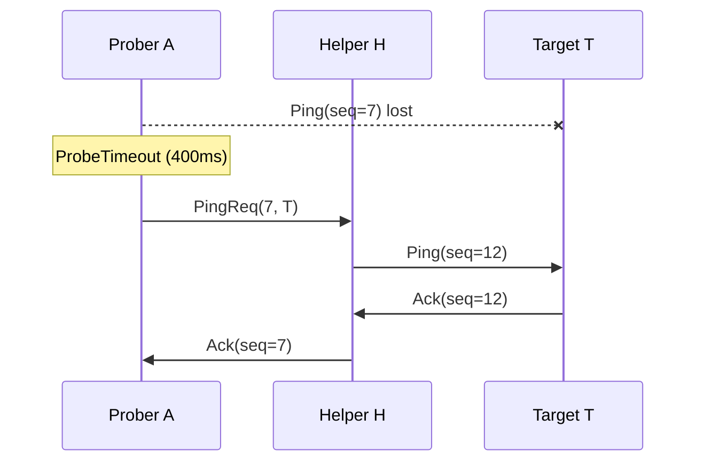
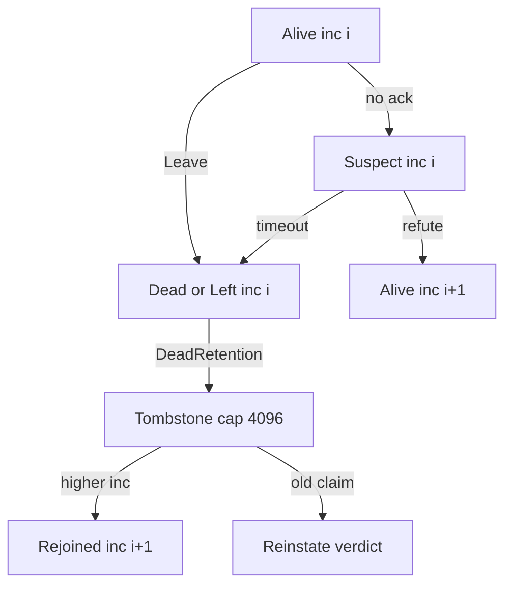

# SWIM Gossip Membership

With the deterministic simulation testing framework from [Deterministic Simulation Testing](01-deterministic-simulation.md) in place, the cluster's first protocol tracks membership so every node agrees on who is alive, who left, and who crashed. All-to-all heartbeats fail at scale: traffic grows as *O*(*N*²), and one flaky or one-way link triggers false failure verdicts.

SWIM (Scalable Weakly-consistent Infection-style Process Group Membership) separates failure detection from dissemination at constant load per node:

- **Direct and indirect probing.** Every period *T*, a node sends `Ping` to one peer. If no `Ack` arrives before timeout, it asks *k* live peers (`PingReq`) to probe the target and relay any `Ack` back, routing around one-way links and local loss at *O*(1) load.
- **Suspicion, incarnations, and epidemic gossip.** A failed probe marks the target `suspect`, not `dead`. Updates piggyback on datagrams — each sent λ⌈log₂ *N*⌉ times — spreading in expected *O*(log *N*) periods. Each node owns a monotonic **incarnation** counter; a suspected node refutes by bumping its incarnation and gossiping `alive(inc+1)`. Only an unrefuted timeout declares `dead`. Periodic push-pull syncs repair missed gossip and heal partitions.

## How SWIM maps to this repository

Package `internal/gossip` implements SWIM in [`config.go`](../../internal/gossip/config.go), [`errors.go`](../../internal/gossip/errors.go), [`member.go`](../../internal/gossip/member.go), [`wire.go`](../../internal/gossip/wire.go), and [`node.go`](../../internal/gossip/node.go).

`*gossip.Node` runs on `internal/env` from [Deterministic Simulation Testing](01-deterministic-simulation.md), implementing `env.Process` (`Start`, `OnDatagram`, `OnRequest`, `EncodeState`) with only `Clock`, `Rand`, and `Transport` — no `Disk`, goroutines, or locks. Callers read `Membership` (`Members`, `Lookup`, `Subscribe`) plus `All`, `Tombstones`, `Join`, `Leave`, `Self`, `Stats`, `LastError`, and `Closed`. `Subscribe` emits synchronous `Event{Kind, Member, At}` callbacks (`EventJoined`, `EventSuspected`, `EventRecovered`, `EventDied`, `EventLeft`). Wire errors register at `CodeAppMin+16..+20` (`80..84` via `Codes()`/`CodeTable()`) for `ErrMalformed`, `ErrNotMember`, `ErrClosed`, `ErrJoinFailed`, and `ErrViewFull`.

### Merge lattice and self-refutation

In `member.go`, each entry is `Member{ID, Region, Incarnation, State}` ordered `StateAlive < StateSuspect < StateDead < StateLeft`. `View` merges updates via `Supersedes(a, b)` on `(Incarnation, State, Region)` — a commutative, idempotent max-lattice where any arrival order yields the same table.

In `node.go`, updates about self bypass the lattice. Any claim at `inc >= own` other than `alive` at the node's incarnation and region triggers refutation to `claim + 1`, queuing `alive`. A node never marks itself suspect or dead, and its incarnation never decreases; at `math.MaxUint32`, refutation saturates (`Stats.RefuteOverflows`).

### Probing and indirect relays

In `node.go`, live peers (excluding self) are probed in shuffled round-robin order; new joiners take a random remaining slot in *O*(1) time, skipping dead or left entries. Every `ProbeInterval` (1 s), an unacked probe marks its target `suspect`; the node then pings the next peer (`KindPing`) and arms `ProbeTimeout` (400 ms). On timeout, it sends `KindPingReq` to `IndirectProbes` (*k* = 3) distinct random live helpers.



<!-- draw-visual: diagrams/02-indirect-probe.mmd -->
```text
     ┌──────────┐     ┌──────────┐     ┌──────────┐
     │ Prober A │     │ Helper H │     │ Target T │
     └─────┬────┘     └─────┬────┘     └─────┬────┘
           │                │                │
           │ Ping(seq=7) lost                │
           ├┈┈┈┈┈┈┈┈┈┈┈┈┈┈┈┈┈┈┈┈┈┈┈┈┈┈┈┈┈┈┈┈×│
           │                │                │
┌──────────────────────┐    │                │
│ ProbeTimeout (400ms) │    │                │
└──────────────────────┘    │                │
           │                │                │
           │ PingReq(7, T)  │                │
           ├───────────────►│                │
           │                │                │
           │                │ Ping(seq=12)   │
           │                ├───────────────►│
           │                │                │
           │                │ Ack(seq=12)    │
           │                │◄───────────────┤
           │                │                │
           │ Ack(seq=7)     │                │
           │◄───────────────┤                │
           │                │                │
```

A helper probes `Target` under its own sequence number, stores the relay in `map[uint32]relay` with an expiry FIFO, and forwards the first matching `KindAck` under the requester's sequence number. Relays expire after one `ProbeInterval`, prune on arrival and ticks, and cap at `MaxRelays` (1,024; `Stats.RelaysDropped`). Failed `KindPing` sends allocate no slot.

### Suspicion, piggybacking, and burial

In `config.go` and `node.go`, entering `StateSuspect` starts a timer for `SuspicionMult × ⌈log₂ N⌉ × ProbeInterval` (multiplier 4, *N* = live count including self, ⌈log₂ *N*⌉ ≥ 1); leaving cancels it, expiry promotes to `StateDead`.

The gossip queue holds one entry per member. Outgoing datagrams pack updates within `MaxPacket` (1,400 B; `MinPacket` = 781 B) by priority: leave notices, the destination's non-alive entry (so a suspected or dead peer hears about itself immediately even after the queue drains), and queued updates sorted by fewest transmits, newest first. Entries drop after `RetransmitMult × ⌈log₂ N⌉` transmits (multiplier 4).

Deleting dead entries outright fails twice: peers purging at different times re-infect each other via sync, and stale `alive(0)` replays resurrect dead nodes.



<!-- draw-visual: diagrams/02-member-lifecycle.mmd -->
```text
┌────────────────┐
│  Alive inc i   ├───────Leave────────┐
└────────┬───────┘                    │
         │                            │
      no ack                          │
         ▼                            ▼
┌────────────────┐          ┌──────────────────┐
│ Suspect inc i  ├─timeout─►│Dead or Left inc i│
└────────┬───────┘          └─────────┬────────┘
         │                            │
      refute                    DeadRetention
         ▼                            ▼
┌────────────────┐          ┌──────────────────┐
│ Alive inc i+1  │          │Tombstone cap 4096│
└────────────────┘          └─────────┬────────┘
                                      │
         ┌────────────────────────────┤
         │                            │
    higher inc                    old claim
         │                            │
         ▼                            ▼
┌────────────────┐          ┌──────────────────┐
│Rejoined inc i+1│          │Reinstate verdict │
└────────────────┘          └──────────────────┘
```

`internal/gossip` keeps a bounded **tombstone** (buried-verdict) floor:

1. **Retention.** `dead`/`left` verdicts stay in the view for `DeadRetention` (5 min); stranger verdicts from sync are not gossiped.
2. **Burial.** On expiry, the entry moves to a tombstone (`MaxTombstones` = 4,096, oldest evicted first).
3. **Old news.** Non-superseding `dead`/`left` updates for a tombstoned ID are dropped. Stale `alive`/`suspect` claims reinstate the verdict for one `DeadRetention` (`Stats.Reinstated`, no event, not queued) so sync replies and destination-led packets force a wiped node to refute to `verdict + 1`. A higher incarnation removes the tombstone and rejoins.

### Join, sync, leave, and wire format

In `node.go`, `Join` and periodic sync share one push-pull RPC (`KindSyncReq`/`KindSyncResp` carrying the full view). `Join` dials all seeds concurrently, succeeds on the first valid reply, or joins errors with `ErrJoinFailed`. Seeds from `Config.Seeds` and `Join` are remembered (`MaxSeeds` = 256). Every `SyncInterval` (15 s, jittered) a node syncs with one random live peer and one heal candidate from `{dead view entries} ∪ {dead tombstones} ∪ {remembered non-live seeds}` — never `StateLeft`. A lonely node retries `Join` once per `ProbeInterval` (`Stats.Rejoins`).

`Leave` marks self `StateLeft`, replaces any queued `StateAlive` self entry, gossips `StateLeft` to every live peer, stops timers, and closes (`ErrClosed` on further calls; datagrams in `Stats.DroppedClosed`).

In `wire.go`, big-endian `Version` 1 frames `version | kind | seq | [target for ping-req] | count | updates...`, separating datagrams (`KindPing`, `KindAck`, `KindPingReq`, `KindGossip`) from syncs (`KindSyncReq`, `KindSyncResp`). Canonical decoding checks minimum bytes before allocating and rejects trailing bytes (`ErrMalformed`), so `Encode(Decode(b)) == b`.

### Design choices and what each costs

- **No authentication.** Trusts datagram senders; a forged `dead(id, MaxUint32)` saturates refutation and evicts that ID permanently.
- **Volatile incarnations.** Nothing writes to `env.Disk`; a wiped node restarts at 0 and learns its prior entry or tombstone via join or sync.
- **Fixed logarithmic suspicion timeout (no Lifeguard).** No local health multiplier or confirmation shortening; a stalled node does not widen its timeouts.
- **Count-bounded full-view sync (`MaxMembers`).** Caps at `MaxUpdates` (65,535) for the `uint16` count; payloads grow linearly with *N*, and long IDs can hit the 16 MiB request cap (`env.ErrTooLarge`).
- **Bounded tombstones (`4,096`) and relays (`1,024`).** Keeps state bounded and `onAck` *O*(1); evicting an old tombstone forgets its floor, and duplicate `PingReq`s hold extra relay slots until expiry.
- **Uniform `MaxPacket`.** Oversized inbound datagrams drop silently as malformed.

### Testing on the simulator

`internal/gossip/dst_test.go` runs every scenario on `internal/sim` via `simtest.Sweep` and `simtest.RequireDeterministic` across four memory-bounded shards: 3-region convergence (5–10% link loss, *N*/10 late joiners, *N*/20 crashes, *N*/20 leaves over 30 s), crash detection, 300 s one-way links with an indirect-probe canary, short and post-retention partition heals, purge stability, and wiped restarts.

## Key pieces in code

Merge lattice in [`internal/gossip/member.go`](../../internal/gossip/member.go):

```go
func Supersedes(a, b Member) bool {
	if a.Incarnation != b.Incarnation {
		return a.Incarnation > b.Incarnation
	}
	if a.State != b.State {
		return a.State > b.State
	}
	return a.Region > b.Region
}
```

Ack handling in [`internal/gossip/node.go`](../../internal/gossip/node.go) closes the active probe or relays `KindAck` in *O*(1) time:

```go
func (n *Node) onAck(seq uint32) {
	if n.probe.active && !n.probe.acked && n.probe.seq == seq {
		n.probe.acked = true
		if n.probe.timer != nil {
			n.probe.timer.Stop()
		}
		return
	}
	r, ok := n.relays[seq]
	if !ok {
		return
	}
	delete(n.relays, seq)
	if n.e.Clock.Now() <= r.expires {
		n.send(r.origin, Message{Kind: KindAck, Seq: r.originSeq})
	}
}
```

Suspicion timers in [`internal/gossip/node.go`](../../internal/gossip/node.go) scale with ⌈log₂ *N*⌉ and re-check state and incarnation:

```go
func (n *Node) startSuspicion(l *memberLocal, u Member) {
	if l.suspect != nil {
		l.suspect.Stop()
	}
	id, inc := u.ID, u.Incarnation
	l.suspect = n.e.Clock.AfterFunc(n.cfg.SuspicionTimeout(n.view.LiveCount()), func() {
		if n.closed {
			return
		}
		m, ok := n.view.Get(id)
		if !ok || m.State != StateSuspect || m.Incarnation != inc {
			return
		}
		m.State = StateDead
		n.apply(m)
	})
}
```

Burial in [`internal/gossip/node.go`](../../internal/gossip/node.go) enforces the `MaxTombstones` (4,096) FIFO cap:

```go
func (n *Node) bury(m Member) {
	for len(n.tombs) >= MaxTombstones {
		ref := n.tombFIFO[0]
		n.tombFIFO = n.tombFIFO[1:]
		if t, ok := n.tombs[ref.id]; ok && t.order == ref.order {
			delete(n.tombs, ref.id)
			n.stats.TombstonesEvicted++
		}
	}
	n.tombSeq++
	n.tombs[m.ID] = tomb{m: m, order: n.tombSeq}
	n.tombFIFO = append(n.tombFIFO, tombRef{id: m.ID, order: n.tombSeq})
	if len(n.tombFIFO) > 2*MaxTombstones {
		n.tombFIFO = slices.DeleteFunc(n.tombFIFO, func(r tombRef) bool {
			t, ok := n.tombs[r.id]
			return !ok || t.order != r.order
		})
	}
}
```

## What the tests show, and what they do not

Measurements come from the 4-core Docker container, with every seed double-run via `simtest.RequireDeterministic`:

- **Convergence and message cost.** `TestSWIMConvergenceDST` (500 + 3 pinned seeds, `HealNet` to identical live views):

  | *N* | ⌈log₂ *N*⌉ | Periods (min / med / p99 / max) | max ÷ ⌈log₂ *N*⌉ | Datagrams / node / period (med / max) |
  |---|---|---|---|---|
  | 20 | 5 | 0 / 8 / 21 / 21 | 4.2 (cap 40) | 3.233 / 4.011 (cap 5.000) |
  | 50 | 6 | 1 / 18 / 26 / 29 | 4.8 (cap 48) | 3.027 / 3.778 (cap 5.000) |
  | 100 | 7 | 10 / 26 / 32 / 34 | 4.9 (cap 56) | 2.905 / 3.554 (cap 5.000) |

  Sync RPCs (up to two per node per `SyncInterval`) are excluded. False deaths were 0 across 1,500+ convergence and 500+ crash-detection runs. Adversarial scaling (8 seeds at *N* = 20, 50, 100, 200, crash at heal) gave maxima of 25.25 s, 28.50 s, 34.50 s, and 38.75 s (max ÷ ⌈log₂ *N*⌉ in 4.75–5.05).
- **Detection, asymmetric links, and canary.** `TestSWIMCrashDetectionDST` (*N* = 20, 5% loss, 500 seeds): 21.5 / 23.0 / 27.0 / 28.0 s (bound 40 s). `TestSWIMAsymmetricLinkDST` (*N* = 12, 300 s one-way link, 500 seeds): 0 suspicions, 0 deaths. `TestCanaryNoIndirectProbe` (indirect probes off): 416–543 suspicions/seed (median 492), 0 evictions because targets refuted in time — showing why asserting zero suspicions matters.
- **Partition heal, purge, and restart.** `TestSWIMPartitionHealDST` (*N* = 12, 500 seeds): 4.0 / 6.5 / 10.5 / 11.5 s (bound 60 s). `TestSWIMLongPartitionHealDST` (`DeadRetention` = 20 s): 2.5 / 7.0 / 14.5 / 16.0 s with a cross-cut seed and 2.5 / 12.0 / 29.0 / 35.0 s with tombstones only (bound 90 s). `TestDeadEntriesStayPurgedDST` (5 nodes, watched 3 × `DeadRetention` past purge): each victim purged once per survivor, zero reinstatements. `TestSWIMRestartSameIDDST` (500 seeds): wiped restarts converged within 30 s on both retained and tombstoned paths.
- **Properties, fuzzing, race, and coverage.** Coverage in `internal/gossip` is 97.4% (remaining branches are defensive). `TestPropViewMergeIsCommutative` and `TestPropIncarnationMonotonic` (`propRecordMonotonicAcrossPurge`) passed 2,000 `rapid` checks. `FuzzGossipWire` (30 s, 64,508 execs) and `FuzzViewMergeLaws` (30 s, 25,371 execs; checked by `TestFuzzSeedsDrawNonEmptyViews`) found no crashers. `go test -race` passed (75 s repo-wide; 52.5 s in `internal/gossip`). The 500-seed sweep took 484.1 s across four shards (~82–132 MB peak vs. 5.1 GB OOM if all 500 ran concurrently).
- **Adversarial testing.** A 73-check harness broke 4 checks on run 1 (`retention-monotonicity`, `stale-replay-after-purge`, `partition-heal-retained-false`, `default-retention-long-partition`). With code audits (cross-peer resurrection, unbounded `relays`, views past `MaxUpdates`, synchronous encode-error callbacks, region-mismatch refutation, duplicate self entries on `Leave`), those drove tombstones, remembered `Join` seeds, and hard caps. Run 2 held 72/73; `relay-once-original-sequence` relays to an unregistered `"target"` (`env.ErrUnreachable`) yet expects a synthetic `Ack` to forward. Dropping unsent relays is intentional, verified by `TestProbeAndIndirectProbe`, `TestRelayBounds`, and `TestSWIMAsymmetricLinkDST`.

### Narrowed claims

1. **Monotonicity and no-resurrection across purges.** *Narrowed:* a node's record (view entry, else tombstone) never moves backward in `Supersedes` order, dead/left entries stay purged without re-gossip storms, and stale `alive` replays cannot revive a buried member — *while fewer than `MaxTombstones` (4,096) later burials occur on that node*. *Why:* FIFO eviction forgets older tombstones, reopening `alive(0)` acceptance; bursts above 4,096 deaths across staggered peer purges can re-admit evicted entries for one `DeadRetention` (without re-gossip). Stranger verdicts from sync also persist one `DeadRetention` on the learner.
2. **Long partition re-merge.** *Narrowed:* healed halves re-merge *if at least one node holds a reachable remembered seed (≤ 256) or a dead view entry / tombstone of an up peer across the cut*. *Why:* SWIM has no external discovery; if cross-cut seeds are down and both sides bury over 4,096 other members, no cross-cut address remains. Many tombstones dilute uniform heal picks (expected first contact ≈ `SyncInterval × h / (u × m)` for *m* nodes, *h* candidates, *u* up peers across the cut).
3. **Restart with lost state and the same ID.** *Narrowed:* wiped nodes rejoin above their prior incarnation whenever any reachable peer holds the entry or tombstone — *unless it already saturated at `math.MaxUint32`*. *Why:* incarnations never wrap.
4. **View capacity vs. message bytes.** *Narrowed:* `Config.MaxMembers` (≤ 65,535) bounds entry count for the wire `uint16`, *not* byte size. *Why:* 65,535 long-ID entries exceed the 16 MiB request cap (`env.ErrTooLarge`), requiring a lower `MaxMembers`.

### What the tests do not prove

Everything above runs only on the single-threaded simulator (`internal/sim`). Real UDP/TCP sockets, kernel buffers, MTU fragmentation across mismatched `MaxPacket` values, DNS, OS timers, GC pauses, and concurrent adapters are tested only when the real runtime wraps the core in [The Object Store and Sync Engine](07-object-store-and-sync-engine.md) and [End-to-End Tests and Hardening](08-end-to-end-and-hardening.md). Peer authentication, persistent incarnations, Lifeguard local-health adaptation, and clusters beyond *N* = 200 are out of scope.

Next, [Reed-Solomon Erasure Coding](03-reed-solomon-erasure-coding.md) builds durable shard placement and storage over `Membership`, followed by [Merkle-Tree Anti-Entropy](04-merkle-anti-entropy.md), [Optimistic Concurrency Control](05-optimistic-concurrency-control.md), and [Sagas](06-sagas.md).

## Go deeper in the repo

- **Protocol:** [`config.go`](../../internal/gossip/config.go), [`errors.go`](../../internal/gossip/errors.go), [`member.go`](../../internal/gossip/member.go), [`wire.go`](../../internal/gossip/wire.go), [`node.go`](../../internal/gossip/node.go) under `internal/gossip/`.
- **Unit and regression tests:** [`member_test.go`](../../internal/gossip/member_test.go), [`wire_test.go`](../../internal/gossip/wire_test.go) ([`testdata/wire-golden.txt`](../../internal/gossip/testdata/wire-golden.txt)), [`node_test.go`](../../internal/gossip/node_test.go), [`repair_test.go`](../../internal/gossip/repair_test.go) (`TestDeadEntryLifetime`, `TestJoinSeedsAreRemembered`, `TestRelayBounds`, `TestViewBounds`).
- **Properties, fuzz, and simulation:** [`prop_test.go`](../../internal/gossip/prop_test.go) (`TestPropViewMergeIsCommutative`, `TestPropIncarnationMonotonic`, `FuzzViewMergeLaws`, [`testdata/merge-seeds.txt`](../../internal/gossip/testdata/merge-seeds.txt)); [`fuzz_test.go`](../../internal/gossip/fuzz_test.go) (`FuzzGossipWire`); [`dst_test.go`](../../internal/gossip/dst_test.go) (`TestSWIMConvergenceDST`, `TestSWIMAsymmetricLinkDST`, `TestCanaryNoIndirectProbe`, `TestSWIMCrashDetectionDST`, `TestSWIMPartitionHealDST`, `TestSWIMRefutationDST`, `TestSWIMRestartSameIDDST`, `TestJoinNoReachableSeedDST`, `TestDeadEntriesStayPurgedDST`, `TestSWIMLongPartitionHealDST`, [`testdata/seeds.txt`](../../internal/gossip/testdata/seeds.txt)).

Replay a pinned 20-node convergence seed or run the asymmetric-link test with its canary:

```sh
docker compose run --rm dev go test ./internal/gossip -run '^TestSWIMConvergenceDST$/^N=20$/^shard=1$/^seed=33$' -seed=33 -count=1
docker compose run --rm dev go test ./internal/gossip -run '^TestSWIMAsymmetricLinkDST$|^TestCanaryNoIndirectProbe$' -seed=33 -v -count=1
```

## Sources and further reading

- **Abhinandan Das, Indranil Gupta, and Ashish Motivala, "SWIM: Scalable Weakly-consistent Infection-style Process Group Membership Protocol" (DSN, 2002).** Direct/indirect probing, suspicion with refutation, and piggybacked dissemination.
- **Armon Dadgar, James Phillips, and Jon Currey, "Lifeguard: Local Health Awareness for More Accurate Failure Detection" (DSN, 2018).** Local health multiplier, buddy refutation, and confirmation-shortened suspicion (not built here).
- **Robbert van Renesse, Yaron Minsky, and Mark Hayden, "A Gossip-Style Failure Detection Service" (Middleware, 1998).** Earlier heartbeat gossip whose per-node load scales with group size.
- **Alan Demers et al., "Epidemic Algorithms for Replicated Database Maintenance" (PODC, 1987).** Rumor-mongering and anti-entropy push-pull primitives combined by SWIM.
