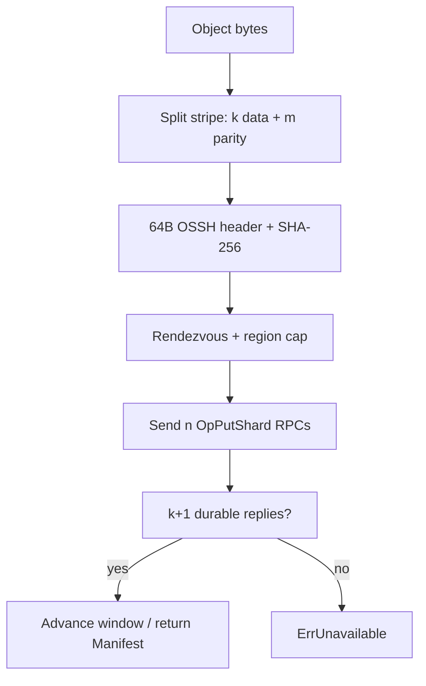
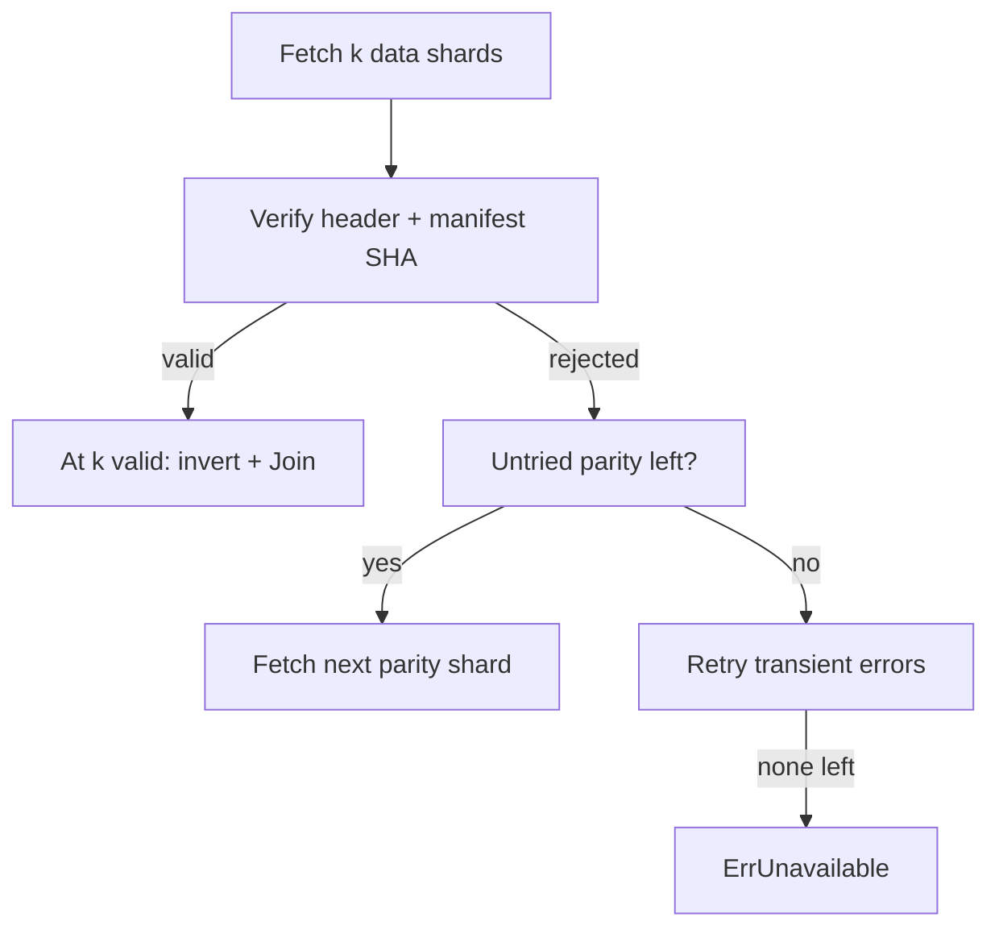

# Reed-Solomon Erasure Coding

With membership from [SWIM Gossip Membership](02-swim-gossip.md), the store spreads object bytes across nodes without tripling disk use. Three-way replication survives two failures at 200% overhead. A `(k, m)` Maximum Distance Separable (MDS) erasure code splits each data block (**stripe**) into `k` **data shards** and `m` **parity shards** (`n = k + m`). Any `k` shards rebuild the stripe, tolerating `m` losses at `m/k` overhead — 50% at the default `4+2` layout.

Reed-Solomon coding works in GF(2^8), where every byte is a field element without overflow. Addition is XOR (`a ^ b`); multiplication is polynomial multiplication modulo `x^8 + x^4 + x^3 + x^2 + 1` (`0x11D`), generator `2`, via lookup tables.

Encoding multiplies a `(k + m) × k` matrix `G` by the `k` data shards byte by byte. Stacking the `k × k` identity `I` over an `m × k` *Cauchy* matrix `C` (`G = [I; C]`, `C[i][j] = 1 / (x_i ^ y_j)`, `x_i = k + i`, `y_j = j`) makes the code *systematic* — clean reads skip decoding — and keeps every `k × k` submatrix of `G` invertible for `k + m <= 256`. On loss, Gauss-Jordan inversion of any `k` surviving rows restores data (re-encoding rebuilds parity). Because this decoder corrects *erasures* (known missing slots), not silent *errors*, checksums and per-object **manifests** turn bad or forged shards into `nil` slots first.

## How erasure coding maps to this repository

Two packages build this layer: `internal/erasure` is pure math (no `internal/env`, I/O, floats, or maps), and `internal/storage` adds shard framing, chunk storage, striping, manifests, placement, and a PUT/GET node on `internal/env` ([Deterministic Simulation Testing](01-deterministic-simulation.md)).

### Finite-field math and codec

In `internal/erasure`:

- **GF(2^8) tables (`gf256.go`).** Init builds `expTable` (510 entries), `logTable`, and 64 KiB `mulTable[256][256]byte`; `Inv`, `Div`, `Log` return `(value, ok)` (zero has none). `MulAddSlice` computes `dst[i] ^= c * src[i]` with `0` and `1` fast paths.
- **Opaque matrices (`matrix.go`).** `Matrix` hides its backing slice. `CodingMatrix(k, m)` builds `[I; C]` for `k >= 1`, `m >= 0`, `k + m <= 256` (`MaxShards = 256`; `m = 0` valid), checking `k > MaxShards || m > MaxShards-k` before adding so hostile integers return `ErrInvalidConfig`. `Invert` runs Gauss-Jordan on a copy (`ErrSingular` on zero pivot).
- **Codec (`codec.go`, `errors.go`).** `Split` allocates one buffer for all `k + m` shards, zero-padding to `ShardSize = (dataLen-1)/k + 1`. `Encode` writes parity with zero allocations when pre-sized; `Verify` checks parity (`ErrParityMismatch`). `ReconstructData` and `Reconstruct` rebuild data or all missing shards (`nil` missing; `[]byte{}` empty); `Join` strips padding.

### Shards, chunk store, and manifests

In `internal/storage`, each shard carries a 64-byte `OSSH` v1 header plus payload (`shard.go`): magic, version `1`, reserved zero, `k`, `m`, shard and stripe indices, payload length (max `MaxStripeSize = 64 MiB`), `VersionID`, four zero bytes, and `SHA-256` over the first 32 header bytes plus payload to catch header flips. `DecodeShard` rejects malformed, oversized, or checksum-failing blobs as `ErrCorrupt`. Blob names follow `shards/<bucket>/<hh>/<version-hex16>/<stripe>.<index>` (`hh` = first byte of `SHA-256(bucket/version-hex)`).

`ChunkStore` (`chunkstore.go`) persists shards on `env.Disk`. `Put` verifies header and checksum first: identical bytes re-`Sync` and succeed (idempotent and durable even after unsynced writes); different valid bytes return `ErrExists`; corrupt bytes are overwritten and synced. `Delete` syncs on found and `ErrNotFound` paths so crashes cannot resurrect unsynced removals. `Get`/`GetBlob` verify every read (`ErrCorrupt`, `ErrNotFound` joined with `env.ErrNotFound`, or `env.ErrIO`).

`Manifest` (`manifest.go`) stores `Bucket`, `Key`, `Version`, `Size`, `ContentSHA`, `Layout`, and per-stripe `ShardRef{Node, Checksum}` in canonical `OMAN` v1 format (bounds-checked before allocating; re-encoded on decode), blocking forged or stale shards.

### Placement and the striped node

Rendezvous hashing in `placement.go` assigns each stripe's `n` shards to distinct nodes by the top 8 bytes of `SHA-256(stripeKey || 0x00 || nodeID)` (ties by `NodeID`) over a cloned, ID-sorted `Membership.Members()`. `regionCap` caps shards per region at `max(m, c*)` (`c*` = smallest feasible cap; `4+2` gives max 2 per region across three regions, `3+3` across two, `1/1/4` across `1/1/10`), avoiding churn on small changes. `Replace` keeps live holders at their manifest indices within the cap and fills vacated slots.

In `stripe.go`, `shardproto.go`, and `node.go`, `Node` implements `env.Process`, serving `OpPutShard`, `OpGetShard`, and `OpDeleteShard` from `ChunkStore` and mapping sentinels at `CodeAppMin+32..+36` (96–100, via `storage.Codes()`).



<!-- draw-visual: diagrams/03-write-path.mmd -->
```text
┌────────────────────────────────┐
│          Object bytes          │
└────────────────┬───────────────┘
                 ▼
┌────────────────────────────────┐
│Split stripe: k data + m parity │
└────────────────┬───────────────┘
                 ▼
┌────────────────────────────────┐
│   64B OSSH header + SHA-256    │
└────────────────┬───────────────┘
                 ▼
┌────────────────────────────────┐
│    Rendezvous + region cap     │
└────────────────┬───────────────┘
                 ▼
┌────────────────────────────────┐
│     Send n OpPutShard RPCs     │
└────────────────┬───────────────┘
                 ▼
┌────────────────────────────────┐
│      k+1 durable replies?      │
└────────────────┬───────────────┘
                 │
                 ├────────────────────────────┐
                 │                            │
                yes                          no
                 │                            │
                 ▼                            ▼
┌────────────────────────────────┐    ┌──────────────┐
│Advance window / return Manifest│    │ErrUnavailable│
└────────────────────────────────┘    └──────────────┘
```

On `Put`, the coordinator draws `VersionID` from `env.Rand`, splits data into stripes (default 1 MiB, last short), and keeps up to `Window` (4) stripes awaiting quorum. Stripes advance at `AckQuorum` (default `min(k + 1, k + m)`, within `[k, k + m]`) durable replies, clearing `op.data = nil` on finish so late closures do not pin object memory; failing quorum returns `ErrUnavailable` joining shard errors.



<!-- draw-visual: diagrams/03-read-fallback.mmd -->
```text
┌────────────────────────────┐
│    Fetch k data shards     │
└──────────────┬─────────────┘
               ▼
┌────────────────────────────┐
│Verify header + manifest SHA│
└──────────────┬─────────────┘
               │
               ├──────────────────────────────────────┐
               │                                      │
             valid                                rejected
               │                                      │
               ▼                                      ▼
┌────────────────────────────┐            ┌──────────────────────┐
│ At k valid: invert + Join  │            │ Untried parity left? │
└────────────────────────────┘            └───────────┬──────────┘
                                                      │
               ┌──────────────────────────────────────┤
               │                                      │
              yes                                    no
               │                                      │
               ▼                                      ▼
┌────────────────────────────┐            ┌──────────────────────┐
│  Fetch next parity shard   │            │Retry transient errors│
└────────────────────────────┘            └───────────┬──────────┘
                                                      │
┌────────────────────────────┐                        │
│       ErrUnavailable       │◄──────none─left────────┘
└────────────────────────────┘
```

On `Get`, the coordinator validates the manifest, builds `man.Layout.Codec()` if `(k, m)` differs, fetches `k` data shards per stripe, and falls back to parity on rejection. After all `n` shards, transient errors (`env.ErrIO`, `env.ErrTimeout`, `env.ErrUnreachable`) retry every `RetryBackoff` (50 ms) up to `MaxShardAttempts` (4); `ErrCorrupt`/`ErrNotFound` never retry. Completion verifies `ContentSHA`; callbacks fire once asynchronously (`Clock.AfterFunc(0)` on early paths).

### Design choices and what each costs

- **Cauchy over Vandermonde.** Systematic and MDS for `k + m <= 256`; caps total shards at 256 in GF(2^8).
- **Per-call O(k^3) inversion, no cache.** Stateless and deterministic; ~64 ops at `k = 4`, ~2M ops at `k = 128`.
- **Erasures only, guarded by hashes.** Simple decoder blocking forgery; every read verifies against a manifest.
- **Early quorum ack.** Advancing at `k + 1` avoids blocking on a paused holder, leaving up to `N - AckQuorum` requests/stripe in flight for up to `RequestTimeout` (1 s).
- **Buffered `Get` and standalone placeholders.** Wire and codec stream per stripe; `Node.Get` buffers the object. `StaticMembership`, random `VersionID`, and single-layout `Put` keep `internal/storage` standalone before [The Object Store and Sync Engine](07-object-store-and-sync-engine.md) wires it to [SWIM Gossip Membership](02-swim-gossip.md), [Merkle-Tree Anti-Entropy](04-merkle-anti-entropy.md), and [Optimistic Concurrency Control](05-optimistic-concurrency-control.md).

### Testing on the simulator

Deterministic simulation testing (`TestStripedPutGetDST`) runs 20 nodes in 3 regions (`4+2`, 16 KiB stripes, 11 objects from 0 B to 6 stripes + 4,093 B) on `internal/sim`, checking `>= k + 1` durable shards at each PUT via `PeekDurable`. A nemesis injects bit-rot, wipes, and read errors under `Budget{MaxDamagedPerGroup: m, GroupOf: storage.StripeGroup}` during 60 chaos GETs and a sweep from every region; a second mode lifts the budget and rots `m + 1` shards of one stripe. Seed `987691` hit three sequential read errors within `m = 2`, motivating transient retries. Canaries toggling `PlantSkipChecksum` (`TestCanaryChecksumSkipBreaksCorruptionProperty`, `TestCanaryChecksumSkipFailsStripedDST`) fail on bad bytes and `ContentSHA` (`ErrCorrupt`).

## Key pieces in code

GF(2^8) inner loop in [`internal/erasure/gf256.go`](../../internal/erasure/gf256.go):

```go
func MulAddSlice(c byte, src, dst []byte) {
	n := min(len(src), len(dst))
	src, dst = src[:n], dst[:n]
	switch c {
	case 0:
		return
	case 1:
		for i, s := range src {
			dst[i] ^= s
		}
		return
	}
	t := &mulTable[c]
	for i, s := range src {
		dst[i] ^= t[s]
	}
}
```

Systematic Cauchy construction in [`internal/erasure/matrix.go`](../../internal/erasure/matrix.go):

```go
func CodingMatrix(k, m int) (Matrix, error) {
	if err := validConfig(k, m); err != nil {
		return Matrix{}, err
	}
	c := newMatrix(k+m, k)
	for i := 0; i < k; i++ {
		c.data[i*k+i] = 1
	}
	for i := 0; i < m; i++ {
		x := byte(k + i)
		row := c.row(k + i)
		for j := 0; j < k; j++ {
			// x >= k > j, so x^byte(j) is always non-zero and Inv succeeds.
			row[j], _ = Inv(x ^ byte(j))
		}
	}
	return c, nil
}
```

`shardExpect.verify` in [`internal/storage/stripe.go`](../../internal/storage/stripe.go) converts corruption and mismatches into `ErrCorrupt` erasures:

```go
func (e shardExpect) verify(index int, blob []byte, want *[32]byte) ([]byte, error) {
	h, payload, err := DecodeShard(blob)
	if err != nil {
		return nil, err
	}
	switch {
	case h.K != e.k || h.M != e.m:
		return nil, fmt.Errorf("storage: shard %d: code k=%d m=%d, want k=%d m=%d: %w", index, h.K, h.M, e.k, e.m, ErrCorrupt)
	case h.Index != index || h.Stripe != e.stripe || h.Version != e.version:
		return nil, fmt.Errorf("storage: shard %d: belongs to version %s stripe %d index %d: %w", index, h.Version, h.Stripe, h.Index, ErrCorrupt)
	case h.PayloadLen != e.shardSize:
		return nil, fmt.Errorf("storage: shard %d: payload %d bytes, want %d: %w", index, h.PayloadLen, e.shardSize, ErrCorrupt)
	case want != nil && h.Checksum != *want:
		return nil, fmt.Errorf("storage: shard %d: checksum differs from the manifest: %w", index, ErrCorrupt)
	}
	return payload, nil
}
```

`regionCap` in [`internal/storage/placement.go`](../../internal/storage/placement.go) computes `max(c*, m)`:

```go
func regionCap(sizes []int, n, m int) int {
	total := 0
	for _, s := range sizes {
		total += s
	}
	if n < 1 || total < n {
		return 0
	}
	for c := 1; ; c++ {
		sum := 0
		for _, s := range sizes {
			sum += min(s, c)
		}
		if sum >= n {
			return max(c, m)
		}
	}
}
```

## What the tests show, and what they do not

Measured in the 4-core Docker container (shared CPU; MB/s varies with load):

- **Throughput (`4+2`, 1 MiB stripe, pure Go).** `BenchmarkEncode1MiBStripe`: 481 MB/s, 0 allocs (483 MB/s, 2.17 ms/stripe earlier). `BenchmarkReconstructTwoDataShards1MiBStripe` (2 data missing): 394 MB/s (297 MB/s earlier). `BenchmarkReconstructAllMissing1MiBStripe` (1 data + 1 parity): 390 MB/s (211 MB/s under load).
- **Memory (`BenchmarkStripedPutGet8MiB`/`32MiB`, `-benchtime 1x`).** On 9 simulated nodes (1 MiB stripes, `Window = 4`, heap sampled after GC every 10 events): 8 MiB peaked at 36.9 MiB above baseline (12.0 MiB durable); 32 MiB peaked at 135.2 MiB (48.0 MiB durable), leaving ~5 MiB and ~7 MiB inferred for coordinator state and in-flight messages after subtracting two disk layers (~2× durable) and buffered GET.
- **Algebra, properties, fuzzing, race, coverage.** GF(2^8) tables matched bitwise multiplication for all 65,536 pairs; MDS passed exhaustively (`k <= 6, m <= 6`), sampled (`k, m <= 64`), and at `k = m = 128`. All `rapid` properties passed at 2,000 checks (`TestPropChunkStoreModel`: 20,000 checks). Three 30 s fuzz runs had 0 crashers and 0 skipped seeds across 11 + 11 + 7 seeds (`FuzzGF256`: 245,137; `FuzzErasureCoding`: 18,227 up to `k = 256`, 64 KiB — multi-MiB payloads live in `TestPropRoundTrip` and `TestRoundTripMultiMB`; `FuzzShardDecode`: 230,868 execs). `go test -race` passed (`-count=3` on `internal/storage`). Coverage: 98.4% (`internal/erasure`), 97.8% (`internal/storage`); `detlint`, `go vet`, `gofmt`, `paniccheck`, and stdlib-only imports passed on all 12 product files.
- **500-seed sweep (`TestStripedPutGetDST`, base 987654 + seed 987691 = 501 runs, 46,593 GETs/mode).** Within budget: 46,593 exact, 0 `ErrUnavailable`, 33,426 fallbacks, 22,201 faults applied, 22,912 rejected; max PUT 294 ms (bound 2 s), max GET 643 ms (bound 3 s), max mean requests/stripe 8 (bound 24), fewest durable shards at PUT ack 5 (`k + 1`). Lifted (plus `m + 1` shards rotted): 12,959 exact, 33,634 `ErrUnavailable`, 0 wrong bytes, max GET 872 ms, max mean requests/stripe 15.
- **Adversarial and regression tests.** An independent 42-check harness held 41; 1 (`window-pending-stripes`) stays broken against old wording because `Window` was narrowed below. Regression tests pin four fixes: syncing `ChunkStore.Put`/`Delete` on identical-byte/absent paths, non-re-entrant `Node.Put` placement-failure callbacks, overflow-safe `k + m`/`ShardSize`/`Identity` bounds, and non-skipping fuzz seeds.

### Narrowed claims

1. **Availability within the fault budget.** Once fault-free writes have settled on all `k + m` shards, permanent damage (bit-rot, wipe) within `MaxDamagedPerGroup = m` never makes a GET unavailable; a PUT acknowledged at quorum may hold fewer than `k + m` shards and cannot yet tolerate `m` more losses ([The Object Store and Sync Engine](07-object-store-and-sync-engine.md#shard-collection-and-loss-declaration)). Transient read errors can still fail a GET if they hit >`m` shards of one stripe faster than 4 attempts/shard outlast them (`env.ErrIO` among causes; 0 observed in 46,593 GETs). *Why:* the budget caps instantaneous damage, while a GET spans time and read errors are consumed on read (seed `987691`).
2. **What `Window` bounds.** `Window` bounds stripes awaiting quorum (PUT) or decode (GET), not individual requests in flight to slow holders. After quorum, up to `N - AckQuorum` requests/stripe (1 at `4+2`, quorum 5) remain outstanding until reply or `RequestTimeout` (1 s) — at most `stripes × (N - AckQuorum)` requests and `(N - AckQuorum)/k` of object size (25% at defaults; `1 + 1 + len(blobName) + 64 + ceil(L/k)` bytes each, or 256 KiB + 98 B for a 1 MiB stripe in bucket `"b"`). `Put` clears `op.data` at ack (`TestNodePutReleasesTheObjectAtTheAck`). *Why:* capping slow-holder requests by `Window` would throttle PUTs to `Window` stripes per `RequestTimeout` when one holder pauses.

### What the tests do not prove

Behavior is proven only on simulated `env.Disk` and `env.Transport`, not real OS filesystems, sockets, disk-full errors, sector torn writes, or concurrent goroutines in [The Object Store and Sync Engine](07-object-store-and-sync-engine.md). `TestStripedPutGetDST` does not crash nodes during PUT (crash durability of `ChunkStore` is proven by `TestPropChunkStoreModel`; the simulator checks `>= k + 1` durable shards at ack). Per-bucket PUT layouts, `Get` size caps, and streaming HTTP reads are unbuilt; dynamic membership, metadata versions, anti-entropy, and shard GC are added in [Merkle-Tree Anti-Entropy](04-merkle-anti-entropy.md), [Optimistic Concurrency Control](05-optimistic-concurrency-control.md), and [The Object Store and Sync Engine](07-object-store-and-sync-engine.md). The request check bounds total requests at `stripes × 24` (logged value is a per-GET mean), and benchmarks use pure-Go tables without SIMD.

## Go deeper in the repo

- **Erasure (`internal/erasure/`):** [`gf256.go`](../../internal/erasure/gf256.go), [`matrix.go`](../../internal/erasure/matrix.go), [`codec.go`](../../internal/erasure/codec.go), [`errors.go`](../../internal/erasure/errors.go); tests/fuzz/bench in [`gf256_test.go`](../../internal/erasure/gf256_test.go) (`FuzzGF256`), [`matrix_test.go`](../../internal/erasure/matrix_test.go), [`codec_test.go`](../../internal/erasure/codec_test.go) (`FuzzErasureCoding`), [`fuzzseeds_test.go`](../../internal/erasure/fuzzseeds_test.go), [`bench_test.go`](../../internal/erasure/bench_test.go).
- **Storage (`internal/storage/`):** [`shard.go`](../../internal/storage/shard.go), [`chunkstore.go`](../../internal/storage/chunkstore.go), [`stripe.go`](../../internal/storage/stripe.go), [`manifest.go`](../../internal/storage/manifest.go), [`placement.go`](../../internal/storage/placement.go), [`shardproto.go`](../../internal/storage/shardproto.go), [`node.go`](../../internal/storage/node.go), [`errors.go`](../../internal/storage/errors.go); tests/fuzz/bench in [`shard_test.go`](../../internal/storage/shard_test.go) (`FuzzShardDecode`), [`stripe_test.go`](../../internal/storage/stripe_test.go), [`chunkstore_test.go`](../../internal/storage/chunkstore_test.go), [`placement_test.go`](../../internal/storage/placement_test.go), [`node_test.go`](../../internal/storage/node_test.go), [`node_repair_test.go`](../../internal/storage/node_repair_test.go), [`dst_test.go`](../../internal/storage/dst_test.go), [`bench_test.go`](../../internal/storage/bench_test.go).

Replay the pinned transient-fault seed or run codec benchmarks:

```sh
docker compose run --rm dev go test ./internal/storage -run '^TestStripedPutGetDST$' -seed=987691 -v -count=1
docker compose run --rm dev go test ./internal/erasure -run '^$' -bench . -benchmem
```

## Sources and further reading

- **Irving S. Reed and Gustave Solomon, "Polynomial Codes over Certain Finite Fields" (SIAM, 1960).** Finite-field polynomial construction behind MDS erasure codes.
- **James S. Plank, "A Tutorial on Reed-Solomon Coding for Fault-Tolerance in RAID-like Systems" (1997) and Plank & Ying Ding (2005).** Byte-wise GF(2^8) math and why naive Vandermonde matrices can fail MDS.
- **Johannes Blömer et al., "An XOR-Based Erasure-Resilient Coding Scheme" (ICSI TR-95-048, 1995).** Cauchy Reed-Solomon matrices over GF(2^w).
- **Backblaze Vaults and `JavaReedSolomon` write-ups.** Parity ratios, stripe sizing, table lookups, and shard repair.
- **Ceph Erasure-Coded Pools documentation.** Mapping `(k, m)` profiles onto failure domains.
- **David G. Thaler and Chinya V. Ravishankar, "Using Name-Based Mappings to Increase Hit Rates" (1998).** Highest Random Weight (rendezvous) hashing.
