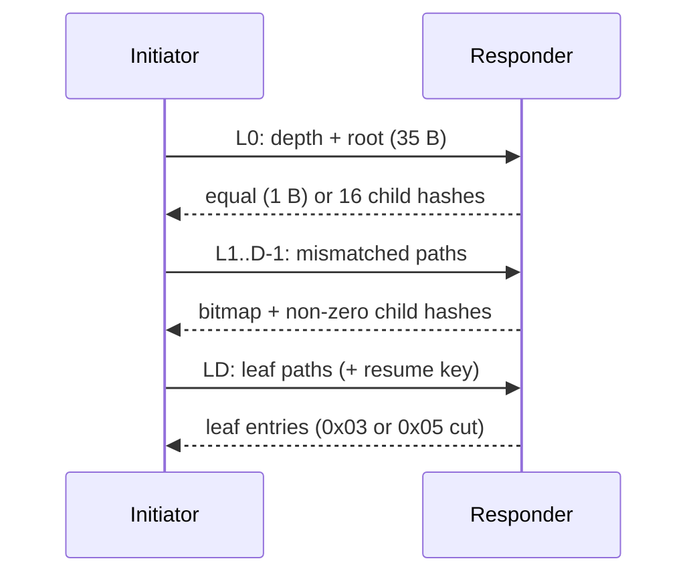
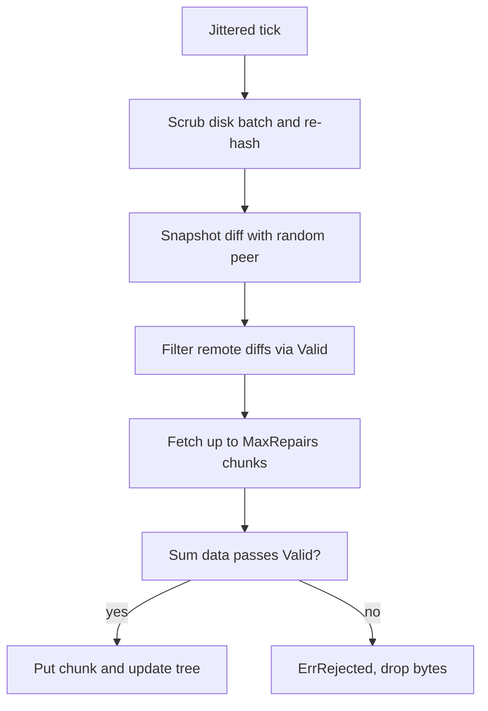

# Merkle-Tree Anti-Entropy

Even with erasure-coded shards placed across nodes in [Reed-Solomon Erasure Coding](03-reed-solomon-erasure-coding.md), replicas drift. Partitions hide writes, packet loss drops replicas, and silent bit-rot flips durable bits without I/O errors. Shipping full inventories wastes bandwidth whenever replicas already agree.

Merkle-tree anti-entropy summarizes each replica's key-to-hash inventory as a hash tree: leaves digest sorted keys and value hashes per bucket; inner nodes digest their children. Two peers compare 32-byte roots first. Equal roots stop in one round trip; unequal roots descend only mismatched branches to differing leaves and pull missing or damaged values.

A tree alone misses silent bit-rot when leaves cache write-time hashes, so a **scrubber** re-reads stored bytes, recomputes hashes, and updates the tree so damaged blobs diverge from healthy peers.

## How Merkle anti-entropy maps to this repository

`internal/merkle` implements the tree, wire format, diff engine, and repair worker on the standard library and `internal/env`, running unchanged under [Deterministic Simulation Testing](01-deterministic-simulation.md).

### Persistent fanout-16 trie

In `tree.go`, `Tree` is a fixed-depth radix trie of fanout 16 (`MinDepth = 1`, `MaxDepth = 16`). A key's path is the first 64 bits of `SHA-256(key)` as 16 big-endian nibbles; leaves at `Depth` hold sorted entries for that prefix. `DepthFor(n)` picks the smallest depth with `16^depth >= n` (3 for 1,000 keys, 4 for 10,000, 5 for 100,000).

Domain-separated SHA-256 encodings prevent tree-structure ambiguity:

- **Leaf:** `SHA-256(0x00 || u32be(count) || for each entry: u32be(len(key)) || key || hash[32])` — distinguishing a present zero-hash key from an absent one.
- **Inner (level `l`):** `SHA-256(0x01 || u8(l) || 16 × childHash[32])`, with 32 zero bytes for empty (`nil`) children.

Differing depths return `ErrDepth`. Nodes are immutable: `Set` and `Delete` copy O(depth) nodes along one path, giving O(1) `Snapshot()` for frozen diff views. `Build` constructs a tree bottom-up (`ErrKey` on duplicate keys). Keys cap at `MaxKeyLen = 1,024` bytes and leaves at `MaxLeafEntries = 4,096` (`ErrLeafFull`).

### Level-by-level diff protocol and wire format

In `diff.go`, `wire.go`, and `errors.go`, `Session` (`Tree.Diff(Limits)`) drives the initiator, stateless `Tree.Answer([]byte)` leaks nothing on vanished peers, and `Compare` runs both in memory.



<!-- draw-visual: diagrams/04-diff-exchange.mmd -->
```text
┌───────────┐     ┌───────────┐
│ Initiator │     │ Responder │
└─────┬─────┘     └─────┬─────┘
      │                 │
      │ L0: depth + root (35 B)
      ├────────────────►│
      │                 │
      │ equal (1 B) or 16 child hashes
      │◄┈┈┈┈┈┈┈┈┈┈┈┈┈┈┈┈┤
      │                 │
      │ L1..D-1: mismatched paths
      ├────────────────►│
      │                 │
      │ bitmap + non-zero child hashes
      │◄┈┈┈┈┈┈┈┈┈┈┈┈┈┈┈┈┤
      │                 │
      │ LD: leaf paths (+ resume key)
      ├────────────────►│
      │                 │
      │ leaf entries (0x03 or 0x05 cut)
      │◄┈┈┈┈┈┈┈┈┈┈┈┈┈┈┈┈┤
      │                 │
```

Each request batches all mismatched nodes at one level: level 0 sends 35 bytes (`0x01 || depth || 0 || root[32]`) and gets 1 byte (`0x04`) when equal or 16 child hashes; inner levels `1..Depth-1` send strictly increasing `ceil(level/2)`-byte prefixes and receive `0x02` replies with a `uint16` bitmap (bit `15 - i` for child `i`) plus non-zero child hashes; level `Depth` fetches mismatched leaves packed by `packLeaves` up to `MaxReplyBytes` (1 MiB) using `0x03` (complete) or `0x05` (cut), resuming past `uvarint(len) || lastKey`.

Because an inner node encodes to ≤ 514 B, `MaxRequestNodes = (MaxReplyBytes - 4) / 514 = 2,040`, capping inner replies at 1,048,564 B and requests at 17,351 B. `Limits.Frontier` (default 1,024, max 2,040) caps mismatched nodes per level; overflow sets `Result.Truncated`.

Decoding enforces minimal `uvarint`s, strictly increasing paths and keys, non-zero inner hashes, and matching leaf prefixes. `decodeResponse` uses flat slices and substrings from one copy (cloning remote-only keys into `Difference`), bounding allocations to `4·len(b) + 64 KiB`. Cut replies (`0x05`) must exceed `MaxReplyBytes - 2,116` B (≥ 990 entries), advance past the resume key, and total ≤ `MaxLeafEntries`, capping any session at `Depth + 5·Frontier` trips. Sentinels are `ErrMalformed`, `ErrDepth`, `ErrKey`, `ErrLeafFull`, `ErrRejected`, and `ErrSession`; `CodeEntries()` registers `CodeMalformed` (112) and `CodeDepth` (113).

### Background scrubber and repair worker

In `worker.go`, `Worker` connects via `Membership` (`Peers()`) and `Repairer` (`Keys`, `Read`, `Valid`, `Fetch`, `Put`). The tree stays in memory: `Start()` scans and hashes every blob from `Repairer.Keys()` so no stored tree can rot; writes call `Record`/`Forget`; `OnRequest` serves diffs from the live tree.



<!-- draw-visual: diagrams/04-worker-loop.mmd -->
```text
┌──────────────────────────────┐
│        Jittered tick         │
└───────────────┬──────────────┘
                ▼
┌──────────────────────────────┐
│ Scrub disk batch and re-hash │
└───────────────┬──────────────┘
                ▼
┌──────────────────────────────┐
│Snapshot diff with random peer│
└───────────────┬──────────────┘
                ▼
┌──────────────────────────────┐
│Filter remote diffs via Valid │
└───────────────┬──────────────┘
                ▼
┌──────────────────────────────┐
│Fetch up to MaxRepairs chunks │
└───────────────┬──────────────┘
                ▼
┌──────────────────────────────┐
│    Sum data passes Valid?    │
└───────────────┬──────────────┘
                │
                ├───────────────────────────────┐
                │                               │
               yes                             no
                │                               │
                ▼                               ▼
┌──────────────────────────────┐    ┌───────────────────────┐
│  Put chunk and update tree   │    │ErrRejected, drop bytes│
└──────────────────────────────┘    └───────────────────────┘
```

Each jittered tick (`[Period/2, 3·Period/2)` from `env.Rand`, default `Period = 1 s`) scrubs `ScrubBatch` keys (64) across the sorted union of `Repairer.Keys()` and `tree.Keys()` — updating `Changed` blobs and dropping missing or unreadable ones (`Dropped`, non-`ErrNotFound` in `ReadErrors`) — then diffs a `Snapshot()` with a random peer from sorted, deduplicated `Membership.Peers()` minus self under `Timeout` (500 ms) and `RoundDeadline` (`10 × Period`). Remote diffs passing `Valid(key, remoteHash)` fetch up to `MaxRepairs` (256; extras `Deferred`); only bytes passing `Valid(key, Sum(data))` reach `Put` and the tree (else `ErrRejected`). A generation counter `gen` drops late callbacks; `Stop()` cancels timers, fails active rounds with `env.ErrClosed` while preserving stats, and lets `Start()` resume.

### Design choices and what each costs

- **In-memory tree rebuilt at `Start`.** Avoids stored-tree corruption; costs a startup disk re-hash and `O(N log N)` key sorting per scrub tick.
- **Fixed-depth fanout-16 trie over `SHA-256(key)`.** Order-independent, shallow, O(1) snapshots; peers must match `Depth` (`ErrDepth`), and prefix collisions can raise `LeafLoad` to 4,096.
- **Stateless responder.** Zero per-peer server memory; concurrent remote writes settle on later rounds.
- **Single 1 MiB reply cap with cut-and-resume.** Bounds frame size and decode allocations; leaf payloads over 1 MiB take extra trips.
- **Pull-only, add-only repair.** `Valid` blocks bad bytes from lying peers; deletes need tombstones or manifests, wired in [Optimistic Concurrency Control](05-optimistic-concurrency-control.md) and [The Object Store and Sync Engine](07-object-store-and-sync-engine.md).

### Testing on the simulator

Deterministic simulation testing uses a content-addressed `chunkStore` (`store_test.go`, `chunk/<hex(SHA-256(bytes))>`, `Valid` checks `key == hash.String()`) multiplexing Merkle (`'M'`), fetch (`'G'`), and write (`'P'`) RPCs via `env.WithNet`. Four suites (48 chunks of 64–1,024 B, depth 2, 500 ms period, 250 ms timeout, scrub batch 16) run under `simtest.RequireDeterministic` — three 3-node suites (`TestBitRotRepairDST`: three 4 s bit-rot phases, `MaxDamagedPerGroup = 2`, `cleanRun`, pinned seed `66014753249261` flipping one bit twice 310 ms apart on `n001` so bytes stayed valid while `Disk.Damaged()` stayed set until `Sync`; `TestMissedWriteRepairDST`: 5 s isolation; `TestRepairUnderLossDST`: 20% loss, `LossPPM = 200,000`, checking `Rounds == Completed + Failed + InFlight`) plus `TestLyingPeerDST` (three honest nodes and a liar sending garbage, `ErrDepth`, fabricated trees, and bad chunks, and a 2-node lone-liar check for `ErrRejected` and an empty disk). `TestScrubRefillsAWipedDiskDST` tests wipes and read errors; `TestCanarySkippedBranch` toggles `SetSkipBranch` (skipping child 15) to verify `sim.ErrDeadline` stalls on seeds 1–3.

## Key pieces in code

Leaf hashing in [`internal/merkle/tree.go`](../../internal/merkle/tree.go):

```go
func leafHash(es []Entry) Hash {
	size := 5
	for _, e := range es {
		size += 4 + len(e.Key) + len(e.Hash)
	}
	buf := make([]byte, 0, size)
	buf = append(buf, tagLeaf)
	buf = binary.BigEndian.AppendUint32(buf, uint32(len(es)))
	for _, e := range es {
		buf = binary.BigEndian.AppendUint32(buf, uint32(len(e.Key)))
		buf = append(buf, e.Key...)
		buf = append(buf, e.Hash[:]...)
	}
	return sha256.Sum256(buf)
}
```

Inner-node hashing in [`internal/merkle/tree.go`](../../internal/merkle/tree.go):

```go
func newInner(level int, kids *[Fanout]*node) *node {
	var buf [2 + Fanout*32]byte
	buf[0], buf[1] = tagInner, byte(level)
	empty := true
	for i, k := range kids {
		if k != nil {
			empty = false
			copy(buf[2+32*i:], k.hash[:])
		}
	}
	if empty {
		return nil
	}
	return &node{hash: sha256.Sum256(buf[:]), kids: kids}
}
```

`Session.Feed` in [`internal/merkle/diff.go`](../../internal/merkle/diff.go) rejects under-full cut replies and advances the diff:

```go
func (s *Session) Feed(b []byte) error {
	if s.done || s.req == nil {
		return fmt.Errorf("merkle: feed at level %d: %w", s.level, ErrSession)
	}
	s.cost.RoundTrips++
	s.cost.BytesReceived += len(b)
	resp, err := decodeResponse(b)
	// Require cut leaf replies to be nearly full so a lying peer cannot stretch
	// one leaf into unbounded tiny continuations.
	if err == nil && resp.more && len(b) <= minCutReply {
		err = malformed("a cut leaf reply that is not full")
	}
	if err != nil {
		return s.fail(fmt.Errorf("merkle: diff level %d: %w", s.level, err))
	}
	if err := s.apply(resp); err != nil {
		return s.fail(fmt.Errorf("merkle: diff level %d: %w", s.level, err))
	}
	s.req = nil
	s.advance()
	return nil
}
```

`diffLeaf` in [`internal/merkle/diff.go`](../../internal/merkle/diff.go) merges sorted leaves and clones remote-only keys:

```go
func diffLeaf(local, remote []Entry, out []Difference) []Difference {
	i, j := 0, 0
	for i < len(local) || j < len(remote) {
		switch {
		case j == len(remote) || (i < len(local) && local[i].Key < remote[j].Key):
			out = append(out, Difference{Key: local[i].Key, Local: local[i].Hash, HasLocal: true})
			i++
		case i == len(local) || remote[j].Key < local[i].Key:
			out = append(out, Difference{Key: strings.Clone(remote[j].Key), Remote: remote[j].Hash, HasRemote: true})
			j++
		default:
			if local[i].Hash != remote[j].Hash {
				out = append(out, Difference{Key: local[i].Key, Local: local[i].Hash, Remote: remote[j].Hash, HasLocal: true, HasRemote: true})
			}
			i++
			j++
		}
	}
	return out
}
```

## What the tests show, and what they do not

Measured in the 4-core Docker container:

- **Diff cost (`MERKLE_MEASURE=1`, `TestMeasureDiffCost`).** In-sync rounds take 1 round trip, 1 hash, and 36 bytes. Divergent runs (`object-%07d`, `d` updates, deletes, and inserts) stay well under the exact bound:

| N | Depth | d | Trips | Hashes | Exact bound | Leaf load | Sent+Recv B |
|---|---|---|---|---|---|---|---|
| 1,000 | 3 | 1 | 4 | 38 | 53 | 4 | 51+1,218 |
| 1,000 | 3 | 10 | 4 | 212 | 521 | 4 | 86+6,967 |
| 1,000 | 3 | 100 | 4 | 713 | 5,201 | 4 | 345+24,255 |
| 10,000 | 4 | 1 | 5 | 51 | 68 | 3 | 57+1,639 |
| 10,000 | 4 | 10 | 5 | 323 | 671 | 3 | 108+10,478 |
| 10,000 | 4 | 100 | 5 | 1,851 | 6,701 | 3 | 548+60,704 |
| 100,000 | 5 | 1 | 6 | 65 | 85 | 4 | 64+2,092 |
| 100,000 | 5 | 10 | 6 | 452 | 841 | 4 | 142+14,629 |
| 100,000 | 5 | 100 | 6 | 3,017 | 8,401 | 4 | 842+98,130 |

- **500-seed sweeps (base `987654321`, 394 s; base `79988930801092`, 450 s).** Maxima vs bounds: `BitRotRepairBound` **4.98 s** / 20 s; `BitRotConvergeBound` **2.81 s** / 25 s; `MissedWriteBound` **2.70 s** / 20 s; `LossConvergeBound` **41.97 s** / 60 s (geometric tail at 20% loss); `LyingConvergeBound` passed all 500 seeds (30 s bound); `refillBound` **2.80 s** / 30 s; `RepairCopiesPerRot` **0.99** total, **1.12** worst seed / 4× (total < 1 since two rots on one blob before repair count twice). `cleanRun` fetched **0** bytes after `CleanSettle` (600 ms) over `CleanWatch` (10 s) on every seed.
- **Properties, fuzzing, race, coverage.** All `rapid` properties passed 2,000 checks (123 s). `FuzzMerkleWire` and `FuzzMerkleDiff` ran 30 s each with 0 crashers after fixing a truncated-bitmap panic (`testdata/fuzz/FuzzMerkleWire/2104aef022c948e1`). `go test -race` passed (88 s; earlier caught an 83,856 B minimal-varint allocation across 2,040 empty leaves, fixed via `uvarintLen64`). Coverage is **97.6%** (97.3% on a second run); `gofmt`, `go vet`, `detlint`, `paniccheck`, and stdlib + `internal/env` imports are clean.
- **Adversarial testing.** 74 checks (40 independent + 34 regression): run 1 scored 70 held, 4 broken (C8, C12, C21, C31); run 2 scored **72 held, 2 broken**. Fixed: `single-leaf-reply-size` (C8: 992 × 1,024 B keys emitted 1,049,541 B; fixed via cut-and-resume, lowering `MaxRequestNodes` from 16,384 to 2,040 so inner replies drop from ~8.03 MiB to ≤ 1,048,564 B, and bounding decode allocations) and `batched-round-trip-bound` (C12: 984 × 1,024 B keys at depth 1 fit one 1,041,091 B reply in 2 trips instead of 3). C21 (`sim-prefix-reply-tight-bound`) and C31 (`clustered-hash-cost`) stay broken against the unmodified harness because they pin the narrowed claims below.

### Narrowed claims

1. **Round-trip count.** Equal roots take 1 round trip. Otherwise, an honest responder (`Tree.Answer`) takes exactly `Depth + L` trips (`L >= 1` leaf replies): `L = 1` iff combined leaf payload `S` for `F` leaves satisfies `S + 2 + uvarint(F) <= MaxReplyBytes`, and `L <= ceil(S / 1,047,510)` always (non-final leaf replies exceed `MaxReplyBytes - 1,060` B). Any responder — lying, mutating, cutting, or one-leaf-per-reply — ends within `Depth + 5·F <= Depth + 5·Frontier` trips (≤ `F` leaf completions + 4 full cut continuations per leaf). *Why:* an earlier "≤ depth" / "≤ Depth + 1" wording overlooked that a depth-`D` trie has `D + 1` levels, leaf payloads > 1 MiB need extra replies, and a one-leaf-per-reply peer takes `Depth + F` trips (3 for two leaves at depth 1 in C21) while converging.
2. **Hash-comparison cost.** Exact count is `1 + Σ(non-empty remote children of mismatched inner nodes) + Σ(remote entries of mismatched leaves)`, bounded by `1 + 16·d·Depth + d·LeafLoad(remote)`. `16·d·(Depth + 1)` holds only for `LeafLoad <= 15`. *Why:* every entry in a mismatched leaf travels in its reply; 46 keys in one depth-2 leaf with one changed hash cost `1 + 1 + 1 + 46 = 49 > 48` (C31; pinned at 45 → 48 vs 46 → 49).
3. **Zero traffic without damage.** With no injected faults, zero chunk bytes move during `CleanWatch` (10 s) after `CleanSettle` (600 ms, 2× store timeout). *Why:* measuring from `t = 0` could catch a worker pulling an in-flight replicated write across asymmetric latencies.

### What the tests do not prove

Everything runs on `internal/sim` against an add-only, content-addressed `chunkStore`, not real OS disks, TCP sockets, or a multi-goroutine node. Concurrent responder writes are not snapshot-isolated across round trips (stragglers settle on later ticks). Deletes and tombstones are unimplemented in `Worker`, and scrubbing sorts all keys per tick (`O(N log N)`). Next, [Optimistic Concurrency Control](05-optimistic-concurrency-control.md) adds versioned metadata and tombstones, and [The Object Store and Sync Engine](07-object-store-and-sync-engine.md) wires anti-entropy to [SWIM Gossip Membership](02-swim-gossip.md), shard manifests, shard GC, and real-runtime transports.

## Go deeper in the repo

- **Implementation (`internal/merkle/`):** [`tree.go`](../../internal/merkle/tree.go), [`wire.go`](../../internal/merkle/wire.go), [`diff.go`](../../internal/merkle/diff.go), [`worker.go`](../../internal/merkle/worker.go), [`errors.go`](../../internal/merkle/errors.go).
- **Tests and fuzz targets:** [`tree_test.go`](../../internal/merkle/tree_test.go), [`wire_test.go`](../../internal/merkle/wire_test.go) (`FuzzMerkleWire`), [`replysize_test.go`](../../internal/merkle/replysize_test.go), [`diff_test.go`](../../internal/merkle/diff_test.go), [`bounds_test.go`](../../internal/merkle/bounds_test.go), [`prop_test.go`](../../internal/merkle/prop_test.go) (`FuzzMerkleDiff`), [`worker_test.go`](../../internal/merkle/worker_test.go), [`lifecycle_test.go`](../../internal/merkle/lifecycle_test.go), [`dst_test.go`](../../internal/merkle/dst_test.go), [`canary_test.go`](../../internal/merkle/canary_test.go), [`store_test.go`](../../internal/merkle/store_test.go).

Replay the pinned bit-rot seed or print diff costs:

```sh
docker compose run --rm dev go test ./internal/merkle -run '^TestBitRotRepairDST$' -seed=66014753249261 -v -count=1
docker compose run --rm -e MERKLE_MEASURE=1 dev go test ./internal/merkle -run '^TestMeasureDiffCost$' -v -count=1
```

## Sources and further reading

- **Ralph C. Merkle, "A Digital Signature Based on a Conventional Encryption Function" (CRYPTO, 1987).** Hash trees authenticating a set under one root digest.
- **Giuseppe DeCandia et al., "Dynamo: Amazon's Highly Available Key-value Store" (SOSP, 2007).** Background anti-entropy with Merkle trees without shipping full inventories.
- **Apache Cassandra Anti-Entropy Repair documentation.** Per-token-range trees, depth vs granularity, and rebuild cost.
- **Riak Active Anti-Entropy (AAE) write-ups.** Continuous hash-tree exchange and periodic rebuilds against silent loss.
- **Ben Laurie, Adam Langley, and Emilia Käsper, RFC 6962: Certificate Transparency (2013).** One-byte domain separation (`0x00` leaves, `0x01` inner nodes) against second-preimage tree attacks.
