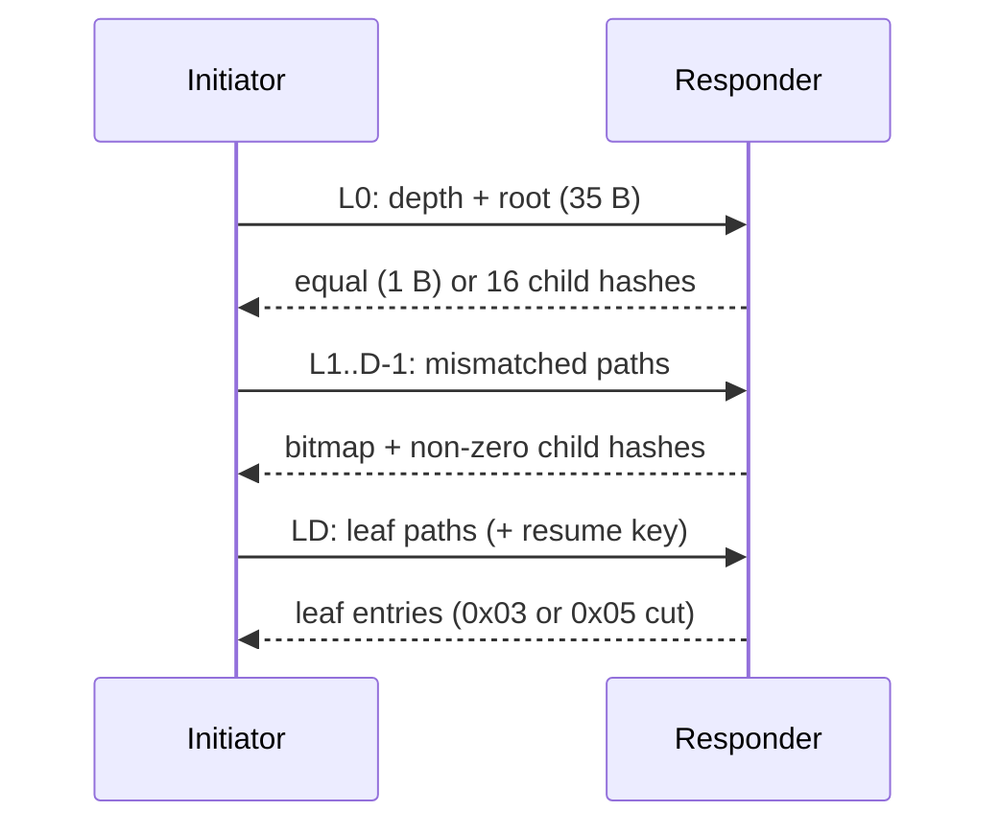
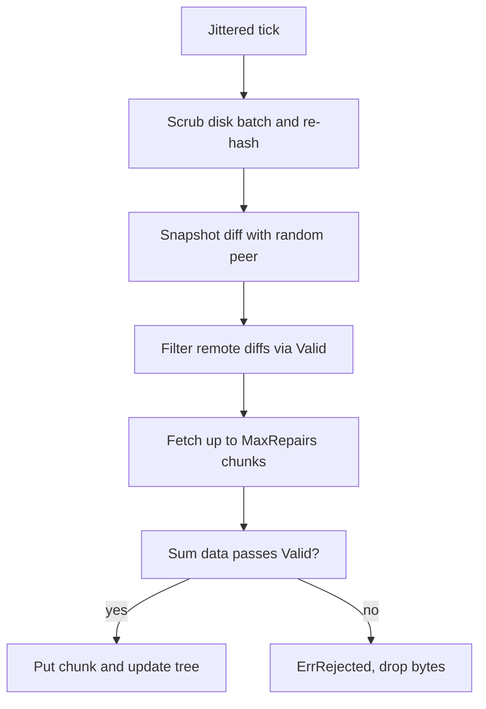

# Merkle-Tree Anti-Entropy

Replicated storage drifts even when writes reach quorum. Partitions hide writes, packet loss drops replicas, and silent bit-rot flips durable bits without an I/O error. Shipping full key inventories wastes bandwidth whenever replicas already agree.

Merkle-tree anti-entropy summarizes each replica's key-to-hash inventory as a hash tree: leaves digest sorted keys and value hashes per partition, and inner nodes digest their children. Two replicas compare 32-byte roots first. Equal roots stop in one message; unequal roots guide a top-down descent down only mismatched branches to the differing leaves, where the node pulls missing or damaged values.

A hash tree alone misses silent bit-rot if leaves only cache write-time hashes. Anti-entropy therefore pairs tree diffs with a scrubber that re-reads stored bytes, recomputes hashes, and updates the tree so damaged blobs diverge from healthy peers.

## How Merkle anti-entropy fits this repository

`internal/merkle` implements the tree, wire framing, diff state machine, and worker. It imports only the standard library and `internal/env`, running unchanged on the virtual clock, transport, disk, and PRNG from [Deterministic Simulation Testing](01-deterministic-simulation.md).

### Persistent fanout-16 trie (`tree.go`)

`Tree` is a fixed-depth radix trie of fanout 16 (`MinDepth = 1`, `MaxDepth = 16`). A key's path is the first 64 bits of `SHA-256(key)` as 16 big-endian nibbles; leaves sit at level `Depth` holding sorted entries for that prefix. `DepthFor(n)` chooses the smallest depth with `16^depth >= n` (3 for 1,000 keys, 4 for 10,000, 5 for 100,000).

Domain-separated SHA-256 encodings close structural attacks:

- **Leaf:** `SHA-256(0x00 || u32be(count) || for each entry: u32be(len(key)) || key || hash[32])`.
- **Inner (level `l`):** `SHA-256(0x01 || u8(l) || 16 × childHash[32])`, with 32 zero bytes for empty children.

Empty subtrees are `nil` and hash to `Hash{}`. Tag `0x00`/`0x01` separates leaves from inner nodes; the level byte separates depths; explicit counts and length-prefixed keys prevent boundary ambiguity and distinguish a present zero-hash key from an absent key. Comparing differing depths returns `ErrDepth`.

Nodes are immutable: `Set` and `Delete` copy O(depth) nodes along one path, making `Snapshot()` O(1) so diffs read a frozen local view. `Build` constructs a tree bottom-up (rejecting duplicate keys with `ErrKey`). Keys cap at `MaxKeyLen = 1,024` bytes and leaves at `MaxLeafEntries = 4,096` (`ErrLeafFull`).

### Level-by-level diff protocol and wire format (`diff.go`, `wire.go`, `errors.go`)

`Session` (`Tree.Diff(Limits)`) drives the initiator; `Tree.Answer([]byte)` is a stateless responder so vanished peers leak nothing; `Compare` runs both in memory.



<!-- draw-visual: diagrams/04-diff-exchange.mmd -->
```text
┌───────────┐     ┌───────────┐
│ Initiator │     │ Responder │
└─────┬─────┘     └─────┬─────┘
      │                 │
      │ L0: depth + root (35 B)
      ├────────────────►│
      │                 │
      │ equal (1 B) or 16 child hashes
      │◄┈┈┈┈┈┈┈┈┈┈┈┈┈┈┈┈┤
      │                 │
      │ L1..D-1: mismatched paths
      ├────────────────►│
      │                 │
      │ bitmap + non-zero child hashes
      │◄┈┈┈┈┈┈┈┈┈┈┈┈┈┈┈┈┤
      │                 │
      │ LD: leaf paths (+ resume key)
      ├────────────────►│
      │                 │
      │ leaf entries (0x03 or 0x05 cut)
      │◄┈┈┈┈┈┈┈┈┈┈┈┈┈┈┈┈┤
      │                 │
```

Each request batches all mismatched nodes at one level:

1. **Level 0:** a 35-byte request (`0x01 || depth || 0 || root[32]`). Equal roots get 1 byte (`0x04`); unequal roots get 16 child hashes.
2. **Levels `1..Depth-1`:** strictly increasing path prefixes in `ceil(level/2)` bytes (low nibble zero on odd levels). Replies (`0x02`) carry a `uint16` bitmap per node (bit `15 - i` for child `i`) plus non-zero 32-byte child hashes.
3. **Level `Depth`:** mismatched leaf paths. `packLeaves` packs entries by exact encoded size up to `MaxReplyBytes` (1 MiB). Complete replies use `0x03`; if a leaf overflows remaining space, it is cut with kind `0x05`, and the next request appends `uvarint(len) || lastKey` to resume strictly after `lastKey`.

Every reply obeys `MaxReplyBytes` (1 MiB). Since an inner node encodes to ≤ 514 bytes, `MaxRequestNodes = (MaxReplyBytes - 4) / 514 = 2,040`, capping inner replies at 1,048,564 B and requests at 17,351 B. `Limits.Frontier` (default 1,024, max 2,040) caps mismatched nodes per level; overflow sets `Result.Truncated` so later rounds catch up.

Decoding enforces minimal `uvarint`s, strictly increasing paths and keys, non-zero inner child hashes, and leaf keys belonging to the requested prefix. `decodeResponse` uses flat `bitmaps`/`hashes` slices and substrings from one input copy (cloning remote-only keys into `Difference`), bounding allocations to `4·len(b) + 64 KiB`. Cut replies (`0x05`) must exceed `MaxReplyBytes - 2,116` B (≥ 990 entries), advance strictly past the resume key, and total ≤ `MaxLeafEntries`, bounding any session to `Depth + 5·Frontier` round trips. Sentinels are `ErrMalformed`, `ErrDepth`, `ErrKey`, `ErrLeafFull`, `ErrRejected`, and `ErrSession`; `CodeEntries()` registers `CodeMalformed` (112) and `CodeDepth` (113) in `env.CodeTable`.

### Background scrubber and repair worker (`worker.go`)

`Worker` connects to a node through `Membership` (`Peers()`) and `Repairer` (`Keys`, `Read`, `Valid`, `Fetch`, `Put`). The tree is never persisted; `Start()` scans and hashes every blob from `Repairer.Keys()` so no on-disk tree can rot. Writes call `Record`/`Forget`; `OnRequest` serves incoming diffs from the live tree.



<!-- draw-visual: diagrams/04-worker-loop.mmd -->
```text
┌──────────────────────────────┐
│        Jittered tick         │
└───────────────┬──────────────┘
                ▼
┌──────────────────────────────┐
│ Scrub disk batch and re-hash │
└───────────────┬──────────────┘
                ▼
┌──────────────────────────────┐
│Snapshot diff with random peer│
└───────────────┬──────────────┘
                ▼
┌──────────────────────────────┐
│Filter remote diffs via Valid │
└───────────────┬──────────────┘
                ▼
┌──────────────────────────────┐
│Fetch up to MaxRepairs chunks │
└───────────────┬──────────────┘
                ▼
┌──────────────────────────────┐
│    Sum data passes Valid?    │
└───────────────┬──────────────┘
                │
                ├───────────────────────────────┐
                │                               │
               yes                             no
                │                               │
                ▼                               ▼
┌──────────────────────────────┐    ┌───────────────────────┐
│  Put chunk and update tree   │    │ErrRejected, drop bytes│
└──────────────────────────────┘    └───────────────────────┘
```

Each jittered tick (`[Period/2, 3·Period/2)` from `env.Rand`, default `Period = 1 s`) runs two steps:

1. **Scrub:** advance a cursor over the sorted union of `Repairer.Keys()` and `tree.Keys()`, re-hashing `ScrubBatch` keys (default 64). Changed bytes update the tree (`Changed`); missing or unreadable blobs are dropped (`Dropped`, non-`ErrNotFound` in `ReadErrors`).
2. **Diff and pull repair:** if idle, pick a peer uniformly from sorted, deduplicated `Membership.Peers()` minus self, diff a `Snapshot()` under `Timeout` (500 ms) and `RoundDeadline` (`10 × Period`), filter remote diffs through `Valid(key, remoteHash)` and the live tree, and fetch up to `MaxRepairs` (256; extras `Deferred`). Only bytes passing `Valid(key, Sum(data))` reach `Put` and the tree; failures record `ErrRejected`.

A generation counter `gen` drops late callbacks after a deadline or `Stop()`. `Stop()` cancels timers, fails any active round with `env.ErrClosed` while preserving cost stats, and lets `Start()` rescan and resume.

### Design choices and what each costs

- **In-memory tree rebuilt at `Start`.** Eliminates stored-tree corruption; costs a full disk re-hash on startup and `O(N log N)` key listing/sorting per scrub tick.
- **Fixed-depth fanout-16 trie over `SHA-256(key)`.** Order-independent, shallow, O(1) snapshots; peers must match `Depth` (`ErrDepth` otherwise) and prefix-ground keys can raise `LeafLoad` up to 4,096.
- **Stateless responder.** Zero per-peer server memory; concurrent remote writes during a diff can miss or surface extra keys until the next round.
- **Single 1 MiB reply cap with cut-and-resume.** Bounds every frame and decode allocation; leaf payloads over 1 MiB need extra round trips.
- **Pull-only, add-only repair.** `Valid` stops lying peers from writing bad bytes; deletes require tombstones or shard manifests (from [Reed-Solomon Erasure Coding](03-reed-solomon-erasure-coding.md)), which arrive with SWIM gossip and shard GC in coming chapters.

### Testing on the simulator

`store_test.go` implements a content-addressed `chunkStore` (`chunk/<hex(SHA-256(bytes))>`, `Valid` checks `key == hash.String()`) multiplexing Merkle (`'M'`), fetch (`'G'`), and write (`'P'`) RPCs via `env.WithNet`. Four DST suites run 3-node clusters (48 chunks of 64–1,024 B, depth 2, 500 ms period, 250 ms timeout, scrub batch 16) under `simtest.RequireDeterministic`:

- `TestBitRotRepairDST`: three 4 s bit-rot phases during writes (`MaxDamagedPerGroup = 2`), checking scrub detection, repair within `BitRotRepairBound` (20 s), convergence within `BitRotConvergeBound` (25 s), and fetches ≤ `RepairCopiesPerRot` (4×) rotted bytes; plus `cleanRun` requiring zero fetches over `CleanWatch` (10 s) after `CleanSettle` (600 ms). Pinned seed `66014753249261` flipped one bit twice 310 ms apart on `n001` (bytes valid again while `Disk.Damaged()` stayed set until `Sync`), so the oracle verifies actual disk bytes alongside `Damaged()`.
- `TestMissedWriteRepairDST`: 5 s single-node isolation during writes; convergence within `MissedWriteBound` (20 s).
- `TestRepairUnderLossDST`: persistent 20% link loss (`LossPPM = 200,000`); checks retries, `Rounds == Completed + Failed + InFlight`, and convergence within `LossConvergeBound` (60 s).
- `TestLyingPeerDST`: three honest nodes beside a liar (garbage, `ErrDepth`, fabricated trees, bad chunks) plus a lone liar verifying `ErrRejected` and an empty disk.

`TestScrubRefillsAWipedDiskDST` tests wipe recovery and read errors. `TestCanarySkippedBranch` toggles `SetSkipBranch` to ignore child 15, verifying baseline convergence on seeds 1–3 and `sim.ErrDeadline` stalls with the bug.

## Key pieces in code

Domain-separated leaf hashing in [`internal/merkle/tree.go`](../../internal/merkle/tree.go) tags leaves with `0x00`, explicit count, and length-prefixed keys:

```go
func leafHash(es []Entry) Hash {
	size := 5
	for _, e := range es {
		size += 4 + len(e.Key) + len(e.Hash)
	}
	buf := make([]byte, 0, size)
	buf = append(buf, tagLeaf)
	buf = binary.BigEndian.AppendUint32(buf, uint32(len(es)))
	for _, e := range es {
		buf = binary.BigEndian.AppendUint32(buf, uint32(len(e.Key)))
		buf = append(buf, e.Key...)
		buf = append(buf, e.Hash[:]...)
	}
	return sha256.Sum256(buf)
}
```

Inner-node hashing in [`internal/merkle/tree.go`](../../internal/merkle/tree.go) binds `0x01` and the level byte, collapsing empty nodes to `nil`:

```go
func newInner(level int, kids *[Fanout]*node) *node {
	var buf [2 + Fanout*32]byte
	buf[0], buf[1] = tagInner, byte(level)
	empty := true
	for i, k := range kids {
		if k != nil {
			empty = false
			copy(buf[2+32*i:], k.hash[:])
		}
	}
	if empty {
		return nil
	}
	return &node{hash: sha256.Sum256(buf[:]), kids: kids}
}
```

`Session.Feed` in [`internal/merkle/diff.go`](../../internal/merkle/diff.go) accounts costs, rejects under-full cut replies, applies the level, and advances:

```go
func (s *Session) Feed(b []byte) error {
	if s.done || s.req == nil {
		return fmt.Errorf("merkle: feed at level %d: %w", s.level, ErrSession)
	}
	s.cost.RoundTrips++
	s.cost.BytesReceived += len(b)
	resp, err := decodeResponse(b)
	// Require cut leaf replies to be nearly full so a lying peer cannot stretch
	// one leaf into unbounded tiny continuations.
	if err == nil && resp.more && len(b) <= minCutReply {
		err = malformed("a cut leaf reply that is not full")
	}
	if err != nil {
		return s.fail(fmt.Errorf("merkle: diff level %d: %w", s.level, err))
	}
	if err := s.apply(resp); err != nil {
		return s.fail(fmt.Errorf("merkle: diff level %d: %w", s.level, err))
	}
	s.req = nil
	s.advance()
	return nil
}
```

`diffLeaf` in [`internal/merkle/diff.go`](../../internal/merkle/diff.go) merges sorted leaves, cloning remote-only keys so finished sessions do not pin wire buffers:

```go
func diffLeaf(local, remote []Entry, out []Difference) []Difference {
	i, j := 0, 0
	for i < len(local) || j < len(remote) {
		switch {
		case j == len(remote) || (i < len(local) && local[i].Key < remote[j].Key):
			out = append(out, Difference{Key: local[i].Key, Local: local[i].Hash, HasLocal: true})
			i++
		case i == len(local) || remote[j].Key < local[i].Key:
			out = append(out, Difference{Key: strings.Clone(remote[j].Key), Remote: remote[j].Hash, HasRemote: true})
			j++
		default:
			if local[i].Hash != remote[j].Hash {
				out = append(out, Difference{Key: local[i].Key, Local: local[i].Hash, Remote: remote[j].Hash, HasLocal: true, HasRemote: true})
			}
			i++
			j++
		}
	}
	return out
}
```

## What the tests show, and what they do not

All measurements were recorded in the 4-core Docker development container:

- **Diff cost (`MERKLE_MEASURE=1`, `TestMeasureDiffCost`).** In-sync rounds take 1 round trip, 1 hash, and 36 bytes. Divergent runs (`object-%07d`, `d` changes split across updates, deletes, and inserts) stay well under the exact bound:

| N | Depth | d | Trips | Hashes | Exact bound | Leaf load | Sent+Recv B |
|---|---|---|---|---|---|---|---|
| 1,000 | 3 | 1 | 4 | 38 | 53 | 4 | 51+1,218 |
| 1,000 | 3 | 10 | 4 | 212 | 521 | 4 | 86+6,967 |
| 1,000 | 3 | 100 | 4 | 713 | 5,201 | 4 | 345+24,255 |
| 10,000 | 4 | 1 | 5 | 51 | 68 | 3 | 57+1,639 |
| 10,000 | 4 | 10 | 5 | 323 | 671 | 3 | 108+10,478 |
| 10,000 | 4 | 100 | 5 | 1,851 | 6,701 | 3 | 548+60,704 |
| 100,000 | 5 | 1 | 6 | 65 | 85 | 4 | 64+2,092 |
| 100,000 | 5 | 10 | 6 | 452 | 841 | 4 | 142+14,629 |
| 100,000 | 5 | 100 | 6 | 3,017 | 8,401 | 4 | 842+98,130 |

- **DST 500-seed sweeps (base `987654321`, 394 s; also verified at base `79988930801092`, 450 s).** Maxima vs bounds: `BitRotRepairBound` **4.98 s** / 20 s; `BitRotConvergeBound` **2.81 s** / 25 s; `MissedWriteBound` **2.70 s** / 20 s; `LossConvergeBound` **41.97 s** / 60 s (geometric tail at 20% loss); `LyingConvergeBound` passed all 500 seeds (30 s bound); `refillBound` **2.80 s** / 30 s; `RepairCopiesPerRot` **0.99** total, **1.12** worst seed / 4× (total < 1 since two rots on one blob before repair count twice). `cleanRun` fetched **0** bytes after `CleanSettle` (600 ms) over `CleanWatch` (10 s) on every seed.
- **Properties, fuzzing, race, coverage.** All `rapid` properties passed at 2,000 checks (123 s). `FuzzMerkleWire` and `FuzzMerkleDiff` ran 30 s each with 0 crashers after fixing a decoder panic on a truncated inner bitmap (`testdata/fuzz/FuzzMerkleWire/2104aef022c948e1`). `go test -race` passed (88 s; earlier caught an 83,856 B minimal-varint allocation across 2,040 empty leaves, fixed via zero-alloc `uvarintLen64`). Coverage is **97.6%** (97.3% in a second container run); `gofmt`, `go vet`, `detlint`, `paniccheck`, and stdlib + `internal/env` imports are clean.
- **Adversarial harness (`agent_work/adversarial/03-merkle/`).** 74 checks (40 independent + 34 regression): run 1 scored 70 held, 4 broken (C8, C12, C21, C31); run 2 scored **72 held, 2 broken**. Fixed: `single-leaf-reply-size` (C8: 992 × 1,024 B keys emitted 1,049,541 B; fixed via cut-and-resume, lowering `MaxRequestNodes` from 16,384 to 2,040 so inner replies drop from ~8.03 MiB to ≤ 1,048,564 B, and bounding decode allocations) and `batched-round-trip-bound` (C12: 984 × 1,024 B keys at depth 1 fit one 1,041,091 B reply in 2 trips instead of 3). C21 (`sim-prefix-reply-tight-bound`) and C31 (`clustered-hash-cost`) remain marked broken against the unmodified harness because they pin the earlier claims narrowed below.

### Narrowed claims

1. **Round-trip count.** Equal roots take 1 round trip. Otherwise, an honest responder (`Tree.Answer`) takes exactly `Depth + L` trips (`L >= 1` leaf replies): `L = 1` iff combined leaf payload `S` for `F` leaves satisfies `S + 2 + uvarint(F) <= MaxReplyBytes`, and `L <= ceil(S / 1,047,510)` always (non-final leaf replies exceed `MaxReplyBytes - 1,060` B). Any responder — lying, mutating, cutting, or one-leaf-per-reply — ends within `Depth + 5·F <= Depth + 5·Frontier` trips (≤ `F` leaf completions + 4 full cut continuations per leaf). *Why:* an earlier "≤ depth" / "≤ Depth + 1" wording overlooked that a depth-`D` trie has `D + 1` levels, leaf payloads > 1 MiB need extra replies, and a one-leaf-per-reply peer takes `Depth + F` trips (3 for two leaves at depth 1 in C21) while converging.
2. **Hash-comparison cost.** Exact count is `1 + Σ(non-empty remote children of mismatched inner nodes) + Σ(remote entries of mismatched leaves)`, bounded by `1 + 16·d·Depth + d·LeafLoad(remote)`. `16·d·(Depth + 1)` holds only for `LeafLoad <= 15`. *Why:* every entry in a mismatched leaf travels in its reply; 46 keys in one depth-2 leaf with one changed hash cost `1 + 1 + 1 + 46 = 49 > 48` (C31; pinned at 45 → 48 vs 46 → 49).
3. **Zero traffic without damage.** With no injected faults, zero chunk bytes move during `CleanWatch` (10 s) after `CleanSettle` (600 ms, 2× store timeout). *Why:* measuring from `t = 0` could catch a worker pulling an in-flight replicated write across asymmetric latencies.

### What the tests do not prove

Everything is proven on `internal/sim` against an add-only, content-addressed `chunkStore`, not real OS disks, TCP sockets, or a multi-goroutine node. Concurrent responder writes are not snapshot-isolated across round trips (stragglers settle on later ticks). Deletes and tombstones are unimplemented, and scrubbing sorts all keys per tick (`O(N log N)`). Integration with shard manifests, SWIM membership, tombstones, shard GC, and real-runtime transports waits for coming chapters.

## Go deeper in the repo

- **Implementation:** [`internal/merkle/tree.go`](../../internal/merkle/tree.go), [`internal/merkle/wire.go`](../../internal/merkle/wire.go), [`internal/merkle/diff.go`](../../internal/merkle/diff.go), [`internal/merkle/worker.go`](../../internal/merkle/worker.go), [`internal/merkle/errors.go`](../../internal/merkle/errors.go).
- **Tree, wire, and bound tests:** `TestRootKnownVectors`, `TestInsertDeleteUpdate`, `TestEmptyAndSingle`, `TestNewAndDepthFor`, `TestKeyLimits`, `TestLeafFull`, `TestSnapshotIsolation` ([`internal/merkle/tree_test.go`](../../internal/merkle/tree_test.go)); `TestWireTable`, `TestWireMalformed` ([`internal/merkle/wire_test.go`](../../internal/merkle/wire_test.go)); `TestReplySizeBound`, `TestPropReplySizeBound`, `TestPropDecodeAllocationBound` ([`internal/merkle/replysize_test.go`](../../internal/merkle/replysize_test.go)); `TestDiffProtocolSteps`, `TestDiffLeafRepliesAreBatched`, `TestDiffFrontierTruncates`, `TestDiffErrors` ([`internal/merkle/diff_test.go`](../../internal/merkle/diff_test.go)); `TestDiffBoundsPinned`, `TestDiffRejectsCheapCuts`, `TestDiffRejectsARepeatedPiece`, `TestPropLongKeyDiffShape` ([`internal/merkle/bounds_test.go`](../../internal/merkle/bounds_test.go)).
- **Properties, worker, DST, and canary:** `TestPropDiffComplete`, `TestPropDiffCost`, `TestPropRootIffEqual`, `TestPropIncrementalEqualsRebuild`, `TestPropOrderIndependent`, `TestPropHostileRepliesEndTheSession` ([`internal/merkle/prop_test.go`](../../internal/merkle/prop_test.go)); `TestCodeEntries`, `TestErrorPeerVanishesMidDiff`, `TestErrorMalformedNode`, `TestErrorDepthOverflow`, `TestNewWorkerValidation`, `TestScrubRefillsAWipedDiskDST` ([`internal/merkle/worker_test.go`](../../internal/merkle/worker_test.go)); `TestWorkerStop`, `TestWorkerStopBeforeStart`, `TestWorkerStopFromInsideATick`, `TestRoundDeadlineKeepsCost`, `TestTruncatedRoundIsNotInSync`, `TestCodeRange` ([`internal/merkle/lifecycle_test.go`](../../internal/merkle/lifecycle_test.go)); `TestBitRotRepairDST`, `TestMissedWriteRepairDST`, `TestRepairUnderLossDST`, `TestLyingPeerDST` ([`internal/merkle/dst_test.go`](../../internal/merkle/dst_test.go)); `TestCanarySkippedBranch`, `TestMeasureDiffCost` ([`internal/merkle/canary_test.go`](../../internal/merkle/canary_test.go)); test store in [`internal/merkle/store_test.go`](../../internal/merkle/store_test.go).
- **Fuzz targets:** `FuzzMerkleWire` ([`internal/merkle/wire_test.go`](../../internal/merkle/wire_test.go)), `FuzzMerkleDiff` ([`internal/merkle/prop_test.go`](../../internal/merkle/prop_test.go)).
- **Adversarial harness and results:** `agent_work/adversarial/03-merkle/` (`ATTACKS.md`, `RESULTS.md`, and `run-all.sh`).

Replay the pinned double-flip bit-rot seed or print the measured diff-cost table:

```sh
docker compose run --rm dev go test ./internal/merkle -run '^TestBitRotRepairDST$' -seed=66014753249261 -v -count=1
docker compose run --rm -e MERKLE_MEASURE=1 dev go test ./internal/merkle -run '^TestMeasureDiffCost$' -v -count=1
```

## Sources and further reading

- **Ralph C. Merkle, "A Digital Signature Based on a Conventional Encryption Function" (CRYPTO, 1987).** The hash-tree construction authenticating a set of values under one root digest.
- **Giuseppe DeCandia et al., "Dynamo: Amazon's Highly Available Key-value Store" (SOSP, 2007).** Background anti-entropy replica synchronization with Merkle trees without shipping full inventories.
- **Apache Cassandra documentation on Anti-Entropy Repair.** Trade-offs in per-token-range Merkle trees, tree depth versus repair granularity, and rebuild/streaming cost.
- **Riak Active Anti-Entropy (AAE) architecture write-ups.** Continuous background hash-tree exchange and periodic rebuilds to catch silent loss and missed writes without manual repairs.
- **Ben Laurie, Adam Langley, and Emilia Käsper, RFC 6962: Certificate Transparency (2013).** One-byte domain separation (`0x00` for leaves, `0x01` for inner nodes) against second-preimage tree-structure attacks.
