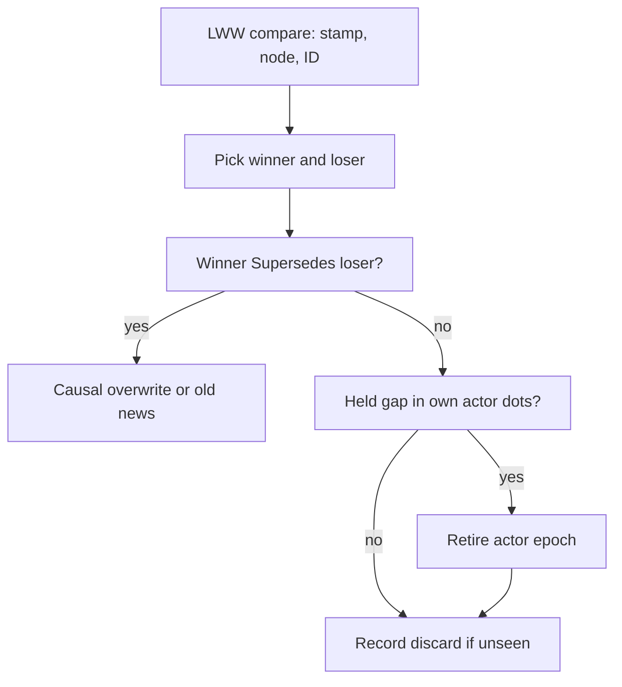
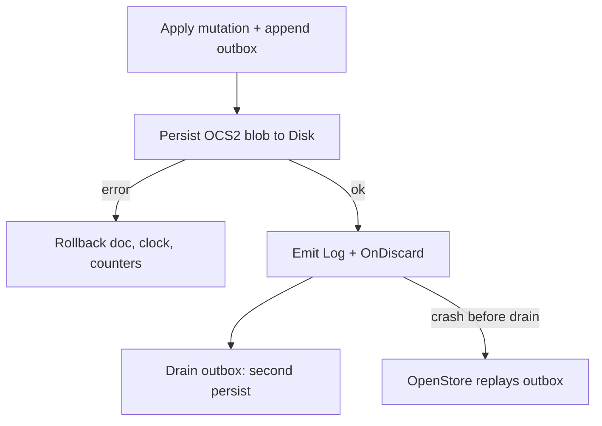

# Optimistic Concurrency Control

Metadata in an object store — object records, manifests, tags, ACLs, routes, and quotas — is updated concurrently without distributed locks. Optimistic concurrency control (OCC) replaces locks with conditional writes. A reader fetches a key's value and opaque **ETag**, and a writer sends `If-Match: <etag>` (still this version) or `If-None-Match: *` (absent or deleted). On one replica that check is atomic: of two writers holding the same ETag, one wins and the other gets `ErrPreconditionFailed`, changing nothing.

A precondition guards only against writers this replica has heard from. Across a partition, both sides validate locally and acknowledge writes. On reconnect, **last-writer-wins (LWW)** decides. Every replica keeps **one version per key** (value or tombstone). The higher hybrid logical clock (HLC) stamp wins, node ID breaks ties, and SHA-256 version ID bytes break any remaining tie. Every replica picks the same winner without coordination and converges byte for byte; the loser is discarded.

**An acknowledged write can be lost to a concurrent write under partition; the system guarantees convergence and a record of the loss, not preservation.** In deliberately contested 500-seed sweeps, 13,999 of 51,161 acknowledged writes (~27.4%) ended discarded on record in a 6-node multi-region chaos workload (partitions, crashes, blind writes, stale `If-Match`, 3 disk losses/run; 751 more lost with a disk), and 10,798 of 74,443 (~14.5%) in a 60 s offline-region workload using conditional writes only.

Two roads were not taken: **CRDTs** (the original specification), which merge concurrent updates per type at the cost of semantic complexity and growing removal metadata; and **Dynamo/Riak-style sibling versions** (an earlier design, rejected), which surface concurrent writes to readers as co-equal versions — judged a bad fit for a store whose callers expect one value or `ErrNotFound`.

Every concurrent discard is counted and emitted (log line and callback), with replay from a persisted outbox after a crash, whether a node replaces a held version or rejects an incoming loser. The same loss may be recorded on more than one node and, past a bounded 256-entry FIFO de-duplication window, more than once on one node — an over-count, never an under-count. Records are local observations, not replicated and not a permanent archive (`DiscardTail` keeps 64 entries). The one loss with no record is a version whose every holder lost its disk before passing it on. Version vectors only classify a replacement or rejection as an ordinary overwrite (or old news) versus a discard; they never pick the winner.

## How optimistic concurrency control maps to this repository

One package, [`internal/occ`](../../internal/occ/store.go), implements versions, HLCs, version vectors, canonical encoding, transactions, discard recording, quota CAS, typed keys, and a push-pull replicator over `internal/env`, running unchanged on [Deterministic Simulation Testing](01-deterministic-simulation.md).

### One version per key, LWW order, and HLC (`hlc.go`, `version.go`, `record.go`, `doc.go`)

`Doc` maps keys to one `Version` with cached sorted keys, wire bytes, and SHA-256 digest. A `Version` carries a `Dot{Actor, Counter}`, causal context (`VersionVector`), `Tombstone` flag, value bytes, HLC `Stamp{Wall, Logical, Node}`, and 32-byte `VersionID` (SHA-256 of actor, counter, and a hash of context, tombstone, stamp, and value).

`Version.Compare` orders by `Stamp.Compare` (`Wall`, `Logical`, `Node`) then `VersionID`; `Record.Merge` takes the maximum (commutative, associative, idempotent, total). Tombstones compete identically with live values, and scalars (`SetScalar`, `SetRoute`, `SetContentType`) are unconditional puts so concurrent scalar overwrites are recorded too. `ETag` is `Version.ID()`: identical across replicas, unique per write even with equal bytes, present on tombstones (returned with `ErrNotFound` on `Get`), and zero when absent.

A local write sets context to `held.v.Clock()` and stamp to `max(HLC.Now(), successor(held.stamp))` without advancing the node's HLC to `successor`. `HLC.Observe` checks every stamp in sorted key order, refusing stamps beyond `MaxClockLead` (1 h) ahead of local time (`AheadStamps++`) without hiding other stamps. A far-future stamp pins only its own key; local causal writes still beat it via `successor`, and only `(MaxInt64, MaxUint32)` returns `ErrClockExhausted`.

### Version vectors as classifier and actor epoch retirement (`vv.go`, `version.go`, `store.go`)

An `Actor` is `(NodeID, Epoch)` and a version's event set is `downset(ctx) ∪ {dot}`. After LWW picks winner and loser, `Version.Supersedes` tests strict inclusion via a linear two-pointer `descends` scan:



<!-- draw-visual: diagrams/05-merge-classify.mmd -->
```text
┌────────────────────────────┐
│LWW compare: stamp, node, ID│
└──────────────┬─────────────┘
               ▼
┌────────────────────────────┐
│   Pick winner and loser    │
└──────────────┬─────────────┘
               ▼
┌────────────────────────────┐
│  Winner Supersedes loser?  │
└──────────────┬─────────────┘
               │
               ├──────────────────────────────────┐
               │                                  │
              yes                                no
               │                                  │
               ▼                                  ▼
┌────────────────────────────┐      ┌───────────────────────────┐
│Causal overwrite or old news│   yes┤Held gap in own actor dots?│
└────────────────────────────┘   │  └─────────────┬─────────────┘
                                 │                │
               ┌─────────────────┘               no
               ▼                                  ▼
┌────────────────────────────┐      ┌───────────────────────────┐
│     Retire actor epoch     ├─────►│  Record discard if unseen │
└────────────────────────────┘      └───────────────────────────┘
```

Strict inclusion means a causal overwrite (held replaced) or old news (incoming rejected), recording nothing. Anything else — concurrent writes, equal event sets, or a forged winner causally below its loser — records a discard.

Plain version vectors encode contiguous downsets `1..N` per actor, creating two dot-reuse hazards:

1. **Gap inflation after a discard.** If node `a` writes `(a@e, 2)`, loses it to a concurrent winner, and later writes `(a@e, 3)` and `(a@e, 4)`, `(a@e, 4)`'s context carries `a@e:3`, falsely claiming `(a@e, 2)` and silencing discards on peers holding `(a@e, 2)`. Whenever a concurrent replacement drops a held version with `loser.clockAt(s.actor) > winner.clockAt(s.actor)`, the store retires its epoch (fresh random epoch, counter 0, `Rotations++`) so no future downset spans the gap.
2. **Wiped or corrupted disk.** Starting without readable `occ/state` draws a fresh random epoch from `env.Rand` so post-wipe writes never impersonate causal successors of pre-wipe writes. Read errors (`env.ErrIO`) never guess: the node stays `ErrNotReady` and retries every `LoadRetry` (100 ms).

### Transactions, crash-safe outbox, and encoding (`store.go`, `doc.go`, `encoding.go`)

Every mutation runs as a snapshot-and-restore transaction (`begin`, `touch`, `end`, `rollback`) saving touched keys, actor, counter, rotations, ahead/discard counts, HLC state, and (on first discard) `tail`, `outbox`, and `seen`.



<!-- draw-visual: diagrams/05-persist-outbox.mmd -->
```text
┌──────────────────────────────┐
│Apply mutation + append outbox│
└───────────────┬──────────────┘
                ▼
┌──────────────────────────────┐
│  Persist OCS2 blob to Disk   │
└───────────────┬──────────────┘
                │
                ├───────────────────────────────┐
                │                               │
              error                            ok
                │                               │
                ▼                               ▼
┌──────────────────────────────┐   ┌────────────────────────┐
│Rollback doc, clock, counters │   │  Emit Log + OnDiscard  │
└──────────────────────────────┘   └────────────┬───────────┘
                                                │
                ┌───────────────────────────────┤
                │                               │
                │                      crash before drain
                │                               │
                ▼                               ▼
┌──────────────────────────────┐   ┌────────────────────────┐
│ Drain outbox: second persist │   │OpenStore replays outbox│
└──────────────────────────────┘   └────────────────────────┘
```

Discards append to `outbox`, `tail` (64 entries), and the 16-byte-hash `seen` FIFO (256 entries) *before* `Persist` syncs `OCS2` (`"OCS2" || SHA-256(payload) || payload`). Failed persists roll back everything and emit nothing. After sync, `emit` writes deterministic log lines (`occ: lww discard key="..." loser=... loser_stamp=... loser_writer=... winner=... winner_stamp=...`) and calls `OnDiscard`, then `drain` clears the outbox in a second write (keeping up to `DiscardOutboxLen` = 1,024 emitted records on drain error). `OpenStore` and `Node.Start` replay undrained records (**at-least-once** across crashes, never double-incrementing `LWWDiscards`).

Wire documents (`OCC\x02`) require strictly increasing keys and context entries; `Decode` bounds counts by remaining bytes, rejects repeated keys immediately, stops building on error, and requires `Encode(doc) == input`.

### Typed metadata, quotas, and replicator (`meta.go`, `quota.go`, `wire.go`, `node.go`, `errors.go`)

`meta.go` defines seven length-prefixed key kinds (`KindTag`, `KindACL`, `KindQuota`, `KindObject`, `KindManifest`, `KindRoute`, `KindContentType`), read-only `Reader` accessors, and durable, broadcasting writes on `*Node` (`Node` never exposes `*Store`).

`quota.go` enforces CAS on `Usage{Bytes, Objects}`: `WriteQuota` refuses unconditional writes, `UpdateQuota` retries only `ErrPreconditionFailed`, and `AddUsage`/`Reader.RecountObjects` use checked 64-bit math (`ErrUsageOverflow` on wrap). After a partition, a quota key's `OnDiscard` drives `RecountQuota`; when recounted usage already matches stored usage, `RecountQuota` re-reads the key to verify its version held (retrying if stale, writing nothing if unchanged), so concurrent recounts settle in two rounds.

`Node` (`env.Process`) broadcasts a single-key `msgDelta` (`DefaultMaxDelta` = 60,000 B) to `DefaultFanout` (2) random peers after writes, and every `DefaultPeriod` (500 ms ±50%) sends its 32-byte digest (`msgDigest`) to a random peer from sorted, de-duplicated `Membership.Peers()`. On mismatch, the peer returns its document; the caller merges and sends `msgPush` if digests still differ. Error codes occupy `128–143` (`occ.Codes()`); `131` is unassigned.

### Design choices and what each costs

- **LWW with discard recording over CRDTs or siblings.** Simple total-order merge and single-value reads; costs lost partitioned writes and local, at-least-once discard records that can over-count.
- **Epoch retirement over gap-aware dotted vectors.** Keeps plain downsets, wire format, and linear `descends`; costs one context entry per gap-creating discard on the writer's node.
- **Undo log plus outbox drain.** `O(changed keys)` rollback instead of `O(doc)` copy; costs a second persist to drain the outbox after discards.
- **Permanent tombstones and full-state push-pull.** Tombstones are never collected (safe GC needs membership history), and anti-entropy sends full documents (`O(doc)`). Merkle-tree sync, SWIM membership, and recount scheduling arrive in coming chapters.

### Testing on the simulator

Five suites run `Node` on `internal/sim`: `TestMultiRegionConvergenceDST` (6 nodes, 3 regions, ±400 ms skew, ±2,000 ppm drift, 2% drop, 5% dup, 3 nemesis phases, mixed writes, 3 disk losses/run — wipe, state bit-rot, permanent crash+wipe), `TestWriterLostAfterDeliveryDST` (4 nodes, 2 regions, writer 3 s behind, 6 rounds losing its disk after peers receive its concurrent deltas), `TestOfflineRegionDST` (region `c` offline 60 s, conditional writes only), `TestConditionalWriteRaceDST` (two writers sharing an ETag on one node vs across a partition), and `TestQuotaOvershootUnderPartitionDST` (4 writers, 1,000 B limit, 100 B objects, `OnDiscard`-driven recounts). An independent seen-set oracle tracks ancestry from held version IDs and receiving incarnations from delivered documents; three canaries confirm it catches silent discards, silent incoming-loser drops, and arrival-order merges.

## Key pieces in code

Local preconditions check the single held record in [`internal/occ/record.go`](../../internal/occ/record.go):

```go
func (p Precondition) Holds(r Record) bool {
	switch p.kind {
	case preIfMatch:
		return r.ok && r.ETag() == p.etag
	case preIfNoneMatch:
		return !r.Live()
	}
	return true
}
```

Merging two records is the pure LWW maximum under `Version.Compare` (`Stamp` then `VersionID`), in [`internal/occ/record.go`](../../internal/occ/record.go):

```go
func (r Record) Merge(o Record) Record {
	switch {
	case !o.ok:
		return r
	case !r.ok:
		return o
	case o.v.Compare(r.v) > 0:
		return o
	}
	return r
}
```

When a merge replaces a held version, `Store.replaced` in [`internal/occ/store.go`](../../internal/occ/store.go) checks causality, retires the actor epoch on a dot gap, and records the discard (`Store.rejected` runs the same `supersedes` check for rejected incoming versions):

```go
func (s *Store) replaced(u *undo, key string, winner, loser Version) {
	causal, ops := winner.supersedes(loser)
	s.work += ops
	if causal {
		return
	}
	// Retiring the actor epoch prevents a later local write from issuing a higher
	// counter whose downset would falsely claim the discarded dot.
	if loser.clockAt(s.actor) > winner.clockAt(s.actor) {
		s.actor.Epoch = s.freshEpoch()
		s.counter = 0
		s.rotations++
	}
	if canaryUnrecordedDiscard {
		return
	}
	s.record(u, key, winner, loser)
}
```

`Store.end` in [`internal/occ/store.go`](../../internal/occ/store.go) rolls back on persist error and emits then drains the outbox only after durable sync:

```go
func (s *Store) end(u *undo, err error) error {
	if err == nil && u.changed && s.persist != nil {
		err = s.persist(s.EncodeState())
	}
	if err != nil {
		s.rollback(u)
		return err
	}
	if len(u.pending) > 0 {
		s.emit(u.pending)
		s.drain()
	}
	return nil
}
```

## What the tests show, and what they do not

Measurements below were recorded in the 4-core Docker container on the current tree:

- **500-seed DST sweeps (`DST_SEEDS=500`, base 1, 241.8 s; gated 500-seed sweep 239 s):**
  - *Multi-region* (1,500 disk losses): 51,161 acks — 3,959 current, 32,452 superseded, 13,999 discarded on record, 751 lost with disk (~0.5/loss). Events/seed p50 100, p99 145, max 152; distinct p50 36, p99 50, max 54; convergence p50 2.25 s, p99 4.32 s, max 4.69 s (bound 15 s); state blob p50 4,799 B, max 7,896 B.
  - *Offline region*: 74,443 acks — 2,000 current, 61,645 superseded, 10,798 discarded, 0 unexplained. Events p50 60, p99 90, max 100; distinct p50 24, p99 35, max 39; region `c` won 834 keys (1–3/seed), lost 3,296 writes (2–14/seed); convergence p50 0.77 s, p99 1.65 s, max 1.79 s.
  - *Writer-loss* (3,000 disk losses): 62,175 acks — 3,878 current, 41,007 superseded, 17,287 discarded, 3 lost with disk before reaching a peer. Events p50 81, max 111; distinct p50 41, max 51; convergence p50 0.81 s, p99 3.02 s, max 3.97 s.
  - *Race and quota*: `TestConditionalWriteRaceDST` passed 500/500 within 10 s. `TestQuotaOvershootUnderPartitionDST`: overshoot p50 1,400 B, p99 2,100 B, max 2,300 B (bound 3,000 B); recounts settled in 2 rounds (bound 6); events p50 16, max 27; distinct p50 8, max 14; convergence p50 0.51 s, max 1.42 s. Counter sums (live + lost disks) matched callbacks and oracle logs on every seed.
- **Epoch-retirement cost.** Disabling retirement shrank max contexts from p50 9→6 (max 15→9) multi-region, 11→4 (16→4) offline, 10→6 (16→8) writer-loss, but broke `TestDiscardGapNeverClaimed`, `TestDotsAreNeverReused`, and `TestPropClassificationMatchesOracle` (5/8 runs at 100 checks; reliably at 2,000, e.g. check 96 on seed 117).
- **Properties, fuzzing, race, coverage, benchmarks, hostile inputs.** All `rapid` properties passed at 2,000 checks (45.3 s); 30 s fuzz targets had 0 crashers and 0 skipped seeds (`FuzzOCCConditionalWrite` 11,740, `FuzzOCCMergeLaws` 17,659, `FuzzOCCDecode` 263,594 execs); `go test -race` passed (34.0 s); coverage 98.5% (`store.go` 100%); all 3 canaries failed 3/3 DST seeds. `BenchmarkMergeDoc` (10% concurrent, 20×): doc merge 2.1 ms / 0.21 MB (1k), 18 ms / 2.0 MB (10k); store merge 4.1 ms / 0.32 MB (1k), 21 ms / 3.4 MB (10k); encode+decode 8.1 ms (1k), 71 ms (10k). `TestHostileMessagesBoundedWork` (16 MiB): many-keys (16,777,138 B) decoded in 31.2 M ops (1.86/B), merged 1.6 M; big-contexts (16,776,993 B) decoded 25.2 M (1.50/B), merged 11.2 M.
- **Adversarial testing.** An independent 61-check harness scored 59 held / 2 broken initially; both defects (`recount-overflow`, wrapping `MaxUint64 + 1`; `recount-stale-noop`, skipping version re-check on a matching read) were fixed and held in run 2 (60 held, 1 broken). The remaining broken check (`partition-two-writer`) asserts `hooks == 1` globally, predating incoming-loser recording: all 10 seeds have 1 distinct lost version, with 1 hook (`1,0`) on 4 seeds (4701, 4703, 4707, 4708) and 2 hooks (`1,1`) on 6 seeds (4702, 4704, 4705, 4706, 4709, 4710).

### Narrowed claims

1. **Emission vs archive and disk loss.** Concurrent discards are counted and emitted at least once with crash replay — local observations, not a replicated or permanent archive (`DiscardTail` holds 64 entries). A version whose every holder loses its disk before passing it on leaves no record.
2. **Counters and de-duplication.** `LWWDiscards` counts local discard events within the 256-entry FIFO, not cluster-wide distinct losses (over-count possible across nodes or after eviction, never under-count); join on `loser=<version ID>`.
3. **Skew and far-future stamps.** "Last" is highest HLC stamp, not real time. Stamps beyond `MaxClockLead` (1 h) increment `AheadStamps` without moving the HLC, pinning only their key; `(MaxInt64, MaxUint32)` bricks only that key (`ErrClockExhausted`).
4. **Epoch-retirement scope.** Supported by the induction invariant, directed tests, and 2,000-check oracle runs, not exhaustive enumeration; DSTs alone do not trigger the two-write gap.

### What the tests do not prove

Everything runs on simulated `env.Disk` and `env.Transport`, not real filesystems, sockets, goroutines, or crashes between `fsync` and log sinks. Tombstones are never collected. Recount scheduling, live SWIM membership, Merkle-tree sync, and integration with [Reed-Solomon Erasure Coding](03-reed-solomon-erasure-coding.md) and [Sagas](06-sagas.md) wait for coming chapters. Because `Version` is a ~150-byte value type, a 16 MiB hostile message allocates linearly in hundreds of megabytes.

## Go deeper in the repo

- **Core and replicator:** [`errors.go`](../../internal/occ/errors.go), [`vv.go`](../../internal/occ/vv.go), [`hlc.go`](../../internal/occ/hlc.go), [`version.go`](../../internal/occ/version.go), [`record.go`](../../internal/occ/record.go), [`doc.go`](../../internal/occ/doc.go), [`encoding.go`](../../internal/occ/encoding.go), [`store.go`](../../internal/occ/store.go), [`quota.go`](../../internal/occ/quota.go), [`meta.go`](../../internal/occ/meta.go), [`wire.go`](../../internal/occ/wire.go), [`node.go`](../../internal/occ/node.go) under `internal/occ/`.
- **Unit, property, and canary tests:** [`store_test.go`](../../internal/occ/store_test.go), [`hlc_test.go`](../../internal/occ/hlc_test.go), [`vv_test.go`](../../internal/occ/vv_test.go), [`quota_test.go`](../../internal/occ/quota_test.go), [`meta_test.go`](../../internal/occ/meta_test.go), [`node_test.go`](../../internal/occ/node_test.go), [`lww2_test.go`](../../internal/occ/lww2_test.go) (`TestDiscardGapNeverClaimed`, `TestIncomingConcurrentLoserIsRecorded`, `TestDiscardRecordSurvivesCrashBeforePublish`, `TestRecountObjectsNeverWraps`, `TestRecountNoopRechecksCurrentVersion`), [`lww2_node_test.go`](../../internal/occ/lww2_node_test.go) (`TestIncomingLoserRecordedWhenWriterIsLost`, `TestDiskLossBeforeReachIsTheOnlyUnrecordedLoss`, `TestNodeReplaysOutboxAfterRestart`), [`prop_test.go`](../../internal/occ/prop_test.go) (`TestPropEveryLossRecorded`, `TestPropCheckAndSetModel`, `TestPropMergeLaws`, `TestPropConvergence`, `TestPropCausalWriteAlwaysWins`, `TestPropNoDiscardWithoutConcurrency`), [`lww2_prop_test.go`](../../internal/occ/lww2_prop_test.go) (`TestPropClassificationMatchesOracle`), [`dst_test.go`](../../internal/occ/dst_test.go), [`lww2_dst_test.go`](../../internal/occ/lww2_dst_test.go).
- **Encoding, fuzzing, and benchmarks:** `TestHostileMessagesBoundedWork` and `FuzzOCCDecode` in [`encoding_test.go`](../../internal/occ/encoding_test.go); `FuzzOCCConditionalWrite` and `FuzzOCCMergeLaws` in [`prop_test.go`](../../internal/occ/prop_test.go); `BenchmarkMergeDoc` in [`bench_test.go`](../../internal/occ/bench_test.go).
- **Adversarial harness:** `agent_work/adversarial/04-occ/` (`ATTACKS.md`, `RESULTS.md`, and `run-all.sh`).

```sh
docker compose run --rm dev go test ./internal/occ -run '^TestMultiRegionConvergenceDST$' -seed=1 -v -count=1
docker compose run --rm dev go test ./internal/occ -run '^$' -bench BenchmarkMergeDoc -benchmem -benchtime 20x
```

## Sources and further reading

- **H. T. Kung and John T. Robinson, "On Optimistic Methods for Concurrency Control" (ACM TODS, 1981).** Read-validate-write concurrency control replacing lock acquisition with commit-time checks.
- **D. Stott Parker Jr. et al., "Detection of Mutual Inconsistency in Distributed Systems" (IEEE TSE, 1983).** Version vectors for distinguishing causal overwrites from concurrent updates across partitions.
- **Sandeep S. Kulkarni et al., "Logical Physical Clocks and Consistent Snapshots in Globally Distributed Databases" (OPODIS, 2014).** Hybrid logical clocks tracking causality while staying bounded to physical time.
- **Roy Fielding, Mark Nottingham, and Julian Reschke, RFC 9110, "HTTP Semantics" (IETF, 2022).** ETags and `If-Match` / `If-None-Match` conditional preconditions.
- **Giuseppe DeCandia et al., "Dynamo: Amazon's Highly Available Key-value Store" (ACM SOSP, 2007).** The sibling-versioning road not taken: exposing concurrent writes to readers for resolution.
- **Marc Shapiro et al., "Conflict-Free Replicated Data Types" (SSS, 2011).** The CRDT road not taken: per-type algebraic merges preserving concurrent writes without discards.
- **Martin Kleppmann, *Designing Data-Intensive Applications* (O'Reilly, 2017).** Chapter 5's critique of last-writer-wins: why simple convergence costs dropped concurrent writes under partition and skew.
