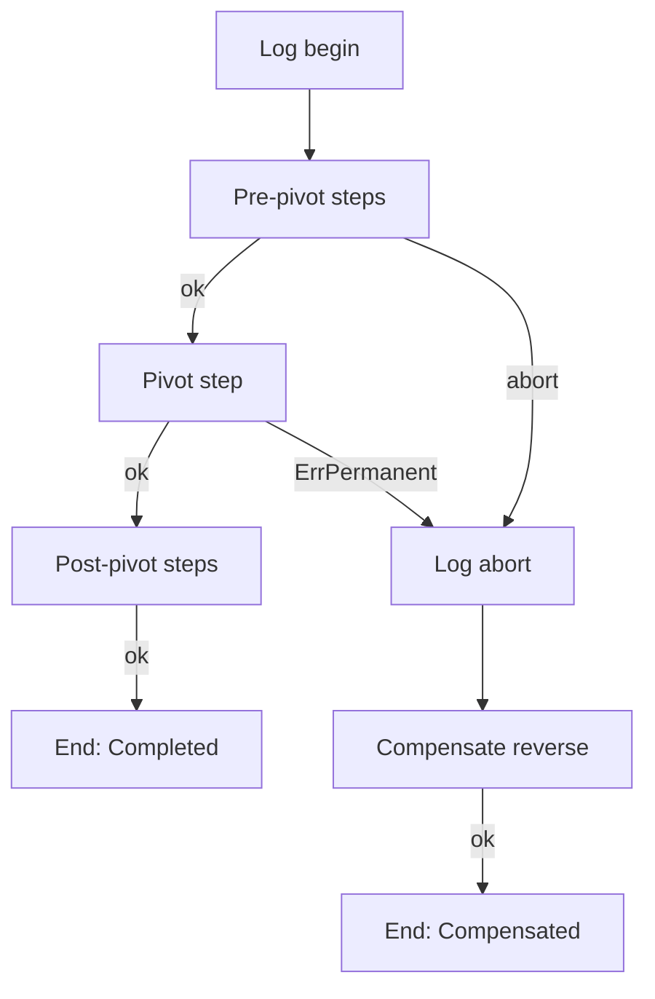
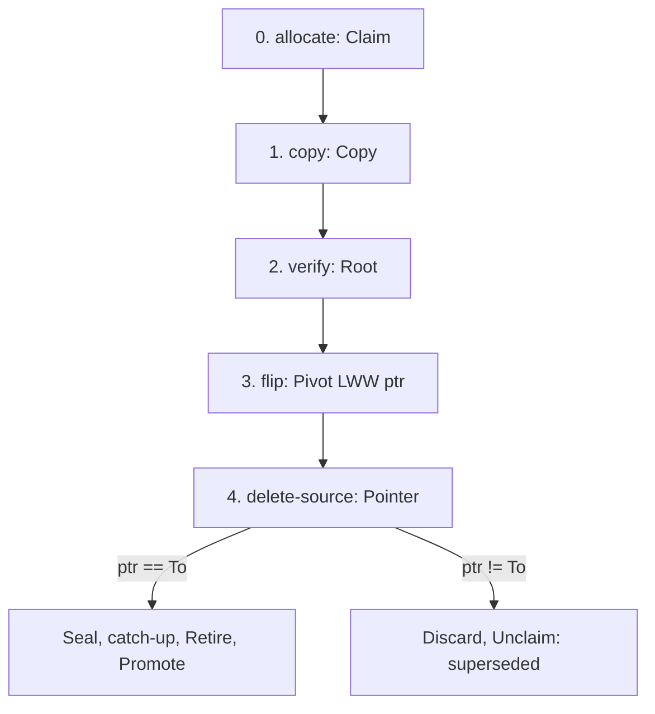

# Sagas

[Optimistic Concurrency Control](05-optimistic-concurrency-control.md) handles single-key metadata via conditional writes and last-writer-wins (LWW) reconciliation, but moving a bucket between regions is not one write. It spans claiming target space, copying objects, checking a Merkle root, flipping the routing pointer, and retiring the source. Distributed locks across a bulk copy stall writers and fail under crashes or partitions.

A **saga** replaces two-phase commit with local steps, each paired with a compensating action that semantically undoes it. Steps commit locally; on a failure before the point of no return, the coordinator runs compensations in reverse order. Two rules make this survive crashes and lost replies:

1. **The pivot step.** One step splits the workflow. Pre-pivot steps are compensable: permanent refusal or exhausted retries abort and roll back. Once the pivot may have applied, rolling back is unsafe, so the coordinator only rolls forward.
2. **Intent-before-action logging and idempotency keys.** Before calling a step, the coordinator durably appends an intent record. After a crash, recovery retries an open intent under the same idempotency key rather than guessing whether the remote store acted.

## How sagas map to this repository

Two packages implement this layer. [`internal/saga`](../../internal/saga/engine.go) holds the engine, append-only checksummed log, pure recovery state machine, retry policy, wire error codes, and five-step bucket-migration workflow. [`internal/saga/sagasim`](../../internal/saga/sagasim/cluster.go) builds a model cluster under deterministic simulation testing ([Deterministic Simulation Testing](01-deterministic-simulation.md)) with an exported failure-point matrix runner and chaos drivers.



<!-- draw-visual: diagrams/06-saga-lifecycle.mmd -->
```text
┌────────────────┐
│   Log begin    │
└────────┬───────┘
         ▼
┌────────────────┐
│Pre-pivot steps ├──────────abort──────────┐
└────────┬───────┘                         │
         │                                 │
        ok                                 │
         ▼                                 ▼
┌────────────────┐               ┌──────────────────┐
│   Pivot step   ├─ErrPermanent─►│    Log abort     │
└────────┬───────┘               └─────────┬────────┘
         │                                 │
        ok                                 │
         ▼                                 ▼
┌────────────────┐               ┌──────────────────┐
│Post-pivot steps│               │Compensate reverse│
└────────┬───────┘               └─────────┬────────┘
         │                                 │
        ok                                ok
         ▼                                 ▼
┌────────────────┐               ┌──────────────────┐
│ End: Completed │               │ End: Compensated │
└────────────────┘               └──────────────────┘
```

Retryable errors at the pivot, any error after it, and any compensation error retry on backoff timers until they succeed.

### Log format and crash recovery

Each saga appends to `<prefix><id>` (default `saga/<id>`) on `env.Disk` ([`log.go`](../../internal/saga/log.go)). Records carry a 13-byte header — magic `0xA5`, big-endian `uint32` payload length, header CRC-32C, payload CRC-32C — plus a varint payload up to `MaxRecord` (1 MiB). Seven kinds trace the lifecycle: `begin`, `intent`, `done`, `abort`, `comp-intent`, `comp-done`, and `end`.

`DecodeLog` separates torn appends from corruption: a strict frame prefix (< 9 bytes after `0xA5`, or a valid header with an incomplete payload) is a **torn tail**, returning complete records, valid offset, and `nil`. Anything else — bad magic, bad checksum, zero or oversized length, trailing bytes, out-of-range fields, or non-canonical encoding — returns `ErrLogCorrupt`. A full frame with a bad checksum is always corruption.

`Resume` ([`resume.go`](../../internal/saga/resume.go)) is a pure state machine shared by live execution and recovery; in-memory state *is* a `Snapshot` advanced by `apply`. Before writing, the engine applies the record to a snapshot copy (blocking illegal transitions before disk), appends, runs any test hook, calls `Sync`, and adopts the snapshot.

On restart, `Engine.Recover` scans the prefix: unreadable logs (`env.ErrIO`) retry on backoff (`Status` returns `ErrSagaNotFound`); corrupt logs or unknown definitions stay untouched and marked broken; zero-record logs are deleted; torn tails are truncated and synced *before* any new append so trailing garbage cannot become a corrupt middle record.

### Engine, retry policy, and errors

`Engine` ([`engine.go`](../../internal/saga/engine.go)) is single-threaded over `env.Clock`, `env.Rand`, and `env.Disk`. Callback-style `Do` and `Compensate` take `Call{Key{Saga, Step}, Attempt, Begun, Input, Outputs}` (cloned slices). Logging `intent` or `comp-intent` before every call keeps attempt counts durable; a token-guarded `StepTimeout` timer turns silent steps into retryable `env.ErrTimeout` and drops late or duplicate callbacks.

`Policy.Backoff` ([`policy.go`](../../internal/saga/policy.go)) doubles `BaseDelay` up to `MaxDelay` with overflow-safe integer jitter in `[0, d * JitterPPM / 1_000_000]` from `env.Rand`:

- **Before the pivot:** retryable errors retry up to `MaxAttempts`, then abort; `ErrPermanent` aborts immediately. Compensation starts at the failing step because it may have half-acted.
- **At the pivot:** retryable errors retry without bound; only `ErrPermanent` aborts, compensating from `pivot - 1` since a refusal did not apply.
- **After the pivot and during compensation:** every error, including `ErrPermanent`, retries without bound; compensations run in reverse.

[`errors.go`](../../internal/saga/errors.go) defines `ErrPermanent`, `ErrSagaNotFound`, `ErrLogCorrupt`, `*StepError`, and wire codes via `saga.Codes()` (`CodePermanent` = 144, `CodeSagaNotFound` = 145, `CodeLogCorrupt` = 146).

### The bucket-migration workflow

[`migration.go`](../../internal/saga/migration.go) defines `bucket-migration` (five steps, pivot 3) behind five narrow interfaces (`Allocator`, `Copier`, `Verifier`, `Router`, `Retirer`, combined as `MigrationOps`). It imports nothing from [SWIM Gossip Membership](02-swim-gossip.md), [Reed-Solomon Erasure Coding](03-reed-solomon-erasure-coding.md), [Merkle-Tree Anti-Entropy](04-merkle-anti-entropy.md), or [Optimistic Concurrency Control](05-optimistic-concurrency-control.md); [The Object Store and Sync Engine](07-object-store-and-sync-engine.md) wires them together.



<!-- draw-visual: diagrams/06-migration-flow.mmd -->
```text
┌───────────────────────────────┐
│       0. allocate: Claim      │
└───────────────┬───────────────┘
                ▼
┌───────────────────────────────┐
│         1. copy: Copy         │
└───────────────┬───────────────┘
                ▼
┌───────────────────────────────┐
│        2. verify: Root        │
└───────────────┬───────────────┘
                ▼
┌───────────────────────────────┐
│     3. flip: Pivot LWW ptr    │
└───────────────┬───────────────┘
                ▼
┌───────────────────────────────┐
│   4. delete-source: Pointer   │
└───────────────┬───────────────┘
                │
                ├──────────────────────────────────┐
                │                                  │
            ptr == To                          ptr != To
                │                                  │
                ▼                                  ▼
┌───────────────────────────────┐   ┌────────────────────────────┐
│Seal, catch-up, Retire, Promote│   │Discard, Unclaim: superseded│
└───────────────────────────────┘   └────────────────────────────┘
```

| # | Step | Forward (`Do`) | Compensate |
|---|---|---|---|
| 0 | `allocate` | `Claim`: register at source, claim target | `Unclaim`: release target, deregister at source |
| 1 | `copy` | `Copy` source to target; output is copied root | `Discard` staged objects at target |
| 2 | `verify` | `Root(to)` must equal step 1's root, else `ErrRootMismatch` | no-op |
| 3 | `flip` (pivot) | `Flip` pointer replicas to `To` with `(Begun, Saga)` | none |
| 4 | `delete-source` | Read merged `Pointer`; finish `moved` or `superseded` | none |

Two invariants govern step 4:

- **Retire before promote.** When `Pointer == To`, the winner calls `Seal` on the source (if already retired by this saga, it jumps to `Promote`), runs a catch-up `Copy`, checks `Root(from) == Root(to)`, calls `Retire`, then `Promote`. Promoting first loses acknowledged writes: a crash before `Retire` lets the retried catch-up overwrite the live target with the sealed source.
- **Duel resolution.** Each migration registers at the source in `allocate`; `Seal` refuses with a retryable busy error while another saga is registered. Across a partition, LWW pointer replicas converge after heal to one target. The loser reads `Pointer != To`, runs `Discard` and `Unclaim` (deregistering), and exits `superseded`; the winner then seals, catches up, retires, and promotes, exiting `moved`.

### Design choices and what each costs

- **One append-only log per saga, no compaction.** Simple encoding, truncation, and offline inspection. *Cost:* terminal logs stay on disk; perpetual post-pivot or compensation retries grow the log ~20 bytes per attempt up to the `2^31 - 1` cap.
- **Coordinator-local log without replication.** Avoids consensus inside the engine. *Cost:* permanent coordinator loss strands the saga and blocks competing seals on the source.
- **Caller-owned idempotency and copy fencing.** The engine supplies `Key{Saga, Step}`, not once-only remote effects. *Cost:* step 4 calls `Discard`, `Unclaim`, `Copy`, and `Root` with `Step: 4`, so ownership, claim, registration, discard, seal, and retire checks must key on `Call.Key.Saga` alone, while `Copy` caches must key on the full `Call.Key` so catch-up never returns step 1's result. Relayed copies also need a generation fence against late replies landing after compensation.
- **Single-threaded callbacks on `internal/env`.** Matches [Deterministic Simulation Testing](01-deterministic-simulation.md) with no locks or goroutines; steps and `MigrationOps` cannot block.

### Testing on the simulator

[`internal/saga/sagasim`](../../internal/saga/sagasim/cluster.go) models `Store` nodes (one per region, persisting buckets and LWW pointers via [`codec.go`](../../internal/saga/sagasim/codec.go)), a `Coordinator` hosting `saga.Engine`, and a `Client`. Releasing a claim without `Discard` leaves visible orphans, `opCopy` carries a per-bucket generation fence, and `sagasim/one-live-location` runs every 20 events.

Four suites drive the model:

- **78-cell failure-point matrix** ([`matrix.go`](../../internal/saga/sagasim/matrix.go)). Six failure kinds (`fail-before-action`, `fail-after-action`, `fail-mid-compensation`, `crash-before-action`, `crash-after-action`, `crash-mid-compensation`) cross five steps (mid-compensation on steps 0–2 only), untorn and torn (`CrashTorn`), with crash cells also under a second torn crash during recovery (`double`). `sagasim.Run` injects faults via a step wrapper and `Config.Hook`, asserts each fault fired, checks nothing runs after durable `end`, and verifies `CheckMoved` or `CheckCompensated`. Because `Harness` and `Cluster` schedule relative to `s.Now()`, [The Object Store and Sync Engine](07-object-store-and-sync-engine.md) reuses all 78 cells on real components.
- **Nemesis chaos (`NemesisRun`) and duels (`DuelRun`).** Chained `a -> b -> c -> a` migrations run beside 24 writes across three 4 s chaos phases and 2 s heals (`MinLive: 3`, `MaxDamagedDisks: 1`). Dueling coordinators move `bk` from `a` to `b` and `c` across a 2–6 s partition (`{c1, b} | {c2, c}`) with ≤300 ms stagger.
- **Skipped-compensation canary (`TestCanarySkippedCompensation`).** Skipping step 0 or step 1's compensation while logging `comp-done` fails `ErrCheck`; skipping step 2's no-op passes.

## Key pieces in code

Header and payload CRC-32C checksums in [`internal/saga/log.go`](../../internal/saga/log.go) separate torn tails from corruption:

```go
func AppendRecord(dst []byte, r Record) ([]byte, error) {
	if err := validRecord(r); err != nil {
		return dst, fmt.Errorf("saga: encode %s: %w: %w", r.Kind, err, env.ErrInvalidArgument)
	}
	payload := appendPayload(nil, r)
	if len(payload) > MaxRecord {
		return dst, fmt.Errorf("saga: encode %s: %d bytes over %d: %w", r.Kind, len(payload), MaxRecord, env.ErrTooLarge)
	}
	var h [headerSize]byte
	h[0] = frameMagic
	binary.BigEndian.PutUint32(h[1:5], uint32(len(payload)))
	binary.BigEndian.PutUint32(h[5:9], crc32.Checksum(h[:5], castagnoli))
	binary.BigEndian.PutUint32(h[9:13], crc32.Checksum(payload, castagnoli))
	dst = append(dst, h[:]...)
	return append(dst, payload...), nil
}
```

Live execution and recovery share `Snapshot.plan` in [`internal/saga/resume.go`](../../internal/saga/resume.go); exhausted attempts abort only before the pivot:

```go
func (s *Snapshot) plan(sh shape) {
	s.Next, s.End = ActNone, 0
	switch s.State {
	case StateRunning:
		switch {
		case s.Step == sh.steps:
			s.Next, s.End = ActEnd, StateCompleted
		case s.Step < sh.pivot && s.Attempt >= sh.maxAttempts:
			s.Next = ActAbort
		default:
			s.Next = ActDo
		}
	case StateCompensating:
		if s.Step < 0 {
			s.Next, s.End = ActEnd, StateCompensated
		} else {
			s.Next = ActCompensate
		}
	}
}
```

`Engine.startDo` in [`internal/saga/engine.go`](../../internal/saga/engine.go) syncs `RecIntent` before invoking `Do` and guards the callback with a timeout token:

```go
func (g *Engine) startDo(r *run) {
	step, attempt := r.snap.Step, r.snap.Attempt+1
	// Persist intent before invoking Do so a crash leaves an unknown outcome that retries.
	if !g.log(r, Record{Kind: RecIntent, Step: step, Attempt: attempt}) {
		return
	}
	g.stats[r.def][step].Attempts++
	var tok uint64
	tok = g.arm(r, func() { g.onDo(r, tok, step, attempt, nil, timeoutErr(g.cfg.Policy)) })
	c := g.call(r, step, attempt)
	g.defs[r.def].Steps[step].Do(c, func(out []byte, err error) { g.onDo(r, tok, step, attempt, out, err) })
}
```

`Cell.Want` in [`internal/saga/sagasim/matrix.go`](../../internal/saga/sagasim/matrix.go) encodes the pivot boundary: lost replies (`FailAfterAction`) before the pivot compensate; at or after the pivot they complete:

```go
func (c Cell) Want() saga.State {
	switch {
	case c.Kind.midComp():
		return saga.StateCompensated
	case c.Kind == FailBeforeAction && c.Step <= saga.MigrationPivot:
		return saga.StateCompensated
	case c.Kind == FailAfterAction && c.Step < saga.MigrationPivot:
		return saga.StateCompensated
	}
	return saga.StateCompleted
}
```

## What the tests show, and what they do not

Measurements ran in the Docker development container:

- **78-cell matrix.** Three 500-seed sweeps (bases 1, 7,700,000, 31,337,000,000) plus pinned seeds — 1,508 runs/cell, 117,624 total — all reached their expected state. Re-measured base-1 sweep (39,000 runs): 24,196 partial log recoveries (449–499/500 per `-torn` cell), worst 5.58 s (`copy` fail-mid-compensation torn) vs `MatrixBound` = 20 s.
- **Nemesis chaos.** Across 1,508 runs (8 initial objects): 6,787 migrations (5,306 Completed, 1,481 Compensated; 2–9/run), max settle 2.85 s after final heal (mean 0.93 s, bound 20 s), mean 17.9 acked writes, 0 lost (`Do`: 8,051 / 8,179 / 5,973 / 9,234 / 12,449). Post-fix 500-seed sweep (40 initial objects → 41–64, mean 57.9): 2,245 migrations (1,781 Completed, 464 Compensated), max settle 2.85 s (mean 0.94 s), mean 17.8 acked writes, 0 lost (`Do`: 2,657 / 2,643 / 2,004 / 3,072 / 4,220).
- **Dueling migrations.** All 1,508 runs converged to one live location with agreed pointers and empty loser target (`b` 761, `c` 747; one `moved`, one `superseded`). Base-1 500-seed sweep (`b` 254, `c` 246): finish after heal ≤ 3.34 s (mean 1.71 s, bound 10 s).
- **Properties, fuzz, race, canary, coverage.** Three `rapid` properties (`TestPropTerminalState`, covering pre-pivot exhaustion and post-pivot `ErrPermanent`; `TestPropRecoveryIdempotent`; `TestPropNoStepAfterTerminal`) passed 2,000 checks each (2.4 s); `FuzzSagaLogRecover` 30 s cleanly; `go test -race` passed (`internal/saga` 9.0 s, `sagasim` 8.9 s); check-suite 500-seed sweep 73.5 s (`internal/saga`), 2.4 s (`sagasim`); coverage 95.5% (`internal/saga`), 91.3% (`sagasim`); `TestCanarySkippedCompensation` caught skipped `allocate` and `copy` compensations.
- **Defects fixed.** Nemesis caught promote-before-retire (~2.6% of seeds; 39/500 when reintroduced; pinned 13, 16, 26, 53 in `testdata/seeds.txt`). Audits fixed a 32-object codec cliff in `sagasim.Store` (`MaxObjects` = 4,096 enforced on writes, raising nemesis to 40 objects), absolute timestamps and unfired-fault checks in `sagasim.Run`, spurious `env.ErrNotFound` in `Begin` cleanup, `Resume` accepting `RecAbort` without an open intent, aliased `Call` slices, `MigrationInput.Validate` missing the 1,024-byte cap, and unfenced two-hop `opCopy`.
- **Adversarial testing.** An independent 125-check-group harness (log decoding, transitions, all 78 matrix cells on fresh seeds, chaos, duels, canary, wire codes, copy fencing) held 125/125 with zero broken (an early interrupted run hit the 32-object cliff before the fix; finished harness uses ≤ 32 objects, so buckets > 32 are covered by `sagasim` regression tests).

### Narrowed claims

None.

### What the tests do not prove

- **Model cluster vs real components.** `sagasim.Store` serializes each region's source registration and sealing in one node. [The Object Store and Sync Engine](07-object-store-and-sync-engine.md) runs the same 78-cell matrix on real SWIM membership, erasure-coded storage, Merkle anti-entropy, and OCC metadata (577 runs across a 500-seed sweep — all 78 cells on base and pinned seeds, rest spread — all expected, begin → terminal p50 11.4 s, max 18.9 s vs 20 s bound), plus 500-seed live-traffic migrations (non-coordinator PUT/overwrite/DELETE; p50 45 acked writes, 12 during migration, max 27.6 s) and duels (max 19.9 s). A full 78 × 500 real-component sweep remains unrun.
- **Permanent coordinator loss.** A dead coordinator's `saga/<id>` log stays readable offline (`saga.DecodeLog`, `saga.Resume`), but there is no takeover, and a held source registration blocks competing seals (`ErrBusy` forever).
- **Log corruption and disk wipes.** Corruption returns `ErrLogCorrupt` leaving the log untouched; nemesis excludes `FaultBitRot`, `FaultWipeDisk`, and `FaultWipeRejoin`.
- **Unbounded retries and caller obligations.** Perpetual post-pivot or compensation failures retry at `MaxDelay` until the `2^31 - 1` attempt cap suspends the saga. Callers must supply unique saga IDs across coordinators, respect `Key.Saga` vs full `Key` scoping in `MigrationOps`, fence relayed copies, and clean up terminal logs externally.

Next, [The Object Store and Sync Engine](07-object-store-and-sync-engine.md) assembles all five protocols into one node behind real sockets, files, and the object API.

## Go deeper in the repo

- **Engine and workflow (`internal/saga/`):** [`log.go`](../../internal/saga/log.go), [`resume.go`](../../internal/saga/resume.go), [`engine.go`](../../internal/saga/engine.go), [`policy.go`](../../internal/saga/policy.go), [`errors.go`](../../internal/saga/errors.go), [`migration.go`](../../internal/saga/migration.go).
- **Model cluster (`internal/saga/sagasim/`):** [`store.go`](../../internal/saga/sagasim/store.go), [`codec.go`](../../internal/saga/sagasim/codec.go), [`ops.go`](../../internal/saga/sagasim/ops.go), [`cluster.go`](../../internal/saga/sagasim/cluster.go), [`matrix.go`](../../internal/saga/sagasim/matrix.go), [`scenarios.go`](../../internal/saga/sagasim/scenarios.go).
- **Tests and fuzz target:** [`log_test.go`](../../internal/saga/log_test.go), [`engine_test.go`](../../internal/saga/engine_test.go), [`migration_test.go`](../../internal/saga/migration_test.go), [`prop_test.go`](../../internal/saga/prop_test.go) (`FuzzSagaLogRecover`), [`dst_test.go`](../../internal/saga/dst_test.go) (`TestMigrationFailurePointsDST`, `TestMatrixCellsCoverEveryFailurePoint`, `TestCanarySkippedCompensation`, `TestMigrationUnderNemesisDST`, `TestDuelingMigrationsDST`, [`testdata/seeds.txt`](../../internal/saga/testdata/seeds.txt)), [`repair_test.go`](../../internal/saga/repair_test.go), [`sagasim_test.go`](../../internal/saga/sagasim/sagasim_test.go), [`sagasim/repair_test.go`](../../internal/saga/sagasim/repair_test.go), [`sagasim/review2_test.go`](../../internal/saga/sagasim/review2_test.go).

```sh
docker compose run --rm dev go test ./internal/saga -run '^TestMigrationFailurePointsDST$' -seed=1 -count=1
docker compose run --rm dev go test ./internal/saga -run '^TestMigrationUnderNemesisDST$' -seed=13 -count=1
```

## Sources and further reading

- **Hector Garcia-Molina and Kenneth Salem, "Sagas" (ACM SIGMOD, 1987).** Local subtransactions paired with reverse-order compensations.
- **Jim Gray, "The Transaction Concept: Virtues and Limitations" (VLDB, 1981).** Compensating transactions when locks cannot span steps.
- **Pat Helland, "Life Beyond Distributed Transactions: an Apostate's Opinion" (CIDR, 2007).** Idempotent messages and tentative state replacing two-phase commit.
- **Brandur Leach, "Implementing Stripe-like Idempotency Keys in Postgres" (2017).** Durable intent before side effects and safe retries on lost replies.
- **Temporal Architecture Documentation (Durable Execution and Event History).** Append-only event history rebuilt by deterministic replay.
