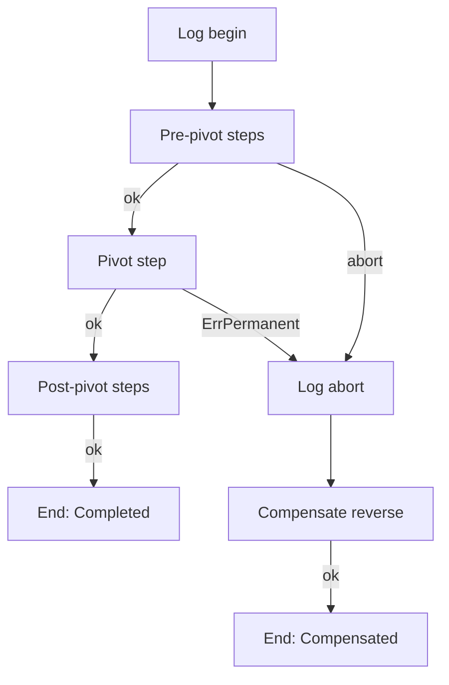
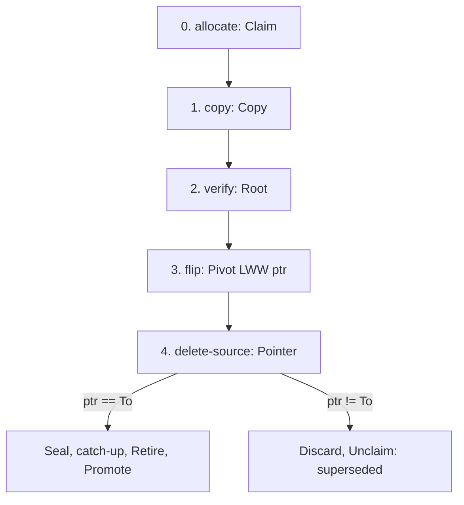

# Sagas

Moving a bucket between storage regions is not one atomic write. It spans claiming target space, copying objects, checking a Merkle root, flipping the routing pointer, and retiring the source. Holding distributed locks across a bulk copy stalls writers and fails when a coordinator crashes or a partition splits the cluster.

A saga replaces two-phase commit with local steps, each paired with a compensating action that semantically undoes its work. Every step commits locally; if a step fails before the point of no return, the coordinator runs compensations in reverse order until the cluster is clean again.

Two rules make this survive crashes and lost responses:

1. **The pivot step.** One step divides the workflow in two. Steps before it are compensable: a permanent refusal or exhausted retries abort and roll back. Once the pivot may have applied, rolling back is unsafe, so the coordinator only rolls forward until every remaining step succeeds.
2. **Intent-before-action logging and idempotency keys.** Before calling a step, the coordinator durably appends an intent record. After a crash, recovery sees an open intent and retries with the same stable idempotency key rather than guessing whether the remote store acted.

## How sagas map to this repository

Two packages implement the saga layer. [`internal/saga`](../../internal/saga/engine.go) holds the generic engine, append-only checksummed log, pure recovery state machine, retry policy, wire error codes, and five-step bucket-migration workflow. [`internal/saga/sagasim`](../../internal/saga/sagasim/cluster.go) builds a deterministic model cluster on the simulator from [Deterministic Simulation Testing](01-deterministic-simulation.md), plus an exported failure-point matrix runner and chaos scenario drivers.



<!-- draw-visual: diagrams/06-saga-lifecycle.mmd -->
```text
┌────────────────┐
│   Log begin    │
└────────┬───────┘
         ▼
┌────────────────┐
│Pre-pivot steps ├──────────abort──────────┐
└────────┬───────┘                         │
         │                                 │
        ok                                 │
         ▼                                 ▼
┌────────────────┐               ┌──────────────────┐
│   Pivot step   ├─ErrPermanent─►│    Log abort     │
└────────┬───────┘               └─────────┬────────┘
         │                                 │
        ok                                 │
         ▼                                 ▼
┌────────────────┐               ┌──────────────────┐
│Post-pivot steps│               │Compensate reverse│
└────────┬───────┘               └─────────┬────────┘
         │                                 │
        ok                                ok
         ▼                                 ▼
┌────────────────┐               ┌──────────────────┐
│ End: Completed │               │ End: Compensated │
└────────────────┘               └──────────────────┘
```

Retryable errors at the pivot, any error after the pivot, and any compensation error retry on backoff timers until they succeed.

### Log format and crash recovery

Each saga appends to one blob under `<prefix><id>` (default `saga/<id>`) via `env.Disk` ([`internal/saga/log.go`](../../internal/saga/log.go)). Each record has a 13-byte header — magic `0xA5`, big-endian `uint32` payload length, header CRC-32C, and payload CRC-32C — plus a varint payload up to `MaxRecord` (1 MiB). Seven record kinds trace the lifecycle: `begin`, `intent`, `done`, `abort`, `comp-intent`, `comp-done`, and `end`.

`DecodeLog` separates torn appends from corruption with a strict prefix rule. A strict frame prefix (fewer than 9 bytes after `0xA5`, or a valid header with an incomplete payload) is a **torn tail**: `DecodeLog` returns the complete records, the valid byte offset, and `nil`. Anything else — bad magic, checksum mismatch, zero or oversized length, trailing bytes, out-of-range fields, or non-canonical encoding — returns `ErrLogCorrupt`. A full frame with a bad checksum is always corruption, even as the last record.

`Resume` ([`internal/saga/resume.go`](../../internal/saga/resume.go)) is a pure state machine shared by live execution and recovery; the engine's in-memory state *is* a `Snapshot` advanced by `apply`. Before writing a record, the engine applies it to a snapshot copy (blocking illegal transitions from reaching disk), appends, runs the optional test hook, calls `Sync`, and then adopts the new snapshot.

On restart, `Engine.Recover` scans the prefix: unreadable logs (`env.ErrIO`) retry on backoff timers (`Status` returns `ErrSagaNotFound`); corrupt logs or unknown definitions are marked broken and left untouched; logs with zero complete records are deleted; and torn tails are truncated and synced *before* any new append so trailing garbage cannot become a corrupt middle record.

### Engine, retry policy, and errors

`Engine` ([`internal/saga/engine.go`](../../internal/saga/engine.go)) is single-threaded and uses only `env.Clock`, `env.Rand`, and `env.Disk`. Steps implement callback-style `Do` and `Compensate`, receiving a `Call` carrying `Key{Saga, Step}`, `Attempt`, `Begun`, and cloned `Input` and `Outputs`. Logging `intent` (or `comp-intent`) before every call keeps attempt counts durable across crashes; each attempt arms a token-guarded `StepTimeout` timer that turns silent steps into retryable `env.ErrTimeout` and drops late or duplicate callbacks.

`Policy.Backoff` ([`internal/saga/policy.go`](../../internal/saga/policy.go)) doubles `BaseDelay` to `MaxDelay` and adds overflow-safe integer jitter in `[0, d * JitterPPM / 1_000_000]` from `env.Rand`. Failure rules follow the pivot:

- **Before the pivot:** retryable errors retry up to `MaxAttempts`, then abort; `ErrPermanent` aborts immediately. Compensation starts at the failing step itself because it may have half-acted.
- **At the pivot:** retryable errors retry without bound; only `ErrPermanent` aborts, compensating from `pivot - 1` since a definitive refusal did not apply.
- **After the pivot and during compensation:** every error, including `ErrPermanent`, retries without bound; compensations run in reverse order.

[`internal/saga/errors.go`](../../internal/saga/errors.go) defines `ErrPermanent`, `ErrSagaNotFound`, `ErrLogCorrupt`, `*StepError`, and wire codes via `saga.Codes()` (`CodePermanent` = 144, `CodeSagaNotFound` = 145, `CodeLogCorrupt` = 146).

### The bucket-migration workflow

[`internal/saga/migration.go`](../../internal/saga/migration.go) defines `bucket-migration` (five steps, pivot 3) behind five narrow interfaces (`Allocator`, `Copier`, `Verifier`, `Router`, `Retirer`, combined as `MigrationOps`), importing nothing from erasure coding, Merkle trees, optimistic concurrency control, or gossip (each arriving in coming chapters).



<!-- draw-visual: diagrams/06-migration-flow.mmd -->
```text
┌───────────────────────────────┐
│       0. allocate: Claim      │
└───────────────┬───────────────┘
                ▼
┌───────────────────────────────┐
│         1. copy: Copy         │
└───────────────┬───────────────┘
                ▼
┌───────────────────────────────┐
│        2. verify: Root        │
└───────────────┬───────────────┘
                ▼
┌───────────────────────────────┐
│     3. flip: Pivot LWW ptr    │
└───────────────┬───────────────┘
                ▼
┌───────────────────────────────┐
│   4. delete-source: Pointer   │
└───────────────┬───────────────┘
                │
                ├──────────────────────────────────┐
                │                                  │
            ptr == To                          ptr != To
                │                                  │
                ▼                                  ▼
┌───────────────────────────────┐   ┌────────────────────────────┐
│Seal, catch-up, Retire, Promote│   │Discard, Unclaim: superseded│
└───────────────────────────────┘   └────────────────────────────┘
```

| # | Step | Forward (`Do`) | Compensate |
|---|---|---|---|
| 0 | `allocate` | `Claim`: register at source, claim target | `Unclaim`: release target, deregister at source |
| 1 | `copy` | `Copy` source to target; output is copied root | `Discard` staged objects at target |
| 2 | `verify` | `Root(to)` must equal step 1's root, else `ErrRootMismatch` | no-op |
| 3 | `flip` (pivot) | `Flip` pointer replicas to `To` with `(Begun, Saga)` | none |
| 4 | `delete-source` | Read merged `Pointer`; finish `moved` or `superseded` | none |

Two invariants govern step 4:

- **Retire before promote.** When `Pointer == To`, the winner calls `Seal` on the source (if already retired by this saga, it jumps straight to `Promote`), runs a catch-up `Copy`, checks `Root(from) == Root(to)`, calls `Retire`, and then calls `Promote`. Promoting first loses acknowledged writes: a crash before `Retire` lets the retried catch-up overwrite the live target with the sealed source.
- **Duel resolution.** Every migration registers at the source in `allocate`, and `Seal` refuses with a retryable busy error while another saga is registered. Across a partition, LWW pointer replicas converge after heal to one target. The loser reads `Pointer != To`, runs `Discard` and `Unclaim` (deregistering at the source), and exits `superseded`; the winner then seals, catches up, retires, and promotes, exiting `moved`.

### Design choices and what each costs

- **One append-only log per saga, no compaction.** Keeps encoding, truncation, and offline inspection simple. *Cost:* terminal logs stay on disk, and perpetual post-pivot or compensation retries grow the log by ~20 bytes per attempt up to the `2^31 - 1` cap.
- **Coordinator-local log without replication.** Avoids consensus inside the engine. *Cost:* permanent coordinator loss strands the saga until operator intervention and blocks competing migrations from sealing the source.
- **Caller-owned idempotency and copy fencing.** The engine supplies a stable `Key{Saga, Step}`, not once-only remote effects. *Cost:* because step 4 calls `Discard`, `Unclaim`, `Copy`, and `Root` with `Step: 4`, ownership, claim, registration, discard, seal, and retire checks must key on `Call.Key.Saga` alone, while any `Copy` cache must key on the full `Call.Key` so step 4's catch-up never returns step 1's cached result. Relayed copies also need a generation fence against late replies landing after compensation.
- **Single-threaded callbacks on `internal/env`.** Fits the simulator contract in [Deterministic Simulation Testing](01-deterministic-simulation.md) with no locks or goroutines. *Cost:* steps and `MigrationOps` cannot block.

### Testing on the deterministic simulator

[`internal/saga/sagasim`](../../internal/saga/sagasim/cluster.go) models `Store` nodes (one per region, persisting buckets and LWW pointers via [`internal/saga/sagasim/codec.go`](../../internal/saga/sagasim/codec.go)), a `Coordinator` hosting `saga.Engine`, and a `Client`. Releasing a claim without `Discard` leaves visible orphans, `opCopy` carries a per-bucket generation fence, and invariant `sagasim/one-live-location` runs every 20 events.

Four suites exercise the engine on `sagasim`:

- **78-cell failure-point matrix** ([`internal/saga/sagasim/matrix.go`](../../internal/saga/sagasim/matrix.go)). Six failure kinds (`fail-before-action`, `fail-after-action`, `fail-mid-compensation`, `crash-before-action`, `crash-after-action`, `crash-mid-compensation`) cross the five steps (mid-compensation on steps 0–2 only), untorn and torn (`CrashTorn`), with crash cells also tested under a second torn crash during recovery (`double`). `sagasim.Run` injects faults via a step wrapper and `Config.Hook`, asserts each fault fired, checks nothing runs after durable `end`, and verifies `CheckMoved` or `CheckCompensated`. Because `Harness` and `Cluster` are exported and schedule relative to `s.Now()`, the integrated node in [The Object Store and Sync Engine](07-object-store-and-sync-engine.md) reuses all 78 cells unchanged on real components.
- **Nemesis chaos (`NemesisRun`) and dueling migrations (`DuelRun`).** Chained `a -> b -> c -> a` migrations run alongside 24 client writes across three 4 s chaos phases and 2 s heal windows (`MinLive: 3`, `MaxDamagedDisks: 1`). Dueling coordinators migrate `bk` from `a` to `b` and `c` across a 2–6 s partition (`{c1, b} | {c2, c}`) with up to 300 ms stagger.
- **Skipped-compensation canary (`TestCanarySkippedCompensation`).** Skipping step 0 or step 1's compensation callback while logging `comp-done` fails `ErrCheck`; skipping step 2's no-op passes.

## Key pieces in code

Each log record carries separate header and payload CRC-32C checksums in [`internal/saga/log.go`](../../internal/saga/log.go), separating torn tails from corruption:

```go
func AppendRecord(dst []byte, r Record) ([]byte, error) {
	if err := validRecord(r); err != nil {
		return dst, fmt.Errorf("saga: encode %s: %w: %w", r.Kind, err, env.ErrInvalidArgument)
	}
	payload := appendPayload(nil, r)
	if len(payload) > MaxRecord {
		return dst, fmt.Errorf("saga: encode %s: %d bytes over %d: %w", r.Kind, len(payload), MaxRecord, env.ErrTooLarge)
	}
	var h [headerSize]byte
	h[0] = frameMagic
	binary.BigEndian.PutUint32(h[1:5], uint32(len(payload)))
	binary.BigEndian.PutUint32(h[5:9], crc32.Checksum(h[:5], castagnoli))
	binary.BigEndian.PutUint32(h[9:13], crc32.Checksum(payload, castagnoli))
	dst = append(dst, h[:]...)
	return append(dst, payload...), nil
}
```

Live execution and recovery share `Snapshot.plan` in [`internal/saga/resume.go`](../../internal/saga/resume.go). Exhausted attempts abort only before the pivot:

```go
func (s *Snapshot) plan(sh shape) {
	s.Next, s.End = ActNone, 0
	switch s.State {
	case StateRunning:
		switch {
		case s.Step == sh.steps:
			s.Next, s.End = ActEnd, StateCompleted
		case s.Step < sh.pivot && s.Attempt >= sh.maxAttempts:
			s.Next = ActAbort
		default:
			s.Next = ActDo
		}
	case StateCompensating:
		if s.Step < 0 {
			s.Next, s.End = ActEnd, StateCompensated
		} else {
			s.Next = ActCompensate
		}
	}
}
```

`Engine.startDo` in [`internal/saga/engine.go`](../../internal/saga/engine.go) syncs `RecIntent` before invoking `Do` and guards the callback with a timeout token:

```go
func (g *Engine) startDo(r *run) {
	step, attempt := r.snap.Step, r.snap.Attempt+1
	// Persist intent before invoking Do so a crash leaves an unknown outcome that retries.
	if !g.log(r, Record{Kind: RecIntent, Step: step, Attempt: attempt}) {
		return
	}
	g.stats[r.def][step].Attempts++
	var tok uint64
	tok = g.arm(r, func() { g.onDo(r, tok, step, attempt, nil, timeoutErr(g.cfg.Policy)) })
	c := g.call(r, step, attempt)
	g.defs[r.def].Steps[step].Do(c, func(out []byte, err error) { g.onDo(r, tok, step, attempt, out, err) })
}
```

In [`internal/saga/sagasim/matrix.go`](../../internal/saga/sagasim/matrix.go), `Cell.Want` encodes the pivot boundary: a lost response (`FailAfterAction`) before the pivot compensates, whereas at or after the pivot it completes:

```go
func (c Cell) Want() saga.State {
	switch {
	case c.Kind.midComp():
		return saga.StateCompensated
	case c.Kind == FailBeforeAction && c.Step <= saga.MigrationPivot:
		return saga.StateCompensated
	case c.Kind == FailAfterAction && c.Step < saga.MigrationPivot:
		return saga.StateCompensated
	}
	return saga.StateCompleted
}
```

## What the tests show, and what they do not

All measurements were recorded inside the project's Docker development container:

- **78-cell matrix.** Across three 500-seed sweeps (bases 1, 7,700,000, and 31,337,000,000) plus pinned seeds — 1,508 runs per cell, 117,624 runs total — every cell ended in its expected state. In the base-1 500-seed sweep (39,000 runs, re-measured after later fixes), 24,196 runs recovered from partial log records (449–499 of 500 seeds per `-torn` cell); worst virtual time was 5.58 s (`copy` fail-mid-compensation torn) vs `MatrixBound` = 20 s.
- **Nemesis chaos.** Across 1,508 runs (8 initial objects), 6,787 migrations ran (5,306 Completed, 1,481 Compensated; 2–9/run), max settle 2.85 s after the final heal (mean 0.93 s, bound 20 s), mean 17.9 acknowledged writes, zero lost (`Do` calls: 8,051 / 8,179 / 5,973 / 9,234 / 12,449). A post-fix 500-seed sweep starting from 40 objects (ending at 41–64, mean 57.9) ran 2,245 migrations (1,781 Completed, 464 Compensated), max settle 2.85 s (mean 0.94 s), mean 17.8 acknowledged writes, zero lost (`Do` calls: 2,657 / 2,643 / 2,004 / 3,072 / 4,220).
- **Dueling migrations.** All 1,508 runs converged to one live location with agreed pointers and an empty loser target (`b` 761, `c` 747; always one `moved`, one `superseded`). In the 500-seed base-1 sweep (`b` 254, `c` 246), finish after heal was at most 3.34 s (mean 1.71 s, bound 10 s).
- **Properties, fuzzing, race, canary, coverage.** Three `rapid` properties (`TestPropTerminalState`, covering pre-pivot exhaustion and post-pivot `ErrPermanent`; `TestPropRecoveryIdempotent`; `TestPropNoStepAfterTerminal`) passed at 2,000 checks each (2.4 s). `FuzzSagaLogRecover` ran 30 s cleanly. `go test -race` passed (`internal/saga` 9.0 s, `sagasim` 8.9 s). A gated 500-seed DST sweep ran in 73.5 s (`internal/saga`) and 2.4 s (`sagasim`). Coverage: 95.5% in `internal/saga`, 91.3% in `internal/saga/sagasim`. `TestCanarySkippedCompensation` caught skipped `allocate` and `copy` compensations.
- **Defects caught and fixed.** The nemesis sweep caught the promote-before-retire lost-write bug (~2.6% of seeds; reintroducing it failed 39/500 seeds; seeds 13, 16, 26, 53 are pinned in `testdata/seeds.txt`). Audits also fixed a 32-object codec cliff in `sagasim.Store` (replaced with a bounded codec up to `MaxObjects` = 4,096 enforced on writes, raising nemesis to 40 objects), absolute timestamps and unfired-fault checks in `sagasim.Run`, spurious `env.ErrNotFound` in `Begin` cleanup, `Resume` accepting `RecAbort` without an open intent, aliased `Call` slices, `MigrationInput.Validate` missing the 1,024-byte cap, and an unfenced two-hop `opCopy`.
- **Adversarial testing.** An independent harness ran 125 check groups across log decoding, engine transitions, all 78 matrix cells on fresh seeds, chaos, duels, the canary, wire codes, and copy fencing. All 125 held with zero broken (an early interrupted run hit the 32-object cliff before the codec fix; the finished harness uses at most 32 objects, so buckets above 32 are covered by `sagasim`'s regression tests). No claim was narrowed.

### What the tests do not prove

- **Model cluster in `sagasim`; real-component runs in `internal/node`.** `sagasim.Store` itself serializes each region's source registration and sealing in one node. The integrated node in [The Object Store and Sync Engine](07-object-store-and-sync-engine.md) now runs the same 78-cell failure matrix on real SWIM membership, erasure-coded storage, Merkle anti-entropy, and OCC metadata (577 runs across a 500-seed sweep — all 78 cells on the base and pinned seeds, remaining seeds spread across cells — all ending in their expected state, begin → terminal p50 11.4 s, max 18.9 s vs the 20 s bound), alongside 500-seed suites for migrations under live non-coordinator PUT, overwrite, and DELETE traffic (p50 45 acknowledged writes, 12 during migration, max 27.6 s) and dueling migrations (max 19.9 s). A full 78 × 500 real-component matrix sweep remains for future hardening.
- **Permanent coordinator loss.** A dead coordinator's `saga/<id>` log stays readable offline (`saga.DecodeLog`, `saga.Resume`), but there is no takeover, and a held source registration blocks competing seals (`ErrBusy` forever).
- **Log corruption and disk wipes.** Corruption returns `ErrLogCorrupt` and leaves the log untouched; the nemesis excludes `FaultBitRot`, `FaultWipeDisk`, and `FaultWipeRejoin`.
- **Unbounded retries and caller obligations.** Perpetual post-pivot or compensation failures retry at `MaxDelay` until the `2^31 - 1` attempt cap suspends the saga. Callers must provide globally unique saga IDs across coordinators, respect `Key.Saga` vs full `Key` scoping in `MigrationOps`, fence relayed copies, and handle any terminal-log cleanup externally.

## Go deeper in the repo

- **Engine and workflow:** [`internal/saga/log.go`](../../internal/saga/log.go), [`internal/saga/resume.go`](../../internal/saga/resume.go), [`internal/saga/engine.go`](../../internal/saga/engine.go), [`internal/saga/policy.go`](../../internal/saga/policy.go), [`internal/saga/errors.go`](../../internal/saga/errors.go), [`internal/saga/migration.go`](../../internal/saga/migration.go).
- **Model cluster and matrix runner:** [`internal/saga/sagasim/store.go`](../../internal/saga/sagasim/store.go), [`internal/saga/sagasim/codec.go`](../../internal/saga/sagasim/codec.go), [`internal/saga/sagasim/ops.go`](../../internal/saga/sagasim/ops.go), [`internal/saga/sagasim/cluster.go`](../../internal/saga/sagasim/cluster.go), [`internal/saga/sagasim/matrix.go`](../../internal/saga/sagasim/matrix.go), [`internal/saga/sagasim/scenarios.go`](../../internal/saga/sagasim/scenarios.go).
- **Tests and fuzz target:** log tests (`TestLogAppendRecover`, `TestLogCorruptMiddleRecordFailsRecovery`, `TestRecoverRetriesReadErrors`, `TestDecodeLogOnSimDiskAfterTornCrash`) in [`internal/saga/log_test.go`](../../internal/saga/log_test.go); engine tests (`TestStateMachineTable`, `TestRetryBackoffSchedule`, `TestCompensationOrder`, `TestIdempotencyKey`, `TestPivotSemantics`, `TestStepErrorFields`, `TestPermanentStopsRetry`, `TestSagaNotFound`, `TestCodesRoundTrip`, `TestEngineEdges`) in [`internal/saga/engine_test.go`](../../internal/saga/engine_test.go); workflow tests (`TestMigrationWorkflow`) in [`internal/saga/migration_test.go`](../../internal/saga/migration_test.go); properties and fuzzing (`TestPropTerminalState`, `TestPropRecoveryIdempotent`, `TestPropNoStepAfterTerminal`, `FuzzSagaLogRecover`) in [`internal/saga/prop_test.go`](../../internal/saga/prop_test.go); DST suites and canary (`TestMigrationFailurePointsDST`, `TestMatrixCellsCoverEveryFailurePoint`, `TestCanarySkippedCompensation`, `TestMigrationUnderNemesisDST`, `TestDuelingMigrationsDST`) in [`internal/saga/dst_test.go`](../../internal/saga/dst_test.go) with pinned seeds in [`internal/saga/testdata/seeds.txt`](../../internal/saga/testdata/seeds.txt); regression and store tests in [`internal/saga/repair_test.go`](../../internal/saga/repair_test.go), [`internal/saga/sagasim/sagasim_test.go`](../../internal/saga/sagasim/sagasim_test.go), and [`internal/saga/sagasim/repair_test.go`](../../internal/saga/sagasim/repair_test.go).
- **Adversarial harness and results:** `agent_work/adversarial/05-saga/` (`ATTACKS.md`, `RESULTS.md`, and `run-all.sh`).

Run the 78-cell failure-point matrix on one seed or replay one of the pinned nemesis seeds:

```sh
docker compose run --rm dev go test ./internal/saga -run '^TestMigrationFailurePointsDST$' -seed=1 -count=1
docker compose run --rm dev go test ./internal/saga -run '^TestMigrationUnderNemesisDST$' -seed=13 -count=1
```

## Sources and further reading

- **Hector Garcia-Molina and Kenneth Salem, "Sagas" (ACM SIGMOD, 1987).** Defines long-lived transactions as local subtransactions paired with reverse-order compensating transactions.
- **Jim Gray, "The Transaction Concept: Virtues and Limitations" (VLDB, 1981).** Early analysis of long-lived activities and compensating transactions when holding locks across steps fails.
- **Pat Helland, "Life Beyond Distributed Transactions: an Apostate's Opinion" (CIDR, 2007).** Explains replacing distributed two-phase commit across independent entities with idempotent messages and explicit tentative state.
- **Brandur Leach, "Implementing Stripe-like Idempotency Keys in Postgres" (2017).** Practical design for recording durable intent before side effects and safely retrying lost responses.
- **Temporal Architecture Documentation (Durable Execution and Event History).** Production workflow-engine pattern of persisting an append-only event history and rebuilding state via deterministic replay.
