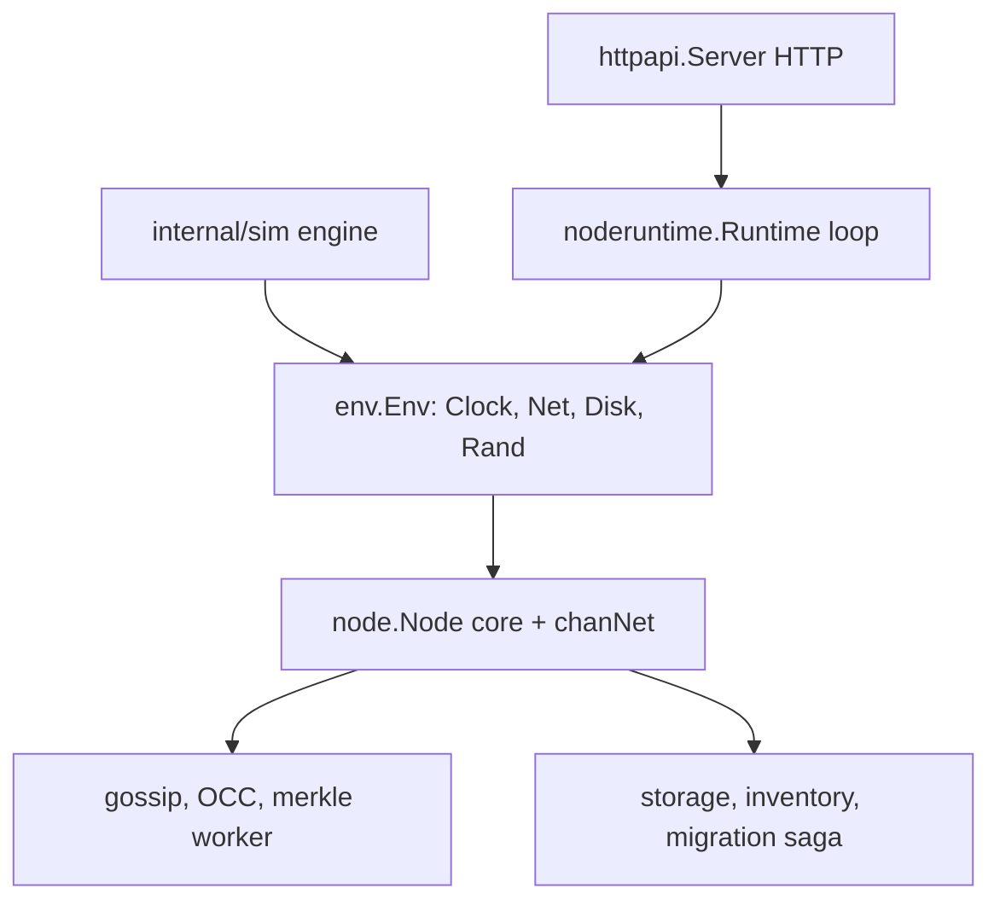
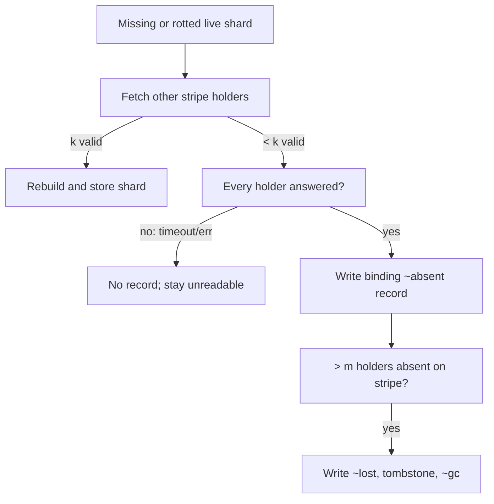

# The Object Store and Sync Engine

Five standalone protocols — membership, erasure coding, Merkle anti-entropy, optimistic concurrency control, and sagas — do not form an object store through simple glue. Integration brings failure modes no single layer sees alone. Metadata and shard data replicate on different schedules, so naive garbage collection deletes live shards whose manifest is still crossing a partition. A migration that purges a source region before seeing every live peer's pre-flip writes destroys acknowledged data. Putting that state machine behind real sockets, timers, and files adds concurrency, cancellation, DNS stalls, and crash-durability bugs a single-threaded simulator never hits.

This repository keeps one protocol core over `internal/env`. Every storage, metadata, membership, repair, and migration decision runs in one deterministic, single-threaded `*node.Node`. The simulator drives it with virtual time and fault injection; in production, a thin runtime wraps the exact same `*node.Node` in an event loop fed by UDP, TCP, wall-clock timers, a crash-safe file disk, and an HTTP object API.

## How the integrated node maps to this repository

Four layers assemble the node: [`internal/node`](../../internal/node/node.go) (`node.go`, `mux.go`, `objects.go`, `records.go`, `meta.go`, `inventory.go`, `migrate.go`, `codes.go`, `status.go`) is the deterministic core (passing the determinism linter), plus an 8-line `Node.Merge` in [`internal/occ/node_merge.go`](../../internal/occ/node_merge.go); [`internal/noderuntime`](../../internal/noderuntime/runtime.go) (`runtime.go`, `realenv.go`, `vfs.go`, `frame.go`, `service.go`) bridges real I/O onto `*node.Node`; [`internal/storage/api.go`](../../internal/storage/api.go) and [`internal/storage/httpapi`](../../internal/storage/httpapi/http.go) (`service.go`, `http.go`) serve HTTP; [`cmd/objnode/main.go`](../../cmd/objnode/main.go) runs the binary and [`compose.yaml`](../../compose.yaml) defines the three-node Docker cluster (`cluster` profile).



<!-- draw-visual: diagrams/07-node-wiring.mmd -->
```text
┌───────────────────────────────┐   ┌──────────────────────────────────┐
│      httpapi.Server HTTP      │   │       internal/sim engine        │
└───────────────┬───────────────┘   └─────────────────┬────────────────┘
                ▼                                     │
┌───────────────────────────────┐                     │
│    noderuntime.Runtime loop   │                     │
└───────────────┬───────────────┘                     │
                ▼                                     │
┌───────────────────────────────┐                     │
│env.Env: Clock, Net, Disk, Rand│◄────────────────────┘
└───────────────┬───────────────┘
                ▼
┌───────────────────────────────┐
│    node.Node core + chanNet   ├─────────────────────┐
└───────────────┬───────────────┘                     │
                ▼                                     ▼
┌───────────────────────────────┐   ┌──────────────────────────────────┐
│   gossip, OCC, merkle worker  │   │storage, inventory, migration saga│
└───────────────────────────────┘   └──────────────────────────────────┘
```

### Wiring, metadata, and last-writer-wins (`node.go`, `mux.go`, `objects.go`, `meta.go`, `codes.go`)

`chanNet` ([`mux.go`](../../internal/node/mux.go)) multiplexes one `env.Transport` across five channels by a leading byte: gossip (`1`), storage (`2`), OCC (`3`), metadata Merkle diffs (`4`), and node RPCs (`5`: metadata fetch, pointer view, shard purge). `AllCodeEntries` ([`codes.go`](../../internal/node/codes.go)) joins wire errors from [SWIM Gossip Membership](02-swim-gossip.md), [Reed-Solomon Erasure Coding](03-reed-solomon-erasure-coding.md), [Merkle-Tree Anti-Entropy](04-merkle-anti-entropy.md), [Optimistic Concurrency Control](05-optimistic-concurrency-control.md), [Sagas](06-sagas.md), the object API (`160–163`), and the node (`176–185`) into one `env.CodeTable` (37 application + 8 `env` codes).

`gossipView` adapts live members (`alive` and `suspect`) for storage, Merkle, and OCC; `regionView` filters to one region for routed buckets. New writes place on the current view while existing manifests keep their placement (no death stampede; returning holders rebuild their shards, while permanently gone nodes stay unreplaced).

Each object lives under **one** OCC key (`ManifestKey(bucket, key)`) holding content type and storage manifest so concurrent PUTs cannot mix one write's metadata with another's bytes. One `merkle.Worker` per node (`metaRepairer`, depth 3, 1 s period) syncs the entire OCC document — tombstones and system keys (`~bucket`, `~live`, `~reg/`, `~retired`, `~flip`, `~claim/`, `~stage/`, `~cv/`, `~gc/`, `~orphan/`, `~absent/`, `~lost/`) included — so nodes discover new buckets automatically. `metaRepairer.Put` merges via `occ.Node.Merge` and refuses losing versions (`ErrStale`); OCC push-pull (3 s) runs as a backstop. Tombstones and system markers stay indefinitely.

**Last-writer-wins.** Concurrent versions are never kept side by side — no siblings, no `300` responses, no conflict listings. One wins by hybrid logical clock (ties by node ID, then version ID), the other is discarded, and every discard is counted and logged (exposed in `/_health` via `Discards`, `RecentDiscards`, and counters). `OnDiscard` defers `handleDiscard`: manifest discards record the loser, write `~gc/<version>`, and schedule a quota recount `RecountSettle` (3 s) out; quota discards schedule the same recount. A periodic quota audit (`AuditBatch = 4` buckets per 500 ms tick) has the lowest-ID live node recount any bucket whose usage disagrees with live manifests after `RecountSettle` with unchanged quota version and manifest digest, fixing partition-era causal recounts that produce no discard.

### Shard collection and loss declaration (`inventory.go`)

Per bucket, a node keeps a local Merkle tree (`InventoryDepth = 2`) of verified shard checksums on disk, updated at start, on `OpPutShard`, and by scrubbing `InventoryScrub` (16) shards per tick. Each tick locally runs `merkle.Compare` between expected manifests (live and staged) and disk, rebuilding missing, corrupt, or unreadable shards from other holders (`MaxRebuilds = 8`). Wire `OpDeleteShard` requests are always refused (`ErrMalformed`).

A shard blob is deleted only by three paths:

1. **Dead version:** unreferenced with death evidence — a live replicated `~gc/<version>` marker or local LWW-loser record — seen by this holder for at least `GCGrace` (10 min default, counted from first sight of evidence), walking all disk files including corrupt shards. Markers are written on overwrites, deletes, manifest discards, post-shard PUT failures, migration `Retire`/`Discard`, and loss declarations.
2. **Orphan:** unreferenced with no evidence for `OrphanGrace` (1 h default). Before deleting, the holder writes `~orphan/<version>/<stripe>.<index>/<holder>`; if that write fails, nothing is deleted. Orphan records no longer decide loss.
3. **Migration purge:** an explicit list of `~gc/` dead versions (no grace) from `Retire` (after every live peer holds the swapped manifests) or `Discard` (its copy intents); holders refuse any version their metadata calls live (`purge_refused`).

Because PUTs acknowledge at `k + 1` shards, a stripe can drop below `k` via unwritten shards, orphan collection, or bit-rot. Loss declaration relies on binding **absence records**, never timers or orphan counts:



<!-- draw-visual: diagrams/07-loss-declaration.mmd -->
```text
┌─────────────────────────────┐
│ Missing or rotted live shard│
└──────────────┬──────────────┘
               ▼
┌─────────────────────────────┐
│  Fetch other stripe holders │
└──────────────┬──────────────┘
               │
               ├─────────────────────────────────┐
               │                                 │
            k valid                          < k valid
               │                                 │
               ▼                                 ▼
┌─────────────────────────────┐   ┌────────────────────────────┐
│   Rebuild and store shard   │   │   Every holder answered?   │
└─────────────────────────────┘   └──────────────┬─────────────┘
                                                 │
               ┌─────────────────────────────────┤
               │                                 │
        no: timeout/err                         yes
               │                                 │
               ▼                                 ▼
┌─────────────────────────────┐   ┌────────────────────────────┐
│  No record; stay unreadable │   │Write binding ~absent record│
└─────────────────────────────┘   └──────────────┬─────────────┘
                                                 │
┌─────────────────────────────┐                  │
│> m holders absent on stripe?│◄─────────────────┘
└──────────────┬──────────────┘
               │
              yes
               ▼
┌─────────────────────────────┐
│ Write ~lost, tombstone, ~gc │
└─────────────────────────────┘
```

A placement holder `H` of `(v, s, i)` writes bucket-scoped `~absent/<v>/<s>.<i>/<H>` only when, in one loop step: `v` is live in `H`'s metadata (staged copies never qualify), not purged, and has no death evidence; `H`'s own shard read answers `not found`, `corrupt`, or a checksum mismatch (a disk read error is not evidence); and `H`'s rebuild got an answer (`shard`, `not found`, or `corrupt`) from **every** other holder of stripe `s` with fewer than `k` verifying. Any timeout, unreachable or not-ready peer, or disk read error writes no record, blocking the decision and leaving the key live and unreadable (`ErrUnavailable`, 503) until recovery. The record binds across restarts: `H` never starts a rebuild for that shard, an in-flight rebuild finishing after `H`'s absence record (or death evidence) arrives or while metadata is unloaded stores nothing, and `H` refuses wire writes (`ErrFenced`, `absent_refused`; writes before metadata loads are also refused). On maintenance ticks, the lowest-ID live node declares `v` lost when any stripe has **more than `m`** manifest holders with bucket-scoped absence records: it writes `~lost/<v>` first, tombstones the manifest (`If-Match`), marks `~gc/<v>`, decrements usage, counts `LostDeclared`, and logs the loss (GET returns 404; remaining shards collect after `GCGrace`).

### Bucket migration on real components (`migrate.go`)

`migrator` implements `saga.MigrationOps` over real cluster components. Routed buckets (`?region=`) accept writes only when `route == ~live` (never before `route` arrives); unrouted buckets refuse migration (`ErrNoMigration`, 400). Per-saga registrations `~reg/<saga>` commute under LWW; `Copy` writes `~cv/<saga>/<version>` intents before storing target shards and stages under `~stage/<saga>`. `Flip` writes `~flip = <saga>|<to>` then `SetRoute` (repairing `route` on retry if its `~flip` won). `Pointer` waits until every live peer, after `ViewSettle` (5 s), agrees on `(route, flip owner, bucket manifest digest)`, ensuring the coordinator holds every live peer's pre-flip writes. `Retire` swaps manifests (`If-Match`), marks replaced versions and non-live intents dead, waits for live-peer pointer agreement again, and purges only that dead list. Absent peers keep pre-flip writes unpurged (readable in the old region on return, or resolved by LWW).

### Real runtime, HTTP API, and Docker cluster (`internal/noderuntime`, `internal/storage/httpapi`, `cmd/objnode`)

[`internal/noderuntime`](../../internal/noderuntime/runtime.go) runs the unchanged `*node.Node` on one loop goroutine (`Runtime.loop`) owning all protocol state without locks. `NodeID` is `host:port` (shared UDP/TCP port). `readDatagrams` feeds a bounded drop-and-count queue (`datagrams_dropped`); `accept` caps TCP handlers at `MaxConns` (256, `connections_refused`), reading one length-prefixed frame per connection up to `MaxFrame` (16 MiB). Outbound dials and hostname lookups (`ResolveTimeout = 5 s`; numeric addresses parse inline) run off-loop; UDP writes use a 100 ms `SendTimeout`. `realTimer` posts generation-checked closures to the loop. `fileDisk.Write` (and first `Append`) writes to `<data>/.tmp/`, loops short writes, `fsync`s, closes, and renames; `Sync` fsyncs the file, its directory, and newly created ancestors (`syncChain`). `service.go` posts calls through a five-state CAS (`callQueued`..`callLeft`): calls canceled before dequeue never run; calls canceled after dequeue run once, return `ErrOutcomeUnknown` joined with cause, and log/count `abandoned_calls`. A loop panic sets `ErrPanicked`, closes all sockets and `Done()`, and exits `cmd/objnode` with code 1.

[`internal/storage/httpapi/http.go`](../../internal/storage/httpapi/http.go) serves buckets (`/{bucket}`, `?quota`, `?acl=`), objects (`/{bucket}/{key}`, `?tag=`, `?tags`, `?meta`), migrations (`/_migrations`), and `/_cluster/members`, `/_health`, emitting quoted `ETag`, `X-Object-Version`, and `X-Content-Sha256`. Limits cap headers (16 KiB), objects (32 MiB), small bodies (64 KiB), header reads (5 s), and request contexts (30 s). One `StatusTable` (24 base + 10 `node.StatusRows()`) maps all sentinels. `parseEntityTags` scans RFC 9110 entity-tag lists left to right (quoted commas, empty elements, `W/` strong comparison); no present `If-Match` or `If-None-Match` header ever degrades to unconditional. [`compose.yaml`](../../compose.yaml)'s `cluster` profile starts three `cmd/objnode` peers (`node-a1`, `node-b1`, `node-c1` in regions `a`, `b`, `c`, `k=2, m=1`) on ephemeral loopback ports.

### Design choices and testing on simulator and real runtime

- **Synchronous `env.Disk` on the loop.** One lock-free core across simulator and production; costs loop-blocking disk I/O and whole-document OCC `fsync` per metadata write (dominating PUT latency).
- **Indefinite tombstones/markers; whole-object buffering; one TCP connection per RPC; no authentication.** Simple recovery and framing; costs metadata growth over history, 32 MiB RAM per in-flight object, per-RPC dial cost, and an open cluster/HTTP boundary.
- **In-memory `recountDue`/`losers`.** A crash drops pending recounts, repaired by the periodic quota audit (`~gc/` markers remain durable).

Ten full-node DSTs in `internal/node` run on [Deterministic Simulation Testing](01-deterministic-simulation.md), guarded by four independent oracles: `ackOracle` (per-key ancestry via `CommitSink`), `gcOracle`/`watchDisk` (every simulated disk `Delete` checked against all nodes' metadata), a converse loss oracle (checking all holders' disks at every `~lost/` commit), and `checkLiveReadableOrLost`, backed by three canaries (`TestCanaryDeleteResurrected`, `TestCanaryNodeSkipsDiscardRecount`, `TestCanaryNodeSkipsQuotaAudit`). In `internal/noderuntime`, four conformance scenarios run verbatim on both simulator and loopback sockets, `TestFileDiskCrashLeavesOldOrNewBytes` faults `fileDisk` at every step of a POSIX model, `synctest` tests lifecycle/cancellation/once-only callbacks, and `internal/testutil/leakcheck` enforces zero leaked goroutines in `TestMain` (`TestCanaryShutdownLeak`).

## Key pieces in code

`chanNet` in [`internal/node/mux.go`](../../internal/node/mux.go) shares one `env.Transport` across all five protocols via a one-byte prefix:

```go
type chanNet struct {
	net env.Transport
	ch  byte
}

func withChannel(ch byte, msg []byte) []byte {
	out := make([]byte, 1+len(msg))
	out[0] = ch
	copy(out[1:], msg)
	return out
}

func (c chanNet) Send(to env.NodeID, msg []byte) error {
	return c.net.Send(to, withChannel(c.ch, msg))
}

func (c chanNet) Request(to env.NodeID, req []byte, timeout time.Duration, cb func([]byte, error)) {
	c.net.Request(to, withChannel(c.ch, req), timeout, cb)
}
```

`AllCodeEntries` in [`internal/node/codes.go`](../../internal/node/codes.go) joins every layer's wire errors into one `env.CodeTable`:

```go
func AllCodeEntries() []env.CodeEntry {
	var all []env.CodeEntry
	all = append(all, gossip.Codes()...)
	all = append(all, storage.CodeEntries()...)
	all = append(all, merkle.CodeEntries()...)
	all = append(all, occ.CodeEntries()...)
	all = append(all, saga.Codes()...)
	all = append(all, storage.APICodeEntries()...)
	all = append(all, NodeCodeEntries()...)
	return all
}

func CodeTable() (*env.CodeTable, error) {
	return env.NewCodeTable(AllCodeEntries()...)
}
```

`unrecoverableStripe` in [`internal/node/inventory.go`](../../internal/node/inventory.go) declares loss only when more than `m` placement holders of one stripe have recorded binding absence:

```go
func (n *Node) unrecoverableStripe(man *storage.Manifest) (int, int, bool) {
	byShard := n.absent[man.Version]
	if len(byShard) == 0 {
		return 0, 0, false
	}
	for s := range man.Stripes {
		c := 0
		for i, ref := range man.Stripes[s].Shards {
			if byShard[[2]int{s, i}][ref.Node] {
				c++
			}
		}
		if c > man.Layout.M {
			return s, c, true
		}
	}
	return 0, 0, false
}
```

`realTimer.arm` and `fire` in [`internal/noderuntime/realenv.go`](../../internal/noderuntime/realenv.go) post generation-checked wall-clock timers to the single-threaded loop:

```go
func (tm *realTimer) arm(d time.Duration) {
	tm.gen++
	g := tm.gen
	tm.pending = true
	if tm.t != nil {
		tm.t.Stop()
	}
	rt := tm.rt
	tm.t = time.AfterFunc(max(d, 0), func() { rt.post(func() { tm.fire(g) }) })
}

func (tm *realTimer) fire(g uint64) {
	if g != tm.gen || !tm.pending {
		return
	}
	tm.pending = false
	delete(tm.rt.timers, tm)
	tm.fn()
}
```

## What the tests show, and what they do not

Measurements ran in the project's 4-core Docker development container:

- **500-seed full-node DSTs (`DST_SEEDS=500`, 1,345 s standalone / 1,726 s whole-module):** all ten suites (including late-flip, isolated-peer, and manifest-discard quota DSTs) passed every seed with zero winner shards collected:

| Scenario (500 seeds unless noted) | Measured (virtual time / counts) |
|---|---|
| Put/Get (21 nodes, 3 regions, 1% loss, partition, crash) | Every ack read back; converge p50 3.27 s, max 10.96 s |
| Partition heal (21 nodes, 800 B quota) | Converge p50 7.09 s, max 12.01 s; discards p50 435 (238–611), distinct losers p50 54 (27–81); oracle p50 16/9/7; overshoot p50 500 B, max 700 B; usage settled p50 8.62 s, max 12.75 s; loser shards collected p50 23 (11–37) |
| Crash, restart, wipe (21 nodes) | Converge p50 2.04 s, max 4.38 s; restarted whole p50 6.04 s, max 8.38 s; wiped refilled p50 15.0 s, max 17.4 s; 4 deletes stay deleted |
| Bit-rot (21 nodes, ≤ `m` rotted/stripe) | 9–33 rotted shards/run; repaired p50 153 ms, max 159 ms; rebuilt/rotted bytes 1.000 |
| 78-cell migration matrix (577 runs: base/pinned + rest spread) | All 577 expected; terminal p50 11.4 s, max 18.9 s (bound 20 s) |
| Migration under traffic (9 nodes, 2% loss) | Acked p50 45 (12 mid-migration); oracle p50 19/17/15/6; max 27.6 s |
| Dueling migrations (9 nodes, 3 sagas) | Exactly one duel winner; terminal p50 14.0 s, max 19.9 s |

- **Loopback runtime (`MEASURE_RUNTIME=1`, 3 nodes, `k=2, m=1`, 1 MiB stripes):** 1 MiB PUT 5.7 MiB/s (p50 174 ms, max 241 ms; down from 9.9 MiB/s before temp-file `fsync`), GET 48.0 MiB/s (p50 16 ms, max 39 ms); 32 MiB PUT 11.5 MiB/s (p50 2.70 s, max 3.32 s), GET 61.2 MiB/s (p50 522 ms, max 538 ms); 11 idle goroutines (96 peak under 16 concurrent 1 MiB puts), 0.6 MiB idle heap.
- **Docker smoke (`agent_work/06-integration/cluster-smoke.sh`):** passes in ~7 s warm (three alive regions; 1,500,000 B PUT on `node-a1`, matching GET on `node-c1`, `If-None-Match: *` → 412, `If-Match` current → 200 and stale → 412, 0 discards), including two overlapping runs.
- **Properties, fuzz, race, lint, coverage, adversarial:** both `rapid` properties passed at 2,000 checks; `FuzzFrame` and `FuzzObjectAPI` passed 30 s gates (and 60 s / 379,052 execs on `FuzzObjectAPI`); `go test -race` passed across all packages; determinism lint passed on 72 files in 11 packages including `internal/node`; coverage is 86.2% (`node`), 87.7% (`noderuntime`), 97.8% (`storage`), 87.8% (`httpapi`), 82.5% (`objnode`), 80.6% (`leakcheck`). Adversarial harness (`agent_work/adversarial/06-integration/`): run 1 held 284/284 before code audits uncovered pre-flip purge and other flaws (small clean samples are not proof of absence); run 2 held 658/662 (4 quoted-comma `If-Match` list bugs); run 3 held 662/662. Twenty further loss-declaration scenarios from a second independent pass now run as regression tests (`internal/node/secondeyes_*_test.go`), three of which exposed defects before they were fixed (disk read errors recorded as absence, an in-flight rebuild storing after absence arrived, and the loss oracle missing migrated manifests).

### Narrowed claims and what the tests do not prove

- **Loss declaration and wiped-holder residual.** "Every key listed live is readable, or declared lost on record" holds only once every holder of every stripe below `k` is up, holds the manifest, can reach the others, and reads its shard without a disk error; until then — or forever if a holder is permanently removed — the key stays live and unreadable (`ErrUnavailable`, 503). A holder whose disk keeps failing reads (not `not found` or `corrupt`) blocks a loss declaration like an unreachable holder does, until its disk answers or a rebuild rewrites the shard. Binding refusal also assumes the holder keeps its absence metadata. A wiped disk (`WipeRejoin`) loses it until metadata sync returns it, letting a pre-wipe shard request land on the new incarnation: the simulator addresses nodes, not incarnations, and in the real runtime an established TCP connection cannot survive a restart, but `Request` carries no destination incarnation and dials after scheduling (`internal/noderuntime/runtime.go`), so a queued, resolving, or dialing request can reach the restarted holder before its deadline. Case (a), already declared lost: metadata sync brings the death marker and the shard collects after `GCGrace`, leaving `k` shards briefly on disk (`TestAStaleShardWriteToAWipedHolderOfADeclaredLostVersionIsCollected`). Case (b), not yet declared: with `k - 1` other good shards the stripe is readable and rebuilt, or if more than `m` records already existed, the version is declared lost while `k` shards exist at that moment (independently reproduced; not closed).
- **Simulator vs real runtime.** Full 21-node chaos, partitions, bit-rot, migrations, and loss suites run on `internal/sim`. Real sockets and files are verified by 4 conformance scenarios, loopback shutdown/panic/cancellation tests, `synctest`, the Docker smoke test, and `TestFileDiskCrashLeavesOldOrNewBytes` (POSIX model only, not real hardware write caches or power loss). Multi-process fault injection and a full 78 × 500 real-component migration sweep wait for a coming hardening chapter.
- **Unbuilt bounds.** Vanished holders are not re-placed; permanent coordinator loss strands a saga; pre-flip writes from absent peers stay readable strays in the old region until the next migration.

## Go deeper in the repo

- **Protocol core:** [`node.go`](../../internal/node/node.go), [`mux.go`](../../internal/node/mux.go), [`objects.go`](../../internal/node/objects.go), [`records.go`](../../internal/node/records.go), [`meta.go`](../../internal/node/meta.go), [`inventory.go`](../../internal/node/inventory.go), [`migrate.go`](../../internal/node/migrate.go), [`codes.go`](../../internal/node/codes.go), [`status.go`](../../internal/node/status.go) under `internal/node/`; [`internal/occ/node_merge.go`](../../internal/occ/node_merge.go).
- **Runtime, HTTP, CLI, cluster:** [`runtime.go`](../../internal/noderuntime/runtime.go), [`realenv.go`](../../internal/noderuntime/realenv.go), [`vfs.go`](../../internal/noderuntime/vfs.go), [`frame.go`](../../internal/noderuntime/frame.go), [`service.go`](../../internal/noderuntime/service.go) under `internal/noderuntime/`; [`internal/storage/api.go`](../../internal/storage/api.go), [`internal/storage/httpapi/service.go`](../../internal/storage/httpapi/service.go), [`internal/storage/httpapi/http.go`](../../internal/storage/httpapi/http.go); [`cmd/objnode/main.go`](../../cmd/objnode/main.go); [`compose.yaml`](../../compose.yaml).
- **Tests and fuzz targets:** DSTs in [`dst_putget_test.go`](../../internal/node/dst_putget_test.go), [`dst_partition_test.go`](../../internal/node/dst_partition_test.go), [`dst_crash_test.go`](../../internal/node/dst_crash_test.go), [`dst_bitrot_test.go`](../../internal/node/dst_bitrot_test.go), [`dst_migration_test.go`](../../internal/node/dst_migration_test.go), [`dst_migtraffic_test.go`](../../internal/node/dst_migtraffic_test.go), [`dst_duel_test.go`](../../internal/node/dst_duel_test.go), [`dst_lateflip_test.go`](../../internal/node/dst_lateflip_test.go), [`dst_quota_test.go`](../../internal/node/dst_quota_test.go); GC, loss, flip, and oracles in [`gc_test.go`](../../internal/node/gc_test.go), [`lost_test.go`](../../internal/node/lost_test.go), [`absent_internal_test.go`](../../internal/node/absent_internal_test.go), `secondeyes_*_test.go`, [`flip_test.go`](../../internal/node/flip_test.go), [`oracle_test.go`](../../internal/node/oracle_test.go), [`prop_test.go`](../../internal/node/prop_test.go); runtime tests and `FuzzFrame` in [`conformance_test.go`](../../internal/noderuntime/conformance_test.go), [`crashfs_test.go`](../../internal/noderuntime/crashfs_test.go), [`hazards_test.go`](../../internal/noderuntime/hazards_test.go), [`request_once_test.go`](../../internal/noderuntime/request_once_test.go), [`frame_test.go`](../../internal/noderuntime/frame_test.go), [`measure_test.go`](../../internal/noderuntime/measure_test.go); HTTP model and `FuzzObjectAPI` in [`internal/storage/httpapi/http_test.go`](../../internal/storage/httpapi/http_test.go); CLI tests in [`cmd/objnode/main_test.go`](../../cmd/objnode/main_test.go).
- **Adversarial harness and smoke:** `agent_work/adversarial/06-integration/` (`ATTACKS.md`, `RESULTS.md`, `run-all.sh`) and `agent_work/06-integration/cluster-smoke.sh`.

Run the simulator-vs-loopback conformance suite or one seed of the partition-heal DST:

```sh
docker compose run --rm dev go test ./internal/noderuntime -run '^TestConformance' -v -count=1
docker compose run --rm dev go test ./internal/node -run '^TestClusterPartitionHealDST$' -seed=1 -v -count=1
```

## Sources and further reading

- **Giuseppe DeCandia et al., "Dynamo: Amazon's Highly Available Key-value Store" (ACM SOSP, 2007).** Leaderless topology and anti-entropy shape this store follows, contrasted with Dynamo's sibling versions.
- **Avinash Lakshman and Prashant Malik, "Cassandra — A Decentralized Structured Storage System" (ACM SIGOPS OSR, 2010).** Combining gossip membership, partitioned storage, and Merkle anti-entropy in one symmetric node.
- **Amazon S3 Conditional Requests documentation and Roy Fielding, Mark Nottingham, and Julian Reschke, RFC 9110, "HTTP Semantics" (IETF, 2022).** `If-Match`, `If-None-Match: *`, strong entity-tag comparison, and entity-tag list parsing.
- **Martin Kleppmann, *Designing Data-Intensive Applications* (O'Reilly, 2017).** Lost-update cost of last-writer-wins under partitions and skew, and why discards must be observable.
- **Will Wilson, "Testing Distributed Systems w/ Deterministic Simulation" (Strange Loop, 2014) and FoundationDB write-ups.** Running one deterministic protocol core unchanged under a simulator and a real I/O runtime.
- **TigerBeetle engineering write-ups on deterministic simulation and storage fault tolerance.** Explicit I/O boundaries, single-threaded state machines, and verifying crash durability alongside simulated faults.
