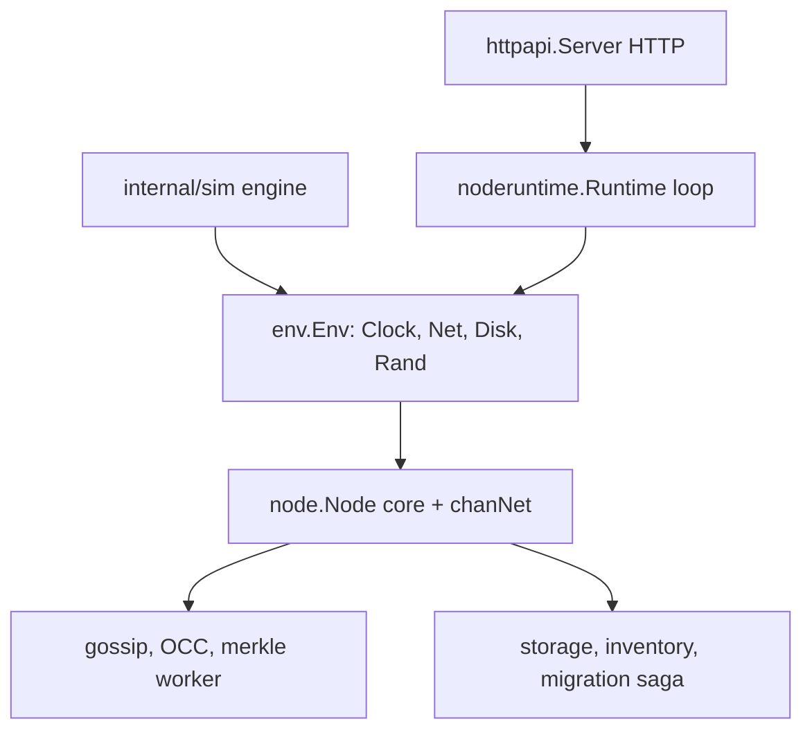
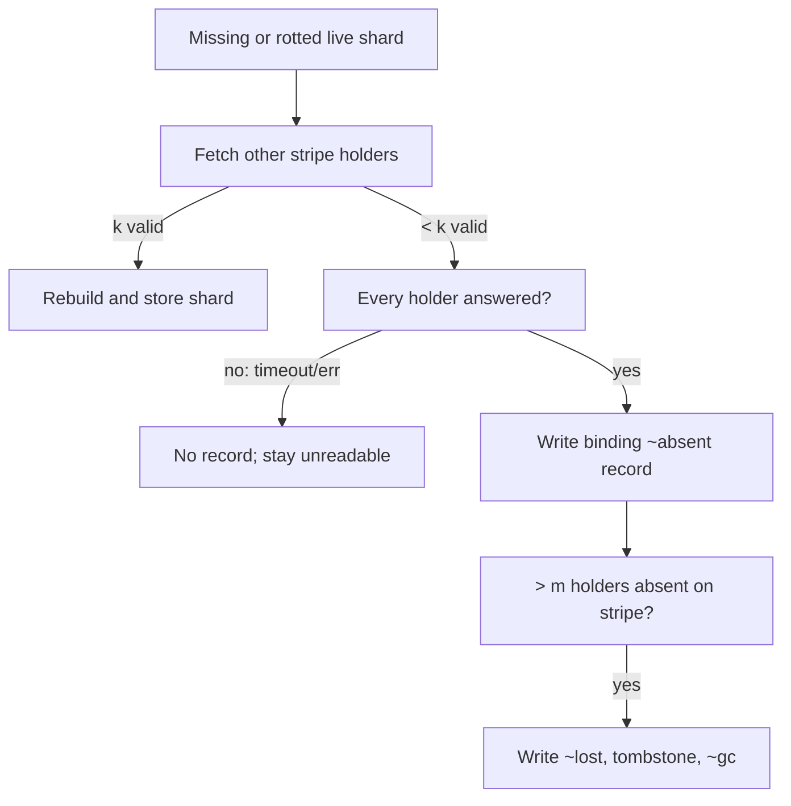

# The Object Store and Sync Engine

Earlier chapters built gossip, erasure coding, Merkle anti-entropy, optimistic concurrency control, and sagas alone; wiring them together creates cross-layer failures. Metadata and shards replicate on separate schedules, so naive GC deletes live shards whose manifest is still crossing a partition. Purging a migration source before seeing live peers' pre-flip writes destroys acknowledged data. Real sockets, timers, and files add concurrency, cancellation, DNS stalls, and crash bugs a simulator never hits.

One deterministic, single-threaded `*node.Node` over `internal/env` owns all storage, metadata, membership, repair, and migration logic. Deterministic simulation testing ([Deterministic Simulation Testing](01-deterministic-simulation.md)) drives it under virtual time and faults; in production, a thin runtime wraps it in an event loop fed by UDP, TCP, timers, a crash-safe file disk, and the object API.

## How the integrated node maps to this repository

Four layers form a node: [`internal/node`](../../internal/node/node.go) is the deterministic core (passing determinism lint) plus a small `Node.Merge` wrapper in [`internal/occ/node_merge.go`](../../internal/occ/node_merge.go); [`internal/noderuntime`](../../internal/noderuntime/runtime.go) bridges real I/O; [`internal/storage/api.go`](../../internal/storage/api.go) and [`internal/storage/httpapi`](../../internal/storage/httpapi/http.go) serve the object API; [`cmd/objnode/main.go`](../../cmd/objnode/main.go) runs `objnode` and [`compose.yaml`](../../compose.yaml) defines the three-node Docker cluster (`cluster` profile).



<!-- draw-visual: diagrams/07-node-wiring.mmd -->
```text
┌───────────────────────────────┐   ┌──────────────────────────────────┐
│      httpapi.Server HTTP      │   │       internal/sim engine        │
└───────────────┬───────────────┘   └─────────────────┬────────────────┘
                ▼                                     │
┌───────────────────────────────┐                     │
│    noderuntime.Runtime loop   │                     │
└───────────────┬───────────────┘                     │
                ▼                                     │
┌───────────────────────────────┐                     │
│env.Env: Clock, Net, Disk, Rand│◄────────────────────┘
└───────────────┬───────────────┘
                ▼
┌───────────────────────────────┐
│    node.Node core + chanNet   ├─────────────────────┐
└───────────────┬───────────────┘                     │
                ▼                                     ▼
┌───────────────────────────────┐   ┌──────────────────────────────────┐
│   gossip, OCC, merkle worker  │   │storage, inventory, migration saga│
└───────────────────────────────┘   └──────────────────────────────────┘
```

### Wiring, metadata, and last-writer-wins

`chanNet` ([`mux.go`](../../internal/node/mux.go)) multiplexes `env.Transport` by leading byte: gossip (`1`), storage (`2`), OCC (`3`), metadata Merkle diffs (`4`), and node RPCs (`5`: metadata fetch, pointer view, shard purge, shard verify from [End-to-End Tests and Hardening](08-end-to-end-and-hardening.md)). `AllCodeEntries` ([`codes.go`](../../internal/node/codes.go)) joins all five protocol error blocks, object API (`160–163`), and node codes (`176–185`) into one `env.CodeTable` (37 app + 8 `env` codes). `gossipView` adapts live (`alive`, `suspect`) members; `regionView` filters one region for routed buckets. New writes use current membership; existing manifests keep placement (returning holders rebuild; gone nodes stay unreplaced).

In [`objects.go`](../../internal/node/objects.go), [`records.go`](../../internal/node/records.go), and [`meta.go`](../../internal/node/meta.go), each object sits under one OCC key (`ManifestKey(bucket, key)`) bundling content type and manifest so concurrent PUTs never mix metadata and bytes. One `merkle.Worker` (`metaRepairer`, depth 3, 1 s period) syncs the full OCC document — tombstones and `~` system keys (`~bucket`, `~live`, `~reg/`, `~retired`, `~flip`, `~claim/`, `~stage/`, `~cv/`, `~gc/`, `~orphan/`, `~absent/`, `~lost/`) — discovering buckets automatically. `metaRepairer.Put` merges via `occ.Node.Merge`, refusing losers (`ErrStale`); OCC push-pull (3 s) is the backstop. Tombstones and markers stay indefinitely.

Conflicts settle by **last-writer-wins (LWW)** ([Optimistic Concurrency Control](05-optimistic-concurrency-control.md)) — no siblings, `300` responses, or conflict listings; discards are counted, logged, and exposed on `/_health` (`Discards`, `RecentDiscards`). `OnDiscard` defers `handleDiscard`: manifest discards record the loser, write `~gc/<version>`, and schedule a quota recount `RecountSettle` (3 s) out; quota discards schedule the same. A periodic audit (`AuditBatch = 4` buckets/500 ms tick) has the lowest-ID live node recount buckets whose usage disagrees with live manifests after `RecountSettle` with unchanged quota version and manifest digest, fixing partition-era causal recounts without discards.

### Shard collection and loss declaration

In [`inventory.go`](../../internal/node/inventory.go), each node keeps a per-bucket Merkle tree (`InventoryDepth = 2`) of verified shard checksums, updated at start, on `OpPutShard`, and by scrubbing `InventoryScrub` (16) shards/tick. Each tick compares expected manifests (live and staged) against disk, rebuilding missing, corrupt, or unreadable shards (`MaxRebuilds = 8`). Wire `OpDeleteShard` is refused (`ErrMalformed`).

Shards delete via three paths:

1. **Dead version:** unreferenced with death evidence (`~gc/<version>` or local LWW loser) for `GCGrace` (10 min default, from first sight), including corrupt shards — written on overwrites, deletes, discards, failed PUTs, migration `Retire`/`Discard`, and loss declarations.
2. **Orphan:** unreferenced without evidence for `OrphanGrace` (1 h default); writes `~orphan/<version>/<stripe>.<index>/<holder>` first (aborting on error). Orphan records never decide loss.
3. **Migration purge:** explicit `~gc/` dead list (no grace) from `Retire` (once live peers hold swapped manifests) or `Discard` (copy intents); holders refuse live versions (`purge_refused`).

Because PUTs ack at `k + 1`, unwritten shards, orphan collection, or bit-rot can drop a stripe below `k`. Loss declaration uses binding **absence records**, never timers or orphan counts:



<!-- draw-visual: diagrams/07-loss-declaration.mmd -->
```text
┌─────────────────────────────┐
│ Missing or rotted live shard│
└──────────────┬──────────────┘
               ▼
┌─────────────────────────────┐
│  Fetch other stripe holders │
└──────────────┬──────────────┘
               │
               ├─────────────────────────────────┐
               │                                 │
            k valid                          < k valid
               │                                 │
               ▼                                 ▼
┌─────────────────────────────┐   ┌────────────────────────────┐
│   Rebuild and store shard   │   │   Every holder answered?   │
└─────────────────────────────┘   └──────────────┬─────────────┘
                                                 │
               ┌─────────────────────────────────┤
               │                                 │
        no: timeout/err                         yes
               │                                 │
               ▼                                 ▼
┌─────────────────────────────┐   ┌────────────────────────────┐
│  No record; stay unreadable │   │Write binding ~absent record│
└─────────────────────────────┘   └──────────────┬─────────────┘
                                                 │
┌─────────────────────────────┐                  │
│> m holders absent on stripe?│◄─────────────────┘
└──────────────┬──────────────┘
               │
              yes
               ▼
┌─────────────────────────────┐
│ Write ~lost, tombstone, ~gc │
└─────────────────────────────┘
```

Holder `H` of `(v, s, i)` writes bucket-scoped `~absent/<v>/<s>.<i>/<H>` only when, in one step: `v` is live (not staged, purged, or dead), `H`'s read returns `not found`, `corrupt`, or checksum mismatch (never disk read error), and rebuild got `shard`, `not found`, or `corrupt` from **every** other holder with `< k` valid. Timeouts, unreachable/not-ready peers, or read errors write nothing (GET returns `ErrUnavailable`, 503). The record binds across restarts: `H` skips rebuilds, drops in-flight rebuilds on absence/death or unloaded metadata, and refuses wire writes (`ErrFenced`, `absent_refused`; pre-load writes too). At `> m` holder absence records on a stripe, the lowest-ID live node writes `~lost/<v>`, tombstones (`If-Match`), marks `~gc/<v>`, decrements usage, counts `LostDeclared`, and logs (GET 404; remaining shards collect after `GCGrace`).

### Bucket migration on real components

`migrator` ([`migrate.go`](../../internal/node/migrate.go)) implements `saga.MigrationOps` ([Sagas](06-sagas.md)). Routed buckets (`?region=`) accept writes only when `route == ~live`; unrouted buckets refuse migration (`ErrNoMigration`, 400). `~reg/<saga>` commutes under LWW; `Copy` writes `~cv/<saga>/<version>` intents before storing shards and staging under `~stage/<saga>`. `Flip` writes `~flip = <saga>|<to>` then `SetRoute` (repairing `route` on retry if `~flip` won). `Pointer` waits until live peers, after `ViewSettle` (5 s), agree on `(route, flip owner, bucket manifest digest)`, confirming live pre-flip writes arrived. `Retire` swaps manifests (`If-Match`), marks replaced versions and non-live intents dead, re-checks agreement, and purges that list. Absent peers keep pre-flip writes unpurged in the old region.

### Real runtime, the object API, and Docker cluster

[`internal/noderuntime`](../../internal/noderuntime/runtime.go) runs `*node.Node` on one lock-free `Runtime.loop` (`NodeID` = `host:port`, shared UDP/TCP). `readDatagrams` feeds a bounded queue (`datagrams_dropped`); `accept` caps TCP at `MaxConns` (256, `connections_refused`), reading one frame ≤ `MaxFrame` (16 MiB). Dials and DNS (`ResolveTimeout = 5 s`; numeric inline) run off-loop; UDP uses 100 ms `SendTimeout`; `realTimer` posts generation-checked closures. `fileDisk.Write` (and first `Append`) writes under `<data>/.tmp/`, loops short writes, `fsync`s, closes, and renames; `Sync` fsyncs file, dir, and new ancestors (`syncChain`). `service.go` uses five-state CAS (`callQueued`..`callLeft`): pre-dequeue cancels never run; post-dequeue cancels run once, return `ErrOutcomeUnknown` with cause, and count `abandoned_calls`. Loop panics set `ErrPanicked`, close sockets and `Done()`, and exit `objnode` with code 1.

[`http.go`](../../internal/storage/httpapi/http.go) serves `/{bucket}` (`?quota`, `?acl=`), `/{bucket}/{key}` (`?tag=`, `?tags`, `?meta`), `/_migrations`, `/_cluster/members`, `/_health`, emitting quoted `ETag`, `X-Object-Version`, `X-Content-Sha256`. Limits cap headers (16 KiB), objects (32 MiB), small bodies (64 KiB), header reads (5 s), contexts (30 s). `StatusTable` (24 base + 10 `node.StatusRows()`) maps sentinels; `parseEntityTags` scans RFC 9110 lists (quoted commas, empty elements, `W/` strong comparison) so preconditions never degrade. [`compose.yaml`](../../compose.yaml) `cluster` profile runs `node-a1`, `node-b1`, `node-c1` (`a`, `b`, `c`, `2+1`) on ephemeral loopback ports.

### Design choices and what each costs

- **Synchronous `env.Disk` on the loop.** Lock-free core across simulator and production; costs loop-blocking I/O and whole-document OCC `fsync` per metadata write (dominating PUT latency).
- **Indefinite tombstones/markers; whole-object buffering; one TCP connection/RPC; no auth.** Simple recovery and framing; costs metadata growth, 32 MiB RAM/object, dial cost, and open boundary.
- **In-memory `recountDue`/`losers`.** Crash drops pending recounts, fixed by quota audit (`~gc/` stays durable).

### Testing on the simulator

Ten full-node suites in `internal/node` run on `internal/sim` with four oracles (`ackOracle` via `CommitSink`, `gcOracle`/`watchDisk`, converse loss oracle, `checkLiveReadableOrLost`) and three canaries (`TestCanaryDeleteResurrected`, `TestCanaryNodeSkipsDiscardRecount`, `TestCanaryNodeSkipsQuotaAudit`). In `internal/noderuntime`, four conformance scenarios run on simulator and loopback, `TestFileDiskCrashLeavesOldOrNewBytes` faults POSIX steps of `fileDisk`, `synctest` checks lifecycle/cancellation/once-only callbacks, and `internal/testutil/leakcheck` enforces zero goroutine leaks (`TestCanaryShutdownLeak`).

## Key pieces in code

`chanNet` ([`internal/node/mux.go`](../../internal/node/mux.go)) shares `env.Transport` across five protocols via a leading byte:

```go
type chanNet struct {
	net env.Transport
	ch  byte
}

func withChannel(ch byte, msg []byte) []byte {
	out := make([]byte, 1+len(msg))
	out[0] = ch
	copy(out[1:], msg)
	return out
}

func (c chanNet) Send(to env.NodeID, msg []byte) error {
	return c.net.Send(to, withChannel(c.ch, msg))
}

func (c chanNet) Request(to env.NodeID, req []byte, timeout time.Duration, cb func([]byte, error)) {
	c.net.Request(to, withChannel(c.ch, req), timeout, cb)
}
```

`unrecoverableStripe` ([`internal/node/inventory.go`](../../internal/node/inventory.go)) declares loss only when `> m` stripe holders recorded absence:

```go
func (n *Node) unrecoverableStripe(man *storage.Manifest) (int, int, bool) {
	byShard := n.absent[man.Version]
	if len(byShard) == 0 {
		return 0, 0, false
	}
	for s := range man.Stripes {
		c := 0
		for i, ref := range man.Stripes[s].Shards {
			if byShard[[2]int{s, i}][ref.Node] {
				c++
			}
		}
		if c > man.Layout.M {
			return s, c, true
		}
	}
	return 0, 0, false
}
```

`realTimer.arm` and `fire` ([`internal/noderuntime/realenv.go`](../../internal/noderuntime/realenv.go)) post generation-checked timers to the loop:

```go
func (tm *realTimer) arm(d time.Duration) {
	tm.gen++
	g := tm.gen
	tm.pending = true
	if tm.t != nil {
		tm.t.Stop()
	}
	rt := tm.rt
	tm.t = time.AfterFunc(max(d, 0), func() { rt.post(func() { tm.fire(g) }) })
}

func (tm *realTimer) fire(g uint64) {
	if g != tm.gen || !tm.pending {
		return
	}
	tm.pending = false
	delete(tm.rt.timers, tm)
	tm.fn()
}
```

## What the tests show, and what they do not

Measurements ran in the 4-core Docker container:

- **500-seed sweeps (`DST_SEEDS=500`, 1,345 s standalone / 1,726 s whole-module):** all ten suites (including late-flip, isolated-peer, manifest-discard quota) passed with zero winner shards collected:

| Scenario (500 seeds unless noted) | Measured (virtual time / counts) |
|---|---|
| Put/Get (21 nodes, 3 regions, 1% loss, split, crash) | Every ack read; converge p50 3.27 s, max 10.96 s |
| Partition heal (21 nodes, 800 B quota) | Converge p50 7.09 s, max 12.01 s; discards p50 435 (238–611), losers p50 54 (27–81); oracle p50 16/9/7; overshoot p50 500 B, max 700 B; settled p50 8.62 s, max 12.75 s; loser shards collected p50 23 (11–37) |
| Crash/restart/wipe (21 nodes) | Converge p50 2.04 s, max 4.38 s; restarted p50 6.04 s, max 8.38 s; wiped refilled p50 15.0 s, max 17.4 s; 4 deletes stay deleted |
| Bit-rot (21 nodes, ≤ `m` rotted/stripe) | 9–33 rotted/run; repaired p50 153 ms, max 159 ms; rebuilt/rotted 1.000 |
| 78-cell matrix (577 runs: base/pinned + spread) | All 577 expected; terminal p50 11.4 s, max 18.9 s (bound 20 s) |
| Migration under traffic (9 nodes, 2% loss) | Acked p50 45 (12 mid-migration); oracle p50 19/17/15/6; max 27.6 s |
| Dueling migrations (9 nodes, 3 sagas) | One duel winner; terminal p50 14.0 s, max 19.9 s |

- **Loopback (`MEASURE_RUNTIME=1`, 3 nodes, `2+1`, 1 MiB stripes):** 1 MiB PUT 5.7 MiB/s (p50 174 ms, max 241 ms; down from 9.9 MiB/s before temp-file `fsync`), GET 48.0 MiB/s (p50 16 ms, max 39 ms); 32 MiB PUT 11.5 MiB/s (p50 2.70 s, max 3.32 s), GET 61.2 MiB/s (p50 522 ms, max 538 ms); 11 idle goroutines (96 peak under 16 concurrent 1 MiB puts), 0.6 MiB idle heap.
- **Docker smoke:** ~7 s warm (3 alive regions; 1,500,000 B PUT on `node-a1`, GET on `node-c1`, `If-None-Match: *` → 412, `If-Match` current → 200, stale → 412, 0 discards), including two overlapping runs.
- **Properties, fuzz, race, lint, coverage, adversarial:** both `rapid` properties 2,000 checks; `FuzzFrame`, `FuzzObjectAPI` 30 s checks (60 s / 379,052 execs on `FuzzObjectAPI`); `go test -race` passed repo-wide; determinism lint passed 72 files in 11 packages (`internal/node` included); coverage 86.2% (`node`), 87.7% (`noderuntime`), 97.8% (`storage`), 87.8% (`httpapi`), 82.5% (`objnode`), 80.6% (`leakcheck`). Adversarial suite: 284/284 run 1 before audits caught pre-flip purge and other flaws (small clean samples do not prove absence); 658/662 run 2 (4 quoted-comma `If-Match` bugs); 662/662 run 3. Twenty loss-declaration tests (`internal/node/secondeyes_*_test.go`) caught 3 defects before repair (read errors as absence, in-flight rebuild storing after absence, loss oracle missing migrated manifests).

### Narrowed claims

**Loss declaration and wiped-holder residual.** "Every key listed live is readable, or declared lost on record" holds only once every holder of every stripe below `k` is up, holds the manifest, reaches peers, and reads without disk error; until then — or forever if a holder is permanently removed — the key stays live and unreadable (`ErrUnavailable`, 503). Repeated disk read errors (not `not found`/`corrupt`) block declaration like an unreachable holder until the disk answers or a rebuild rewrites the shard. Binding refusal assumes the holder keeps its absence metadata. A wiped disk (`WipeRejoin`) loses it until metadata sync returns it, letting a pre-wipe shard request reach the new incarnation: the simulator addresses nodes, not incarnations, and in `internal/noderuntime/runtime.go`, `Request` carries no destination incarnation and dials after scheduling, so a queued, resolving, or dialing request can hit the restarted holder before deadline (established TCP cannot survive restart). Case (a), already declared lost: metadata sync brings the death marker and the shard collects after `GCGrace`, leaving `k` shards briefly (`TestAStaleShardWriteToAWipedHolderOfADeclaredLostVersionIsCollected`). Case (b), not yet declared: with `k - 1` good shards the stripe is readable and rebuilt, or if `> m` records existed, the version is declared lost while `k` shards exist (independently reproduced; not closed).

### What the tests do not prove

- **Simulator vs real runtime.** Full 21-node chaos, partitions, bit-rot, migrations, and loss suites run on `internal/sim`. Real sockets and files are checked by 4 conformance scenarios, loopback shutdown/panic/cancellation tests, `synctest`, Docker smoke, and `TestFileDiskCrashLeavesOldOrNewBytes` (POSIX model only, not hardware caches or power loss). [End-to-End Tests and Hardening](08-end-to-end-and-hardening.md) adds multi-process fault injection; a full 78 × 500 real-component sweep remains unrun.
- **Unbuilt bounds.** Vanished holders are not re-placed; permanent coordinator loss strands a saga; absent peers' pre-flip writes stay readable strays in the old region until the next migration.

Next, [End-to-End Tests and Hardening](08-end-to-end-and-hardening.md) exercises the cluster on simulated and real tiers and attacks the suite itself.

## Go deeper in the repo

- **Core (`internal/node/`):** [`node.go`](../../internal/node/node.go), [`mux.go`](../../internal/node/mux.go), [`objects.go`](../../internal/node/objects.go), [`records.go`](../../internal/node/records.go), [`meta.go`](../../internal/node/meta.go), [`inventory.go`](../../internal/node/inventory.go), [`migrate.go`](../../internal/node/migrate.go), [`codes.go`](../../internal/node/codes.go), [`status.go`](../../internal/node/status.go); [`internal/occ/node_merge.go`](../../internal/occ/node_merge.go).
- **Runtime/HTTP/CLI:** [`runtime.go`](../../internal/noderuntime/runtime.go), [`realenv.go`](../../internal/noderuntime/realenv.go), [`vfs.go`](../../internal/noderuntime/vfs.go), [`frame.go`](../../internal/noderuntime/frame.go), [`service.go`](../../internal/noderuntime/service.go) (`internal/noderuntime/`); [`internal/storage/api.go`](../../internal/storage/api.go), [`internal/storage/httpapi/service.go`](../../internal/storage/httpapi/service.go), [`internal/storage/httpapi/http.go`](../../internal/storage/httpapi/http.go); [`cmd/objnode/main.go`](../../cmd/objnode/main.go); [`compose.yaml`](../../compose.yaml).
- **Tests:** `internal/node/` ([`dst_putget_test.go`](../../internal/node/dst_putget_test.go), [`dst_partition_test.go`](../../internal/node/dst_partition_test.go), [`dst_crash_test.go`](../../internal/node/dst_crash_test.go), [`dst_bitrot_test.go`](../../internal/node/dst_bitrot_test.go), [`dst_migration_test.go`](../../internal/node/dst_migration_test.go), [`dst_migtraffic_test.go`](../../internal/node/dst_migtraffic_test.go), [`dst_duel_test.go`](../../internal/node/dst_duel_test.go), [`dst_lateflip_test.go`](../../internal/node/dst_lateflip_test.go), [`dst_quota_test.go`](../../internal/node/dst_quota_test.go), [`gc_test.go`](../../internal/node/gc_test.go), [`lost_test.go`](../../internal/node/lost_test.go), [`absent_internal_test.go`](../../internal/node/absent_internal_test.go), `secondeyes_*_test.go`, [`flip_test.go`](../../internal/node/flip_test.go), [`oracle_test.go`](../../internal/node/oracle_test.go), [`prop_test.go`](../../internal/node/prop_test.go)); `internal/noderuntime/` ([`conformance_test.go`](../../internal/noderuntime/conformance_test.go), [`crashfs_test.go`](../../internal/noderuntime/crashfs_test.go), [`hazards_test.go`](../../internal/noderuntime/hazards_test.go), [`request_once_test.go`](../../internal/noderuntime/request_once_test.go), [`frame_test.go`](../../internal/noderuntime/frame_test.go) `FuzzFrame`, [`measure_test.go`](../../internal/noderuntime/measure_test.go)); [`internal/storage/httpapi/http_test.go`](../../internal/storage/httpapi/http_test.go) (`FuzzObjectAPI`); [`cmd/objnode/main_test.go`](../../cmd/objnode/main_test.go).

```sh
docker compose run --rm dev go test ./internal/noderuntime -run '^TestConformance' -v -count=1
docker compose run --rm dev go test ./internal/node -run '^TestClusterPartitionHealDST$' -seed=1 -v -count=1
```

## Sources and further reading

- **Giuseppe DeCandia et al., "Dynamo" (ACM SOSP, 2007).** Leaderless anti-entropy vs. sibling versions.
- **Avinash Lakshman and Prashant Malik, "Cassandra" (ACM SIGOPS OSR, 2010).** Gossip, storage, Merkle anti-entropy.
- **Amazon S3 Conditional Requests and RFC 9110 (IETF, 2022).** `If-Match`, `If-None-Match: *`, strong comparison.
- **Martin Kleppmann, *Designing Data-Intensive Applications* (O'Reilly, 2017).** Lost-update cost of last-writer-wins.
- **Will Wilson, "Testing Distributed Systems w/ Deterministic Simulation" (2014).** One core under simulator and real I/O.
- **TigerBeetle simulation write-ups.** Explicit I/O boundaries, single-threaded state machines, crash durability.
