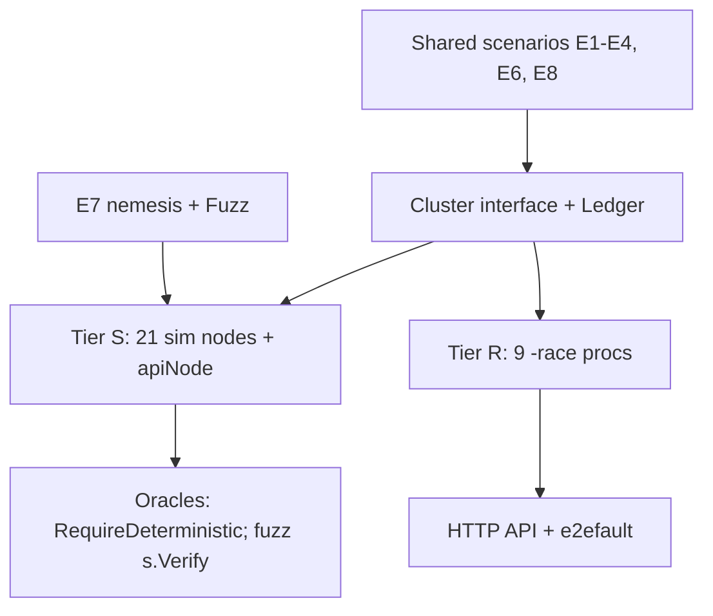
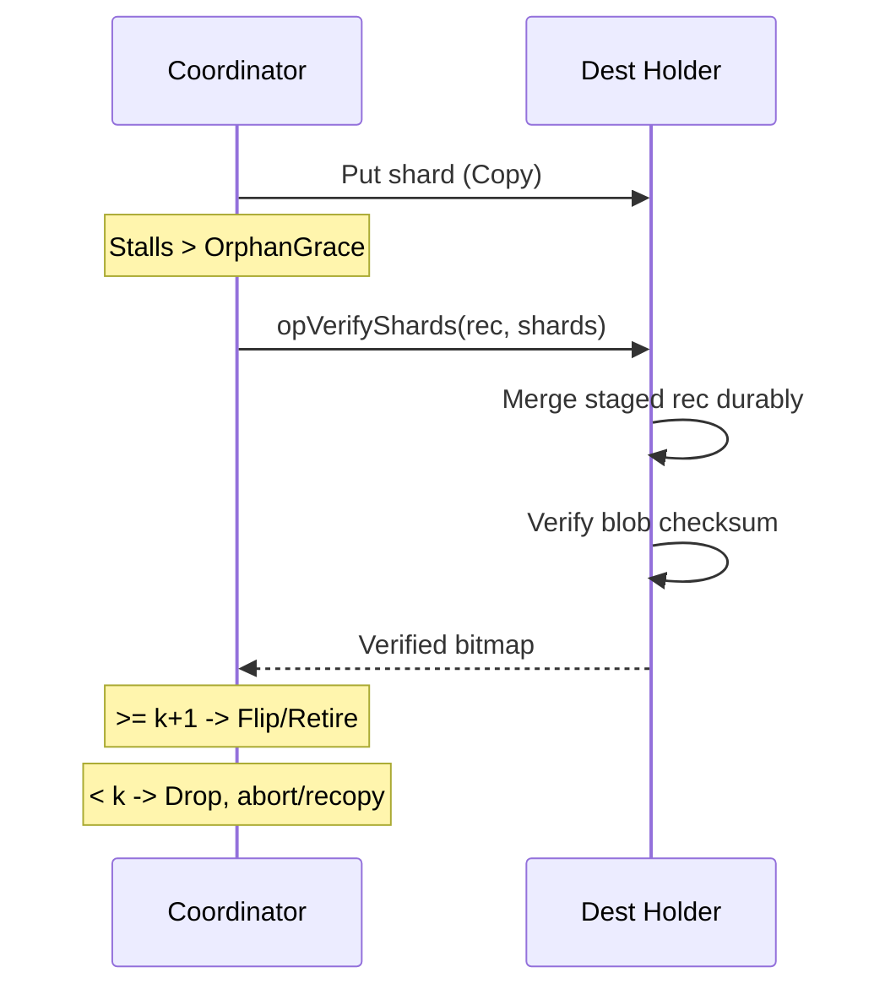

# End-to-End Tests and Hardening

[The Object Store and Sync Engine](07-object-store-and-sync-engine.md) wired gossip, erasure coding, Merkle anti-entropy, optimistic concurrency control, and sagas behind the object API, sockets, and disk. Per-layer tests miss cross-layer bugs; even a green end-to-end suite stays blind if an unplaceable layout, loose error check, or short fault window lets data loss pass.

End-to-end hardening closes both gaps. Shared scenarios run under deterministic simulation testing (Tier S) with continuous oracles and exact replay, and on real `objnode` processes (Tier R) over HTTP with `-race`, signals, and `fsync`. Fuzzing, sweeps, canaries, and adversarial suites attack the harness itself, fixing checks that pass when their guarantee breaks.

## How end-to-end testing maps to this repository

The suite lives in `test/e2e/` (`package e2e`, [`e2e.go`](../../test/e2e/e2e.go)) and shares `Lineage` ([`internal/nodetest/lineage.go`](../../internal/nodetest/lineage.go)) with `internal/node`.



<!-- draw-visual: diagrams/08-two-tier-harness.mmd -->
```text
┌──────────────────────────────────────────────┐     ┌───────────────────────┐
│                                              │     │                       │
│        Shared scenarios E1-E4, E6, E8        │  ┌──┤   E7 nemesis + Fuzz   │
│                                              │  │  │                       │
└───────────────────────┬──────────────────────┘  │  └───────────────────────┘
                        │                         │
                        │                         │
                        │                         │
                        │                         │
                        ▼                         │
┌──────────────────────────────────────────────┐  │
│                                              │  │
│          Cluster interface + Ledger          ├──┼──────────────┐
│                                              │  │              │
└───────────────────────┬──────────────────────┘  │              │
                        │                         │              │
                        │                         │              │
                        ├─────────────────────────┘              │
                        │                                        │
                        ▼                                        ▼
┌──────────────────────────────────────────────┐     ┌───────────────────────┐
│                                              │     │                       │
│        Tier S: 21 sim nodes + apiNode        │     │ Tier R: 9 -race procs │
│                                              │     │                       │
└───────────────────────┬──────────────────────┘     └───────────┬───────────┘
                        │                                        │
                        │                                        │
                        │                                        │
                        │                                        │
                        ▼                                        ▼
┌──────────────────────────────────────────────┐     ┌───────────────────────┐
│                                              │     │                       │
│ Oracles: RequireDeterministic; fuzz s.Verify │     │  HTTP API + e2efault  │
│                                              │     │                       │
└──────────────────────────────────────────────┘     └───────────────────────┘
```

### Two tiers behind one interface

Scenarios E1–E4, E6, and E8 run against `Cluster` ([`cluster_test.go`](../../test/e2e/cluster_test.go)), sharing `Ledger` to hash PUT attempts and verify GETs against ETags or prior attempts:

- **Tier S ([`simcluster_test.go`](../../test/e2e/simcluster_test.go)).** 21 `*node.Node` instances across three regions (`4+2`, 64 KiB stripes) on the simulator ([Deterministic Simulation Testing](01-deterministic-simulation.md)). Clients call `apiNode` on channel `0xA0`, subjecting traffic to latency, splits, and lost replies without mocks. Scenarios use `simtest.RequireDeterministic`; fuzz runs end with `s.Verify()`.
- **Tier R ([`realcluster_test.go`](../../test/e2e/realcluster_test.go)).** Builds `cmd/objnode -race -tags e2efault` once and runs 9 processes (3/region, `4+2`; E4/E5 use `2+1` so routed buckets fit in one region). Port collisions retry the cluster; startup fails closed with logs if any node exits; `Pdeathsig: SIGKILL` and `TestTierRHarnessLeavesNothingBehindWhenATestFails` prevent leaks.

Four hooks aid testing without altering defaults: `ManifestOfRecord`/`ManifestOfStaged` ([`records.go`](../../internal/node/records.go)); `Health.MetaDigest`, `MetaRoot`, `rebuilt_bytes` ([`api.go`](../../internal/storage/api.go), [`objects.go`](../../internal/node/objects.go)); `//go:build e2efault` blocklist ([`e2efault.go`](../../internal/noderuntime/e2efault.go)) behind `outboundFilter` ([`runtime.go`](../../internal/noderuntime/runtime.go), checked absent by `TestDefaultBuildCarriesNoFaultInjection`); and `leakReport` ([`main.go`](../../cmd/objnode/main.go)).

### Two product defects found by adversarial testing

The initial suite found no product defects; stricter checks and adversarial testing uncovered two:

1. **Live reads short of `k` shards returned 404 instead of 503.** Per-op allowlists in `(*nemesis).settle` failed E7 seed `1` (`get w/k15 via n017`). `storage.Node.Get` joins `storage.ErrUnavailable` with shard causes (`ErrNotFound`, `ErrCorrupt`); first-match tables listed shard causes first, returning wire code 96 (404) or 97 (500) instead of 99 (503). Moving `ErrUnavailable` first in [`internal/storage/errors.go`](../../internal/storage/errors.go) and [`internal/storage/httpapi/http.go`](../../internal/storage/httpapi/http.go) fixed it without changing codes (pinned by seed `1` and 8-cause tests).
2. **A coordinator paused past `OrphanGrace` completed and lost acknowledged objects.** E7 and fuzz faults lasted 4 s before `FaultHealAll`. Pausing a coordinator 70 s starting 100 ms into migration (vs 60 s `OrphanGrace`) lost objects on 6/12 seeds (5/6 with no lost reply; 0/12 at 15 s or 30 s): `Copy` wrote shards before staging manifests, destination inventory orphan-collected them, verify checked manifest-only roots, and `Retire` swapped live manifests onto deleted versions.



<!-- draw-visual: diagrams/08-verify-shards.mmd -->
```text
       ┌─────────────┐     ┌─────────────┐
       │ Coordinator │     │ Dest Holder │
       └──────┬──────┘     └──────┬──────┘
              │                   │
              │ Put shard (Copy)  │
              ├──────────────────►│
              │                   │
   ┌──────────────────────┐       │
   │ Stalls > OrphanGrace │       │
   └──────────────────────┘       │
              │                   │
              │ opVerifyShards(rec, shards)
              ├──────────────────►│
              │                   │
              │                   │ Merge staged rec durably
              │                   ├──┐
              │                   │  │
              │                   │◄─┘
              │                   │
              │                   │ Verify blob checksum
              │                   ├──┐
              │                   │  │
              │                   │◄─┘
              │                   │
              │ Verified bitmap   │
              │◄┈┈┈┈┈┈┈┈┈┈┈┈┈┈┈┈┈┈┤
              │                   │
  ┌───────────────────────┐       │
  │ >= k+1 -> Flip/Retire │       │
  └───────────────────────┘       │
              │                   │
┌───────────────────────────┐     │
│ < k -> Drop, abort/recopy │     │
└───────────────────────────┘     │
              │                   │
```

[`meta.go`](../../internal/node/meta.go), [`migrate.go`](../../internal/node/migrate.go), and [`inventory.go`](../../internal/node/inventory.go) add `opVerifyShards` (op 4), establishing this guarantee:

> A migration never routes a bucket to, or swaps a manifest onto, a copied version unless the destination holders have confirmed, and from then on keep, at least the write quorum of every stripe's shards — however long any node, the coordinator included, was stalled.

Verification runs after copy, in verify and catch-up (`Root`), and in `Retire` before swapping: the holder durably merges the staged/live record so inventory expects the shard before checking checksums. Stripes need `AckQuorum` (`k+1` default): below quorum retries; `< k` verified-plus-unreachable drops the staged version (pre-flip compensates; post-flip re-copies). `Retire` deletes staged records after peers hold swapped manifests and reports swaps to `CommitSink`. Four 3-seed tests in [`dst_migstall_test.go`](../../internal/node/dst_migstall_test.go) (`TestMigrationVerifyBelowKCompensates`, `TestMigrationVerifyBelowQuorumWaitsForRebuild`, `TestMigrationRetireBelowQuorumWaitsForRebuild`, `TestMigrationRetireBelowKRecopiesAndNeverGoesLive`) fail if the threshold drops or the retire re-check is removed.

### Coverage holes, replay, and canaries

Auditing and mutating the suite exposed three holes, each pinned by a canary:

1. **Fuzzed migrations moved nothing.** `fuzzOptions` ran 9 nodes (3/region) at `4+2`, so routed bucket `m` could not place 6-shard stripes; all 234 initial fuzz runs migrated an empty bucket. Switching to 12 nodes (4/region) at `2+1`, writing two warm-up objects before cycle 1, requiring `>= k` destination shards per pre-existing key, and keeping `TestCanaryFuzzRoutedBucketCannotPlaceShards` closed it.
2. **Timed-out starts treated as "nothing started."** `finishMigration` returned `nil` on `env.ErrTimeout`, leaving a started saga untracked; it now checks `coord.Engine().IDs()` after heal, awaits started sagas, and refreshes `n.region` (`TestNemesisAmbiguousMigrationStartIsTracked`, `TestCanaryNemesisForgottenAmbiguousMigrationFails`).
3. **Partition test required no successes.** E2 passed even if every split PUT/GET returned `ErrUnavailable`; it now requires surviving-side PUTs (`len(side) >= k+m`) and GETs (`>= k` pre-cut shards, including early reads) to succeed (`TestCanaryE2ObjectOpsUnavailableDuringSplitFails`).

Every repaired check keeps a canary (15 Tier S canaries in [`canary_test.go`](../../test/e2e/canary_test.go), Tier R's E9 canary, `checkCanaryFailure`, [`oracle_self_test.go`](../../test/e2e/oracle_self_test.go)). Anti-vacuity guards stay exact per event or start at a seed floor: a sweep heuristic false-failed E7 `-seed=102` (replaced by per-migration checks plus 10/20-seed totals), `checkE7AvailabilityFloor` starts at 10 seeds, and `internal/merkle`'s `TestLyingPeerDST` (seed `214339956433005`, 1/1,503 seeds) switched to exact per-seed checks plus a 10-seed floor.

Every Tier S failure prints a replay line:

```text
REPLAY: go test ./test/e2e -run '^TestE7NemesisHealingCyclesS$/^shard=1$/^seed=1$' -seed=1 -count=1
```

Sharding by `i mod 4` sent single-seed replays to `shard=0`, letting shards 1–3 pass empty. [`harness_test.go`](../../test/e2e/harness_test.go) now shards by `uint64(seed) % 4` and fails closed on zero subtests; `TestReplayCommandsReproduceEverySeed` ([`replay_test.go`](../../test/e2e/replay_test.go)) re-runs every printed line across `DST_SEEDS=8` and E5 cells.

### Design choices and what each costs

- **Fast CI vs on-demand sweeps.** Sweeping all scenarios at 500 seeds took ~2.8 h before tuning. `seedsFor` ([`harness_test.go`](../../test/e2e/harness_test.go)) assigns shares of `DST_SEEDS` (`3/5` for E7 down to `1/25` for multi-MB E1) plus pinned [`testdata/seeds.txt`](../../test/e2e/testdata/seeds.txt); `E2E_FULL_SEEDS=1` or `-seed` bypasses shares, and `-race` runs 1 unpinned seed and every 8th E5 cell. Push CI ([`.github/workflows/ci.yml`](../../.github/workflows/ci.yml)) runs build, static checks, and `go test -short` (trimming E5 from 78 to 10 cells on 1 seed, cutting `test/e2e` from 351 s to 73 s); full gates, fuzzing, sweeps, and Tier R (`E2E_TIER_R=1`) run on demand in Docker. *Cost:* push CI covers only a fixed-seed slice.
- **Post-flip vs pre-existing metrics.** `dest_objects`/`dest_shards` count live objects and verified destination shards afterwards (including post-flip writes); `moved_objects`/`moved_shards` count pre-existing objects live on the coordinator at migration start and their destination shards.
- **Tier S breadth vs Tier R OS boundaries.** Simulator sweeps test hundreds of seeds deterministically; real processes test sockets, `-race`, signals, and `fsync` at lower concurrency.

### Testing on the simulator

On Tier S ([`simoracle_test.go`](../../test/e2e/simoracle_test.go)), four oracles run every event: `Ledger` (`e2e/no-get-returns-wrong-bytes`), `watchDisk` (no deletion of winnable shards or commits after deletion), loss-declaration validity (`~lost/<v>` vs holders' disks), and regional spread (`<= m` shards/region when capacity allows). `nodetest.Lineage` (`CommitSink`/`DiscardSink`: acked writes are current, migrated, superseded, or discard losers) checks at heals and end; `Converged`, `checkLiveReadableOrLost`, and `checkOrphans` (no stray shard past `OrphanGrace + GCGrace + 10 s`) run after heal or grace. Both tiers check `RecentDiscards` and `len(RecentDiscards) == min(Discards, 64)` via `checkContests`.

[`nemesis_test.go`](../../test/e2e/nemesis_test.go) and [`e7_test.go`](../../test/e2e/e7_test.go) run `TestE7NemesisHealingCyclesS` (21 nodes, 4 cycles of 4 s chaos, 20 s `OrphanGrace`, 5 s `GCGrace`, 2–5 faults/cycle beside 250 ms traffic) and `FuzzClusterNemesis` (12 nodes, `2+1`, `planFromBytes`, skips `> 64 KiB`, ≤3 cycles, ≤8 ops). The budget keeps `k` verifiable shards/live stripe on untouched up holders, caps down/paused nodes at 3, and never wipes an active coordinator or sole metadata holder (`metadataElsewhere`).

## Key pieces in code

`availabilityReadClean` ([`test/e2e/nemesis_test.go`](../../test/e2e/nemesis_test.go)) voids a read only if it ended at or after the cycle's first network fault or node touch:

```go
func (n *nemesis) availabilityReadClean(k *Call) bool {
	if k.Size != -1 {
		return false
	}
	if n.netFault && k.Ended >= n.netFaultAt {
		return false
	}
	id := env.NodeID(k.At.ID)
	if n.touched[id] && k.Ended >= n.touchedAt[id] {
		return false
	}
	return true
}
```

`CodeEntries` ([`internal/storage/errors.go`](../../internal/storage/errors.go)) puts `CodeUnavailable` first so short-of-`k` reads encode as 99 (HTTP 503):

```go
func CodeEntries() []env.CodeEntry {
	return []env.CodeEntry{
		{Code: CodeUnavailable, Err: ErrUnavailable},
		{Code: CodeNotFound, Err: ErrNotFound},
		{Code: CodeCorrupt, Err: ErrCorrupt},
		{Code: CodeExists, Err: ErrExists},
		{Code: CodeInvalid, Err: ErrInvalid},
	}
}
```

`e5CellSeeds` ([`test/e2e/e5sim_test.go`](../../test/e2e/e5sim_test.go), `e5TrimStride = 8`) trims E5 to 10 cells under `-short` unless `-seed` or `E2E_FULL_SEEDS=1` is set:

```go
func e5CellSeeds(cell, cells int, short, race, explicitSeed, fullSeeds bool, seeds, pinned []int64) []int64 {
	trimShort := short && !explicitSeed && !fullSeeds
	if (race || trimShort) && cell%e5TrimStride != 0 {
		return nil
	}
	mine := e5Seeds(seeds, pinned, cell, cells)
	if trimShort && len(mine) > 1 {
		return mine[:1:1]
	}
	return mine
}
```

## What the tests show, and what they do not

Measurements ran in the Docker `dev` container (Tier S virtual time; Tier R wall time, `-race` `objnode`).

| Scenario | Verified (Tier S / Tier R) | Not shown here |
|---|---|---|
| **E1** Put/get | **S** (100 seeds): 33 objects, 660 reads, ≤168 ms; multi-MB (20 seeds, 2 MiB+29): ≤1.18 s. **R**: 36 objects (incl. 3 MiB+29), 288 reads, 3 MiB put 1.96–2.22 s | Faulted reads (E2/E3/E7); missing-region spread; permanent-loss re-placement |
| **E2** Partition | **S**: 125 seeds: detect ≤10.0 s, converge ≤11.6 s, 9 PUTs ok, 13 discards, 0 lost; 126 seeds: 15 GETs ok. **R**: detect 21.8 s, converge 5.7 s, 5 PUTs, 15–16 GETs ok, 10 discards, 0 lost | Cuts past `OrphanGrace` ([The Object Store and Sync Engine](07-object-store-and-sync-engine.md)); asymmetric cuts (E7); read-your-writes while split |
| **E3** Bit-rot | **S** (125 seeds): 20–28 rotted/seed, repair p50 1.24 s (reads)/2.0 s (idle), rebuilt/damaged 1.000, moved/damaged ≤5.02; `scenarioAbsenceShortOfLoss`. **R**: 23 shards, 1.4 s, 148,302 B rebuilt | Metadata/saga-log rot; rot `> m`; wire repair bytes on Tier R |
| **E4** Migration | **S**: 52 seeds at 500; 25-seed baseline p50 24.8 s/max 26.9 s, source-empty check; stalled-coordinator test (`OrphanGrace`+10 s). **R** (`2+1`): 10.5 s, 97 calls, 13 objects | Dueling migrations ([Sagas](06-sagas.md), [The Object Store and Sync Engine](07-object-store-and-sync-engine.md)); stalled coordinator on Tier R |
| **E5** Rollback | **S** (78 cells): 202 runs at 500 seeds (280 with seed 1 pinned), p50 11.4 s/max 16.9 s. **R** (`2+1`, 24 objects): kill target 7.4 s, kill coordinator 5.2 s | Unreturned coordinator; organic copy failures on Tier R (blocklist-forced) |
| **E6** Crash/wipe | **S** (125 seeds): 24 writes acked, rejoin p50 5.1 s, refill p50 2.2 s, 0 lost. **R**: incarnation 0→2, rejoin 3.4 s, 18-shard refill 2.3 s | Tier R catch-up checked only against prior shards (manifests unread over HTTP); torn crashes (E5) |
| **E7** Nemesis | **S**: 300 seeds (1,200 heals): 7–18 faults/seed, converge p50 7.6 s/max 26.2 s; 301 seeds: `availability_gets` 6–42 (p50 20, floor 10/seed), `dest_objects` 0–19 (`dest_shards` 0–114), `moved_objects` 0–15 (`moved_shards` 0–90); 0 lost | Mid-run clock steps; faults past budget; metadata/saga-log rot |
| **E8** Metadata | **S** (250 seeds, ±2 s skew): 25 split edits, 15 current, 8 discards, 6 stale ETags refused, converge ≤10.6 s. **R**: 22 acked (15 current, 7 logged), converge 4.5 s, 6 refused | Matching quota writes to discards (`QuotaInfo` lacks ETag) |
| **E9** Shutdown | **R** only: SIGTERM under load; exit 1.28–1.57 s (status 0, `goroutines left at exit: 0`), 7–8 in-flight finished, 0 failed, 24–34 acked read back | Internal cancellation ([The Object Store and Sync Engine](07-object-store-and-sync-engine.md)); stalled-disk shutdown |

- **Fuzz, sweeps, and gates.** All 15 fuzz targets passed with 0 crashers: 15 min on four headline targets (up to 1.64 M execs; `FuzzClusterNemesis` 234 pre-repair, 287–384 in 120 s post-repair, 18-input corpus `dest_objects=5`, `dest_shards=15`, `moved_objects=4`, `moved_shards=12`) and 5 min on the rest. An on-demand sweep (base `9000001`) ran eight simulator packages (332–5,000 seeds; 199 E7 seeds) cleanly; `internal/saga/sagasim` has no seed-sweeping tests. Tier R (13 tests, 242 s) passed standalone five times and after a 10-minute preload, but hit 1 s shard-timeout 503s after an hour-long sweep (cause unestablished), so full gates run Tier R first (`-race` `test/e2e` needs `-timeout 20m`+).
- **Adversarial suites.** Independent passes (long schedules, 30-wave soak, `ENOSPC` tmpfs, malformed inputs, startup contract) caught two harness bugs (nemesis settle accepted any non-PUT error; real cluster accepted a failed node), plus the stalled-coordinator defect and replay-sharding bug, leaving 0 broken claims.

### Narrowed claims

None.

### What the tests do not prove

- **Single-disk metadata ack.** Metadata and manifests ack after one local `fsync` ([Optimistic Concurrency Control](05-optimistic-concurrency-control.md)); losing that disk before anti-entropy copies the write loses it unrecorded (`TestCanaryE7WipingTheOnlyCopyOfAnAcknowledgedWriteIsCaught`, seed `166963932986536`).
- **Unreturned coordinator and frame cap.** A coordinator that never returns leaves its saga unfinished; the guarantee covers returning coordinators only. Whole-bucket migration messages cap at 16 MiB.
- **Real-process write concurrency.** Tier R caps in-flight PUTs at 1/cluster outside E9 (4); 4 concurrent PUTs across 9 `-race` processes on a small machine hit `objnode`'s fixed 1 s `RequestTimeout` (503) until a timeout flag exists.
- **Static clocks and partition reads.** The simulator models static skew and drift only, not mid-run clock steps. E2 promises valid bytes, `ErrUnavailable`, or `ErrNotFound` while split, with no read-your-writes promise during a partition.

## Go deeper in the repo

- **Harness/oracles:** [`cluster_test.go`](../../test/e2e/cluster_test.go), [`api_test.go`](../../test/e2e/api_test.go), [`simcluster_test.go`](../../test/e2e/simcluster_test.go), [`simoracle_test.go`](../../test/e2e/simoracle_test.go), [`harness_test.go`](../../test/e2e/harness_test.go), [`realcluster_test.go`](../../test/e2e/realcluster_test.go), [`internal/nodetest/lineage.go`](../../internal/nodetest/lineage.go), [`internal/noderuntime/e2efault.go`](../../internal/noderuntime/e2efault.go).
- **Scenarios/fuzz/canaries/replay (`test/e2e/`):** [`scenario_e1_test.go`](../../test/e2e/scenario_e1_test.go)–[`scenario_e4_test.go`](../../test/e2e/scenario_e4_test.go), [`scenario_e6_test.go`](../../test/e2e/scenario_e6_test.go), [`e5sim_test.go`](../../test/e2e/e5sim_test.go), [`nemesis_test.go`](../../test/e2e/nemesis_test.go), [`e7_test.go`](../../test/e2e/e7_test.go), [`migstall_test.go`](../../test/e2e/migstall_test.go), [`absence_test.go`](../../test/e2e/absence_test.go), [`tiers_test.go`](../../test/e2e/tiers_test.go), [`tierr_test.go`](../../test/e2e/tierr_test.go), [`canary_test.go`](../../test/e2e/canary_test.go), [`oracle_self_test.go`](../../test/e2e/oracle_self_test.go), [`replay_test.go`](../../test/e2e/replay_test.go), [`testdata/seeds.txt`](../../test/e2e/testdata/seeds.txt).
- **Fixes/CI:** [`internal/storage/errors.go`](../../internal/storage/errors.go), [`internal/storage/httpapi/http.go`](../../internal/storage/httpapi/http.go), [`internal/node/codes_test.go`](../../internal/node/codes_test.go), [`internal/node/meta.go`](../../internal/node/meta.go), [`internal/node/migrate.go`](../../internal/node/migrate.go), [`internal/node/inventory.go`](../../internal/node/inventory.go), [`internal/node/dst_migstall_test.go`](../../internal/node/dst_migstall_test.go), [`.github/workflows/ci.yml`](../../.github/workflows/ci.yml).

```sh
docker compose run --rm dev go test -short -count=1 ./test/e2e
docker compose run --rm -e E2E_TIER_R=1 dev go test ./test/e2e -run 'R$|TierR|DefaultBuild|CanaryE9' -count=1 -v -timeout 40m
docker compose run --rm dev go test ./test/e2e -run '^$' -fuzz '^FuzzClusterNemesis$' -fuzztime 120s -fuzzminimizetime 5s
```

## Sources and further reading

- **Kyle Kingsbury, Jepsen analyses.** Nemesis schedules and what passing runs do and do not prove.
- **Will Wilson (2014) and Jingyu Zhou et al., "FoundationDB" (SIGMOD, 2021).** Full-store simulation, replay, sweeps.
- **TigerBeetle VOPR write-ups.** Fault-budgeted simulation with continuous oracles.
- **Ding Yuan et al., "Simple Testing Can Prevent Most Critical Failures" (OSDI, 2014).** Error-handling outages and untested fault combinations.
- **Go documentation, "Go Fuzzing" (`testing.F`).** Coverage-guided mutation, minimization, structured plans from bytes.
