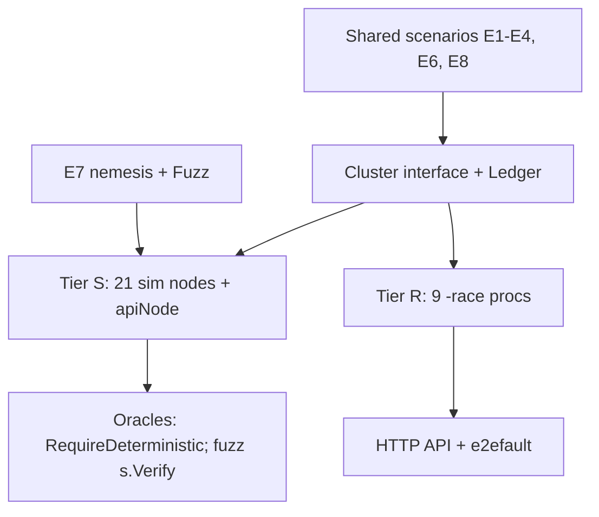
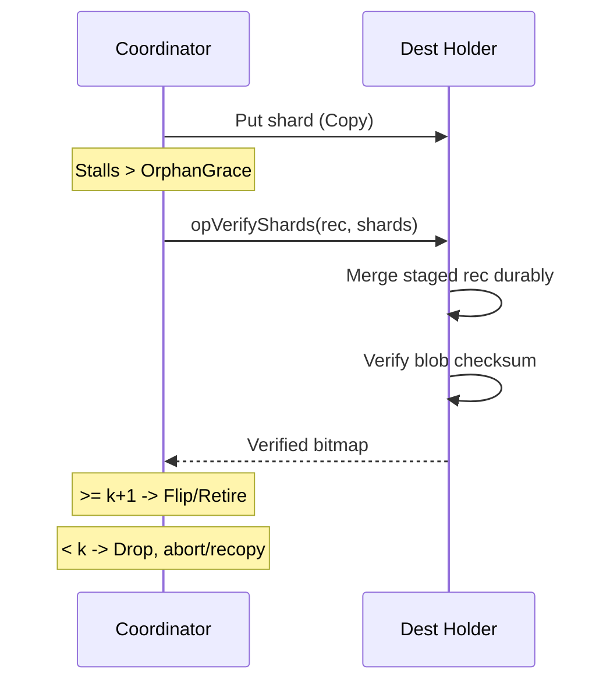

# End-to-End Tests and Hardening

Unit tests and per-protocol simulations test each layer alone, missing failures when gossip, erasure coding, Merkle anti-entropy, OCC, and migration sagas share one node behind an object API, sockets, and disk. Even a green end-to-end suite stays blind if an unplaceable layout, permissive error check, or short fault window lets data-loss bugs pass.

End-to-end hardening closes both gaps. Shared scenarios run on a deterministic simulator (Tier S) with continuous oracles and exact replay, and on real `objnode` processes (Tier R) over HTTP with `-race`, signals, and `fsync`. Fuzzing, seed sweeps, canaries, and adversarial harnesses attack the suite itself to find checks that still pass when their guarantee is broken, and each one found is repaired.

## How end-to-end testing maps to this repository

The suite lives in `test/e2e/` (`package e2e`, [`e2e.go`](../../test/e2e/e2e.go) plus `_test.go` files) and shares `Lineage` ([`internal/nodetest/lineage.go`](../../internal/nodetest/lineage.go)) with `internal/node`.



<!-- draw-visual: diagrams/08-two-tier-harness.mmd -->
```text
┌──────────────────────────────────────────────┐     ┌───────────────────────┐
│                                              │     │                       │
│        Shared scenarios E1-E4, E6, E8        │  ┌──┤   E7 nemesis + Fuzz   │
│                                              │  │  │                       │
└───────────────────────┬──────────────────────┘  │  └───────────────────────┘
                        │                         │
                        │                         │
                        │                         │
                        │                         │
                        ▼                         │
┌──────────────────────────────────────────────┐  │
│                                              │  │
│          Cluster interface + Ledger          ├──┼──────────────┐
│                                              │  │              │
└───────────────────────┬──────────────────────┘  │              │
                        │                         │              │
                        │                         │              │
                        ├─────────────────────────┘              │
                        │                                        │
                        ▼                                        ▼
┌──────────────────────────────────────────────┐     ┌───────────────────────┐
│                                              │     │                       │
│        Tier S: 21 sim nodes + apiNode        │     │ Tier R: 9 -race procs │
│                                              │     │                       │
└───────────────────────┬──────────────────────┘     └───────────┬───────────┘
                        │                                        │
                        │                                        │
                        │                                        │
                        │                                        │
                        ▼                                        ▼
┌──────────────────────────────────────────────┐     ┌───────────────────────┐
│                                              │     │                       │
│ Oracles: RequireDeterministic; fuzz s.Verify │     │  HTTP API + e2efault  │
│                                              │     │                       │
└──────────────────────────────────────────────┘     └───────────────────────┘
```

### Two tiers behind one `Cluster` interface

Scenarios E1–E4, E6, and E8 run once against `Cluster` ([`cluster_test.go`](../../test/e2e/cluster_test.go)), sharing `Ledger` to hash PUT attempts and check GETs against their ETag or prior attempts.

- **Tier S ([`simcluster_test.go`](../../test/e2e/simcluster_test.go)).** Runs 21 `*node.Node` instances in three regions (`k=4, m=2`, 64 KiB stripes) on [Deterministic Simulation Testing](01-deterministic-simulation.md). Regional clients call `apiNode` on channel `0xA0`, subjecting client traffic to latency, partitions, and lost replies without mocks. Every scenario run on the simulator tier passes through `simtest.RequireDeterministic`; fuzz inputs end with `s.Verify()`.
- **Tier R ([`realcluster_test.go`](../../test/e2e/realcluster_test.go)).** Builds `cmd/objnode -race -tags e2efault` once per binary and runs 9 processes (3/region, `k=4, m=2`; E4/E5 use `k=2, m=1` so routed buckets fit in one region). Tests binding real ports reserve them together and retry the whole cluster on fresh ports when a reserved port is taken; startup fails closed with logs if any node exits, and `Pdeathsig: SIGKILL` plus `TestTierRHarnessLeavesNothingBehindWhenATestFails` prevent leaked processes.

Four product hooks aid testing without changing default behavior: `ManifestOfRecord`/`ManifestOfStaged` ([`internal/node/records.go`](../../internal/node/records.go)); `Health.MetaDigest`, `MetaRoot`, and `rebuilt_bytes` ([`internal/storage/api.go`](../../internal/storage/api.go), [`internal/node/objects.go`](../../internal/node/objects.go)); a `//go:build e2efault` blocklist ([`internal/noderuntime/e2efault.go`](../../internal/noderuntime/e2efault.go)) behind `outboundFilter` ([`internal/noderuntime/runtime.go`](../../internal/noderuntime/runtime.go), verified absent from default builds by `TestDefaultBuildCarriesNoFaultInjection`); and `leakReport` ([`cmd/objnode/main.go`](../../cmd/objnode/main.go)).

### Continuous oracles, nemesis cycles, and whole-cluster fuzzing

On Tier S ([`simoracle_test.go`](../../test/e2e/simoracle_test.go)), four oracles fire on every event: `Ledger` (`e2e/no-get-returns-wrong-bytes`), deletion safety (`watchDisk`, forbidding deletion of any winnable shard or committing after shard deletion), loss-declaration validity (checking `~lost/<v>` against all holders' disks), and regional spread (`<= m` shards/region when capacity allows). `nodetest.Lineage` (via `CommitSink`/`DiscardSink`, requiring acknowledged writes to be current, migrated, superseded, or a discard loser) is checked at every heal and at the end; `Converged`, `checkLiveReadableOrLost`, and `checkOrphans` (no stray shard past `OrphanGrace + GCGrace + 10s`) run after a heal or after the grace periods. Both tiers check `RecentDiscards` and `len(RecentDiscards) == min(Discards, 64)` via `checkContests`.

The nemesis runner ([`nemesis_test.go`](../../test/e2e/nemesis_test.go), [`e7_test.go`](../../test/e2e/e7_test.go)) drives `TestE7NemesisHealingCyclesS` (21 nodes, 4 cycles of 4s chaos, 20s `OrphanGrace`, 5s `GCGrace`) and `FuzzClusterNemesis` (12 nodes, `k=2, m=1`, `planFromBytes`, skipping inputs `> 64 KiB`). E7's random plan injects 2–5 faults per cycle (node, link, disk, and migration faults) beside 250ms traffic; the fuzz target builds its plan from its input (up to 3 cycles and 8 operations). Its budget keeps `k` verifiable shards per live stripe on untouched up holders, caps down/paused nodes at 3, and never wipes an active coordinator or the sole holder of a metadata version (`metadataElsewhere`).

### Two product defects found — and why a suite needs an outside attacker

The initial suite found no product defects. Tightening checks and an adversarial pass uncovered two:

1. **Live-object reads short of `k` shards answered 404 instead of 503.** Adding per-op allowlists to `(*nemesis).settle` failed E7 seed `1` (`get w/k15 via n017`). `storage.Node.Get` joins `storage.ErrUnavailable` with per-shard causes (`ErrNotFound`, `ErrCorrupt`), and first-match tables listed shard causes ahead of it, returning wire code 96 (not found, HTTP 404) or 97 (corrupt, HTTP 500) instead of 99 (503). Moving `ErrUnavailable` ahead of per-shard causes in [`internal/storage/errors.go`](../../internal/storage/errors.go) and [`internal/storage/httpapi/http.go`](../../internal/storage/httpapi/http.go) fixed it without changing codes, held by seed `1` and 8-cause tests.
2. **A migration coordinator frozen past `OrphanGrace` completed and lost acknowledged objects.** E7 and fuzz faults lasted seconds (4s chaos before `FaultHealAll`). An outside attacker paused a coordinator for 70s starting 100ms after migration start, during the copy (vs 60s `OrphanGrace`), losing objects on 6 of 12 seeds (5 of 6 without a lost reply; 0 of 12 at 15s or 30s). `Copy` wrote shards before staging the manifest; destination inventory ignored copy intents and orphan-collected them; the verify step checked manifest-only roots; and `Retire` swapped live manifests onto deleted versions.



<!-- draw-visual: diagrams/08-verify-shards.mmd -->
```text
       ┌─────────────┐     ┌─────────────┐
       │ Coordinator │     │ Dest Holder │
       └──────┬──────┘     └──────┬──────┘
              │                   │
              │ Put shard (Copy)  │
              ├──────────────────►│
              │                   │
   ┌──────────────────────┐       │
   │ Stalls > OrphanGrace │       │
   └──────────────────────┘       │
              │                   │
              │ opVerifyShards(rec, shards)
              ├──────────────────►│
              │                   │
              │                   │ Merge staged rec durably
              │                   ├──┐
              │                   │  │
              │                   │◄─┘
              │                   │
              │                   │ Verify blob checksum
              │                   ├──┐
              │                   │  │
              │                   │◄─┘
              │                   │
              │ Verified bitmap   │
              │◄┈┈┈┈┈┈┈┈┈┈┈┈┈┈┈┈┈┈┤
              │                   │
  ┌───────────────────────┐       │
  │ >= k+1 -> Flip/Retire │       │
  └───────────────────────┘       │
              │                   │
┌───────────────────────────┐     │
│ < k -> Drop, abort/recopy │     │
└───────────────────────────┘     │
              │                   │
```

The fix in [`internal/node/meta.go`](../../internal/node/meta.go), [`internal/node/migrate.go`](../../internal/node/migrate.go), and [`internal/node/inventory.go`](../../internal/node/inventory.go) adds `opVerifyShards` (op 4), establishing this guarantee:

> A migration never routes a bucket to, or swaps a manifest onto, a copied version unless the destination holders have confirmed, and from then on keep, at least the write quorum of every stripe's shards — however long any node, the coordinator included, was stalled.

The confirming holder is, by the same request, made to keep the shard: the coordinator sends the staged (or live) manifest record with the shard list, and the holder merges it durably so inventory expects the shard before verifying checksums. Verification runs after each copy, in the verify step and post-flip catch-up (`Root`), and in `Retire` before swapping. Each stripe needs `AckQuorum` (`k+1` default): below quorum retries; if verified plus unreachable holders drop below `k`, the staged version is marked dead and deleted (pre-flip compensates; post-flip re-copies from source). `Retire` deletes staged records only after peers hold swapped manifests and reports swaps to `CommitSink`. In [`internal/node/dst_migstall_test.go`](../../internal/node/dst_migstall_test.go), the threshold and retire-time re-check each have tests on three seeds (`TestMigrationVerifyBelowKCompensates`, `TestMigrationVerifyBelowQuorumWaitsForRebuild`, `TestMigrationRetireBelowQuorumWaitsForRebuild`, `TestMigrationRetireBelowKRecopiesAndNeverGoesLive`); lowering the threshold or removing the re-check fails them.

### Coverage holes caught in the suite, replay, and canaries

Auditing and mutating the suite exposed three coverage holes, each guarded by a kept canary:

1. **Fuzzed migrations moved nothing.** `fuzzOptions` ran 9 nodes (3/region) at `k=4, m=2`, so routed bucket `m` could not place 6-shard stripes; all 234 initial fuzz runs migrated an empty bucket. Switching to 12 nodes (4/region) at `k=2, m=1`, writing two warm-up objects before cycle 1, requiring `>= k` verified destination shards per pre-existing key, and keeping `TestCanaryFuzzRoutedBucketCannotPlaceShards` closed it.
2. **Timed-out starts treated as "nothing started."** `finishMigration` returned `nil` on `env.ErrTimeout`, leaving a started saga untracked, `n.region` stale, and the coordinator unprotected. It now inspects `coord.Engine().IDs()` after heal, awaits any started saga, and refreshes `n.region` (`TestNemesisAmbiguousMigrationStartIsTracked`, `TestCanaryNemesisForgottenAmbiguousMigrationFails`).
3. **Partition test required no successes.** E2 passed even if every partition-time PUT/GET returned `ErrUnavailable`. It now requires surviving-side PUTs (`len(side) >= k+m`) and GETs (`>= k` pre-cut shards, including early reads) to succeed (`TestCanaryE2ObjectOpsUnavailableDuringSplitFails`).

Every repaired check is mutation-tested with a kept canary (15 Tier S canaries in [`canary_test.go`](../../test/e2e/canary_test.go), Tier R's E9 canary, `checkCanaryFailure`, and [`oracle_self_test.go`](../../test/e2e/oracle_self_test.go)). Anti-vacuity guards must be exact per event or apply only from a seed floor: a sweep heuristic false-failed single-seed E7 `-seed=102` (replaced by exact per-migration checks plus totals from 10 or 20 seeds), `checkE7AvailabilityFloor` guards availability reads from 10 seeds up, and `internal/merkle`'s `TestLyingPeerDST` (seed `214339956433005`, 1/1,503 seeds) replaced a probable per-seed check with exact per-seed checks plus a 10-seed floor.

**Replay.** Every Tier S failure prints:

```text
REPLAY: go test ./test/e2e -run '^TestE7NemesisHealingCyclesS$/^shard=1$/^seed=1$' -seed=1 -count=1
```

Sharding by slice index `i mod 4` sent single-seed replays to `shard=0`, so shards 1–3 ran zero subtests and passed. [`harness_test.go`](../../test/e2e/harness_test.go) now shards by `uint64(seed) % 4` and fails closed on zero subtests; [`replay_test.go`](../../test/e2e/replay_test.go) (`TestReplayCommandsReproduceEverySeed`) re-runs every printed line across `DST_SEEDS=8` and E5 cells.

### Seed shares, measurement names, and how long runs execute

- **Fast CI vs on-demand runs.** Sweeping all scenarios at 500 seeds took ~2.8h before tuning. `seedsFor` ([`harness_test.go`](../../test/e2e/harness_test.go)) assigns shares of `DST_SEEDS` (`3/5` for E7 down to `1/25` for multi-MB E1) plus pinned [`testdata/seeds.txt`](../../test/e2e/testdata/seeds.txt); `E2E_FULL_SEEDS=1` or `-seed` bypasses shares, and `-race` runs 1 unpinned seed and every eighth E5 cell. Push CI (`agent_work/gates/ci-fast.sh`) runs build, static checks, and `go test -short` (trimming E5's 78 cells to 10 on 1 seed, cutting `test/e2e` from 351s to 73s). Full gates (`gate.sh`), fuzzing (`run-fuzz.sh`), sweeps (`run-sweep.sh`), and Tier R (`E2E_TIER_R=1`) are on-demand Docker runs.
- **Measurement names.** `dest_objects`/`dest_shards` count live objects and verified destination shards afterwards (including post-flip writes); `moved_objects`/`moved_shards` count strictly pre-existing objects live on the coordinator at migration start and their destination shards.

## Key pieces in code

`Ledger.checkRead` ([`test/e2e/cluster_test.go`](../../test/e2e/cluster_test.go)) backs `e2e/no-get-returns-wrong-bytes` on both tiers, checking acknowledged ETags strictly while allowing bytes from an unacknowledged attempt:

```go
func (l *Ledger) checkRead(k *Call) error {
	sum := sha256.Sum256(k.Data)
	if k.Info.Size != int64(len(k.Data)) {
		return fmt.Errorf("get %s/%s from %s: %d bytes, size %d", k.Bucket, k.Key, k.At.ID, len(k.Data), k.Info.Size)
	}
	if k.Info.ContentSHA != "" && k.Info.ContentSHA != hex.EncodeToString(sum[:]) {
		return fmt.Errorf("get %s/%s from %s: bytes do not hash to the version's content hash", k.Bucket, k.Key, k.At.ID)
	}
	if a, ok := l.byETag[k.Info.ETag]; ok {
		if a.bucket != k.Bucket || a.key != k.Key || a.sum != sum {
			return fmt.Errorf("get %s/%s from %s: version %s returned bytes other than the ones written under it", k.Bucket, k.Key, k.At.ID, short(k.Info.ETag))
		}
		return nil
	}
	if !slices.ContainsFunc(l.attempts[objID(k.Bucket, k.Key)], func(a attempt) bool { return a.sum == sum }) {
		return fmt.Errorf("get %s/%s from %s: %d bytes that no client ever wrote to this key", k.Bucket, k.Key, k.At.ID, len(k.Data))
	}
	return nil
}
```

`availabilityReadClean` ([`test/e2e/nemesis_test.go`](../../test/e2e/nemesis_test.go)) voids an availability read only if it ended at or after the cycle's first network fault or node touch:

```go
func (n *nemesis) availabilityReadClean(k *Call) bool {
	if k.Size != -1 {
		return false
	}
	if n.netFault && k.Ended >= n.netFaultAt {
		return false
	}
	id := env.NodeID(k.At.ID)
	if n.touched[id] && k.Ended >= n.touchedAt[id] {
		return false
	}
	return true
}
```

`CodeEntries` ([`internal/storage/errors.go`](../../internal/storage/errors.go)) puts `CodeUnavailable` ahead of per-shard causes so short-of-`k` reads encode as 99 (HTTP 503):

```go
func CodeEntries() []env.CodeEntry {
	return []env.CodeEntry{
		{Code: CodeUnavailable, Err: ErrUnavailable},
		{Code: CodeNotFound, Err: ErrNotFound},
		{Code: CodeCorrupt, Err: ErrCorrupt},
		{Code: CodeExists, Err: ErrExists},
		{Code: CodeInvalid, Err: ErrInvalid},
	}
}
```

`e5CellSeeds` ([`test/e2e/e5sim_test.go`](../../test/e2e/e5sim_test.go)) trims the 78-cell matrix to a 10-cell smoke under `-short` unless `-seed` or `E2E_FULL_SEEDS=1` is set:

```go
const e5TrimStride = 8

func e5CellSeeds(cell, cells int, short, race, explicitSeed, fullSeeds bool, seeds, pinned []int64) []int64 {
	trimShort := short && !explicitSeed && !fullSeeds
	if (race || trimShort) && cell%e5TrimStride != 0 {
		return nil
	}
	mine := e5Seeds(seeds, pinned, cell, cells)
	if trimShort && len(mine) > 1 {
		return mine[:1:1]
	}
	return mine
}
```

## What the tests show, and what they do not

Measurements ran in the Docker `dev` container (Tier S virtual time; Tier R wall time, `-race` `objnode`).

| Scenario | Verified (Tier S / Tier R) | Not shown here |
|---|---|---|
| **E1** Put/get | **S** (100 seeds): 33 objects, 660 reads, ≤168ms; multi-MB (20 seeds, 2 MiB+29): ≤1.18s. **R**: 36 objects (incl. 3 MiB+29), 288 reads, 3 MiB put 1.96–2.22s | Faulted reads (E2/E3/E7); missing-region spread; permanent-loss re-placement |
| **E2** Partition | **S**: 125 seeds: detect ≤10.0s, converge ≤11.6s, 9 PUTs ok, 13 discards, 0 lost; 126 seeds: 15 GETs ok. **R**: detect 21.8s, converge 5.7s, 5 PUTs, 15–16 GETs ok, 10 discards, 0 lost | Cuts past `OrphanGrace` ([The Object Store and Sync Engine](07-object-store-and-sync-engine.md)); asymmetric cuts (E7); read-your-writes while split |
| **E3** Bit-rot | **S** (125 seeds): 20–28 rotted/seed, repair p50 1.24s (reads)/2.0s (idle), rebuilt/damaged 1.000, moved/damaged ≤5.02; `scenarioAbsenceShortOfLoss`. **R**: 23 shards, 1.4s, 148,302 B rebuilt | Metadata/saga-log rot; rot `> m`; wire repair bytes on Tier R |
| **E4** Migration | **S**: 52 seeds at 500; 25-seed baseline p50 24.8s/max 26.9s, immediate source-empty check; stalled-coordinator test (`OrphanGrace`+10s). **R** (`2+1`): 10.5s, 97 calls, 13 objects | Dueling migrations ([Sagas](06-sagas.md), [The Object Store and Sync Engine](07-object-store-and-sync-engine.md)); stalled coordinator on Tier R |
| **E5** Rollback | **S** (78 cells): 202 runs at 500 seeds (280 with seed 1 pinned), p50 11.4s/max 16.9s. **R** (`2+1`, 24 objects): kill target 7.4s, kill coordinator 5.2s | Unreturned coordinator; organic copy failures on Tier R (blocklist-forced) |
| **E6** Crash/wipe | **S** (125 seeds): 24 writes acked, rejoin p50 5.1s, refill p50 2.2s, 0 lost. **R**: incarnation 0→2, rejoin 3.4s, 18-shard refill 2.3s | Shard catch-up on Tier R checked only against prior shards (manifests unread over HTTP); torn crashes (E5) |
| **E7** Nemesis | **S**: 300 seeds (1,200 heals): 7–18 faults/seed, converge p50 7.6s/max 26.2s; 301 seeds: `availability_gets` 6–42 (p50 20, floor 10/seed), `dest_objects` 0–19 (`dest_shards` 0–114), `moved_objects` 0–15 (`moved_shards` 0–90); 0 lost | Mid-run clock steps; faults past budget; metadata/saga-log rot |
| **E8** Metadata | **S** (250 seeds, ±2s skew): 25 split edits, 15 current, 8 discards, 6 stale ETags refused, converge ≤10.6s. **R**: 22 acked (15 current, 7 logged), converge 4.5s, 6 refused | Matching quota writes to discards (`QuotaInfo` lacks ETag) |
| **E9** Shutdown | **R** only: SIGTERM under load; exit 1.28–1.57s (status 0, `goroutines left at exit: 0`), 7–8 in-flight finished, 0 failed, 24–34 acked read back | Internal cancellation ([The Object Store and Sync Engine](07-object-store-and-sync-engine.md)); stalled-disk shutdown |

- **Hardening fuzz, sweeps, and gates.** All 15 fuzz targets passed `run-fuzz.sh` with zero crashers: 15 min on four headline targets (up to 1.64M execs; `FuzzClusterNemesis` ran 234 pre-repair, then 287–384 in 120s post-repair, its 18-input corpus giving `dest_objects=5`, `dest_shards=15`, `moved_objects=4`, `moved_shards=12`) and 5 min on the rest. `run-sweep.sh` (base `9000001`) swept eight DST packages (332–5,000 seeds; 199 E7 seeds) cleanly; a ninth (`internal/saga/sagasim`) has no seed-sweeping tests. Tier R (13 tests, 242s) passed standalone five times and after a 10-minute preload, but hit 1s shard-timeout 503s after an hour-long sweep (cause unestablished), so the gate runs Tier R first (`-race` `test/e2e` needs `-timeout 20m`+).
- **Adversarial suites.** `agent_work/adversarial/07-e2e/` (long schedules, 30-wave soak, `ENOSPC` tmpfs, malformed inputs, startup contract) caught two harness bugs: the nemesis settle step accepted any error on non-PUT ops, and the real cluster accepted a node that failed to start. A second pass found the stalled-coordinator defect and replay-sharding bug, leaving no broken claims.

### Stated limits

- **Single-disk metadata ack.** Metadata and manifests ack after one local `fsync` ([Optimistic Concurrency Control](05-optimistic-concurrency-control.md)); losing that disk before anti-entropy copies the write loses it without a discard record (`TestCanaryE7WipingTheOnlyCopyOfAnAcknowledgedWriteIsCaught`, seed `166963932986536`).
- **Unreturned coordinator and frame cap.** A coordinator that never returns leaves its saga unfinished; the guarantee covers returning coordinators only. Whole-bucket migration messages cap at 16 MiB.
- **Real-process write concurrency.** Tier R caps in-flight PUTs at 1/cluster outside E9 (4); 4 concurrent PUTs across 9 `-race` processes on a small machine hit `objnode`'s fixed 1s `RequestTimeout` (503) until a timeout flag exists.
- **Static clocks and partition reads.** The simulator models static skew and drift only, not mid-run clock steps. E2 promises valid bytes, `ErrUnavailable`, or `ErrNotFound` while split, with no read-your-writes promise during a partition.

## Go deeper in the repo

- **Harness, tiers, and oracles:** [`cluster_test.go`](../../test/e2e/cluster_test.go), [`api_test.go`](../../test/e2e/api_test.go), [`simcluster_test.go`](../../test/e2e/simcluster_test.go), [`simoracle_test.go`](../../test/e2e/simoracle_test.go), [`harness_test.go`](../../test/e2e/harness_test.go), [`realcluster_test.go`](../../test/e2e/realcluster_test.go), [`internal/nodetest/lineage.go`](../../internal/nodetest/lineage.go), [`internal/noderuntime/e2efault.go`](../../internal/noderuntime/e2efault.go).
- **Scenarios, fuzzing, canaries, and replay:** [`scenario_e1_test.go`](../../test/e2e/scenario_e1_test.go)–[`scenario_e6_test.go`](../../test/e2e/scenario_e6_test.go), [`e5sim_test.go`](../../test/e2e/e5sim_test.go), [`nemesis_test.go`](../../test/e2e/nemesis_test.go), [`e7_test.go`](../../test/e2e/e7_test.go) (`TestE7NemesisHealingCyclesS`, `FuzzClusterNemesis`, `TestFuzzClusterNemesisCorpusMovesShards`, `TestNemesisAmbiguousMigrationStartIsTracked`), [`migstall_test.go`](../../test/e2e/migstall_test.go), [`absence_test.go`](../../test/e2e/absence_test.go), [`tiers_test.go`](../../test/e2e/tiers_test.go), [`tierr_test.go`](../../test/e2e/tierr_test.go), [`canary_test.go`](../../test/e2e/canary_test.go), [`oracle_self_test.go`](../../test/e2e/oracle_self_test.go), [`replay_test.go`](../../test/e2e/replay_test.go) (`TestReplayCommandsReproduceEverySeed`), [`testdata/seeds.txt`](../../test/e2e/testdata/seeds.txt).
- **Fixes and migration tests:** [`internal/storage/errors.go`](../../internal/storage/errors.go), [`internal/storage/httpapi/http.go`](../../internal/storage/httpapi/http.go), [`internal/node/codes_test.go`](../../internal/node/codes_test.go), [`internal/node/meta.go`](../../internal/node/meta.go), [`internal/node/migrate.go`](../../internal/node/migrate.go), [`internal/node/inventory.go`](../../internal/node/inventory.go), [`internal/node/dst_migstall_test.go`](../../internal/node/dst_migstall_test.go) (`TestMigrationVerifyBelowKCompensates`, `TestMigrationVerifyBelowQuorumWaitsForRebuild`, `TestMigrationRetireBelowQuorumWaitsForRebuild`, `TestMigrationRetireBelowKRecopiesAndNeverGoesLive`).
- **Scripts and adversarial harness:** `agent_work/adversarial/07-e2e/`, `agent_work/gates/ci-fast.sh`, `agent_work/07-e2e/hardening/run-fuzz.sh`, `agent_work/07-e2e/hardening/run-sweep.sh`.

Run fast smoke, Tier R, or fuzzing via Docker (full runs use `run-fuzz.sh` / `run-sweep.sh`):

```sh
docker compose run --rm dev go test -short -count=1 ./test/e2e
docker compose run --rm -e E2E_TIER_R=1 dev go test ./test/e2e -run 'R$|TierR|DefaultBuild|CanaryE9' -count=1 -v -timeout 40m
docker compose run --rm dev go test ./test/e2e -run '^$' -fuzz '^FuzzClusterNemesis$' -fuzztime 120s -fuzzminimizetime 5s
```

## Sources and further reading

- **Kyle Kingsbury, Jepsen analyses.** Nemesis schedules and stating what a passing run does and does not show.
- **Will Wilson, "Testing Distributed Systems w/ Deterministic Simulation" (2014) and Jingyu Zhou et al., "FoundationDB" (SIGMOD, 2021).** Full-store deterministic simulation, seeded replay, and long sweeps.
- **TigerBeetle VOPR write-ups.** Fault-budgeted simulation paired with continuous state-machine oracles.
- **Ding Yuan et al., "Simple Testing Can Prevent Most Critical Failures" (OSDI, 2014).** Catastrophic outages from error-handling paths and untested fault combinations.
- **Go documentation, "Go Fuzzing" (`testing.F`).** Coverage-guided mutation, minimization budgets, and structured plans from raw bytes.
