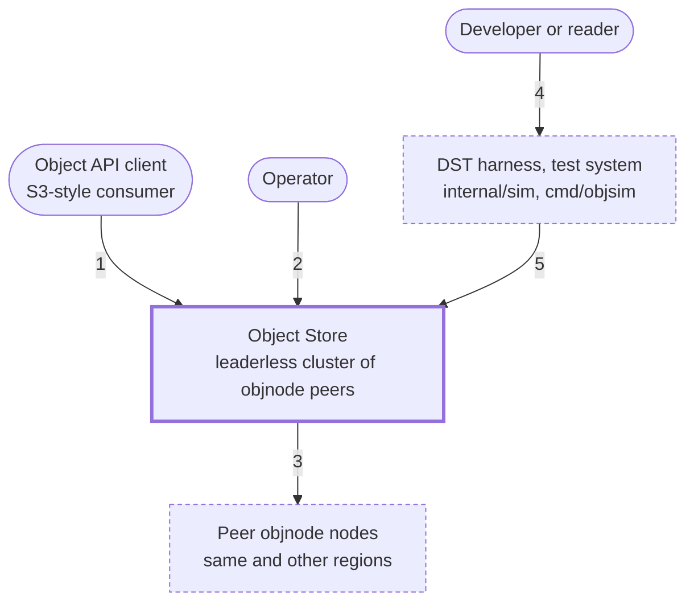

# C4 Level 1 — System Context

Object Store is a leaderless cluster of `objnode` peers with an HTTP object API and a deterministic simulation testing (DST) harness. Sync is between nodes only: there is no client replica.

Model: diagram `context` in [model.json](model.json).



<!-- draw-visual: diagrams/01-system-context.mmd -->
```text
┌───────────────────┐    ┌────────────┐    ┌──────────────────┐
│ Object API client ├─1─►│Object Store├─3─►│Peer objnode nodes│
└───────────────────┘    └────────────┘    └──────────────────┘
                                ▲
┌───────────────────┐           │
│      Operator     ├─────2─────┤
└───────────────────┘           │
                                │
┌───────────────────┐           │
│    DST harness    ├─────5─────┘
└───────────────────┘
          ▲
          4
          │
┌─────────┴─────────┐
│Developer or reader│
└───────────────────┘
```

| ID | Element | Kind |
| --- | --- | --- |
| `api-client` | Object API client | client |
| `operator` | Operator | person |
| `developer` | Developer or reader | person |
| `store` | Object Store | system in focus |
| `peers` | Peer objnode nodes, same and other regions | external (other instances of the same system) |
| `dst` | DST harness (`internal/sim`, `internal/sim/simtest`, `cmd/objsim`) | external, test system |

| # | From | To | Relationship | Technology |
| --- | --- | --- | --- | --- |
| 1 | Object API client | Store | Creates buckets; puts, gets, heads, deletes and lists objects; edits tags, ACL entries and quota; reads object metadata | HTTP, path-style |
| 2 | Operator | Store | Runs nodes; starts and checks bucket migrations; reads membership and health | CLI flags or JSON config file; HTTP |
| 3 | Store | Peer nodes | Gossips membership; sends and fetches shards; diffs the metadata Merkle tree and fetches the keys that differ; exchanges metadata versions (digest first, then the document; changed keys after each write); asks for pointer views, asks the holders of copied shards to verify them and sends purge lists during a migration | UDP datagrams; TCP length-prefixed frames, one connection per request |
| 4 | Developer or reader | DST harness | Runs and replays scenarios from one `int64` seed | `go test -seed`, `DST_SEED`, `cmd/objsim` |
| 5 | DST harness | Store | Runs the system's protocol code as simulated nodes under injected faults. The cluster scenarios run the whole node, 21 nodes in three regions | `internal/env` interfaces, in process |
