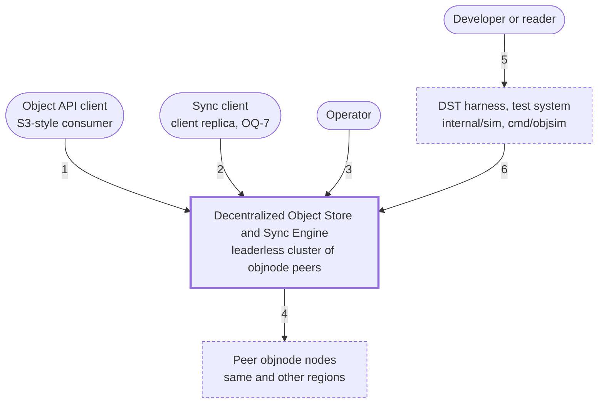

# C4 Level 1 — System Context

**As built.** The system, its HTTP API, the `objnode` binary, the traffic between peers and the DST harness exist and match this diagram (relationships 1, 3, 4 and 6 checked against `cmd/objnode`, `internal/storage/httpapi`, `internal/noderuntime` and `internal/node` when Chunk 6 landed, 2026-11-22; relationship 4 checked again against `internal/node` for the migration's shard check, 2026-11-23). The Sync client and relationship 2 are not to be built: OQ-7 was decided as node-level sync only.

Model: diagram `context` in [model.json](model.json). Source: PLAN.md sections 1, 2.1, 2.7, 7.1.



<!-- draw-visual: diagrams/01-system-context.mmd -->
```text
┌───────────────────┐    ┌────────────────────────────┐    ┌──────────────────┐
│ Object API client ├─1─►│Object store and sync engine├─4─►│Peer objnode nodes│
└───────────────────┘    └────────────────────────────┘    └──────────────────┘
                                        ▲
┌───────────────────┐                   │
│    Sync client    ├─────────2─────────┤
└───────────────────┘                   │
                                        │
┌───────────────────┐                   │
│      Operator     ├─────────3─────────┤
└───────────────────┘                   │
                                        │
┌───────────────────┐                   │
│    DST harness    ├─────────6─────────┘
└───────────────────┘
          ▲
          5
          │
┌─────────┴─────────┐
│Developer or reader│
└───────────────────┘
```

| ID | Element | Kind |
| --- | --- | --- |
| `api-client` | Object API client | client |
| `sync-client` | Sync client (client replica; not to be built: PLAN.md OQ-7 was decided as node-level sync only) | client |
| `operator` | Operator | person |
| `developer` | Developer or reader | person |
| `store` | Decentralized Object Store & Sync Engine | system in focus |
| `peers` | Peer objnode nodes, same and other regions | external (other instances of the same system) |
| `dst` | DST harness (`internal/sim`, `internal/sim/simtest`, `cmd/objsim`) | external, test system |

| # | From | To | Relationship | Technology |
| --- | --- | --- | --- | --- |
| 1 | Object API client | Store | Creates buckets; puts, gets, heads, deletes and lists objects; edits tags, ACL entries and quota; reads object metadata | HTTP, path-style (OQ-6) |
| 2 | Sync client | Store | Edits metadata offline, then syncs it. Not to be built: OQ-7 was decided as node-level sync only, with no client replica | HTTP `/v1/sync` (OQ-7) |
| 3 | Operator | Store | Runs nodes; starts and checks bucket migrations; reads membership and health | CLI flags or JSON config file; HTTP |
| 4 | Store | Peer nodes | Gossips membership; sends and fetches shards; diffs the metadata Merkle tree and fetches the keys that differ; exchanges metadata versions (digest first, then the document; changed keys after each write); asks for pointer views, asks the holders of copied shards to verify them and sends purge lists during a migration | UDP datagrams; TCP length-prefixed frames, one connection per request |
| 5 | Developer or reader | DST harness | Runs and replays scenarios from one `int64` seed | `go test -seed`, `DST_SEED`, `cmd/objsim` |
| 6 | DST harness | Store | Runs the system's protocol code as simulated nodes under injected faults. The cluster scenarios run the whole node, 21 nodes in three regions | `internal/env` interfaces, in process |
