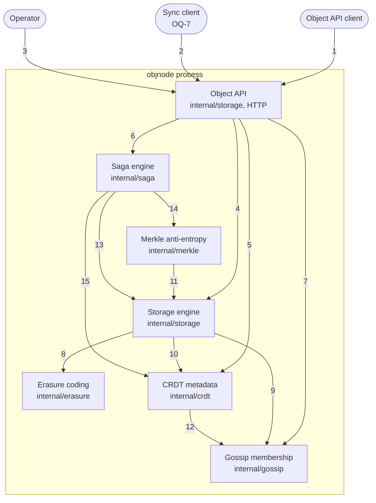

# C4 Level 2 — Container, domain view

**Partly as built.** Erasure coding (`internal/erasure`) and the Storage engine (`internal/storage`: shard format, chunk store, striping, manifest, placement, put and get paths) exist, and relationship 8 matches the code. The Saga engine (`internal/saga`: orchestrator, log, recovery, bucket-migration workflow) exists too, but its migration steps run only against a model cluster (`internal/saga/sagasim`): relationships 13 to 15 stay the target design until Chunk 6 binds the steps to the real components. Gossip membership (`internal/gossip`: SWIM probe, indirect probe, suspicion, dissemination, full-state sync, Membership view) exists as well, but no other package reads its view yet: relationships 7, 9 and 12 stay the target design until Chunk 6 wires the consumers. Merkle anti-entropy (`internal/merkle`: hash tree, diff protocol, wire codec, anti-entropy worker) exists too, over its own `Repairer` and `Membership` interfaces and a test chunk store: relationships 11 and 14 stay the target design until Chunk 6 binds it to the storage engine and the saga verify step. The Object API, the other containers and the other relationships are the target design.

Model: diagram `container` in [model.json](model.json). Source: PLAN.md sections 3, 4.2, 7.2, 7.4, 7.5, 7.8.
Containers are Go packages inside one `objnode` process. The runtime and environment
wiring of the same containers is in [03-container-runtime.md](03-container-runtime.md).



Terminal rendering, in 4 parts. Each numbered relationship appears in exactly one part.

**Part a.** Clients and the operator call the Object API (1 to 3).

<!-- draw-visual: diagrams/02-container-a.mmd -->
```text
┌─────────────────┐    ┌──────────┐
│Object API client├─1─►│Object API│
└─────────────────┘    └──────────┘
                             ▲
┌─────────────────┐          │
│   Sync client   ├────2─────┤
└─────────────────┘          │
                             │
┌─────────────────┐          │
│     Operator    ├────3─────┘
└─────────────────┘
```

**Part b.** What the Object API uses (4 to 7).

<!-- draw-visual: diagrams/02-container-b.mmd -->
```text
┌──────────┐    ┌─────────────────┐
│Object API├─4─►│  Storage engine │
└─────┬────┘    └─────────────────┘
      │
      │         ┌─────────────────┐
      ├──────5─►│  CRDT metadata  │
      │         └─────────────────┘
      │
      │         ┌─────────────────┐
      ├──────6─►│   Saga engine   │
      │         └─────────────────┘
      │
      │         ┌─────────────────┐
      └──────7─►│Gossip membership│
                └─────────────────┘
```

**Part c.** Merkle anti-entropy and the Storage engine (8 to 11).

<!-- draw-visual: diagrams/02-container-c.mmd -->
```text
┌───────────────────┐     ┌──────────────┐     ┌─────────────────┐
│Merkle anti-entropy├─11─►│Storage engine├──8─►│  Erasure coding │
└───────────────────┘     └───────┬──────┘     └─────────────────┘
                                  │
                                  │            ┌─────────────────┐
                                  ├─────────9─►│Gossip membership│
                                  │            └─────────────────┘
                                  │
                                  │            ┌─────────────────┐
                                  └────────10─►│  CRDT metadata  │
                                               └─────────────────┘
```

**Part d.** Saga engine steps, and CRDT peer choice (12 to 15).

<!-- draw-visual: diagrams/02-container-d.mmd -->
```text
┌───────────┐     ┌───────────────────┐     ┌─────────────────┐
│Saga engine├─15─►│   CRDT metadata   ├─12─►│Gossip membership│
└─────┬─────┘     └───────────────────┘     └─────────────────┘
      │
      │           ┌───────────────────┐
      ├───────13─►│   Storage engine  │
      │           └───────────────────┘
      │
      │           ┌───────────────────┐
      └───────14─►│Merkle anti-entropy│
                  └───────────────────┘
```

| ID | Container | Package | Component diagram |
| --- | --- | --- | --- |
| `c-api` | Object API | `internal/storage` (HTTP object API) | — |
| `c-storage` | Storage engine | `internal/storage` | [09](09-component-storage.md) |
| `c-erasure` | Erasure coding | `internal/erasure` | [05](05-component-erasure.md) |
| `c-gossip` | Gossip membership | `internal/gossip` | [04](04-component-gossip.md) |
| `c-merkle` | Merkle anti-entropy | `internal/merkle` | [06](06-component-merkle.md) |
| `c-crdt` | CRDT metadata | `internal/crdt` | [07](07-component-crdt.md) |
| `c-saga` | Saga engine | `internal/saga` | [08](08-component-saga.md) |

| # | From | To | Relationship |
| --- | --- | --- | --- |
| 1 | Object API client | Object API | Puts, gets, heads, deletes and lists objects; manages buckets, tags, ACL, quota and metadata (HTTP, S3-like path-style) |
| 2 | Sync client | Object API | Syncs a client-side CRDT document (HTTP `/v1/sync`, OQ-7) |
| 3 | Operator | Object API | Starts and checks migrations; reads membership and health (HTTP) |
| 4 | Object API | Storage engine | Object put, get, head, delete, list; bucket create |
| 5 | Object API | CRDT metadata | Tags, ACL, quota, metadata; metadata sync endpoint |
| 6 | Object API | Saga engine | Migration start and status |
| 7 | Object API | Gossip membership | Membership and health |
| 8 | Storage engine | Erasure coding | Encode and Reconstruct per stripe |
| 9 | Storage engine | Gossip membership | Places shards by rendezvous hashing over the Membership view |
| 10 | Storage engine | CRDT metadata | Stores each object manifest as an LWW-Register value |
| 11 | Merkle anti-entropy | Storage engine | Diffs manifest and shard-inventory trees; repairs through the Repairer interface |
| 12 | CRDT metadata | Gossip membership | Picks replication peers from the Membership view |
| 13 | Saga engine | Storage engine | Migration steps: allocate target, copy shards, delete source |
| 14 | Saga engine | Merkle anti-entropy | Migration step: verify Merkle root |
| 15 | Saga engine | CRDT metadata | Migration step: flip routing pointer (LWW-Register) |
