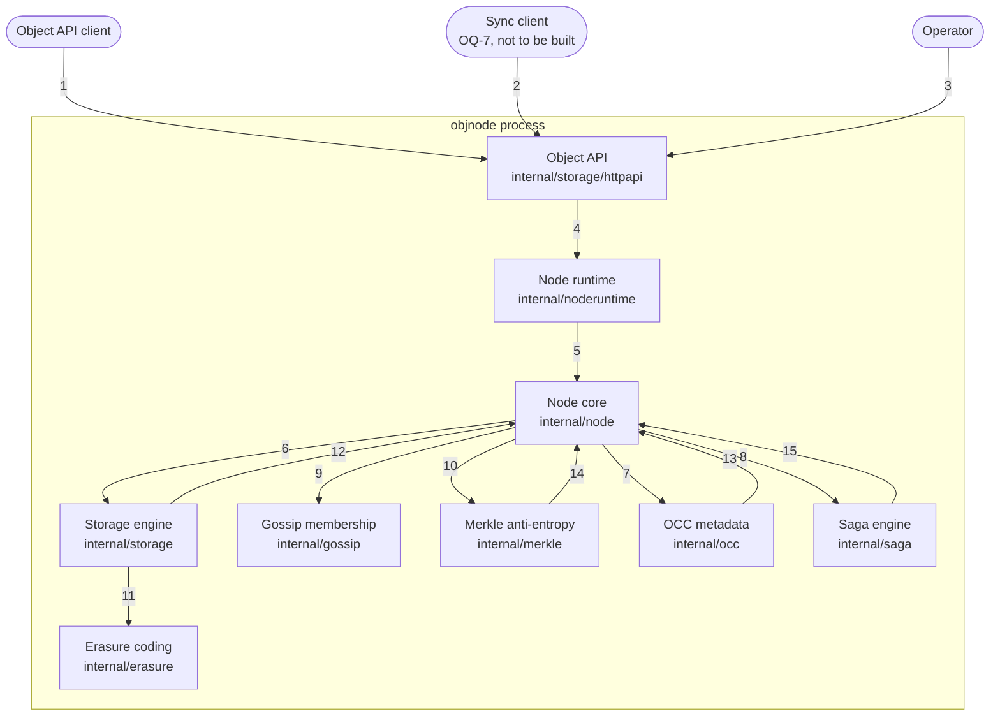

# C4 Level 2 — Container, domain view

**As built.** Every container and relationships 1 and 3 to 15 exist and match this diagram (checked against the imports and calls of `internal/node`, `internal/noderuntime`, `internal/storage/httpapi` and `cmd/objnode` when Chunk 6 landed, 2026-11-22). The Sync client and relationship 2 are not to be built: OQ-7 was decided as node-level sync only. The view differs from the target design in one way that changes most of its arrows: no protocol package calls another. Storage, gossip, Merkle, OCC and saga import only `internal/env` (storage also imports `internal/erasure`); each declares the small interfaces it needs, and the Node core (`internal/node`) builds all five into one node and implements those interfaces. The Object API does not call the protocol packages either: it calls one `Service` interface, which the Node runtime implements. See "Differences from the target design" below.

Model: diagram `container` in [model.json](model.json). Source: PLAN.md sections 3, 4.2, 7.2, 7.4, 7.5, 7.8; code in `internal/node`, `internal/noderuntime`, `internal/storage/httpapi`.
Containers are Go packages inside one `objnode` process. The runtime and environment
wiring of the same containers is in [03-container-runtime.md](03-container-runtime.md).



Terminal rendering, in 4 parts. Each numbered relationship appears in exactly one part.

**Part a.** Clients and the operator call the Object API (1 to 3).

<!-- draw-visual: diagrams/02-container-a.mmd -->
```text
┌─────────────────┐    ┌──────────┐
│Object API client├─1─►│Object API│
└─────────────────┘    └──────────┘
                             ▲
┌─────────────────┐          │
│   Sync client   ├────2─────┤
└─────────────────┘          │
                             │
┌─────────────────┐          │
│     Operator    ├────3─────┘
└─────────────────┘
```

**Part b.** From an HTTP request to the node (4, 5).

<!-- draw-visual: diagrams/02-container-b.mmd -->
```text
┌──────────┐    ┌────────────┐    ┌─────────┐
│Object API├─4─►│Node runtime├─5─►│Node core│
└──────────┘    └────────────┘    └─────────┘
```

**Part c.** What the Node core builds and calls, and erasure coding under the Storage engine (6 to 11).

<!-- draw-visual: diagrams/02-container-c.mmd -->
```text
┌─────────┐     ┌───────────────────┐     ┌──────────────┐
│Node core├──6─►│   Storage engine  ├─11─►│Erasure coding│
└────┬────┘     └───────────────────┘     └──────────────┘
     │
     │          ┌───────────────────┐
     ├───────7─►│    OCC metadata   │
     │          └───────────────────┘
     │
     │          ┌───────────────────┐
     ├───────8─►│    Saga engine    │
     │          └───────────────────┘
     │
     │          ┌───────────────────┐
     ├───────9─►│ Gossip membership │
     │          └───────────────────┘
     │
     │          ┌───────────────────┐
     └──────10─►│Merkle anti-entropy│
                └───────────────────┘
```

**Part d.** The interfaces the protocol packages declare and the Node core implements (12 to 15).

<!-- draw-visual: diagrams/02-container-d.mmd -->
```text
┌───────────────────┐     ┌─────────┐
│   Storage engine  ├─12─►│Node core│
└───────────────────┘     └─────────┘
                               ▲
┌───────────────────┐          │
│    OCC metadata   ├───13─────┤
└───────────────────┘          │
                               │
┌───────────────────┐          │
│Merkle anti-entropy├───14─────┤
└───────────────────┘          │
                               │
┌───────────────────┐          │
│    Saga engine    ├───15─────┘
└───────────────────┘
```

| ID | Container | Package | Component diagram |
| --- | --- | --- | --- |
| `c-api` | Object API | `internal/storage/httpapi`: handler, status table, limits, server, `Service` interface. Its request and response types and API error sentinels are in `internal/storage` (`api.go`) | — |
| `c-runtime` | Node runtime | `internal/noderuntime`: the real environment and the node loop; `Runtime` implements `httpapi.Service` | — |
| `c-node` | Node core | `internal/node`: the one `Node` that the simulator and the real runtime both execute | — |
| `c-storage` | Storage engine | `internal/storage` | [09](09-component-storage.md) |
| `c-erasure` | Erasure coding | `internal/erasure` | [05](05-component-erasure.md) |
| `c-gossip` | Gossip membership | `internal/gossip` | [04](04-component-gossip.md) |
| `c-merkle` | Merkle anti-entropy | `internal/merkle` | [06](06-component-merkle.md) |
| `c-occ` | OCC metadata | `internal/occ` | [07](07-component-occ.md) |
| `c-saga` | Saga engine | `internal/saga` | [08](08-component-saga.md) |

| # | From | To | Relationship |
| --- | --- | --- | --- |
| 1 | Object API client | Object API | Creates buckets; puts, gets, heads, deletes and lists objects; edits tags, ACL entries and quota; reads object metadata (HTTP, path-style). Writes take `If-Match` or `If-None-Match: *`; object responses carry an ETag |
| 2 | Sync client | Object API | Syncs a client-side metadata document (HTTP `/v1/sync`). Not to be built: OQ-7 was decided as node-level sync only, with no client replica |
| 3 | Operator | Object API | Starts and checks migrations (`POST /_migrations`, `GET /_migrations/{id}`); reads membership and health (`GET /_cluster/members`, `GET /_health`) |
| 4 | Object API | Node runtime | Calls the object service: each route is one of the 16 methods of the `Service` interface. The API package declares the interface and `noderuntime.Runtime` implements it |
| 5 | Node runtime | Node core | Builds the one `Node` over the real environment, delivers datagrams and requests to it, and posts each service call to the node loop, where it runs as a `Node` method (`PutObject`, `GetObject`, `CreateBucket`, `PutTag`, `StartMigration`, `Health` and the rest) |
| 6 | Node core | Storage engine | Puts object bytes through the storage node of the bucket's placement scope (all regions, or one region for a routed bucket) and gets them by manifest. Passes inbound shard requests on after its own checks: shard deletes over the wire are refused, and so is a write of a shard the node recorded absent. Keeps the per-bucket shard inventory on the chunk store, rebuilds a missing or rotted shard with the stripe codec, and deletes collected and purged shards |
| 7 | Node core | OCC metadata | Keeps all metadata as OCC keys: the object record (storage manifest and content type) under the object's manifest key, bucket records, tags, ACL entries, quota usage, the bucket's routing pointer, and its own system records (migration claims and intents, death markers, orphan, absence and loss records). Writes are conditional where the API call is. Receives every last-writer-wins discard through `OnDiscard` |
| 8 | Node core | Saga engine | Creates the engine with the bucket migration as its one definition, recovers unfinished sagas at start, begins a migration and reads its status |
| 9 | Node core | Gossip membership | Reads the live members, the full member list and the live count; subscribes to membership events; calls `Leave` when the node stops |
| 10 | Node core | Merkle anti-entropy | Runs one anti-entropy worker per node over every metadata key. Builds a tree per bucket of the shards the node holds and compares it, on the node itself, with the tree its manifests expect. Builds the source and target roots of a migration |
| 11 | Storage engine | Erasure coding | Encode and Reconstruct per stripe |
| 12 | Storage engine | Node core | Reads the members to place shards on, through the `Membership` interface it declares. The node core answers from the gossip view (`gossipView`), or from the members of one region (`regionView`) for a routed bucket |
| 13 | OCC metadata | Node core | Reads its replication peers through the `Membership` interface it declares; the node core answers with the live members other than itself |
| 14 | Merkle anti-entropy | Node core | Reads its peers through `Membership` and reaches the stored data through `Repairer`. The node core implements both: the repairer (`metaRepairer`) is over the OCC metadata keys, tombstones included, and stores a fetched version by merging it with last-writer-wins |
| 15 | Saga engine | Node core | Runs the migration steps through `MigrationOps`. The node core's `migrator` implements them: claims and registrations as metadata keys, the copy through a storage node of its own, the roots with `merkle.Build`, the flip as a write of the routing pointer |

Differences from the target design:

- **The Node core is the only binder.** The target design drew direct calls between the
  protocol packages: storage to gossip and to the metadata layer, Merkle to storage, the
  metadata layer to gossip, saga to storage, Merkle and the metadata layer. As built none
  of those calls exists. Each package declares an interface and `internal/node` implements
  it (relationships 12 to 15) and makes the calls itself (6 to 10). The eleven target
  relationships between the Object API or a protocol package and another protocol package
  are replaced by relationships 4 to 10 and 12 to 15.
- **The Object API calls one interface.** The target design had the API call storage, the
  metadata layer, the saga engine and gossip. As built it calls `Service` (relationship 4).
  It imports `internal/occ`, `internal/saga` and `internal/env` only for the error values
  in its status table, and `internal/storage` for the request and response types.
- **The Object API moved** from `internal/storage` to `internal/storage/httpapi`, so that
  `internal/storage` stays free of `net/http` and passes the determinism lint.
- **The runtime is split in two.** The target design had one Node runtime in
  `internal/node`. As built, `internal/node` is the protocol core that the simulator also
  runs, and `internal/noderuntime` holds the sockets, the file disk, the wall clock and
  the loop goroutine.
- **Merkle repairs metadata, not shards, through `Repairer`.** The worker's tree is one
  tree per node over every metadata key, not a manifest tree per bucket: repair is
  pull-only, and a per-bucket worker cannot learn of a bucket it has never heard of.
  Shard repair does not use the worker: the node core compares two local trees and
  rebuilds from the other holders. Peers do not exchange shard-inventory trees.
- **The object manifest is stored by the node core**, inside the object record, with the
  store's ordinary conditional `Put`. Storage returns the manifest and stores nothing;
  the typed `PutManifest` of `internal/occ` is not used.
- **The migration verify step** compares two roots as bytes inside `internal/saga`. The
  node core builds both roots; the saga package does not call `internal/merkle`.
