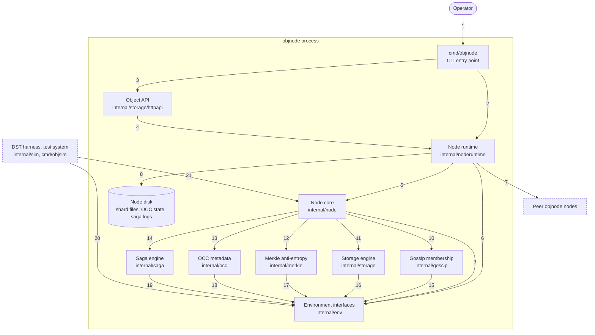

# C4 Level 2 — Container, runtime and environment view

**As built.** Every container and relationship exists and matches this diagram (checked against `cmd/objnode`, `internal/noderuntime`, `internal/node` and `internal/storage/httpapi` when Chunk 6 landed, 2026-11-22; relationship 21 checked again against `test/e2e`, 2026-11-23). The target design had one Node runtime in `internal/node`. As built it is two packages: the Node core (`internal/node`), which is the single-threaded node that the simulator also runs, and the Node runtime (`internal/noderuntime`), which holds the sockets, the file disk, the wall clock and the loop goroutine. The Object API is drawn here too, because `cmd/objnode` starts it and it calls the runtime.

Model: diagram `container-runtime` in [model.json](model.json). Source: PLAN.md sections 2.1, 2.5, 3, 7.1; code in `cmd/objnode/main.go`, `internal/noderuntime` (`runtime.go`, `service.go`, `realenv.go`, `frame.go`, `vfs.go`) and `internal/node` (`node.go`, `mux.go`).
One protocol core, two environments: `internal/noderuntime` (real) and the DST harness
(simulated) both implement `internal/env`, and both run the same `node.Node`. Domain
relationships between the same containers are in [02-container.md](02-container.md).



Terminal rendering, in 4 parts. Each numbered relationship appears in exactly one part.

**Part a.** Start-up and the HTTP server (1 to 4).

<!-- draw-visual: diagrams/03-container-runtime-a.mmd -->
```text
┌────────┐    ┌───────────┐    ┌────────────┐
│Operator├─1─►│cmd/objnode├─2─►│Node runtime│
└────────┘    └─────┬─────┘    └────────────┘
                    │                 ▲
                    │                 4
                    │                 │
                    │          ┌──────┴─────┐
                    └───────3─►│ Object API │
                               └────────────┘
```

**Part b.** The node runtime: the node it runs, the environment it supplies and the outside world (5 to 8).

<!-- draw-visual: diagrams/03-container-runtime-b.mmd -->
```text
┌────────────┐    ┌────────────┐
│Node runtime├─5─►│ Node core  │
└──────┬─────┘    └────────────┘
       │
       │          ┌────────────┐
       ├───────6─►│internal/env│
       │          └────────────┘
       │
       │          ┌────────────┐
       ├───────7─►│ Peer nodes │
       │          └────────────┘
       │
       │          ┌────────────┐
       └───────8─►│ Node disk  │
                  └────────────┘
```

**Part c.** The node core builds and drives the protocol packages, on the real runtime and under the DST harness alike (10 to 14, 21).

<!-- draw-visual: diagrams/03-container-runtime-c.mmd -->
```text
┌───────────┐     ┌─────────┐     ┌───────┐
│DST harness├─21─►│Node core├─10─►│ Gossip│
└───────────┘     └────┬────┘     └───────┘
                       │
                       │          ┌───────┐
                       ├──────11─►│Storage│
                       │          └───────┘
                       │
                       │          ┌───────┐
                       ├──────12─►│ Merkle│
                       │          └───────┘
                       │
                       │          ┌───────┐
                       ├──────13─►│  OCC  │
                       │          └───────┘
                       │
                       │          ┌───────┐
                       └──────14─►│  Saga │
                                  └───────┘
```

**Part d.** The node core and the packages act through the environment interfaces; the DST harness implements them (9, 15 to 20).

<!-- draw-visual: diagrams/03-container-runtime-d.mmd -->
```text
┌───────────┐     ┌────────────┐
│ Node core ├──9─►│internal/env│
└───────────┘     └────────────┘
                         ▲
┌───────────┐            │
│   Gossip  ├────15──────┤
└───────────┘            │
                         │
┌───────────┐            │
│  Storage  ├────16──────┤
└───────────┘            │
                         │
┌───────────┐            │
│   Merkle  ├────17──────┤
└───────────┘            │
                         │
┌───────────┐            │
│    OCC    ├────18──────┤
└───────────┘            │
                         │
┌───────────┐            │
│    Saga   ├────19──────┤
└───────────┘            │
                         │
┌───────────┐            │
│DST harness├────20──────┘
└───────────┘
```

| ID | Container | Package or technology |
| --- | --- | --- |
| `c-objnode` | cmd/objnode | `cmd/objnode`, Go CLI. Flags `-id`, `-region`, `-listen`, `-http`, `-data`, `-seeds`, `-k`, `-m`, `-stripe`, `-max-object`, `-shutdown-timeout`, `-config` |
| `c-api` | Object API | `internal/storage/httpapi`: `Server` over `net/http`, with header, body and time limits |
| `c-runtime` | Node runtime | `internal/noderuntime`: UDP datagrams and TCP length-prefixed frames on one port, file disk, wall clock with loop-posted timers, the node loop and its goroutines, `Runtime` as the object service |
| `c-node` | Node core | `internal/node`: `Node`, an `env.Process`. Single-threaded and determinism-linted: no goroutines, locks, sockets or wall clock |
| `c-env` | Environment interfaces | `internal/env`: `Clock`, `Rand`, `Transport`, `Disk` |
| `c-disk` | Node disk (data store) | files under the data directory: temp file, fsync, rename; directory fsync on `Sync` |
| `c-gossip`, `c-storage`, `c-merkle`, `c-occ`, `c-saga` | Protocol packages | see [02-container.md](02-container.md) |
| `peers` | Peer objnode nodes | external |
| `dst` | DST harness (`internal/sim`, `internal/sim/simtest`, `cmd/objsim`) | external, test system |

| # | From | To | Relationship |
| --- | --- | --- | --- |
| 1 | Operator | cmd/objnode | Starts a node from flags or a JSON config file |
| 2 | cmd/objnode | Node runtime | Builds the runtime from its options (the node core's `Config` among them), starts it, waits for a signal or for the node loop to fail, and shuts it down. A loop failure makes the process exit 1 |
| 3 | cmd/objnode | Object API | Starts the HTTP server over the runtime, with the node core's status rows added to the status table; shuts it down before the runtime |
| 4 | Object API | Node runtime | Calls the object service through the `Service` interface; `Runtime` implements it |
| 5 | Node runtime | Node core | Builds the one `Node` over the real environment (`node.New`), starts and stops it, delivers every datagram and request to it, and posts each service call to the node loop. All protocol state belongs to that one goroutine |
| 6 | Node runtime | Environment interfaces | Implements Clock, Rand, Transport and Disk for the real runtime |
| 7 | Node runtime | Peer objnode nodes | Sends and receives datagrams and request/response frames (UDP; TCP, one connection per request) |
| 8 | Node runtime | Node disk | Reads and writes named blobs (file-backed Disk). Disk calls run on the node loop |
| 9 | Node core | Environment interfaces | Is an `env.Process` and acts only through Clock, Rand, Transport and Disk. It gives each protocol package its own channel of the one transport: a channel byte in front of every message (gossip 1, shard requests 2, OCC 3, metadata diffs 4, node requests 5) |
| 10–14 | Node core | Gossip, Storage, Merkle, OCC, Saga | Builds each over the environment and dispatches inbound datagrams and requests to it by channel byte. What it calls on each is rows 6 to 10 of [02-container.md](02-container.md) |
| 15–19 | Gossip, Storage, Merkle, OCC, Saga | Environment interfaces | Acts only through Clock, Rand, Transport, Disk |
| 20 | DST harness | Environment interfaces | Implements Clock, Rand, Transport, Disk for every simulated node; its event loop calls the same protocol handlers |
| 21 | DST harness | Node core | Runs the same `Node` as a simulated process (`node.NewFactory`). Test code: the full-node simulation tests of `internal/node`, the conformance test of `internal/noderuntime`, which runs the same scenarios on the simulator and on loopback sockets, and the end-to-end suite (`test/e2e`), which runs its scenarios on the simulator and on real `objnode` processes over HTTP |

Differences from the target design:

- The Node runtime of the target design is two containers, the Node core and the Node
  runtime. Relationships 3 (implements the environment), 9 (peers) and 10 (disk) of the
  target design now start at the Node runtime (6 to 8 here); the wiring of the five
  protocol packages starts at the Node core (10 to 14).
- Relationships 3 and 4 are new: `cmd/objnode` starts the HTTP server, and the server
  calls the runtime through an interface. The target design drew the Object API only in
  the domain view.
- Relationship 9 is new: the node core is itself protocol code on the environment
  interfaces. It lists and reads the shard files, sets the maintenance timer and sends its
  own node requests.
- Relationship 21 is new. It is test code, drawn because it is the check that the
  simulator and the real runtime execute the same node.
- The Node disk holds the OCC state blob (`occ/state`) as well as the shard files and the
  saga logs.
