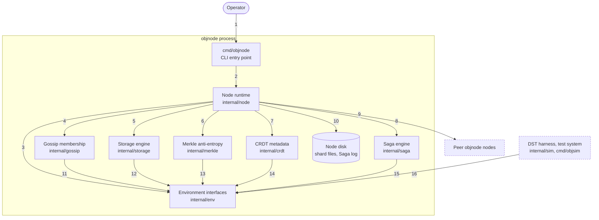

# C4 Level 2 — Container, runtime and environment view

**Partly as built.** The DST harness (`internal/sim`, `internal/sim/simtest`, `cmd/objsim`) and the environment interfaces (`internal/env`) exist and match this diagram. Everything else is the target design.

Model: diagram `container-runtime` in [model.json](model.json). Source: PLAN.md sections 2.1, 2.5, 3, 7.1.
One protocol core, two environments: `internal/node` (real) and the DST harness
(simulated) both implement `internal/env`. Domain relationships between the same
containers are in [02-container.md](02-container.md).



Terminal rendering, in 3 parts. Each numbered relationship appears in exactly one part.

**Part a.** Start-up and the outside world (1 to 3, 9, 10).

<!-- draw-visual: diagrams/03-container-runtime-a.mmd -->
```text
┌────────┐    ┌───────────┐    ┌────────────┐     ┌────────────┐
│Operator├─1─►│cmd/objnode├─2─►│Node runtime├──3─►│internal/env│
└────────┘    └───────────┘    └──────┬─────┘     └────────────┘
                                      │
                                      │           ┌────────────┐
                                      ├────────9─►│ Peer nodes │
                                      │           └────────────┘
                                      │
                                      │           ┌────────────┐
                                      └───────10─►│ Node disk  │
                                                  └────────────┘
```

**Part b.** The node runtime wires and drives the protocol packages (4 to 8).

<!-- draw-visual: diagrams/03-container-runtime-b.mmd -->
```text
┌────────────┐    ┌───────┐
│Node runtime├─4─►│ Gossip│
└──────┬─────┘    └───────┘
       │
       │          ┌───────┐
       ├───────5─►│Storage│
       │          └───────┘
       │
       │          ┌───────┐
       ├───────6─►│ Merkle│
       │          └───────┘
       │
       │          ┌───────┐
       ├───────7─►│  CRDT │
       │          └───────┘
       │
       │          ┌───────┐
       └───────8─►│  Saga │
                  └───────┘
```

**Part c.** The packages act through the environment interfaces; the DST harness implements them (11 to 16).

<!-- draw-visual: diagrams/03-container-runtime-c.mmd -->
```text
┌───────────┐     ┌────────────┐
│   Gossip  ├─11─►│internal/env│
└───────────┘     └────────────┘
                         ▲
┌───────────┐            │
│  Storage  ├────12──────┤
└───────────┘            │
                         │
┌───────────┐            │
│   Merkle  ├────13──────┤
└───────────┘            │
                         │
┌───────────┐            │
│    CRDT   ├────14──────┤
└───────────┘            │
                         │
┌───────────┐            │
│    Saga   ├────15──────┤
└───────────┘            │
                         │
┌───────────┐            │
│DST harness├────16──────┘
└───────────┘
```

| ID | Container | Package or technology |
| --- | --- | --- |
| `c-objnode` | cmd/objnode | `cmd/objnode`, Go CLI |
| `c-node` | Node runtime | `internal/node`: UDP, TCP length-prefixed frames, file disk, wall clock, node loop |
| `c-env` | Environment interfaces | `internal/env`: `Clock`, `Rand`, `Transport`, `Disk` |
| `c-disk` | Node disk (data store) | files: temp file, fsync, rename |
| `c-gossip`, `c-storage`, `c-merkle`, `c-crdt`, `c-saga` | Protocol packages | see [02-container.md](02-container.md) |
| `peers` | Peer objnode nodes | external |
| `dst` | DST harness (`internal/sim`, `internal/sim/simtest`, `cmd/objsim`) | external, test system |

| # | From | To | Relationship |
| --- | --- | --- | --- |
| 1 | Operator | cmd/objnode | Starts a node from flags or a config file |
| 2 | cmd/objnode | Node runtime | Runs one node |
| 3 | Node runtime | Environment interfaces | Implements Clock, Rand, Transport, Disk for the real runtime |
| 4–8 | Node runtime | Gossip, Storage, Merkle, CRDT, Saga | Wires into the node; drives from the node loop |
| 9 | Node runtime | Peer objnode nodes | Sends and receives datagrams and request/response frames (UDP; TCP) |
| 10 | Node runtime | Node disk | Reads and writes named blobs (file-backed Disk) |
| 11–15 | Gossip, Storage, Merkle, CRDT, Saga | Environment interfaces | Acts only through Clock, Rand, Transport, Disk |
| 16 | DST harness | Environment interfaces | Implements Clock, Rand, Transport, Disk for every simulated node; its event loop calls the same protocol handlers |
