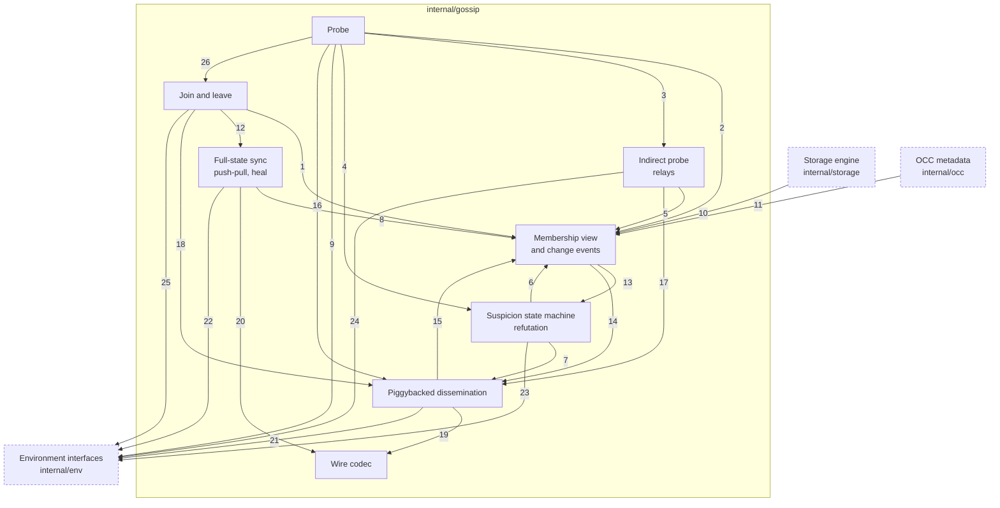

# C4 Level 3 — Component: gossip (`internal/gossip`)

**Partly as built.** The seven components PLAN.md names and the wire codec exist and match this diagram (checked against `internal/gossip` when Chunk 1 landed, 2026-11-22). Relationships 10 and 11 are the target design: no other package reads the Membership view yet. Storage placement and replication peer choice are wired to it in Chunk 6.

Model: diagram `component-gossip` in [model.json](model.json). Source: PLAN.md sections 3, 4.2 (Chunk 1), 7.7; code in `node.go`, `member.go`, `wire.go`, `config.go`, `errors.go`.
All components but the wire codec and the `View` lattice are parts of one single-threaded `Node`; the boxes are groups of its handlers, not separate types.



Terminal rendering, in 4 parts. Each numbered relationship appears in exactly one part.

**Part a.** Who reads and writes the Membership view, and what it starts (1, 2, 5, 6, 8, 10, 11, 13, 15).

<!-- draw-visual: diagrams/04-component-gossip-a.mmd -->
```text
┌─────────────────────────┐     ┌───────────────┐     ┌───────────────────────┐
│      Join and leave     ├──1─►│Membership view├─13─►│Suspicion state machine│
└─────────────────────────┘     └───────────────┘     └───────────────────────┘
                                        ▲
┌─────────────────────────┐             │
│          Probe          ├──────2──────┤
└─────────────────────────┘             │
                                        │
┌─────────────────────────┐             │
│      Indirect probe     ├──────5──────┤
└─────────────────────────┘             │
                                        │
┌─────────────────────────┐             │
│ Suspicion state machine ├──────6──────┤
└─────────────────────────┘             │
                                        │
┌─────────────────────────┐             │
│     Full-state sync     ├──────8──────┤
└─────────────────────────┘             │
                                        │
┌─────────────────────────┐             │
│Piggybacked dissemination├─────15──────┤
└─────────────────────────┘             │
                                        │
┌─────────────────────────┐             │
│      Storage engine     ├─────10──────┤
└─────────────────────────┘             │
                                        │
┌─────────────────────────┐             │
│       OCC metadata      ├─────11──────┘
└─────────────────────────┘
```

**Part b.** What the probe tick drives, and the join path (3, 4, 9, 12, 16, 20, 26).

<!-- draw-visual: diagrams/04-component-gossip-b.mmd -->
```text
┌─────┐     ┌─────────────────────────┐     ┌───────────────┐     ┌──────────┐
│Probe├──3─►│      Indirect probe     │     │Full-state sync├─20─►│Wire codec│
└──┬──┘     └─────────────────────────┘     └───────────────┘     └──────────┘
   │                                                ▲
   │        ┌─────────────────────────┐             │
   ├─────4─►│ Suspicion state machine │             │
   │        └─────────────────────────┘             │
   │                                                │
   │        ┌─────────────────────────┐             │
   ├────16─►│Piggybacked dissemination│             │
   │        └─────────────────────────┘             │
   │                                                │
   │        ┌─────────────────────────┐             │
   ├─────9─►│       internal/env      │             │
   │        └─────────────────────────┘             │
   │                                                │
   │        ┌─────────────────────────┐             │
   └────26─►│      Join and leave     ├─────12──────┘
            └─────────────────────────┘
```

**Part c.** What is gossiped (7, 14, 17, 18, 19).

<!-- draw-visual: diagrams/04-component-gossip-c.mmd -->
```text
┌───────────────────────┐     ┌─────────────────────────┐     ┌──────────┐
│Suspicion state machine├──7─►│Piggybacked dissemination├─19─►│Wire codec│
└───────────────────────┘     └─────────────────────────┘     └──────────┘
                                           ▲
┌───────────────────────┐                  │
│    Membership view    ├───────14─────────┤
└───────────────────────┘                  │
                                           │
┌───────────────────────┐                  │
│     Indirect probe    ├───────17─────────┤
└───────────────────────┘                  │
                                           │
┌───────────────────────┐                  │
│     Join and leave    ├───────18─────────┘
└───────────────────────┘
```

**Part d.** The other calls on the environment (21 to 25).

<!-- draw-visual: diagrams/04-component-gossip-d.mmd -->
```text
┌─────────────────────────┐     ┌────────────┐
│Piggybacked dissemination├─21─►│internal/env│
└─────────────────────────┘     └────────────┘
                                       ▲
┌─────────────────────────┐            │
│     Full-state sync     ├────22──────┤
└─────────────────────────┘            │
                                       │
┌─────────────────────────┐            │
│ Suspicion state machine ├────23──────┤
└─────────────────────────┘            │
                                       │
┌─────────────────────────┐            │
│      Indirect probe     ├────24──────┤
└─────────────────────────┘            │
                                       │
┌─────────────────────────┐            │
│      Join and leave     ├────25──────┘
└─────────────────────────┘
```

| ID | Component | As built |
| --- | --- | --- |
| `g-join` | Join and leave | `Join` and `Leave` in `node.go`. `Join` sends the push-pull sync to every seed at once and completes on the first reply, or fails with `ErrJoinFailed` and each seed's cause; its callback never runs inside `Join`. Seeds from `Config.Seeds` and from `Join` are remembered, at most `MaxSeeds` (256). `Leave` marks the node left at its incarnation, tells every live member in one gossip datagram, stops the timers and closes the node |
| `g-probe` | Probe | `onTick` and `nextTarget`. One ping per `ProbeInterval` to the next live member in shuffled round-robin order; a member that becomes live in mid-round is inserted at a random later position. A target with no ack, direct or relayed, by the next tick becomes suspect |
| `g-indirect` | Indirect probe | `onProbeTimeout`, `onPingReq` and the relay table. After `ProbeTimeout` without an ack, asks `k` random other live members (`IndirectProbes`, default 3) to ping the target. A relay pings with its own sequence number and forwards the ack with the requester's. A relay entry lasts one probe interval, at most `MaxRelays` (1,024) are held, and none is kept for a ping that could not be sent |
| `g-suspicion` | Suspicion state machine | `suspectLocally`, `startSuspicion` and `refute`. A member that becomes suspect, by a failed probe or by gossip, gets a timer of `SuspicionMult` × ⌈log₂ N⌉ × `ProbeInterval`; if it is still suspect at that incarnation when the timer fires, it is declared dead. A node refutes any claim about itself, other than alive at its own incarnation, by raising its incarnation; it cannot go past the maximum `uint32` |
| `g-dissem` | Piggybacked dissemination | `enqueue`, `piggyback` and `sendWith`. One queue entry per member. Every datagram the node sends carries updates within `MaxPacket`: explicit leads, then the destination's own entry if it is not alive, then the queue, fewest transmissions first. An entry is dropped after `RetransmitMult` × ⌈log₂ N⌉ transmissions |
| `g-sync` | Full-state sync | `syncWith`, `onSync` and `OnRequest`. Push-pull: the caller sends its whole view, the receiver merges it and replies with its merged view, the caller merges that. Every `SyncInterval` a node syncs with one random live member and one random heal target, taken from the dead entries in its view, its dead tombstones and its remembered seeds that are not live |
| `g-view` | Membership view and change events | `View` in `member.go`, the pure merge lattice ordered by (incarnation, state, region) through `Supersedes`, and the node's merge step `apply`. Exposes the `Membership` interface (`Members`, `Lookup`, `Subscribe`) and five event kinds, delivered synchronously: joined, suspected, recovered, died, left. Holds at most `MaxMembers` entries. Added by the build: a dead or left entry stays for `DeadRetention` and then becomes a tombstone; at most `MaxTombstones` (4,096) are kept and the oldest is evicted |
| `g-wire` | Wire codec | `wire.go` and `errors.go`, added by the build; PLAN.md does not name it. `Message`, `Encode` and `Decode`, version 1. Ping, ack, ping-req and gossip are datagram kinds; sync request and sync response travel only as requests. Decoding is strict and canonical. Wire error codes 80 to 84. This code does no I/O |

| # | From | To | Relationship |
| --- | --- | --- | --- |
| 1 | Join and leave | Membership view | `Leave` marks this node left in the view |
| 2 | Probe | Membership view | Picks one live member per period, shuffled round-robin; each tick also buries expired dead and left entries |
| 3 | Probe | Indirect probe | After the probe timeout with no ack, asks `k` other members to ping the target; a relayed ack counts as the probe's ack |
| 4 | Probe | Suspicion state machine | Marks the target suspect when no ack, direct or relayed, came by the next period |
| 5 | Indirect probe | Membership view | Picks the `k` relays at random from the live members other than the target |
| 6 | Suspicion state machine | Membership view | Sets suspect, then dead when the timeout fires at the same incarnation; raises this node's incarnation to refute |
| 7 | Suspicion state machine | Piggybacked dissemination | Queues this node's refutation, alive at a higher incarnation |
| 8 | Full-state sync | Membership view | Sends the whole view and merges the peer's; picks one random live member and one heal target from dead entries, dead tombstones and seeds that are not live |
| 9 | Probe | Environment interfaces | Period and probe-timeout timers; random probe order (Clock, Rand) |
| 10 | Storage engine | Membership view | Reads Membership for shard placement (target design) |
| 11 | OCC metadata | Membership view | Reads the live members as its replication peers, through the `Membership` interface `internal/occ` declares (target design) |
| 12 | Join and leave | Full-state sync | A join is the push-pull sync sent to every seed; the first reply completes it |
| 13 | Membership view | Suspicion state machine | Starts the suspicion timer when a member becomes suspect, by probe or by gossip, and stops it when the member leaves suspect; hands claims about this node itself to refutation |
| 14 | Membership view | Piggybacked dissemination | Queues every accepted change for gossip, except a dead or left verdict about a member this node never held |
| 15 | Piggybacked dissemination | Membership view | Hands the updates on each inbound datagram to the merge; reads the destination's entry and the live count for the retransmit limit |
| 16 | Probe | Piggybacked dissemination | Sends pings and acks; each carries piggybacked updates |
| 17 | Indirect probe | Piggybacked dissemination | Sends ping-reqs, relayed pings and forwarded acks; each carries piggybacked updates |
| 18 | Join and leave | Piggybacked dissemination | `Leave` queues the left entry and sends a gossip datagram led by it to every live member |
| 19 | Piggybacked dissemination | Wire codec | Encodes every outbound datagram and decodes every inbound one |
| 20 | Full-state sync | Wire codec | Encodes and decodes sync requests and replies |
| 21 | Piggybacked dissemination | Environment interfaces | Sends every datagram (Transport) |
| 22 | Full-state sync | Environment interfaces | Sync requests with a timeout; the sync timer; random peer choice (Transport, Clock, Rand) |
| 23 | Suspicion state machine | Environment interfaces | Suspicion timeout timers (Clock) |
| 24 | Indirect probe | Environment interfaces | Random choice of relays; relay expiry times (Rand, Clock) |
| 25 | Join and leave | Environment interfaces | Zero-delay timer, so that a join callback never runs inside `Join` (Clock) |
| 26 | Probe | Join and leave | While the node knows no live member but itself, re-joins the remembered seeds once per period |

Differences from the target design:

- Relationship 5 ended at the Suspicion state machine in the target design. As built, a
  relayed ack only marks the probe acknowledged; the probe alone reports a failure
  (relationship 4). Relationship 5 now shows what the indirect probe takes from the view.
- Relationship 9 named the Transport in the target design. As built, every datagram
  leaves through the dissemination send path (relationships 16, 17, 18 and 21), so that
  each one carries piggybacked updates.
- Relationship 7 covered every state change in the target design. As built, the view's
  merge step queues changes (relationship 14) and the suspicion code queues only this
  node's refutation.
- Relationships 12 to 26 and the Wire codec are new. The package uses Clock, Rand and
  Transport and no Disk. The view and its tombstones also read the time from the Clock,
  for event times and retention; that is not drawn.
