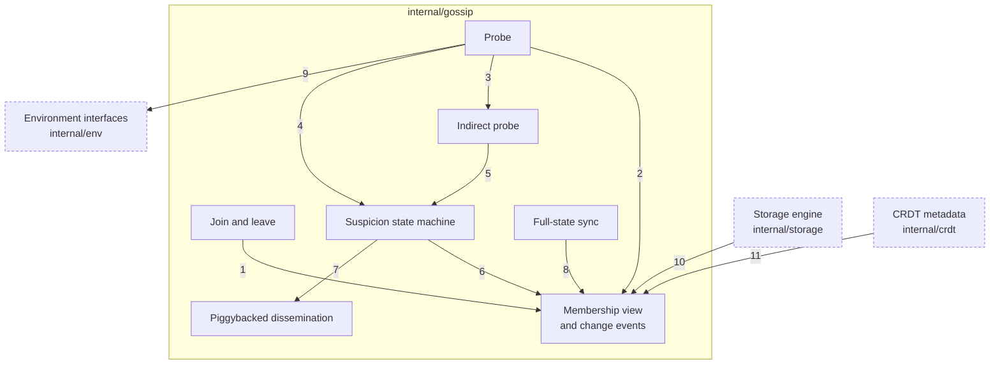

# C4 Level 3 — Component: gossip (`internal/gossip`)

**TARGET architecture — designed 2026-11-21, awaiting Nick's buy-in.**

Of the neighbours drawn here, the Storage engine and `internal/env` are built; this package and its relationships are the target design.

Model: diagram `component-gossip` in [model.json](model.json). Source: PLAN.md sections 3, 4.2 (Chunk 1), 7.7.



Terminal rendering, in 2 parts. Each numbered relationship appears in exactly one part.

**Part a.** Who reads and writes the Membership view (1, 2, 6, 8, 10, 11).

<!-- draw-visual: diagrams/04-component-gossip-a.mmd -->
```text
┌───────────────────────┐     ┌───────────────┐
│     Join and leave    ├──1─►│Membership view│
└───────────────────────┘     └───────────────┘
                                      ▲
┌───────────────────────┐             │
│         Probe         ├──────2──────┤
└───────────────────────┘             │
                                      │
┌───────────────────────┐             │
│Suspicion state machine├──────6──────┤
└───────────────────────┘             │
                                      │
┌───────────────────────┐             │
│    Full-state sync    ├──────8──────┤
└───────────────────────┘             │
                                      │
┌───────────────────────┐             │
│     Storage engine    ├─────10──────┤
└───────────────────────┘             │
                                      │
┌───────────────────────┐             │
│     CRDT metadata     ├─────11──────┘
└───────────────────────┘
```

**Part b.** The failure-detection path (3, 4, 5, 7, 9).

<!-- draw-visual: diagrams/04-component-gossip-b.mmd -->
```text
┌─────┐    ┌───────────────────────┐    ┌─────────────────────────┐
│Probe├─3─►│     Indirect probe    │    │Piggybacked dissemination│
└──┬──┘    └───────────┬───────────┘    └─────────────────────────┘
   │                   │                             ▲
   │                   5                             │
   │                   ▼                             │
   │       ┌───────────────────────┐                 │
   ├────4─►│Suspicion state machine├────────7────────┘
   │       └───────────────────────┘
   │
   │       ┌───────────────────────┐
   └────9─►│      internal/env     │
           └───────────────────────┘
```

| ID | Component | PLAN.md wording |
| --- | --- | --- |
| `g-join` | Join and leave | join through seed nodes; clean leave |
| `g-probe` | Probe | per-period randomized probe of one member in shuffled round-robin order |
| `g-indirect` | Indirect probe | indirect probe through `k` others on timeout |
| `g-suspicion` | Suspicion state machine | alive/suspect/dead; suspicion timeout scaled by `log N`; incarnation numbers for refutation |
| `g-dissem` | Piggybacked dissemination | retransmit limit of `λ·log N` |
| `g-sync` | Full-state sync | periodic, with one random peer, including previously dead and seed addresses (7.7) |
| `g-view` | Membership view and change events | exposed to other packages |

| # | From | To | Relationship |
| --- | --- | --- | --- |
| 1 | Join and leave | Membership view | Joins through seed nodes; clean leave |
| 2 | Probe | Membership view | Picks one member per period, shuffled round-robin |
| 3 | Probe | Indirect probe | On timeout, probes through `k` others |
| 4 | Probe | Suspicion state machine | Reports the probe result |
| 5 | Indirect probe | Suspicion state machine | Reports the indirect probe result |
| 6 | Suspicion state machine | Membership view | Sets alive, suspect or dead; incarnation numbers refute |
| 7 | Suspicion state machine | Piggybacked dissemination | Hands over state changes to disseminate |
| 8 | Full-state sync | Membership view | Merges full state with one random peer, including dead and seed addresses |
| 9 | Probe | Environment interfaces | Datagrams, period timers, random order (Transport, Clock, Rand) |
| 10 | Storage engine | Membership view | Reads Membership for shard placement |
| 11 | CRDT metadata | Membership view | Reads Membership for replication peer choice |
