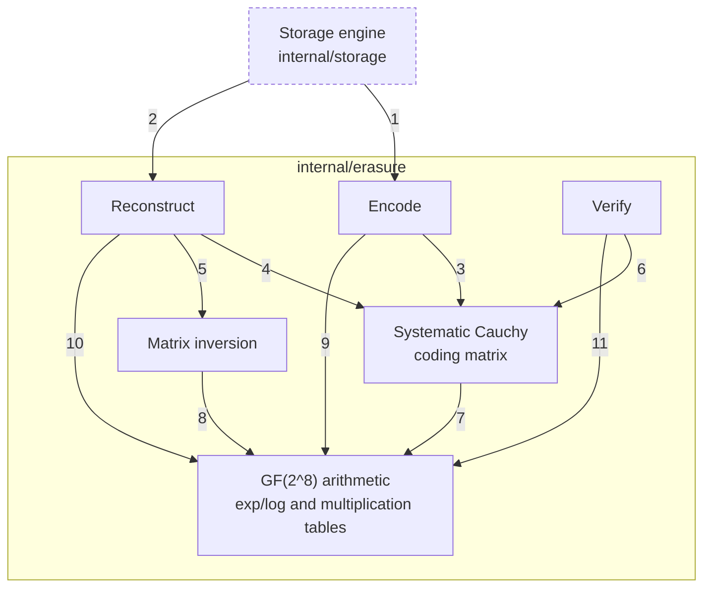

# C4 Level 3 — Component: erasure (`internal/erasure`)

**As built.** Checked against `internal/erasure` when Chunk 2 landed (2026-11-21).

Model: diagram `component-erasure` in [model.json](model.json). Source: PLAN.md sections 3, 4.2 (Chunk 2), 7.3; code in `gf256.go`, `matrix.go`, `codec.go`.



Terminal rendering, in 4 parts. Each numbered relationship appears in exactly one part.

**Part a.** The Storage engine calls two operations (1, 2).

<!-- draw-visual: diagrams/05-component-erasure-a.mmd -->
```text
┌──────────────┐    ┌───────────┐
│Storage engine├─1─►│   Encode  │
└───────┬──────┘    └───────────┘
        │
        │           ┌───────────┐
        └────────2─►│Reconstruct│
                    └───────────┘
```

**Part b.** All three operations use the coding matrix (3, 4, 6, 7).

<!-- draw-visual: diagrams/05-component-erasure-b.mmd -->
```text
┌───────────┐    ┌────────────────────┐    ┌─────────────────┐
│   Encode  ├─3─►│Cauchy coding matrix├─7─►│GF 2^8 arithmetic│
└───────────┘    └────────────────────┘    └─────────────────┘
                            ▲
┌───────────┐               │
│Reconstruct├───────4───────┤
└───────────┘               │
                            │
┌───────────┐               │
│   Verify  ├───────6───────┘
└───────────┘
```

**Part c.** Reconstruct also inverts a matrix (5, 8).

<!-- draw-visual: diagrams/05-component-erasure-c.mmd -->
```text
┌───────────┐    ┌────────────────┐    ┌─────────────────┐
│Reconstruct├─5─►│Matrix inversion├─8─►│GF 2^8 arithmetic│
└───────────┘    └────────────────┘    └─────────────────┘
```

**Part d.** All three operations multiply whole shards in the field (9 to 11).

<!-- draw-visual: diagrams/05-component-erasure-d.mmd -->
```text
┌───────────┐     ┌─────────────────┐
│   Encode  ├──9─►│GF 2^8 arithmetic│
└───────────┘     └─────────────────┘
                           ▲
┌───────────┐              │
│Reconstruct├─────10───────┤
└───────────┘              │
                           │
┌───────────┐              │
│   Verify  ├─────11───────┘
└───────────┘
```

| ID | Component | As built |
| --- | --- | --- |
| `e-gf` | GF(2^8) arithmetic | `gf256.go`: polynomial 0x11D, generator 2, exp/log tables and a 256×256 multiplication table; `MulAddSlice` for whole shards |
| `e-matrix` | Matrix inversion | `matrix.go`: `Matrix.Invert`, Gauss-Jordan; a singular matrix is `ErrSingular` |
| `e-cauchy` | Systematic Cauchy coding matrix | `matrix.go`: `CodingMatrix(k, m)`, `[I \| C]` with `C` a Cauchy matrix; `k ≥ 1`, `m ≥ 0`, `k + m ≤ 256` |
| `e-encode` | Encode | `codec.go`: `Codec.Encode`, with `Split` to cut a stripe into `k` data shards |
| `e-reconstruct` | Reconstruct | `codec.go`: `Codec.Reconstruct` (data and parity) and `ReconstructData` (data only), with `Join`; more than `m` losses returns `ErrTooFewShards` |
| `e-verify` | Verify | `codec.go`: `Codec.Verify` recomputes the parity; a difference is `ErrParityMismatch` |

| # | From | To | Relationship |
| --- | --- | --- | --- |
| 1 | Storage engine | Encode | Splits each stripe into `k` data shards and encodes `m` parity shards |
| 2 | Storage engine | Reconstruct | Rebuilds the data shards of a stripe from any `k` verified shards (`ReconstructData`) |
| 3 | Encode | Coding matrix | Uses the coding matrix `[I \| C]` |
| 4 | Reconstruct | Coding matrix | Takes the rows of the first `k` present shards; re-encodes missing parity |
| 5 | Reconstruct | Matrix inversion | Inverts the `k×k` submatrix |
| 6 | Verify | Coding matrix | Recomputes each parity shard from the coding matrix |
| 7 | Coding matrix | GF(2^8) arithmetic | Field arithmetic: each Cauchy entry is an inverse |
| 8 | Matrix inversion | GF(2^8) arithmetic | Field arithmetic |
| 9 | Encode | GF(2^8) arithmetic | Multiplies data shards by matrix coefficients (`MulAddSlice`) |
| 10 | Reconstruct | GF(2^8) arithmetic | Multiplies present shards by inverse-matrix coefficients (`MulAddSlice`) |
| 11 | Verify | GF(2^8) arithmetic | Multiplies data shards by matrix coefficients (`MulAddSlice`) |

Differences from the target design:

- No product code calls `Verify`. The target design had the Storage engine call it. The
  Storage engine finds a damaged shard by its checksum and passes it to Reconstruct as
  missing, because the code corrects erasures at known positions and does not locate errors.
- Relationships 9 to 11 are new: the three operations call the field arithmetic directly.
