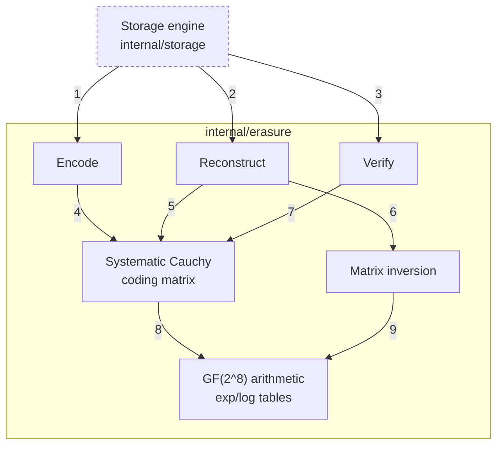

# C4 Level 3 — Component: erasure (`internal/erasure`)

**TARGET architecture — designed 2026-11-21, awaiting Nick's buy-in.**

Model: diagram `component-erasure` in [model.json](model.json). Source: PLAN.md sections 3, 4.2 (Chunk 2), 7.3.



Terminal rendering, in 3 parts. Each numbered relationship appears in exactly one part.

**Part a.** The Storage engine calls the three operations (1 to 3).

<!-- draw-visual: diagrams/05-component-erasure-a.mmd -->
```text
┌──────────────┐    ┌───────────┐
│Storage engine├─1─►│   Encode  │
└───────┬──────┘    └───────────┘
        │
        │           ┌───────────┐
        ├────────2─►│Reconstruct│
        │           └───────────┘
        │
        │           ┌───────────┐
        └────────3─►│   Verify  │
                    └───────────┘
```

**Part b.** All three operations use the coding matrix (4, 5, 7, 8).

<!-- draw-visual: diagrams/05-component-erasure-b.mmd -->
```text
┌───────────┐    ┌────────────────────┐    ┌─────────────────┐
│   Encode  ├─4─►│Cauchy coding matrix├─8─►│GF 2^8 arithmetic│
└───────────┘    └────────────────────┘    └─────────────────┘
                            ▲
┌───────────┐               │
│Reconstruct├───────5───────┤
└───────────┘               │
                            │
┌───────────┐               │
│   Verify  ├───────7───────┘
└───────────┘
```

**Part c.** Reconstruct also inverts a matrix (6, 9).

<!-- draw-visual: diagrams/05-component-erasure-c.mmd -->
```text
┌───────────┐    ┌────────────────┐    ┌─────────────────┐
│Reconstruct├─6─►│Matrix inversion├─9─►│GF 2^8 arithmetic│
└───────────┘    └────────────────┘    └─────────────────┘
```

| ID | Component | PLAN.md wording |
| --- | --- | --- |
| `e-gf` | GF(2^8) arithmetic | field GF(2^8), polynomial 0x11D, generator 2, exp/log tables |
| `e-matrix` | Matrix inversion | matrix inversion |
| `e-cauchy` | Systematic Cauchy coding matrix | systematic `[I \| C]` with `C` a Cauchy matrix; `k + m ≤ 256` |
| `e-encode` | Encode | `Encode` |
| `e-reconstruct` | Reconstruct | `Reconstruct`; more than `m` losses returns `ErrTooFewShards` |
| `e-verify` | Verify | `Verify` |

| # | From | To | Relationship |
| --- | --- | --- | --- |
| 1 | Storage engine | Encode | Encodes each stripe into `k` data and `m` parity shards |
| 2 | Storage engine | Reconstruct | Rebuilds a stripe from any `k` verified shards |
| 3 | Storage engine | Verify | Calls Verify |
| 4 | Encode | Coding matrix | Uses the coding matrix `[I \| C]` |
| 5 | Reconstruct | Coding matrix | Takes the rows of the surviving shards |
| 6 | Reconstruct | Matrix inversion | Inverts the `k×k` submatrix |
| 7 | Verify | Coding matrix | Uses the coding matrix |
| 8 | Coding matrix | GF(2^8) arithmetic | Field arithmetic |
| 9 | Matrix inversion | GF(2^8) arithmetic | Field arithmetic |
