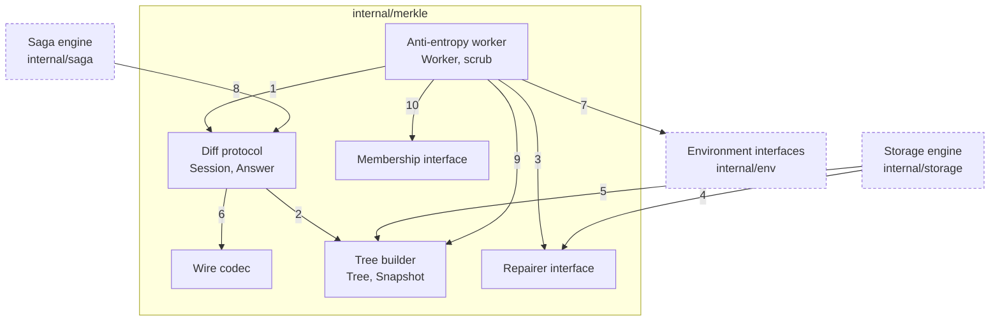

# C4 Level 3 — Component: merkle (`internal/merkle`)

**Partly as built.** The tree builder, the diff protocol, the anti-entropy worker, the `Repairer` interface, the wire codec and the `Membership` interface exist and match this diagram (checked against `internal/merkle` when Chunk 3 landed, 2026-11-22). Relationships 4, 5 and 8 are the target design: only test code implements `Repairer` and `Membership` so far, and nothing outside the package calls it. The storage engine, the saga verify step, the peer list from gossip and the node runtime are wired in Chunk 6.

Model: diagram `component-merkle` in [model.json](model.json). Source: PLAN.md sections 3, 4.2 (Chunk 3), 7.4, 7.8; code in `tree.go`, `diff.go`, `wire.go`, `worker.go`, `errors.go`.
The package uses Clock, Rand and Transport and no Disk: the worker reaches stored bytes only through the `Repairer` interface. The tree is kept in memory and rebuilt from the stored data at every start.



Terminal rendering, in 4 parts. Each numbered relationship appears in exactly one part.

**Part a.** The anti-entropy worker (1, 2, 3, 7).

<!-- draw-visual: diagrams/06-component-merkle-a.mmd -->
```text
┌───────────────────┐    ┌──────────────────┐    ┌────────────┐
│Anti-entropy worker├─1─►│  Diff protocol   ├─2─►│Tree builder│
└─────────┬─────────┘    └──────────────────┘    └────────────┘
          │
          │              ┌──────────────────┐
          ├───────────3─►│Repairer interface│
          │              └──────────────────┘
          │
          │              ┌──────────────────┐
          └───────────7─►│   internal/env   │
                         └──────────────────┘
```

**Part b.** The Saga engine, the Diff protocol and the Wire codec (6, 8).

<!-- draw-visual: diagrams/06-component-merkle-b.mmd -->
```text
┌───────────┐    ┌─────────────┐    ┌──────────┐
│Saga engine├─8─►│Diff protocol├─6─►│Wire codec│
└───────────┘    └─────────────┘    └──────────┘
```

**Part c.** What the Storage engine supplies (4, 5).

<!-- draw-visual: diagrams/06-component-merkle-c.mmd -->
```text
┌──────────────┐    ┌──────────────────┐
│Storage engine├─4─►│Repairer interface│
└───────┬──────┘    └──────────────────┘
        │
        │           ┌──────────────────┐
        └────────5─►│   Tree builder   │
                    └──────────────────┘
```

**Part d.** The worker's tree and its peer list (9, 10).

<!-- draw-visual: diagrams/06-component-merkle-d.mmd -->
```text
┌───────────────────┐     ┌────────────────────┐
│Anti-entropy worker├──9─►│    Tree builder    │
└─────────┬─────────┘     └────────────────────┘
          │
          │               ┌────────────────────┐
          └───────────10─►│Membership interface│
                          └────────────────────┘
```

| ID | Component | As built |
| --- | --- | --- |
| `m-tree` | Tree builder | `Tree` in `tree.go`: `New`, `Build`, `Set`, `Delete`, `Get`, `Root`, `Snapshot`, `DepthFor`. A trie of fixed depth (1 to 16) and fanout 16 on the first 64 bits of `SHA-256(key)`; a leaf holds its entries sorted by key. Leaf and inner hashes are domain-separated by a tag byte, and an inner hash also covers its level; an empty subtree is the all-zero hash. Nodes are immutable: `Set` and `Delete` copy one path, and `Snapshot` is O(1). Limits: keys of at most 1,024 bytes (`ErrKey`), at most 4,096 entries per leaf (`ErrLeafFull`) |
| `m-diff` | Diff protocol | `diff.go`. `Session` is the asking side: a state machine over a snapshot of the local tree that produces one request per tree level (`Request`) and takes the reply (`Feed`). `Tree.Answer` is the answering side and holds no state between requests. Leaf entries are packed into replies of at most 1 MiB; a leaf that does not fit is cut and resumed after its last key. At most `Limits.Frontier` mismatched nodes (default 1,024, at most 2,040) go on to the next level; the rest are dropped and the result is marked `Truncated`. Every reply is validated, so a session ends within `Depth + 5·Frontier` round trips whatever the peer sends. `Compare` runs a whole diff in memory. This code does no I/O |
| `m-wire` | Wire codec | `wire.go` and `errors.go`, added by the build; PLAN.md does not name it. Encodes and decodes the diff request and the four reply kinds: inner, leaf, cut leaf and equal. Big-endian, minimal varints; decoding is strict and canonical. Sets `MaxReplyBytes` (1 MiB) and `MaxRequestNodes` (2,040). Wire error codes 112 and 113, in the package's block 112 to 127. This code does no I/O |
| `m-worker` | Anti-entropy worker | `Worker` in `worker.go`: `NewWorker`, `Start`, `Stop`, `Record`, `Forget`, `OnRequest`, `Stats`. Each jittered period it re-reads and re-hashes the next `ScrubBatch` stored keys, so that rotted, missing and unreadable data shows in its tree (the scrub). Then, if no round is in flight, it picks one peer at random, diffs, and pulls each key whose remote hash `Repairer.Valid` accepts, at most `MaxRepairs` per round. Pull-only: a node repairs itself. A round has a deadline; a failed round is abandoned whole and the next period is the retry. `Stop` ends the round in flight with `env.ErrClosed`; `Start` after `Stop` rescans and resumes |
| `m-repairer` | Repairer interface | `Repairer` in `worker.go`, declared by the package: `Keys`, `Read`, `Valid`, `Fetch`, `Put`. The worker's only way to stored bytes, local or on a peer. `Valid` decides which hash is right for a key; fetched bytes are stored only when their SHA-256 passes it. Only the test chunk store implements it so far |
| `m-membership` | Membership interface | `Membership` in `worker.go`, added by the build; PLAN.md does not name it. `Peers` returns the candidate peer IDs; the worker sorts them and removes duplicates and its own ID. Only test code implements it so far |

| # | From | To | Relationship |
| --- | --- | --- | --- |
| 1 | Anti-entropy worker | Diff protocol | Each round: runs a diff `Session` on a snapshot of its tree; answers a peer's diff requests with `Tree.Answer` |
| 2 | Diff protocol | Tree builder | Reads the root, child hashes and leaf entries; compares them and descends only mismatched branches |
| 3 | Anti-entropy worker | Repairer interface | Lists and reads stored keys for the scrub; checks remote hashes, fetches differing keys from the peer and stores the bytes that pass |
| 4 | Storage engine | Repairer interface | Implements: rebuilds rotted or missing shards from any `k` good shards (target design) |
| 5 | Storage engine | Tree builder | Supplies manifest and shard-inventory `key → hash` maps (target design) |
| 6 | Diff protocol | Wire codec | Encodes and decodes every diff request and reply |
| 7 | Anti-entropy worker | Environment interfaces | Period and round-deadline timers (Clock); period jitter and random peer choice (Rand); one diff request per round trip, with a timeout (Transport) |
| 8 | Saga engine | Diff protocol | Migration verify step: compares source and target roots (target design) |
| 9 | Anti-entropy worker | Tree builder | Keeps the tree equal to the stored bytes: scrub re-hashes, repaired keys, `Record` and `Forget`; takes a snapshot for each round |
| 10 | Anti-entropy worker | Membership interface | Reads the peer list at the start of each round |

Differences from the target design:

- Relationship 6 ran from the Diff protocol to the Transport in the target design. As
  built, the diff code does no I/O: the worker sends each request and feeds the reply to
  the session (relationship 7). Relationship 6 now shows the Wire codec, which is new.
- Relationship 7 named the Clock only. As built, the worker also uses Rand and Transport.
  The package makes no Disk call.
- Relationships 9 and 10 and the Membership interface are new. The worker owns the tree
  and fills it itself, by hashing what `Repairer.Keys` and `Repairer.Read` return and
  through the write hooks `Record` and `Forget`. The storage engine supplying ready maps
  (relationship 5) stays the target design until Chunk 6.
- Round trips: PLAN.md says "≤ depth". As built, a diff takes one round trip per tree
  level, `Depth + 1` with the leaf level, plus one for each further leaf reply when the
  leaf data passes the 1 MiB reply limit.
- There are no tombstones. `Forget` removes a key from the tree, and a later round with a
  peer that still holds the key would pull it back. Deletes are a limit for Chunk 6.
