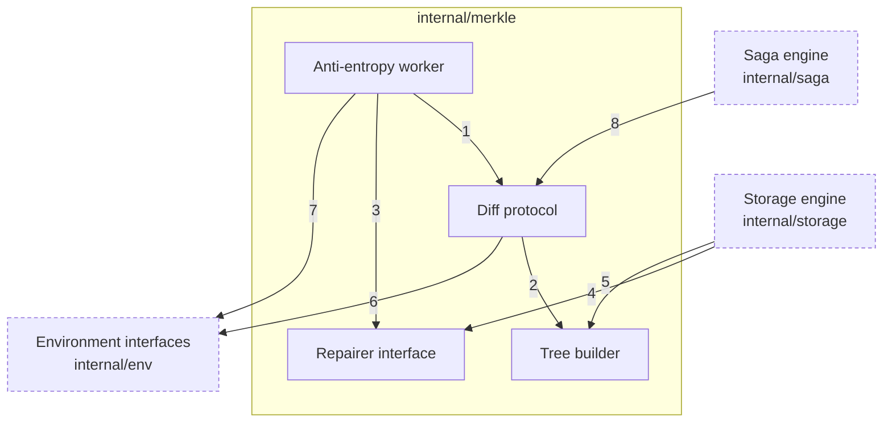

# C4 Level 3 — Component: merkle (`internal/merkle`)

**TARGET architecture — designed 2026-11-21, awaiting Nick's buy-in.**

Of the neighbours drawn here, the Storage engine and `internal/env` are built; this package and its relationships are the target design.

Model: diagram `component-merkle` in [model.json](model.json). Source: PLAN.md sections 3, 4.2 (Chunk 3), 7.4, 7.8.



Terminal rendering, in 3 parts. Each numbered relationship appears in exactly one part.

**Part a.** The anti-entropy worker (1, 2, 3, 7).

<!-- draw-visual: diagrams/06-component-merkle-a.mmd -->
```text
┌───────────────────┐    ┌──────────────────┐    ┌────────────┐
│Anti-entropy worker├─1─►│  Diff protocol   ├─2─►│Tree builder│
└─────────┬─────────┘    └──────────────────┘    └────────────┘
          │
          │              ┌──────────────────┐
          ├───────────3─►│Repairer interface│
          │              └──────────────────┘
          │
          │              ┌──────────────────┐
          └───────────7─►│   internal/env   │
                         └──────────────────┘
```

**Part b.** The Saga engine and the Diff protocol (6, 8).

<!-- draw-visual: diagrams/06-component-merkle-b.mmd -->
```text
┌───────────┐    ┌─────────────┐    ┌────────────┐
│Saga engine├─8─►│Diff protocol├─6─►│internal/env│
└───────────┘    └─────────────┘    └────────────┘
```

**Part c.** What the Storage engine supplies (4, 5).

<!-- draw-visual: diagrams/06-component-merkle-c.mmd -->
```text
┌──────────────┐    ┌──────────────────┐
│Storage engine├─4─►│Repairer interface│
└───────┬──────┘    └──────────────────┘
        │
        │           ┌──────────────────┐
        └────────5─►│   Tree builder   │
                    └──────────────────┘
```

| ID | Component | PLAN.md wording |
| --- | --- | --- |
| `m-tree` | Tree builder | SHA-256 hash tree over a `key → hash` map; fixed-fanout trie on the hash of the key; incremental update |
| `m-diff` | Diff protocol | exchanges roots and descends only mismatched branches, one level per round trip |
| `m-worker` | Anti-entropy worker | picks a peer each period, diffs, and repairs through a `Repairer` interface |
| `m-repairer` | Repairer interface | declared by the package; repairs go through it |

| # | From | To | Relationship |
| --- | --- | --- | --- |
| 1 | Anti-entropy worker | Diff protocol | Each period: picks a peer and diffs |
| 2 | Diff protocol | Tree builder | Compares roots; descends mismatched branches |
| 3 | Anti-entropy worker | Repairer interface | Repairs the differing keys |
| 4 | Storage engine | Repairer interface | Implements: rebuilds rotted or missing shards from any `k` good shards |
| 5 | Storage engine | Tree builder | Supplies manifest and shard-inventory `key → hash` maps |
| 6 | Diff protocol | Environment interfaces | Request/response rounds with the peer, one tree level each (Transport) |
| 7 | Anti-entropy worker | Environment interfaces | Period timer (Clock) |
| 8 | Saga engine | Diff protocol | Migration verify step: compares source and target roots |
