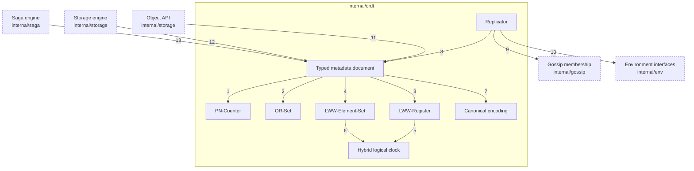

# C4 Level 3 — Component: crdt (`internal/crdt`)

**TARGET architecture — designed 2026-11-21, awaiting Nick's buy-in.**

Model: diagram `component-crdt` in [model.json](model.json). Source: PLAN.md sections 3, 4.2 (Chunk 4), 7.2, 7.5.



Terminal rendering, in 3 parts. Each numbered relationship appears in exactly one part.

**Part a.** Inside the metadata document (1 to 7).

<!-- draw-visual: diagrams/07-component-crdt-a.mmd -->
```text
┌───────────────────────┐    ┌──────────────────┐    ┌────────────────────┐
│Typed metadata document├─3─►│   LWW-Register   ├─5─►│Hybrid logical clock│
└───────────┬───────────┘    └──────────────────┘    └────────────────────┘
            │                                                   ▲
            │                ┌──────────────────┐               │
            ├─────────────4─►│ LWW-Element-Set  ├───────6───────┘
            │                └──────────────────┘
            │
            │                ┌──────────────────┐
            ├─────────────1─►│    PN-Counter    │
            │                └──────────────────┘
            │
            │                ┌──────────────────┐
            ├─────────────2─►│      OR-Set      │
            │                └──────────────────┘
            │
            │                ┌──────────────────┐
            └─────────────7─►│Canonical encoding│
                             └──────────────────┘
```

**Part b.** Who uses the metadata document (8, 11, 12, 13).

<!-- draw-visual: diagrams/07-component-crdt-b.mmd -->
```text
┌──────────────┐     ┌───────────────────────┐
│  Replicator  ├──8─►│Typed metadata document│
└──────────────┘     └───────────────────────┘
                                 ▲
┌──────────────┐                 │
│  Object API  ├───────11────────┤
└──────────────┘                 │
                                 │
┌──────────────┐                 │
│Storage engine├───────12────────┤
└──────────────┘                 │
                                 │
┌──────────────┐                 │
│ Saga engine  ├───────13────────┘
└──────────────┘
```

**Part c.** What the Replicator needs (9, 10).

<!-- draw-visual: diagrams/07-component-crdt-c.mmd -->
```text
┌──────────┐     ┌─────────────────┐
│Replicator├──9─►│Gossip membership│
└─────┬────┘     └─────────────────┘
      │
      │          ┌─────────────────┐
      └──────10─►│   internal/env  │
                 └─────────────────┘
```

| ID | Component | PLAN.md wording |
| --- | --- | --- |
| `x-pn` | PN-Counter | storage quotas |
| `x-orset` | OR-Set | bucket tags, ACL memberships; classic add-tags plus tombstone set (OQ-12) |
| `x-lwwreg` | LWW-Register | object metadata, routing pointers; object manifests (7.2) |
| `x-lwwset` | LWW-Element-Set | fourth type, kept from the spec's structure list |
| `x-hlc` | Hybrid logical clock | LWW timestamps `(wall, counter, node ID)` with node-ID tie-break |
| `x-enc` | Canonical encoding | equal states are equal bytes |
| `x-doc` | Typed metadata document | composed of the CRDT types |
| `x-repl` | Replicator | exchanges state with random peers from a `Membership` interface: digest first, state on mismatch |

| # | From | To | Relationship |
| --- | --- | --- | --- |
| 1 | Metadata document | PN-Counter | Storage quotas |
| 2 | Metadata document | OR-Set | Bucket tags, ACL memberships |
| 3 | Metadata document | LWW-Register | Object metadata, routing pointers, manifests |
| 4 | Metadata document | LWW-Element-Set | Composed of |
| 5 | LWW-Register | Hybrid logical clock | LWW timestamps |
| 6 | LWW-Element-Set | Hybrid logical clock | LWW timestamps |
| 7 | Metadata document | Canonical encoding | Equal states encode to equal bytes |
| 8 | Replicator | Metadata document | Sends a digest first; merges full state on mismatch |
| 9 | Replicator | Gossip membership | Picks a random live peer from Membership |
| 10 | Replicator | Environment interfaces | Periodic push-pull exchange with the peer (Clock, Rand, Transport) |
| 11 | Object API | Metadata document | Tags, ACL, quota and metadata edits |
| 12 | Storage engine | Metadata document | Object manifests |
| 13 | Saga engine | Metadata document | Routing pointer flip |
