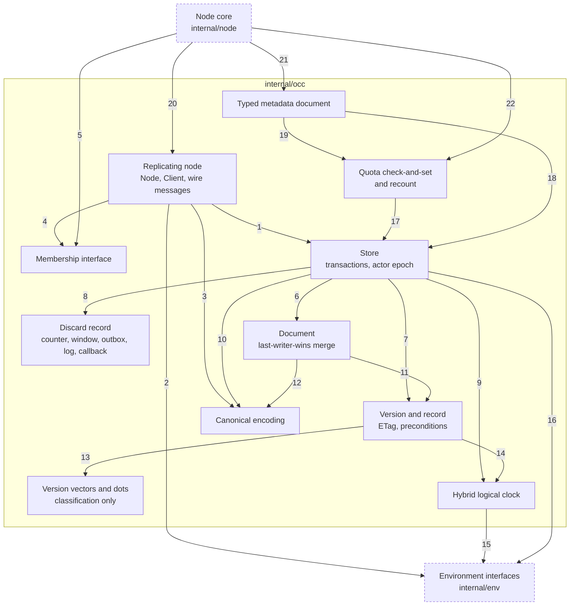

# C4 Level 3 — Component: occ (`internal/occ`)

**As built.** The eleven components inside the package exist and match this diagram (checked against `internal/occ` when Chunk 4 landed, 2026-11-22). Relationships 5 and 20 to 22 are as built since Chunk 6 (checked against `internal/node`, 2026-11-22). The one caller of the package is the Node core (`internal/node`): the object API, the storage engine and the saga engine do not call it, and the node core supplies the `Membership` interface from the gossip view. Chunk 6 added one method inside the package, `Node.Merge`.

Model: diagram `component-occ` in [model.json](model.json). Source: PLAN.md sections 3, 4.2 (Chunk 4), 7.5 and the LWW ruling in 9.1; code in `errors.go`, `vv.go`, `hlc.go`, `version.go`, `record.go`, `doc.go`, `encoding.go`, `store.go`, `quota.go`, `meta.go`, `wire.go`, `node.go`.
The package is optimistic concurrency control for metadata. Each key holds exactly one version on every replica. A conditional write (`If-Match` on an ETag, or `If-None-Match`) is refused when the key has moved on. When two concurrent versions of a key meet, last-writer-wins picks one as a function of the pair alone: the higher hybrid logical clock stamp, then the node ID, then the version ID. The other version is discarded, and every such discard is counted, logged and reported through a callback. Version vectors only tell an ordinary overwrite from a concurrent discard; they never pick the winner.



Terminal rendering, in 6 parts. Each numbered relationship appears in exactly one part.

**Part a.** The replicating node and its peer list (1 to 4).

<!-- draw-visual: diagrams/07-component-occ-a.mmd -->
```text
┌────────────────┐    ┌────────────────────┐
│Replicating node├─1─►│       Store        │
└────────┬───────┘    └────────────────────┘
         │
         │            ┌────────────────────┐
         ├─────────2─►│    internal/env    │
         │            └────────────────────┘
         │
         │            ┌────────────────────┐
         ├─────────3─►│ Canonical encoding │
         │            └────────────────────┘
         │
         │            ┌────────────────────┐
         └─────────4─►│Membership interface│
                      └────────────────────┘
```

**Part b.** Inside the store (6 to 10).

<!-- draw-visual: diagrams/07-component-occ-b.mmd -->
```text
┌─────┐     ┌────────────────────┐
│Store├──6─►│Document, LWW merge │
└──┬──┘     └────────────────────┘
   │
   │        ┌────────────────────┐
   ├─────7─►│ Version and record │
   │        └────────────────────┘
   │
   │        ┌────────────────────┐
   ├─────8─►│   Discard record   │
   │        └────────────────────┘
   │
   │        ┌────────────────────┐
   ├─────9─►│Hybrid logical clock│
   │        └────────────────────┘
   │
   │        ┌────────────────────┐
   └────10─►│ Canonical encoding │
            └────────────────────┘
```

**Part c.** The document and its versions (11 to 13).

<!-- draw-visual: diagrams/07-component-occ-c.mmd -->
```text
┌───────────────────┐     ┌──────────────────┐     ┌───────────────┐
│Document, LWW merge├─11─►│Version and record├─13─►│Version vectors│
└─────────┬─────────┘     └──────────────────┘     └───────────────┘
          │
          │               ┌──────────────────┐
          └───────────12─►│Canonical encoding│
                          └──────────────────┘
```

**Part d.** Stamps, and what the store and the clock take from the environment (14 to 16).

<!-- draw-visual: diagrams/07-component-occ-d.mmd -->
```text
┌────────────────────┐     ┌────────────┐
│       Store        ├─16─►│internal/env│
└────────────────────┘     └────────────┘
                                  ▲
┌────────────────────┐            │
│Hybrid logical clock├────15──────┘
└────────────────────┘
           ▲
          14
           │
┌──────────┴─────────┐
│ Version and record │
└────────────────────┘
```

**Part e.** Quotas and the typed document write through the store (17 to 19).

<!-- draw-visual: diagrams/07-component-occ-e.mmd -->
```text
┌───────────────────────┐     ┌───────────────────┐
│Typed metadata document├─19─►│Quota check-and-set│
└───────────┬───────────┘     └─────────┬─────────┘
            │                           │
            │                          17
            │                           ▼
            │                 ┌───────────────────┐
            └─────────────18─►│       Store       │
                              └───────────────────┘
```

**Part f.** What the Node core calls and implements (5, 20 to 22).

<!-- draw-visual: diagrams/07-component-occ-f.mmd -->
```text
┌─────────┐     ┌───────────────────────┐
│Node core├─20─►│    Replicating node   │
└────┬────┘     └───────────────────────┘
     │
     │          ┌───────────────────────┐
     ├──────21─►│Typed metadata document│
     │          └───────────────────────┘
     │
     │          ┌───────────────────────┐
     ├──────22─►│  Quota check-and-set  │
     │          └───────────────────────┘
     │
     │          ┌───────────────────────┐
     └───────5─►│  Membership interface │
                └───────────────────────┘
```

| ID | Component | As built |
| --- | --- | --- |
| `o-hlc` | Hybrid logical clock | `hlc.go`. `Stamp{Wall, Logical, Node}` with a total order: wall, then logical counter, then node ID. `HLC` over `env.Clock`: `Now` returns a stamp above every earlier one; `Observe` takes in a remote stamp and refuses one more than `MaxClockLead` (1 hour) ahead of the local clock with `ErrClockAhead`. At the end of the stamp space `Now` returns `ErrClockExhausted` |
| `o-vv` | Version vectors and dots | `vv.go`, and `Dot` in `version.go`. `Actor{Node, Epoch}`; a `VersionVector` maps actors to counters, with `Compare` (equal, before, after, concurrent), `Descends` and `Join`. A version carries a dot (its actor and counter) and a causal context (what its writer had seen). Used for classification only: they tell whether the winner's writer had seen the loser. They never choose the winner |
| `o-version` | Version and record | `version.go` and `record.go`. `Version`: dot, causal context, tombstone flag, value, stamp and a `VersionID` (SHA-256 over all of them). `Version.Compare` is the last-writer-wins order: stamp, then version ID; only forged input reaches the version ID. `Supersedes` asks whether one version's writer had seen the other. `Record` is the one optional version of a key; `Record.Merge` keeps the greater version. `ETag` is the version ID, so it is equal on every node holding the version; a tombstone has one, an absent key has the zero ETag. `Precondition`: `IfMatch(etag)`, `IfNoneMatch()`, `Unconditional()`, checked by `Holds` |
| `o-doc` | Document, last-writer-wins merge | `Doc` in `doc.go`: a map from key to one `Version`. `Merge` and `MergeVersion` keep, per key, the greater version under `Version.Compare`; the merge is commutative, associative, idempotent and has no error path. `Digest` is the SHA-256 of the canonical encoding. `Subset` and `KeysWithPrefix` cut out parts of it. There is one version per key in memory, in the encoding and in the API |
| `o-enc` | Canonical encoding | `encoding.go`, with `Doc.Encode` and `Decode` in `doc.go`. Replicas holding the same versions produce the same bytes. Document: the magic `OCC\x02`, a key count, then `(key, version)` pairs in strictly increasing key order. Decoding is strict and bounded: a repeated or out-of-order key, a non-minimal varint, a count larger than the remaining input and trailing bytes are rejected with `ErrMalformed`, and the result must re-encode to the input |
| `o-store` | Store | `Store` and `Reader` in `store.go`. `Put`, `Delete` and `SetScalar` check the precondition against the held version and install its causal successor, with a stamp above the one it replaces. `Merge` takes in a peer's document. Every mutation is a transaction: the store applies the change, encodes its state blob and calls the `Persist` hook; if that fails it restores the document, the actor, the dot counter, the clock and the discard state, so a failed persist leaves no trace. Dots come from one counter per actor. The actor epoch is drawn at random when there is no readable state, and retired for a fresh one when a discard leaves a gap in the node's own dots. State blob: `OCS2`, a SHA-256, then epoch, counter, discard state and the document; an unreadable blob is treated as no state. `Reader` is the read-only side: `Get`, `Record`, `Keys`, `Doc`, `Digest`, `Scalar` |
| `o-discard` | Discard record | In `store.go`; PLAN.md names the guarantee, the build added the parts. When a merge drops a version that the winner's writer had not seen, either a held version replaced or an incoming version rejected, the store records a `Discard{Key, Winner, Loser}`: it adds one to a persisted counter (`LWWDiscards`), keeps the record in a 64-entry tail (`DiscardTail`) and in a persisted outbox, and after the persist succeeds writes one log line through `Log` and calls `OnDiscard(key, winner, loser)`. A window of the last 256 `(key, loser)` pairs stops a re-sent loser from being recorded twice. The outbox is emitted again when a node opens its state, so a crash between the durable merge and the emission loses no record. Records are local to the node; they are not replicated |
| `o-quota` | Quota check-and-set and recount | `quota.go`. `Usage{Bytes, Objects}`. `UpdateQuota` reads the usage with the precondition to write it back under, computes, and writes conditionally; it retries only on `ErrPreconditionFailed`, at most `attempts` times. `WriteQuota` refuses an unconditional write. `RecountQuota` takes a `Recount` hook and writes only when the stored usage differs from the recount. `AddUsage` enforces a limit with checked arithmetic. The package does not schedule recounts |
| `o-meta` | Typed metadata document | `meta.go`. Seven key kinds over the same store: tags, ACL entries, quotas, object metadata, object manifests, a bucket's routing pointer and content type. Key builders and `ParseKey`; `Permission` bits; `ObjectMeta{Size, Hash, Created}`. Typed writes (`PutTag`, `PutACL`, `PutObjectMeta`, `PutManifest`, `SetRoute`, `SetContentType`) and typed reads on `Reader`. `Reader.RecountObjects` sums a bucket's live object sizes for a quota recount and returns `ErrUsageOverflow` instead of wrapping |
| `o-node` | Replicating node | `Node` in `node.go` (an `env.Process`), `Client`, and the messages in `wire.go` and `errors.go`. Loads the state blob at start and retries on a read error. Each jittered period it sends its document digest to one random peer; the peer answers "match" or its whole document; the node merges it and pushes its own document back if the two still differ. After each local write it sends the changed key as a datagram to `Fanout` (2) random peers. Serves remote get, put and delete requests; `Client` sends them. All writes go through `Node` methods, which persist and then broadcast; `Reader()` is read-only. Wire error codes 128 to 136 in the package's block 128 to 143, with 131 unassigned. Added in Chunk 6: `Merge` in `node_merge.go`, which folds a fetched document into the store with the same merge, discard record and persistence; the node core's metadata repairer calls it |
| `o-membership` | Membership interface | `Membership` in `node.go`, declared by the package: `Peers() []env.NodeID`. The node sorts the list and removes duplicates and its own ID. `StaticMembership` is a fixed list. The node core supplies it from the gossip view |

| # | From | To | Relationship |
| --- | --- | --- | --- |
| 1 | Replicating node | Store | Runs every local write and every received document as a store transaction; supplies the `Persist` hook and passes on `Log` and `OnDiscard` |
| 2 | Replicating node | Environment interfaces | Round and load-retry timers (Clock); period jitter and peer choice (Rand); digest requests, pushes, delta datagrams and client operations (Transport); reads, writes and syncs the state blob `occ/state` (Disk) |
| 3 | Replicating node | Canonical encoding | Sends and receives documents in the canonical encoding; encodes client operations and results |
| 4 | Replicating node | Membership interface | Reads the peer list for each round and each delta broadcast |
| 5 | Node core | Membership interface | Implements it: `gossipView.Peers`, the gossip view's live members other than the node itself |
| 6 | Store | Document | Holds the node's document; merges a received document into it key by key |
| 7 | Store | Version and record | Checks the precondition against the held record; builds the successor version; asks `Supersedes` to classify each replaced or rejected version |
| 8 | Store | Discard record | Records every concurrent version the merge drops, replaced or rejected, in the same durable write as the merge; emits after the persist succeeds |
| 9 | Store | Hybrid logical clock | Takes a stamp for each write; observes every stamp of a received or loaded document |
| 10 | Store | Canonical encoding | Encodes and decodes the checksummed state blob |
| 11 | Document | Version and record | Holds one version per key; a merge keeps the greater version under the last-writer-wins order |
| 12 | Document | Canonical encoding | Equal documents encode to equal bytes; the digest is their SHA-256 |
| 13 | Version and record | Version vectors and dots | Carries a dot and a causal context; `Supersedes` compares them. Classification only |
| 14 | Version and record | Hybrid logical clock | Carries a stamp; the last-writer-wins order compares stamps first |
| 15 | Hybrid logical clock | Environment interfaces | Reads the node's clock (Clock) |
| 16 | Store | Environment interfaces | Draws a fresh actor epoch (Rand). The store makes no Disk call: it persists through the hook the node supplies |
| 17 | Quota check-and-set | Store | Reads the usage and writes it back under `If-Match` or `If-None-Match`, through the store's or the node's `Put` |
| 18 | Typed metadata document | Store | Typed keys and values, written through the store's or the node's `Put` and read through `Reader` |
| 19 | Typed metadata document | Quota check-and-set | `RecountObjects` supplies the usage a recount writes |
| 20 | Node core | Replicating node | Makes every metadata write through `Node` methods: `Put` and `Delete` under the precondition the API call carries (`IfMatch`, `IfNoneMatch`, or none) for object and bucket records, `SetScalar` for its system records, and `Merge` for a version fetched by metadata anti-entropy. Reads through `Reader()`. Receives each discard through `OnDiscard` and handles it after the merge has returned |
| 21 | Node core | Typed metadata document | Uses the typed keys (`ManifestKey`, `QuotaKey`, `RouteKey`), the typed writes `PutTag`, `PutACL` and `SetRoute`, and `Route` on `Reader`. The object record, which is the storage manifest plus the content type, is one value under the manifest key, written with `Put`; `PutManifest`, `PutObjectMeta` and `SetContentType` are not used |
| 22 | Node core | Quota check-and-set | `UpdateQuota` with `AddUsage` when an object is put or deleted. `RecountQuota` with the node's own recount over the live manifests: a settle time after a quota-key or manifest-key discard, and from the periodic quota audit |

The package only reports a discard. The node core decides what follows (relationships 20 and 22): it counts the discard and passes it to its sink, schedules a quota recount for a discard on a quota key or a manifest key, and marks the losing object version dead so that its shards are collected.

Differences from the target design:

- **The CRDT design was replaced.** The first design of this component, drawn here until Chunk 4 landed, had four CRDT types (PN-Counter, OR-Set, LWW-Register, LWW-Element-Set) under a typed document. By owner ruling (the OCC amendment of 2026-11-21, PLAN.md 4.2 and 7.5), metadata is protected by optimistic concurrency control instead. None of the four types was built, and the package is `internal/occ`, not `internal/crdt`.
- **Sibling versions were ruled out.** Keeping both concurrent versions of a key as siblings for a reader to resolve was built first and then ruled out by the owner (the LWW ruling, PLAN.md 9.1). Each key holds one version. Last-writer-wins picks it, and every discarded concurrent write is recorded: counted, logged and reported through `OnDiscard`. The system guarantees convergence and a record of the loss, not preservation of both writes.
- The Store, the Discard record, Version and record, Version vectors and the Membership interface are new components. The hybrid logical clock, the canonical encoding, the typed metadata document and the replicator (now the Replicating node) keep their places from the first design.
- The replicator read the gossip view directly in the first design. As built, the package declares its own `Membership` interface (relationship 4) and the node core implements it (relationship 5), so the package does not import `internal/gossip`.
- Relationships 20 to 22 started at the Object API, the Storage engine and the Saga engine in the target design. As built all three start at the Node core: the API calls the node through one service interface, storage returns the manifest and stores nothing, and the migration's routing flip is a `SetRoute` made by the node core's implementation of the saga step interfaces. Relationship 22 now ends at the quota code; the routing flip is part of relationship 21.
- Relationship 2 named Clock, Rand and Transport. As built, the node also uses Disk, for one state blob.
- Quotas were a PN-Counter. As built, a quota is one check-and-set value. Updates made on two sides of a partition settle by last-writer-wins, so the stored usage can be one side's figure until a recount corrects it.
- Limits: tombstones are kept forever, and a mismatched round exchanges whole documents.
