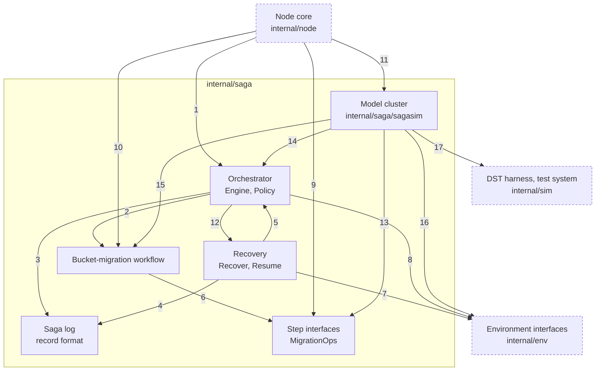

# C4 Level 3 — Component: saga (`internal/saga`)

**As built.** The orchestrator, the saga log, recovery, the bucket-migration workflow, the step interfaces and the model cluster exist and match this diagram (checked against `internal/saga` and `internal/saga/sagasim` when Chunk 5 landed, 2026-11-22). Relationships 1 and 9 to 11 are as built since Chunk 6 (checked against `internal/node`, 2026-11-22). The package still imports only `internal/env`: the Node core (`internal/node`) creates the engine and implements the step interfaces on the storage, Merkle and metadata packages, so the steps are bound to the real components from outside this package.

Model: diagram `component-saga` in [model.json](model.json). Source: PLAN.md sections 3, 4.2 (Chunk 5), 7.8; code in `engine.go`, `policy.go`, `log.go`, `resume.go`, `migration.go`, and `sagasim/`; the real step implementation is `internal/node/migrate.go`.



Terminal rendering, in 4 parts. Each numbered relationship appears in exactly one part.

**Part a.** Running a saga (2, 3, 6, 12).

<!-- draw-visual: diagrams/08-component-saga-a.mmd -->
```text
┌────────────┐     ┌─────────────────────────┐    ┌───────────────┐
│Orchestrator├──2─►│Bucket-migration workflow├─6─►│Step interfaces│
└──────┬─────┘     └─────────────────────────┘    └───────────────┘
       │
       │           ┌─────────────────────────┐
       ├────────3─►│         Saga log        │
       │           └─────────────────────────┘
       │
       │           ┌─────────────────────────┐
       └───────12─►│         Recovery        │
                   └─────────────────────────┘
```

**Part b.** What the Node core creates, implements and registers (1, 9 to 11).

<!-- draw-visual: diagrams/08-component-saga-b.mmd -->
```text
┌─────────┐     ┌─────────────────────────┐
│Node core├──1─►│       Orchestrator      │
└────┬────┘     └─────────────────────────┘
     │
     │          ┌─────────────────────────┐
     ├───────9─►│     Step interfaces     │
     │          └─────────────────────────┘
     │
     │          ┌─────────────────────────┐
     ├──────10─►│Bucket-migration workflow│
     │          └─────────────────────────┘
     │
     │          ┌─────────────────────────┐
     └──────11─►│      Model cluster      │
                └─────────────────────────┘
```

**Part c.** Recovery and the environment (4, 5, 7, 8).

<!-- draw-visual: diagrams/08-component-saga-c.mmd -->
```text
┌────────┐    ┌────────────┐
│Recovery├─4─►│  Saga log  │
└────┬───┘    └────────────┘
     │
     │        ┌────────────┐
     ├─────5─►│Orchestrator│
     │        └──────┬─────┘
     │               │
     │               8
     │               ▼
     │        ┌────────────┐
     └─────7─►│internal/env│
              └────────────┘
```

**Part d.** The model cluster (13 to 17).

<!-- draw-visual: diagrams/08-component-saga-d.mmd -->
```text
┌─────────────┐     ┌─────────────────────────┐
│Model cluster├─13─►│     Step interfaces     │
└──────┬──────┘     └─────────────────────────┘
       │
       │            ┌─────────────────────────┐
       ├────────14─►│       Orchestrator      │
       │            └─────────────────────────┘
       │
       │            ┌─────────────────────────┐
       ├────────15─►│Bucket-migration workflow│
       │            └─────────────────────────┘
       │
       │            ┌─────────────────────────┐
       ├────────16─►│       internal/env      │
       │            └─────────────────────────┘
       │
       │            ┌─────────────────────────┐
       └────────17─►│       DST harness       │
                    └─────────────────────────┘
```

| ID | Component | As built |
| --- | --- | --- |
| `s-orch` | Orchestrator | `engine.go`, `policy.go`: `Engine` (`Begin`, `Status`, `Stats`) and `Policy`. Single-threaded. Steps before the pivot retry up to `MaxAttempts` with clock-driven backoff and jitter, then compensate in reverse order; the pivot aborts only on `ErrPermanent`; later steps and compensations retry until they succeed. Each call carries the idempotency key `Key{Saga, Step}` |
| `s-log` | Saga log | `log.go`: the record format of the per-saga blob `saga/<id>`. Append-only frames with a magic byte, a length and two CRC-32C checksums; `AppendRecord` encodes and `DecodeLog` returns the valid prefix. A strict prefix of a frame is a torn tail; anything else wrong is `ErrLogCorrupt`. This code does no I/O |
| `s-recovery` | Recovery | `Engine.Recover` in `engine.go` and the pure `Resume` state machine in `resume.go`. Truncates a torn tail before anything is appended, validates every transition, and plans the next action: run a step, abort, compensate or end. A corrupt log is left as found and reported by `Status` |
| `s-workflow` | Bucket-migration workflow | `migration.go`: `Migration(ops)`, five steps: `allocate` → `copy` → `verify` → `flip` (the pivot) → `delete-source`. `delete-source` seals the source, runs a catch-up copy and a second root comparison, retires the source and then promotes the target |
| `s-steps` | Step interfaces | `migration.go`: `MigrationOps`, made of `Allocator`, `Copier`, `Verifier`, `Router` and `Retirer`. Two implementations: the model cluster's `Ops`, and `migrator` in `internal/node`, which runs the steps on the real storage, Merkle and metadata packages |
| `s-sim` | Model cluster | `internal/saga/sagasim`, added by the build; PLAN.md does not name it. Test support: model stores, a coordinator process that hosts the `Engine`, and a writing client, as simulator nodes. It also exports the 78-cell failure-point matrix runner (`Harness`, `Cells`, `Run`) and the nemesis and duel scenario drivers, for reuse on real components |

| # | From | To | Relationship |
| --- | --- | --- | --- |
| 1 | Node core | Orchestrator | Creates the engine (`New`) with the migration as its one definition, calls `Recover` at start, begins a migration (`Begin`, with a saga ID prefixed by the node ID) and reads its status (`Status`); `OnEnd` reports a finished saga. Status is known only on the coordinating node |
| 2 | Orchestrator | Bucket-migration workflow | Runs the steps of a registered definition: bounded retry with backoff before the pivot, compensation in reverse order |
| 3 | Orchestrator | Saga log | Encodes each record; the record is appended and synced before the step or compensation acts |
| 4 | Recovery | Saga log | Decodes the valid prefix of each log; tells a torn tail from corruption |
| 5 | Recovery | Orchestrator | Hands over the recovered snapshot; the orchestrator resumes or compensates from it |
| 6 | Bucket-migration workflow | Step interfaces | Claim, copy, root, flip pointer (pivot), seal, retire, promote; unclaim and discard to compensate |
| 7 | Recovery | Environment interfaces | Lists and reads logs, truncates a torn tail, deletes an empty log; retry timer for an unreadable log (Disk, Clock, Rand) |
| 8 | Orchestrator | Environment interfaces | Appends and syncs records; step timeout and backoff timers; jitter (Disk, Clock, Rand) |
| 9 | Node core | Step interfaces | Implements `MigrationOps` as `migrator`. Claim and registration are metadata keys; the copy reads each live object and puts it into the target region through a storage node of its own, after recording an intent for the version it will write; the roots are built with `merkle.Build`; the flip writes a flip-owner record and then the routing pointer (`SetRoute`); the pointer check needs the same view from every live peer; retire swaps each manifest for its staged copy and purges a named list of dead versions |
| 10 | Node core | Bucket-migration workflow | Registers `Migration(migrator)` as the engine's definition; decodes the `MigrationInput` a call carries |
| 11 | Node core | Model cluster | Test code: the node package's tests implement `Harness.Build` over real nodes and run the 78-cell failure matrix with `Run` |
| 12 | Orchestrator | Recovery | Checks each record against the same state machine before writing it, and takes its next action from it |
| 13 | Model cluster | Step interfaces | Implements `MigrationOps` over the model stores (`sagasim.Ops`) |
| 14 | Model cluster | Orchestrator | Its coordinator process hosts the `Engine`; the matrix runner freezes it at a chosen record through `Config.Hook` |
| 15 | Model cluster | Bucket-migration workflow | Registers the migration definition; the matrix runner wraps its steps to inject failures |
| 16 | Model cluster | Environment interfaces | Requests between coordinator, stores and client; each store's state blob; client and reload retry timers (Transport, Disk, Clock, Rand) |
| 17 | Model cluster | DST harness | Builds the cluster as simulated nodes; crashes, torn crashes, the nemesis and invariants |

Differences from the target design:

- Relationship 7 started at the Saga log in the target design. As built, the log code is a
  record format and does no I/O; recovery and the orchestrator make the `env.Disk` calls
  (relationships 7 and 8).
- Relationship 12 is new: the orchestrator and recovery share one state machine, so a
  record that would be an illegal transition is never written.
- The Model cluster and relationships 13 to 17 are new.
- Relationship 1 started at the Object API in the target design, and relationships 9 to 11
  ran from the step interfaces to the Storage engine, Merkle anti-entropy and the metadata
  layer. As built the package calls none of them. The Node core starts and reads
  migrations (1) and implements the step interfaces (9), and the calls into storage,
  Merkle and OCC metadata are made by that implementation, outside this package; they
  are relationships 6, 7 and 10 of [02-container.md](02-container.md). Relationships 10
  and 11 are new in their place.
