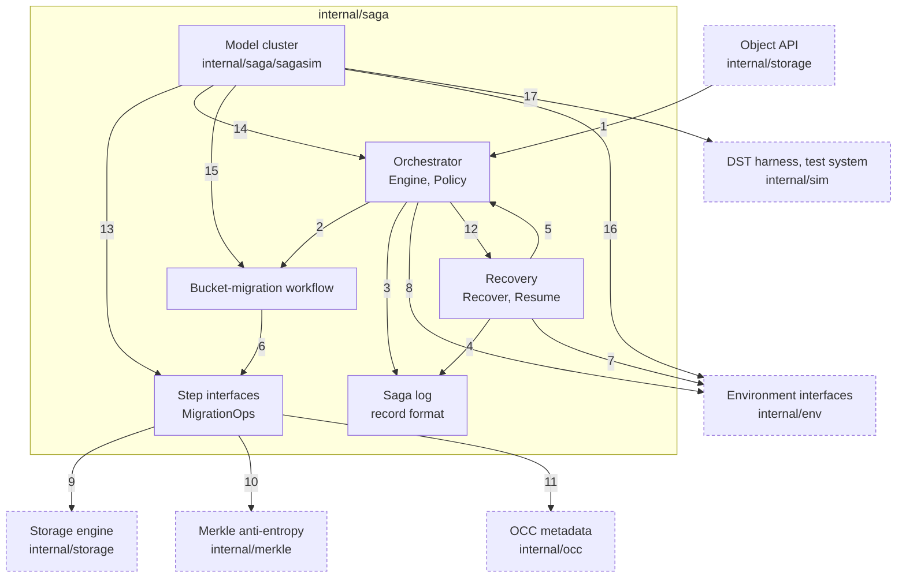

# C4 Level 3 — Component: saga (`internal/saga`)

**Partly as built.** The orchestrator, the saga log, recovery, the bucket-migration workflow, the step interfaces and the model cluster exist and match this diagram (checked against `internal/saga` and `internal/saga/sagasim` when Chunk 5 landed, 2026-11-22). The Object API and relationships 1 and 9 to 11 are the target design: until Chunk 6 binds the step interfaces to the storage, Merkle and metadata components, the migration steps run only against the model cluster.

Model: diagram `component-saga` in [model.json](model.json). Source: PLAN.md sections 3, 4.2 (Chunk 5), 7.8; code in `engine.go`, `policy.go`, `log.go`, `resume.go`, `migration.go`, and `sagasim/`.



Terminal rendering, in 4 parts. Each numbered relationship appears in exactly one part.

**Part a.** Starting and running a saga (1 to 3, 12).

<!-- draw-visual: diagrams/08-component-saga-a.mmd -->
```text
┌──────────┐    ┌────────────┐     ┌─────────────────────────┐
│Object API├─1─►│Orchestrator├──2─►│Bucket-migration workflow│
└──────────┘    └──────┬─────┘     └─────────────────────────┘
                       │
                       │           ┌─────────────────────────┐
                       ├────────3─►│         Saga log        │
                       │           └─────────────────────────┘
                       │
                       │           ┌─────────────────────────┐
                       └───────12─►│         Recovery        │
                                   └─────────────────────────┘
```

**Part b.** The workflow steps and where they will act (6, 9 to 11).

<!-- draw-visual: diagrams/08-component-saga-b.mmd -->
```text
┌─────────────────────────┐    ┌───────────────┐     ┌───────────────────┐
│Bucket-migration workflow├─6─►│Step interfaces├──9─►│   Storage engine  │
└─────────────────────────┘    └───────┬───────┘     └───────────────────┘
                                       │
                                       │             ┌───────────────────┐
                                       ├─────────10─►│Merkle anti-entropy│
                                       │             └───────────────────┘
                                       │
                                       │             ┌───────────────────┐
                                       └─────────11─►│    OCC metadata   │
                                                     └───────────────────┘
```

**Part c.** Recovery and the environment (4, 5, 7, 8).

<!-- draw-visual: diagrams/08-component-saga-c.mmd -->
```text
┌────────┐    ┌────────────┐
│Recovery├─4─►│  Saga log  │
└────┬───┘    └────────────┘
     │
     │        ┌────────────┐
     ├─────5─►│Orchestrator│
     │        └──────┬─────┘
     │               │
     │               8
     │               ▼
     │        ┌────────────┐
     └─────7─►│internal/env│
              └────────────┘
```

**Part d.** The model cluster (13 to 17).

<!-- draw-visual: diagrams/08-component-saga-d.mmd -->
```text
┌─────────────┐     ┌─────────────────────────┐
│Model cluster├─13─►│     Step interfaces     │
└──────┬──────┘     └─────────────────────────┘
       │
       │            ┌─────────────────────────┐
       ├────────14─►│       Orchestrator      │
       │            └─────────────────────────┘
       │
       │            ┌─────────────────────────┐
       ├────────15─►│Bucket-migration workflow│
       │            └─────────────────────────┘
       │
       │            ┌─────────────────────────┐
       ├────────16─►│       internal/env      │
       │            └─────────────────────────┘
       │
       │            ┌─────────────────────────┐
       └────────17─►│       DST harness       │
                    └─────────────────────────┘
```

| ID | Component | As built |
| --- | --- | --- |
| `s-orch` | Orchestrator | `engine.go`, `policy.go`: `Engine` (`Begin`, `Status`, `Stats`) and `Policy`. Single-threaded. Steps before the pivot retry up to `MaxAttempts` with clock-driven backoff and jitter, then compensate in reverse order; the pivot aborts only on `ErrPermanent`; later steps and compensations retry until they succeed. Each call carries the idempotency key `Key{Saga, Step}` |
| `s-log` | Saga log | `log.go`: the record format of the per-saga blob `saga/<id>`. Append-only frames with a magic byte, a length and two CRC-32C checksums; `AppendRecord` encodes and `DecodeLog` returns the valid prefix. A strict prefix of a frame is a torn tail; anything else wrong is `ErrLogCorrupt`. This code does no I/O |
| `s-recovery` | Recovery | `Engine.Recover` in `engine.go` and the pure `Resume` state machine in `resume.go`. Truncates a torn tail before anything is appended, validates every transition, and plans the next action: run a step, abort, compensate or end. A corrupt log is left as found and reported by `Status` |
| `s-workflow` | Bucket-migration workflow | `migration.go`: `Migration(ops)`, five steps: `allocate` → `copy` → `verify` → `flip` (the pivot) → `delete-source`. `delete-source` seals the source, runs a catch-up copy and a second root comparison, retires the source and then promotes the target |
| `s-steps` | Step interfaces | `migration.go`: `MigrationOps`, made of `Allocator`, `Copier`, `Verifier`, `Router` and `Retirer`. Only the model cluster implements it so far; Chunk 6 binds it to the real components |
| `s-sim` | Model cluster | `internal/saga/sagasim`, added by the build; PLAN.md does not name it. Test support: model stores, a coordinator process that hosts the `Engine`, and a writing client, as simulator nodes. It also exports the 78-cell failure-point matrix runner (`Harness`, `Cells`, `Run`) and the nemesis and duel scenario drivers, for reuse on real components |

| # | From | To | Relationship |
| --- | --- | --- | --- |
| 1 | Object API | Orchestrator | Migration start and status (target design) |
| 2 | Orchestrator | Bucket-migration workflow | Runs the steps of a registered definition: bounded retry with backoff before the pivot, compensation in reverse order |
| 3 | Orchestrator | Saga log | Encodes each record; the record is appended and synced before the step or compensation acts |
| 4 | Recovery | Saga log | Decodes the valid prefix of each log; tells a torn tail from corruption |
| 5 | Recovery | Orchestrator | Hands over the recovered snapshot; the orchestrator resumes or compensates from it |
| 6 | Bucket-migration workflow | Step interfaces | Claim, copy, root, flip pointer (pivot), seal, retire, promote; unclaim and discard to compensate |
| 7 | Recovery | Environment interfaces | Lists and reads logs, truncates a torn tail, deletes an empty log; retry timer for an unreadable log (Disk, Clock, Rand) |
| 8 | Orchestrator | Environment interfaces | Appends and syncs records; step timeout and backoff timers; jitter (Disk, Clock, Rand) |
| 9 | Step interfaces | Storage engine | Allocate target, copy shards, delete source (target design) |
| 10 | Step interfaces | Merkle anti-entropy | Verify Merkle root (target design; the merkle package is built, and the step is bound to it in Chunk 6) |
| 11 | Step interfaces | OCC metadata | Flip the bucket's routing pointer: `SetRoute`, an unconditional write settled by last-writer-wins (target design; the occ package is built, and the step is bound to it in Chunk 6) |
| 12 | Orchestrator | Recovery | Checks each record against the same state machine before writing it, and takes its next action from it |
| 13 | Model cluster | Step interfaces | Implements `MigrationOps` over the model stores (`sagasim.Ops`) |
| 14 | Model cluster | Orchestrator | Its coordinator process hosts the `Engine`; the matrix runner freezes it at a chosen record through `Config.Hook` |
| 15 | Model cluster | Bucket-migration workflow | Registers the migration definition; the matrix runner wraps its steps to inject failures |
| 16 | Model cluster | Environment interfaces | Requests between coordinator, stores and client; each store's state blob; client and reload retry timers (Transport, Disk, Clock, Rand) |
| 17 | Model cluster | DST harness | Builds the cluster as simulated nodes; crashes, torn crashes, the nemesis and invariants |

Differences from the target design:

- Relationship 7 started at the Saga log in the target design. As built, the log code is a
  record format and does no I/O; recovery and the orchestrator make the `env.Disk` calls
  (relationships 7 and 8).
- Relationship 12 is new: the orchestrator and recovery share one state machine, so a
  record that would be an illegal transition is never written.
- The Model cluster and relationships 13 to 17 are new. The cluster stands in for the
  storage, Merkle and metadata components, so relationships 9 to 11 stay planned until
  Chunk 6.
