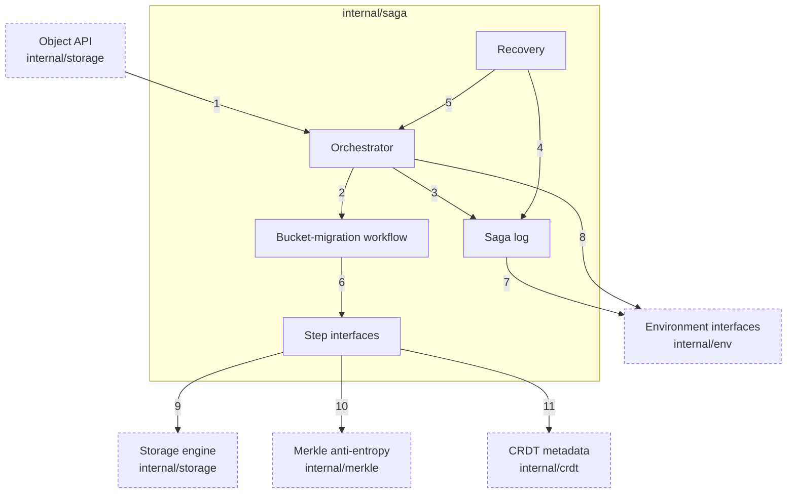

# C4 Level 3 — Component: saga (`internal/saga`)

**TARGET architecture — designed 2026-11-21, awaiting Nick's buy-in.**

Of the neighbours drawn here, the Storage engine and `internal/env` are built; this package and its relationships are the target design.

Model: diagram `component-saga` in [model.json](model.json). Source: PLAN.md sections 3, 4.2 (Chunk 5), 7.8.



Terminal rendering, in 3 parts. Each numbered relationship appears in exactly one part.

**Part a.** Starting a migration (1 to 3).

<!-- draw-visual: diagrams/08-component-saga-a.mmd -->
```text
┌──────────┐    ┌────────────┐    ┌─────────────────────────┐
│Object API├─1─►│Orchestrator├─2─►│Bucket-migration workflow│
└──────────┘    └──────┬─────┘    └─────────────────────────┘
                       │
                       │          ┌─────────────────────────┐
                       └───────3─►│         Saga log        │
                                  └─────────────────────────┘
```

**Part b.** The workflow steps and where they act (6, 9 to 11).

<!-- draw-visual: diagrams/08-component-saga-b.mmd -->
```text
┌─────────────────────────┐    ┌───────────────┐     ┌───────────────────┐
│Bucket-migration workflow├─6─►│Step interfaces├──9─►│   Storage engine  │
└─────────────────────────┘    └───────┬───────┘     └───────────────────┘
                                       │
                                       │             ┌───────────────────┐
                                       ├─────────10─►│Merkle anti-entropy│
                                       │             └───────────────────┘
                                       │
                                       │             ┌───────────────────┐
                                       └─────────11─►│   CRDT metadata   │
                                                     └───────────────────┘
```

**Part c.** Recovery and the environment (4, 5, 7, 8).

<!-- draw-visual: diagrams/08-component-saga-c.mmd -->
```text
┌────────┐    ┌────────────┐    ┌────────────┐
│Recovery├─4─►│  Saga log  ├─7─►│internal/env│
└────┬───┘    └────────────┘    └────────────┘
     │                                 ▲
     │        ┌────────────┐           │
     └─────5─►│Orchestrator├─────8─────┘
              └────────────┘
```

| ID | Component | PLAN.md wording |
| --- | --- | --- |
| `s-orch` | Orchestrator | durable orchestrator; bounded retry with clock-driven backoff; compensations in reverse order, retried until they succeed; idempotency keys (`saga ID + step`) |
| `s-log` | Saga log | append-only, checksummed log on `env.Disk`; intent written and synced before a step acts |
| `s-recovery` | Recovery | resumes or compensates from any log prefix |
| `s-workflow` | Bucket-migration workflow | allocate target → copy shards → verify Merkle root → flip routing pointer (the pivot) → delete source |
| `s-steps` | Step interfaces | small step interfaces; bound to the real components in Chunk 6 |

| # | From | To | Relationship |
| --- | --- | --- | --- |
| 1 | Object API | Orchestrator | Migration start and status |
| 2 | Orchestrator | Bucket-migration workflow | Runs steps; bounded retry with backoff; compensates in reverse order |
| 3 | Orchestrator | Saga log | Writes and syncs intent before a step acts |
| 4 | Recovery | Saga log | Reads any log prefix |
| 5 | Recovery | Orchestrator | Resumes or compensates |
| 6 | Bucket-migration workflow | Step interfaces | Allocate, copy, verify, flip pointer (pivot), delete source |
| 7 | Saga log | Environment interfaces | Append-only checksummed log (Disk) |
| 8 | Orchestrator | Environment interfaces | Backoff timers (Clock) |
| 9 | Step interfaces | Storage engine | Allocate target, copy shards, delete source |
| 10 | Step interfaces | Merkle anti-entropy | Verify Merkle root |
| 11 | Step interfaces | CRDT metadata | Flip routing pointer (LWW-Register) |
