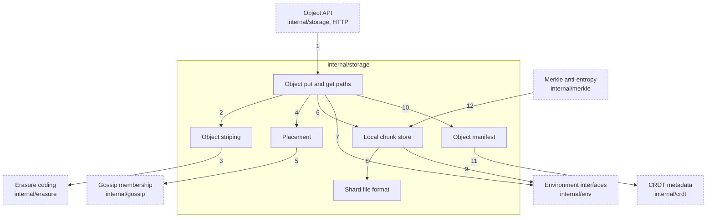

# C4 Level 3 — Component: storage (`internal/storage`)

**TARGET architecture — designed 2026-11-21, awaiting Nick's buy-in.**

Model: diagram `component-storage` in [model.json](model.json). Source: PLAN.md sections 3, 4.2 (Chunks 2 and 6), 7.2, 7.4.
The HTTP object API lives in the same package and is drawn as its own container (`c-api`).



Terminal rendering, in 3 parts. Each numbered relationship appears in exactly one part.

**Part a.** The put and get paths (1, 2, 4, 6, 7, 10).

<!-- draw-visual: diagrams/09-component-storage-a.mmd -->
```text
┌──────────┐    ┌────────────────────────┐     ┌─────────────────┐
│Object API├─1─►│Object put and get paths├──2─►│ Object striping │
└──────────┘    └────────────┬───────────┘     └─────────────────┘
                             │
                             │                 ┌─────────────────┐
                             ├──────────────4─►│    Placement    │
                             │                 └─────────────────┘
                             │
                             │                 ┌─────────────────┐
                             ├──────────────6─►│Local chunk store│
                             │                 └─────────────────┘
                             │
                             │                 ┌─────────────────┐
                             ├──────────────7─►│   internal/env  │
                             │                 └─────────────────┘
                             │
                             │                 ┌─────────────────┐
                             └─────────────10─►│ Object manifest │
                                               └─────────────────┘
```

**Part b.** Calls into neighbouring packages (3, 5, 11).

<!-- draw-visual: diagrams/09-component-storage-b.mmd -->
```text
┌───────────────┐     ┌─────────────────┐
│Object striping├──3─►│  Erasure coding │
└───────────────┘     └─────────────────┘

┌───────────────┐     ┌─────────────────┐
│   Placement   ├──5─►│Gossip membership│
└───────────────┘     └─────────────────┘

┌───────────────┐     ┌─────────────────┐
│Object manifest├─11─►│  CRDT metadata  │
└───────────────┘     └─────────────────┘
```

**Part c.** The local chunk store (8, 9, 12).

<!-- draw-visual: diagrams/09-component-storage-c.mmd -->
```text
┌───────────────────┐     ┌─────────────────┐    ┌─────────────────┐
│Merkle anti-entropy├─12─►│Local chunk store├─8─►│Shard file format│
└───────────────────┘     └────────┬────────┘    └─────────────────┘
                                   │
                                   │             ┌─────────────────┐
                                   └──────────9─►│   internal/env  │
                                                 └─────────────────┘
```

| ID | Component | PLAN.md wording |
| --- | --- | --- |
| `t-format` | Shard file format | 64-byte header plus payload, with per-shard SHA-256 |
| `t-chunk` | Local chunk store | over `env.Disk`: atomic write, verified read, list, delete |
| `t-stripe` | Object striping | fixed-size stripes (1 MiB of data) so multi-MB objects stream |
| `t-manifest` | Object manifest | size, content SHA-256, `k`, `m`, stripe count, per-shard checksums, node chosen for each shard |
| `t-place` | Placement | region-aware, rendezvous hashing over a `Membership` interface |
| `t-paths` | Object put and get paths | PUT at `k+1` durable shards plus local manifest; GET from any `k` verified shards; delete is a tombstone manifest (OQ-15) |

| # | From | To | Relationship |
| --- | --- | --- | --- |
| 1 | Object API | Put and get paths | Object put, get, head, delete, list |
| 2 | Put and get paths | Object striping | Cuts objects into 1 MiB stripes |
| 3 | Object striping | Erasure coding | Encode and Reconstruct per stripe |
| 4 | Put and get paths | Placement | Chooses a node for each shard |
| 5 | Placement | Gossip membership | Rendezvous hashing over Membership; at most `m` shards of a stripe per region |
| 6 | Put and get paths | Local chunk store | Stores and reads local shards |
| 7 | Put and get paths | Environment interfaces | Sends shards to peers and fetches shards from peers (Transport) |
| 8 | Local chunk store | Shard file format | Header plus payload; SHA-256 verified on every read |
| 9 | Local chunk store | Environment interfaces | Atomic write, verified read, list, delete (Disk) |
| 10 | Put and get paths | Object manifest | Writes the manifest; tombstone manifest on delete |
| 11 | Object manifest | CRDT metadata | Value of the key's LWW-Register |
| 12 | Merkle anti-entropy | Local chunk store | Repairs rotted or missing shards (Repairer) |
