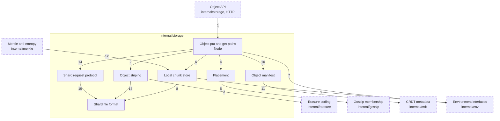

# C4 Level 3 — Component: storage (`internal/storage`)

**Partly as built.** The shard format, chunk store, striping, manifest, placement, shard request protocol and the node's put and get paths exist and match this diagram (checked against `internal/storage` when Chunk 2 landed, 2026-11-21). The Object API and relationships 1, 5, 11 and 12 are the target design.

Model: diagram `component-storage` in [model.json](model.json). Source: PLAN.md sections 3, 4.2 (Chunks 2 and 6), 7.2, 7.4; code in `shard.go`, `chunkstore.go`, `stripe.go`, `manifest.go`, `placement.go`, `shardproto.go`, `node.go`.
The HTTP object API lives in the same package and is drawn as its own container (`c-api`).



Terminal rendering, in 4 parts. Each numbered relationship appears in exactly one part.

**Part a.** The put and get paths (1, 2, 4, 6, 7, 10).

<!-- draw-visual: diagrams/09-component-storage-a.mmd -->
```text
┌──────────┐    ┌────────────────────────┐     ┌─────────────────┐
│Object API├─1─►│Object put and get paths├──2─►│ Object striping │
└──────────┘    └────────────┬───────────┘     └─────────────────┘
                             │
                             │                 ┌─────────────────┐
                             ├──────────────4─►│    Placement    │
                             │                 └─────────────────┘
                             │
                             │                 ┌─────────────────┐
                             ├──────────────6─►│Local chunk store│
                             │                 └─────────────────┘
                             │
                             │                 ┌─────────────────┐
                             ├──────────────7─►│   internal/env  │
                             │                 └─────────────────┘
                             │
                             │                 ┌─────────────────┐
                             └─────────────10─►│ Object manifest │
                                               └─────────────────┘
```

**Part b.** Calls into neighbouring packages (3, 5, 11).

<!-- draw-visual: diagrams/09-component-storage-b.mmd -->
```text
┌───────────────┐     ┌─────────────────┐
│Object striping├──3─►│  Erasure coding │
└───────────────┘     └─────────────────┘

┌───────────────┐     ┌─────────────────┐
│   Placement   ├──5─►│Gossip membership│
└───────────────┘     └─────────────────┘

┌───────────────┐     ┌─────────────────┐
│Object manifest├─11─►│  CRDT metadata  │
└───────────────┘     └─────────────────┘
```

**Part c.** The local chunk store (8, 9, 12).

<!-- draw-visual: diagrams/09-component-storage-c.mmd -->
```text
┌───────────────────┐     ┌─────────────────┐    ┌─────────────────┐
│Merkle anti-entropy├─12─►│Local chunk store├─8─►│Shard file format│
└───────────────────┘     └────────┬────────┘    └─────────────────┘
                                   │
                                   │             ┌─────────────────┐
                                   └──────────9─►│   internal/env  │
                                                 └─────────────────┘
```

**Part d.** The shard request protocol, and what else uses the shard file format (13 to 15).

<!-- draw-visual: diagrams/09-component-storage-d.mmd -->
```text
┌────────────────────────┐     ┌──────────────────────┐
│Object put and get paths├─14─►│Shard request protocol│
└────────────────────────┘     └──────────────────────┘

┌────────────────────────┐     ┌──────────────────────┐
│    Object striping     ├─13─►│  Shard file format   │
└────────────────────────┘     └──────────────────────┘
                                           ▲
┌────────────────────────┐                 │
│ Shard request protocol ├───────15────────┘
└────────────────────────┘
```

| ID | Component | As built |
| --- | --- | --- |
| `t-format` | Shard file format | `shard.go`: 64-byte header plus payload; the SHA-256 in the header covers the other header fields and the payload; canonical blob names |
| `t-chunk` | Local chunk store | `chunkstore.go`: `ChunkStore` over `env.Disk`: write then sync, verified read, list, delete; a returned `Put` or `Delete` is durable |
| `t-stripe` | Object striping | `stripe.go`: `Layout` (default 4+2, 1 MiB stripes); `EncodeStripe` and `DecodeStripe` work one stripe at a time |
| `t-manifest` | Object manifest | `manifest.go`: size, content SHA-256, layout (`k`, `m`, stripe size), and per shard the node chosen and the blob checksum; canonical binary encoding |
| `t-place` | Placement | `placement.go`: region-aware rendezvous hashing over the `Membership` interface declared here; `Place` for a new stripe, `Replace` for repair |
| `t-proto` | Shard request protocol | `shardproto.go`: op byte (put, get or delete shard), blob name, body; errors return as wire codes 96 to 100. Added by the build; PLAN.md does not name it |
| `t-paths` | Object put and get paths | `node.go`: `Node`. PUT succeeds when every stripe has `k+1` durable shard acknowledgements and returns the manifest; GET reads any `k` verified shards per stripe; the same node serves shard requests. Not built yet: storing the manifest, and delete as a tombstone manifest (OQ-15, Chunk 6) |

| # | From | To | State | Relationship |
| --- | --- | --- | --- | --- |
| 1 | Object API | Put and get paths | target | Object put, get, head, delete, list |
| 2 | Put and get paths | Object striping | built | Cuts objects into stripes; encodes and decodes each stripe |
| 3 | Object striping | Erasure coding | built | `Split`, `Encode`, `ReconstructData` and `Join` per stripe |
| 4 | Put and get paths | Placement | built | Chooses a node for each shard of a stripe |
| 5 | Placement | Gossip membership | target | Rendezvous hashing over Membership; at most `m` shards of a stripe per region. Built over the `Membership` interface with a static member list; the gossip package is built, and its live view is wired to placement in Chunk 6 |
| 6 | Put and get paths | Local chunk store | built | Serves shard put, get and delete requests from the local store |
| 7 | Put and get paths | Environment interfaces | built | Sends shards to peers and fetches shards from peers (Transport); zero-delay callbacks and retry backoff (Clock); version IDs (Rand) |
| 8 | Local chunk store | Shard file format | built | Header plus payload; SHA-256 verified on every write and read |
| 9 | Local chunk store | Environment interfaces | built | Write then sync, verified read, list, delete (Disk) |
| 10 | Put and get paths | Object manifest | built | PUT fills in and returns the manifest; GET takes each shard's node and checksum from it. Target: storing the manifest; tombstone manifest on delete |
| 11 | Object manifest | CRDT metadata | target | Value of the key's LWW-Register |
| 12 | Merkle anti-entropy | Local chunk store | target | Repairs rotted or missing shards (Repairer) |
| 13 | Object striping | Shard file format | built | Wraps each shard in a header on encode; checks header and checksum on decode |
| 14 | Put and get paths | Shard request protocol | built | Encodes requests to peers; decodes requests it serves |
| 15 | Shard request protocol | Shard file format | built | Names the shard by its canonical blob name |
