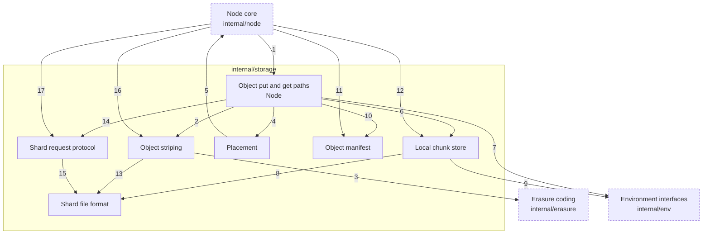

# C4 Level 3 — Component: storage (`internal/storage`)

The one caller of the package's engine is the Node core (`internal/node`). The package imports only `internal/env` and `internal/erasure`: it does not call gossip, the metadata layer or Merkle.

Model: diagram `component-storage` in [model.json](model.json). Code in `shard.go`, `chunkstore.go`, `stripe.go`, `manifest.go`, `placement.go`, `shardproto.go`, `node.go`.
The HTTP object API is its own package, `internal/storage/httpapi`, and its own container (`c-api`). `api.go` in this package holds only what the API and the node core share: the request and response types and the API error sentinels (wire codes 160 to 163).



Terminal rendering, in 5 parts. Each numbered relationship appears in exactly one part.

**Part a.** The put and get paths (2, 4, 6, 7, 10).

<!-- draw-visual: diagrams/09-component-storage-a.mmd -->
```text
┌────────────────────────┐     ┌─────────────────┐
│Object put and get paths├──2─►│ Object striping │
└────────────┬───────────┘     └─────────────────┘
             │
             │                 ┌─────────────────┐
             ├──────────────4─►│    Placement    │
             │                 └─────────────────┘
             │
             │                 ┌─────────────────┐
             ├──────────────6─►│Local chunk store│
             │                 └─────────────────┘
             │
             │                 ┌─────────────────┐
             ├──────────────7─►│   internal/env  │
             │                 └─────────────────┘
             │
             │                 ┌─────────────────┐
             └─────────────10─►│ Object manifest │
                               └─────────────────┘
```

**Part b.** What the package needs from outside (3, 5).

<!-- draw-visual: diagrams/09-component-storage-b.mmd -->
```text
┌───────────────┐    ┌──────────────┐
│Object striping├─3─►│Erasure coding│
└───────────────┘    └──────────────┘

┌───────────────┐    ┌──────────────┐
│   Placement   ├─5─►│  Node core   │
└───────────────┘    └──────────────┘
```

**Part c.** The local chunk store (8, 9).

<!-- draw-visual: diagrams/09-component-storage-c.mmd -->
```text
┌─────────────────┐    ┌─────────────────┐
│Local chunk store├─8─►│Shard file format│
└────────┬────────┘    └─────────────────┘
         │
         │             ┌─────────────────┐
         └──────────9─►│   internal/env  │
                       └─────────────────┘
```

**Part d.** The shard request protocol, and what else uses the shard file format (13 to 15).

<!-- draw-visual: diagrams/09-component-storage-d.mmd -->
```text
┌────────────────────────┐     ┌──────────────────────┐
│Object put and get paths├─14─►│Shard request protocol│
└────────────────────────┘     └──────────────────────┘

┌────────────────────────┐     ┌──────────────────────┐
│    Object striping     ├─13─►│  Shard file format   │
└────────────────────────┘     └──────────────────────┘
                                           ▲
┌────────────────────────┐                 │
│ Shard request protocol ├───────15────────┘
└────────────────────────┘
```

**Part e.** What the Node core calls (1, 11, 12, 16, 17).

<!-- draw-visual: diagrams/09-component-storage-e.mmd -->
```text
┌─────────┐     ┌────────────────────────┐
│Node core├──1─►│Object put and get paths│
└────┬────┘     └────────────────────────┘
     │
     │          ┌────────────────────────┐
     ├──────11─►│    Object manifest     │
     │          └────────────────────────┘
     │
     │          ┌────────────────────────┐
     ├──────12─►│   Local chunk store    │
     │          └────────────────────────┘
     │
     │          ┌────────────────────────┐
     ├──────16─►│    Object striping     │
     │          └────────────────────────┘
     │
     │          ┌────────────────────────┐
     └──────17─►│ Shard request protocol │
                └────────────────────────┘
```

| ID | Component | Description |
| --- | --- | --- |
| `t-format` | Shard file format | `shard.go`: 64-byte header plus payload; the SHA-256 in the header covers the other header fields and the payload; canonical blob names |
| `t-chunk` | Local chunk store | `chunkstore.go`: `ChunkStore` over `env.Disk`: write then sync, verified read, list, delete; a returned `Put` or `Delete` is durable |
| `t-stripe` | Object striping | `stripe.go`: `Layout` (default 4+2, 1 MiB stripes); `EncodeStripe` and `DecodeStripe` work one stripe at a time |
| `t-manifest` | Object manifest | `manifest.go`: size, content SHA-256, layout (`k`, `m`, stripe size), and per shard the node chosen and the blob checksum; canonical binary encoding |
| `t-place` | Placement | `placement.go`: region-aware rendezvous hashing over the `Membership` interface declared here; `Place` for a new stripe, `Replace` for repair |
| `t-proto` | Shard request protocol | `shardproto.go`: op byte (put, get or delete shard), blob name, body; errors return as wire codes 96 to 100 |
| `t-paths` | Object put and get paths | `node.go`: `Node`. PUT succeeds when every stripe has `k+1` durable shard acknowledgements and returns the manifest; GET reads any `k` verified shards per stripe; the same node serves shard requests. The package stores no manifest and has no object delete: the node core keeps the manifest in OCC metadata, and a delete is an OCC tombstone there |

| # | From | To | State | Relationship |
| --- | --- | --- | --- | --- |
| 1 | Node core | Put and get paths | built | `Put` on the storage node of the bucket's placement scope, `Get` by manifest. The node core keeps one storage node for all regions and one per region for routed buckets, and the migration copy uses a further one of its own; only the first serves inbound shard requests, which the node core hands to `OnRequest` after its own checks. Head, delete and list do not reach this package: they are metadata reads and writes |
| 2 | Put and get paths | Object striping | built | Cuts objects into stripes; encodes and decodes each stripe |
| 3 | Object striping | Erasure coding | built | `Split`, `Encode`, `ReconstructData` and `Join` per stripe |
| 4 | Put and get paths | Placement | built | Chooses a node for each shard of a stripe |
| 5 | Placement | Node core | built | Rendezvous hashing over the `Membership` interface; at most `m` shards of a stripe per region. The node core implements the interface from the gossip view's live members (`gossipView`), or from those of one region (`regionView`). New writes are placed on the current view; an existing manifest keeps its placement when a member dies |
| 6 | Put and get paths | Local chunk store | built | Serves shard put, get and delete requests from the local store |
| 7 | Put and get paths | Environment interfaces | built | Sends shards to peers and fetches shards from peers (Transport); zero-delay callbacks and retry backoff (Clock); version IDs (Rand) |
| 8 | Local chunk store | Shard file format | built | Header plus payload; SHA-256 verified on every write and read |
| 9 | Local chunk store | Environment interfaces | built | Write then sync, verified read, list, delete (Disk) |
| 10 | Put and get paths | Object manifest | built | PUT fills in and returns the manifest; GET takes each shard's node and checksum from it |
| 11 | Node core | Object manifest | built | Stores the encoded manifest, with the content type, as the object record under the object's OCC manifest key, and decodes it (`DecodeManifest`) for every read, inventory pass and migration copy |
| 12 | Node core | Local chunk store | built | Shard inventory and repair through `Node.Store()`: lists a bucket's shards and reads their headers for the scrub, reads blobs to answer and to verify, and to check a copied shard against the checksum a migration names, writes a rebuilt shard (`Put`), and deletes collected and purged shards (`Delete`) |
| 13 | Object striping | Shard file format | built | Wraps each shard in a header on encode; checks header and checksum on decode |
| 14 | Put and get paths | Shard request protocol | built | Encodes requests to peers; decodes requests it serves |
| 15 | Shard request protocol | Shard file format | built | Names the shard by its canonical blob name |
| 16 | Node core | Object striping | built | Rebuild of a missing or rotted shard: `DecodeStripe` from the other holders' shards against the manifest's checksums, then `EncodeStripe`, keeping its own index |
| 17 | Node core | Shard request protocol | built | Encodes get-shard requests to the other holders for a rebuild. Decodes every inbound shard request before the storage node sees it: a shard delete is refused, and so is a put of a shard the node recorded absent |

Notes:

- The Object API calls the node through one service interface, and the Node core calls this package (relationship 1).
- Placement reads a `Membership` interface that the Node core implements from the gossip view (relationship 5); this package does not import `internal/gossip`.
- The Node core stores the manifest (relationship 11), and this package never calls `internal/occ`.
- The Merkle worker repairs metadata only. Shards are repaired by the Node core (relationship 12): it compares the tree of shards a bucket's manifests expect with the tree of shards on disk, and rebuilds or collects on the chunk store itself.
- Re-placing the shards of a node that never returns is not implemented; `Replace` in `placement.go` has no caller outside the package's tests.
